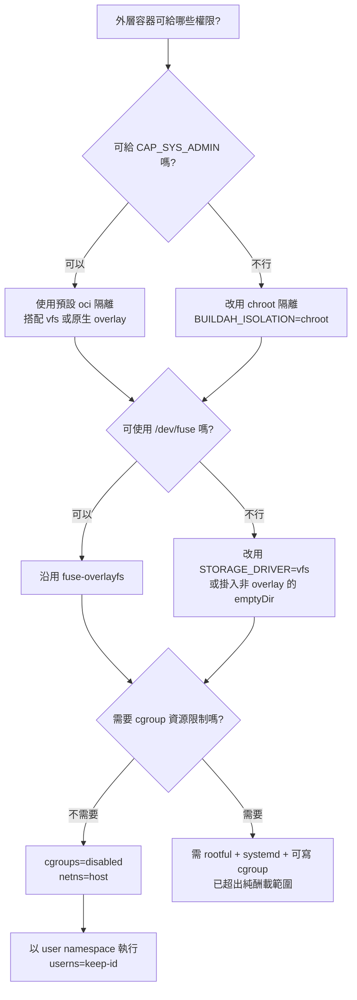

# 把第二層 Podman 當成一般應用程式酬載來執行:不授予硬體特權的 podman-in-podman

## 摘要

「Podman in Podman」(常縮寫為 PINP)指的是在一個 Podman 容器內部,再執行一套 Podman 來建立、執行或建置另一層容器。常見做法是給外層容器 `--privileged`,或補上 `CAP_SYS_ADMIN`、`CAP_MKNOD` 與 `/dev/fuse`;這些做法確實可行,但 Red Hat 的作者對此立場明確:「Given that, I am **not a fan** of using the `--privileged` flag. I believe we can do better from a security perspective.」[^rhpodman]

本文件把第二層 Podman 純粹當成應用程式酬載(payload)來看待,**不假設它需要主機的硬體與核心資源控制權**。具體目標是在**不給 `CAP_SYS_ADMIN`、不給 `/dev/fuse`、不關閉 SELinux、不給 `--privileged`** 的前提下,讓容器內的 Podman 仍能建立、執行,甚至建置映像檔。

為了讓不具背景知識的人也能讀懂,以下先說明容器引擎為何天生需要額外權限,再逐項拆解哪些權限其實可以避開、哪些無法避開。

核心結論如下。

1. Podman 建立容器時真正需要的核心能力其實很少。官方 `containers.conf` 的預設能力集只有 11 項(`CHOWN`、`DAC_OVERRIDE`、`FOWNER`、`FSETID`、`KILL`、`NET_BIND_SERVICE`、`SETFCAP`、`SETGID`、`SETPCAP`、`SETUID`、`SYS_CHROOT`),不含 `SYS_ADMIN`,也不含 `MKNOD`[^containersconf]。官方 Podman 容器映像檔更把這份清單直接寫進映像檔標籤 `io.containers.capabilities`,讓外層引擎「只給這些」就能跑[^podcontainerfile][^podrun]。
2. 不需要 `/dev/fuse` 的關鍵在於把儲存驅動從 `fuse-overlayfs` 換成 `vfs`(或在外層磁碟區上使用原生 overlay)。`vfs` 不經過 `fuse-overlayfs`,因此不依賴 FUSE 裝置;官方對其效能的說明是「比原生 overlay 慢,但明顯快於 `fuse-overlayfs`」[^rootless][^podtrouble]。
3. 建置映像檔(`RUN` 指令)是唯一真正需要較多特權的部分。若外層不給 `SYS_ADMIN`,可改用 Buildah 的 `chroot` 隔離模式(`BUILDAH_ISOLATION=chroot` / `--isolation=chroot`),它刻意用「較少的特權」換取「較少的功能」,正是為這種受限環境設計[^buildah5818][^buildahbuild]。
4. 完全「零特權」是做不到的。Podman 維護者明確指出,要在容器內再跑容器,至少需要 `CAP_SETUID` 與 `CAP_SETGID` 能生效,並能建立 user namespace;這是核心層級的硬性限制[^pod4131]。

---

## 先釐清:「應用程式酬載」與「硬體特權」的分界

一般容器引擎之所以需要額外權限,是因為它要掛載檔案系統、建立裝置節點、寫入 cgroup、切換 UID/GID。把第二層 Podman 當成一般應用程式,就是逐項檢查這些需求能否以其他機制滿足。具體項目如下。

| 項目 | 為何一般容器會有 | 對第二層 Podman 的影響 |
|---|---|---|
| `--privileged` | 關閉所有隔離 | 完全不需要;Red Hat 的作者直言「I am **not a fan** of using the `--privileged` flag」[^rhpodman] |
| `CAP_SYS_ADMIN` | 掛載檔案系統 | 只在建置(`RUN`)或需要掛載時才需要[^rhpodman] |
| `CAP_MKNOD` | 在 `/dev` 建立裝置節點 | 只有在內層以 root 建立裝置節點時才需要[^rhpodman] |
| `/dev/fuse` | `fuse-overlayfs` 的後端 | 改用 `vfs` 儲存驅動即可不需要[^rootless] |
| `--security-opt label=disable` | 繞過 SELinux 對掛載的阻擋 | 可用 SELinux 型別(`container_runtime_t`)與巢狀標籤替代[^buildah5818][^securityopt] |
| `--security-opt seccomp=unconfined` | 允許 `unshare`、`mount` 等系統呼叫 | 需要放寬,但可改用自訂 profile 而非完全關閉[^rhpodman] |
| 可寫的 `/sys/fs/cgroup` | 建立與限制內層 cgroup | 用 `cgroups="disabled"` 完全避開[^podconf][^cgroups] |

官方映像檔的做法本身就是這個思路:它在 `/etc/containers/containers.conf` 中直接宣告 `cgroups="disabled"`、`cgroupns="host"`、`netns="host"`、`userns="host"`、`ipcns="host"`、`utsns="host"`,並指定 `cgroup_manager = "cgroupfs"`[^podconf]。換句話說,官方映像檔並不試圖在容器內建立獨立的 cgroup 與命名空間,而是直接沿用外層容器的視野,以此避開對 cgroup 寫入權的需求。

---

## 最低能力需求

### 官方預設能力集

`containers.conf(5)` 定義的預設能力集如下[^containersconf]:

```
default_capabilities = [
      "CHOWN",
      "DAC_OVERRIDE",
      "FOWNER",
      "FSETID",
      "KILL",
      "NET_BIND_SERVICE",
      "SETFCAP",
      "SETGID",
      "SETPCAP",
      "SETUID",
      "SYS_CHROOT",
]
```

同一份文件特別註明:Docker 會額外給 `AUDIT_WRITE`、`MKNOD`、`NET_RAW`,而 Podman 預設不給[^containersconf]。`SYS_ADMIN` 不在其中。

### 映像檔自我宣告所需能力

官方 Podman 映像檔在 `Containerfile` 中加了標籤[^podcontainerfile]:

```dockerfile
LABEL "io.containers.capabilities"="CHOWN,DAC_OVERRIDE,FOWNER,FSETID,KILL,NET_BIND_SERVICE,SETFCAP,SETGID,SETPCAP,SETUID,SYS_CHROOT"
```

`podman-run(1)` 說明這個標籤的用途:映像檔可用 `io.containers.capabilities` 標籤宣告執行所需的 capabilities 清單,Podman 會「只」以這些能力啟動容器,前提是該清單是預設集合的子集;若指定的能力不在預設集合內,Podman 會印出錯誤並改用預設能力[^podrun]。

值得注意的是這份清單包含 `SYS_CHROOT`,這正是 Buildah 的 `chroot` 隔離模式所依賴的能力;而 `SETUID`/`SETGID`/`SETPCAP`/`SETFCAP` 則與 user namespace 的 UID/GID 對應有關。這也解釋了為何官方映像檔能在相對受限的環境中運作。

### 維護者對「最低需求」的說法

在 podman#4131「Support running podman containers inside unprivileged (docker) container」這條長期追蹤的 issue 中,維護者的立場演變如下[^pod4131]:

- 2019 年結論是必須 `--privileged`,因此無法在 CircleCI / GitHub Actions 這類環境使用。
- 2020-06-15,rhatdan 表示:「Depends on your definition of "unprivileged". In order to run containers within a container you are going to need at least "CAP_SETUID" and "CAP_SETGID" available to the container engine within the container. This will probably also require real/root to be possible.」[^pod4131]
- 2020-08 有使用者回報,已可在不使用 `--privileged`、僅加 `--cap-add SYS_ADMIN --cap-add SYS_RESOURCE`(並關閉 seccomp 與 SELinux)的情況下運作[^pod4131]。

因此「不給 SYS_ADMIN」在**執行**層面可行,但在**建置**層面通常需要替代方案。

---

## 儲存:如何擺脫 `/dev/fuse`

### 為什麼預設需要 `/dev/fuse`

官方映像檔在 `Containerfile` 中建立 drop-in 設定檔,分別為 rootful 與 rootless 指定 `fuse-overlayfs` 作為掛載程式。rootful 版本產生的內容等價於[^podcontainerfile]:

```ini
# /etc/containers/storage.rootful.conf.d/20-image_build.conf
[storage]
driver = "overlay"

[storage.options]
additionalimagestores = ["/usr/lib/containers/storage", "/var/lib/shared"]

[storage.options.overlay]
mount_program = "/usr/bin/fuse-overlayfs"
mountopt = "nodev,fsync=0"
```

rootless 版本內容類似,只是 `additionalimagestores` 僅有 `/var/lib/shared`,並寫入 `/etc/containers/storage.rootless.conf.d/20-image_build.conf`[^podcontainerfile]。

`fuse-overlayfs` 需要 FUSE 裝置,因此需要 `--device /dev/fuse`。若主機未載入模組,會出現 `fuse: device not found, try 'modprobe fuse' first`[^podtrouble]。

### 選項一:改用 `vfs` 儲存驅動

`rootless.md` 明確列出 rootless 支援的儲存驅動只有兩種:overlay(可搭配 `fuse-overlayfs`)與 VFS[^rootless]。`vfs` 是唯一不經過 `fuse-overlayfs` 的選項,因此不需要 `/dev/fuse`。

代價是效能。官方疑難排解在討論嵌套建置效能時,把 `vfs` 與 `fuse-overlayfs` 做了直接比較:改用 `vfs` 的方法「offers slower performance than using the volume method above but is significantly faster than fuse-overlayfs」,也就是說 `vfs` 比原生 overlay 慢,但明顯快於 `fuse-overlayfs`[^podtrouble]。Red Hat 的說明文件也提到有人改用 VFS 儲存驅動,但「this is not that efficient」[^rhpodman]。

Buildah 的 GitLab CI 範例把 `STORAGE_DRIVER: vfs` 當作標準做法,其註解說明了理由:「Docker offers overlayfs as a default, but buildah cannot stack overlayfs on top of another overlayfs filesystem」[^buildah4538]。

設定方式(映像檔內):

```ini
# /etc/containers/storage.conf
[storage]
driver = "vfs"
```

或在命令列以環境變數覆寫:

```bash
STORAGE_DRIVER=vfs podman build -t myimage .
```

### 選項二:在非 overlay 的外層磁碟區上使用原生 overlay

Buildah 維護者 nalind 指出:在核心 5.11 或 RHEL 8.5 之後,「the kernel's overlay implementation is available and should be fine if storage is an emptyDir volume (or more specifically, not on an overlay filesystem, which is what the container rootfs is on)」[^buildah5818]。也就是說,只要把內層儲存放在一個非 overlay 的掛載點(例如 Kubernetes 的 `emptyDir`),原生 overlay 就能運作,不必依賴 `fuse-overlayfs`。

同樣地,Podman 官方疑難排解建議把主機本機目錄掛入 `/var/lib/containers/storage`,讓嵌套建置使用原生 overlay 而非 `fuse-overlayfs`,可大幅改善 I/O 效能[^podtrouble]。

### 選項三:直接掛入一個空的儲存磁碟區

官方映像檔的 README 與 Red Hat 文件都建議至少掛入 `/var/lib/containers`(rootful)或 `~/.local/share/containers`(rootless)[^podsample][^rhpodman]。不掛入會導致容器狀態不一致(所有容器顯示為 `created` 或 `configured`)[^podtrouble]。

### 若仍使用映像檔預設的 fuse-overlayfs

nalind 提供了確切的修改方式[^buildah5818]:

> The image contains an `/etc/containers/storage.conf` which is configured to use fuse-overlayfs. You'll need to comment out the `mount_program` setting and remove the "fsync=0" argument from the `mountopt` setting to update the configuration to not use fuse-overlayfs.

依目前映像檔的實際結構,對應作法是移除或覆寫 `/etc/containers/storage.rootful.conf.d/20-image_build.conf` 與 `/etc/containers/storage.rootless.conf.d/20-image_build.conf` 中的 `mount_program` 與 `mountopt` 設定[^podcontainerfile]。

---

## 建置映像檔:以 `chroot` 隔離取代 SYS_ADMIN

### `--isolation=chroot` 是什麼

`buildah-build(1)` 的原文定義[^buildahbuild]:

> **--isolation** *type*
>
> Controls what type of isolation is used for running processes as part of `RUN` instructions. Recognized types include *oci* (OCI-compatible runtime, the default), *rootless* (OCI-compatible runtime invoked using a modified configuration, with *--no-new-keyring* added to its *create* invocation, reusing the host's network and UTS namespaces, and creating private IPC, PID, mount, and user namespaces; the default for unprivileged users), and *chroot* (an internal wrapper that leans more toward chroot(1) than container technology, reusing the host's control group, network, IPC, and PID namespaces, and creating private mount and UTS namespaces, and creating user namespaces only when they're required for ID mapping).

關鍵在於 `chroot` 模式**沿用外層的 cgroup、network、IPC、PID 命名空間**,只建立 private mount 與 UTS 命名空間,且只有在需要 ID 對應時才建立 user namespace。相較於 `oci` 模式,它需要的特權少得多[^buildahbuild]。

也可用環境變數設定[^buildahbuild]:

```bash
export BUILDAH_ISOLATION=chroot
```

### 官方為何把 chroot 設為映像檔預設

官方 `buildah/Containerfile` 與 `podman/Containerfile`、`aio/Containerfile` 都有這一行[^buildahcontainerfile][^podcontainerfile][^aiocontainerfile]:

```dockerfile
# Set an environment variable to default to chroot isolation for RUN
# instructions and "buildah run".
ENV BUILDAH_ISOLATION=chroot
```

Buildah 維護者 nalind 對這個選擇的解釋是[^buildah5818]:

> In many cases, a container that's run using the image will not be given enough privileges for `buildah run` or the handling of RUN instructions in Dockerfiles in `buildah build` to be able to launch a container using an actual runtime like crun or runc. The chroot-based method is severely limited in functionality compared to crun or runc, but in return it exercises fewer privileges than they might, so it works (or "works") in a number of cases where they might not. If your environment provides enough privileges to not have to use chroot, feel free to override it.

以及[^buildah5818]:

> The chroot-based method is severely limited in functionality compared to crun or runc, but in return it exercises fewer privileges.

這正是「把第二層 Podman 當成應用程式酬載」的官方立場:**用功能換特權**。

### chroot 隔離的已知限制

- 不隔離 cgroup、network、IPC、PID 命名空間,因此無法用 `RUN` 指令做資源限制,也無法在 `RUN` 中執行 systemd 之類需要獨立 PID 命名空間的服務[^buildahbuild]。
- 由於沿用外層網路命名空間,`RUN` 中的網路行為等同於外層容器,通常需要搭配 `--net=host` 才不會因為無法建立 bridge 而失敗(詳見「若堅持使用 `oci` 隔離」一節的實測案例)[^buildah5818]。
- 功能上比 crun/runc 少很多,部分映像檔的 `RUN` 指令可能無法正確執行[^buildah5818]。

### 若堅持使用 `oci` 隔離:實測可行的組合

Buildah issue #5818 中,使用者 chmeliik 在 Kubernetes Pod 中成功以 `BUILDAH_ISOLATION=oci` 完成嵌套建置,並逐項記錄了每個錯誤與對應修正。這份紀錄極具參考價值[^buildah5818]:

| 遇到的錯誤 | 修正方式 |
|---|---|
| `fuse: device not found, try 'modprobe fuse' first` | 提供 `/dev/fuse`(或在 storage.conf 停用 fuse-overlayfs) |
| `opening file /sys/fs/cgroup/cgroup.subtree_control for writing: Read-only file system` | 使用 `unshare --map-root-user --mount` |
| `Error: mount /var/lib/containers/storage/overlay:/var/lib/containers/storage/overlay, flags: 0x1000: operation not permitted` | 同上,透過 `--mount` 建立新的 mount namespace |
| `unshare: unshare failed: Operation not permitted` | 加入 `--map-root-user` |
| `open /proc/sys/net/ipv4/ping_group_range: Read-only file system` | 建置時加 `--net=host` |
| `mount proc to proc: Operation not permitted` | 建置時加 `--pid=host` |
| `unshare: write failed /proc/self/uid_map: Operation not permitted` | 給 Pod 加上 `SETFCAP` 能力 |
| `mount devpts to dev/pts: Permission denied` | 使用 SELinux 型別 `container_runtime_t` |

其 Pod 定義的關鍵部分為[^buildah5818]:

```yaml
      env:
        - name: BUILDAH_ISOLATION
          value: oci
        - name: STORAGE_DRIVER
          value: overlay
      command: ["bash", "-c"]
      args:
        - |-
          unshare --map-root-user --mount -- buildah build --net=host --pid=host .
      securityContext:
        capabilities:
          add:
            - SETFCAP
        seLinuxOptions:
          type: container_runtime_t
```

該使用者最後的結論是:在沒有 user namespace 的情況下,要讓 `BUILDAH_ISOLATION=oci` 運作,需要「`unshare` usage、`SETFCAP` on the Pod to enable unshare、the `container_runtime_t` label on the Pod」,並認為這仍優於「使用 `BUILDAH_ISOLATION=chroot` 而不具備這些條件」[^buildah5818]。

值得注意的是,`SETFCAP` 本來就在 Podman 的預設能力集內[^containersconf],因此對 Podman 而言這不算額外特權;`container_runtime_t` 則是 SELinux 型別選擇,而非關閉 SELinux。

### 另一位維護者的最小可行範例

cgwalters(OSTree/Bootc 維護者)在同一 issue 提供了更精簡的參考範例,並指出外層有 user namespace 才是關鍵[^buildah5818]:

```
$ podman run -v /var/lib/containers --security-opt=label=disable --cap-add=all --rm -ti \
  quay.io/centos-bootc/centos-bootc:stream10 \
  podman run --rm -ti --net=host --cgroups=disabled \
    busybox echo hello
```

他的評語是:「as long as the outer container is invoked with a user namespace (as Nalin mentions, `hostUsers: false` from the pod spec) that provides a really key security level.」[^buildah5818]這也呼應 nalind 對 Kubernetes `hostUsers: false` 的建議[^buildah5818]。

---

## 執行容器:最小可行命令

### 以 `vfs` 與關閉 cgroup 的方式執行

若外層容器以非 root 使用者身分執行,且已設定好 `/etc/subuid`、`/etc/subgid`,以下組合不需要 `SYS_ADMIN`、不需要 `/dev/fuse`、不需要 `--privileged`:

```bash
podman run --rm -it \
  --userns=keep-id \
  --cgroups=disabled \
  -e STORAGE_DRIVER=vfs \
  quay.io/podman/stable \
  podman run --rm --cgroups=disabled --net=host alpine echo hello
```

各選項的作用如下。

- `--userns=keep-id`:建立 user namespace,把目前使用者的 UID:GID 對應為容器內相同的數值;依官方對照表,host user 與 container user 都是 `$UID`[^userns]。這讓內層 Podman 能在自己的 user namespace 內進行 UID/GID 切換,而不必取得主機層級的特權[^rootless]。
- `--cgroups=disabled`:強制容器不建立 cgroup,因此會與 `--cgroupns`、`--cgroup-parent` 衝突;這正是避開 `/sys/fs/cgroup` 唯讀問題的方式[^cgroups]。
- `-e STORAGE_DRIVER=vfs`:改用不需要 FUSE 的儲存驅動[^rootless]。
- 內層 `--net=host`:沿用外層網路命名空間,避免需要建立 bridge 或 veth(受限環境下會出現 `failed to create a bridge interface podman0: Operation not permitted`)[^pod16405]。

### 為什麼 `cgroups="disabled"` 是官方映像檔的預設

官方映像檔的 `containers.conf` 同時設定 `cgroups="disabled"` 與 `cgroup_manager = "cgroupfs"`[^podconf]。前者的意義是「Disable cgroup support, will inherit cgroups from parent」[^containersconf],後者則避免在沒有 systemd user session 的容器內嘗試使用 systemd cgroup 管理器。

這也解釋了為何在容器內執行 Podman 常看到以下警告:容器內沒有 systemd 使用者 session,Podman 會自動退回 `cgroupfs` 管理器[^podtrouble]。

### `--security-opt unmask=ALL` 的用途

Rootless 的內層 Podman 有時需要存取被預設遮蔽或設為唯讀的路徑。`podman-run(1)` 列出的預設限制為[^securityopt]:

- 預設被遮蔽(masked,完全不可存取):`/proc/acpi`、`/proc/kcore`、`/proc/keys`、`/proc/latency_stats`、`/proc/sched_debug`、`/proc/scsi`、`/proc/timer_list`、`/proc/timer_stats`、`/sys/firmware`、`/sys/fs/selinux`、`/sys/devices/virtual/powercap`。
- 預設唯讀:`/proc/asound`、`/proc/bus`、`/proc/fs`、`/proc/irq`、`/proc/sys`、`/proc/sysrq-trigger`、`/sys/fs/cgroup`。

`unmask=ALL` 會解除上述全部限制[^securityopt]。Red Hat 的 rootless 範例使用 `--security-opt unmask=ALL`,正是為了讓內層 Podman 能讀寫這些路徑[^rhpodman]。

注意:若採用「把第二層 Podman 當酬載」的思路,應優先考慮是否能以 `--net=host`、`--cgroups=disabled` 等方式避開對這些路徑的需求,而不是無條件使用 `unmask=ALL`;因為解除遮蔽會擴大攻擊面。

### 使用者命名空間:`podman unshare` 的角色

`podman unshare` 會在新的 user namespace 中啟動一個行程,使呼叫者的 UID 與主 GID 在該 namespace 內顯示為 UID 0 / GID 0,並透過 `newuidmap`、`newgidmap` 把 `/etc/subuid`、`/etc/subgid` 中對應的範圍一併對應進來[^unshare]。

其官方說明強調:「`podman unshare` is useful for troubleshooting unprivileged operations and for manually clearing storage and other data related to images and containers.」[^unshare]此外,若要在無特權的情況下使用 `podman mount`,也必須先進入 `podman unshare` 工作階段[^unshare]。

對「把 Podman 當酬載」而言,`podman unshare` 的意義是:它提供了一條在不取得主機特權的前提下,取得足以操作儲存與掛載的 namespace 環境的路徑。這與 chmeliik 使用 `unshare --map-root-user` 的思路一致[^buildah5818]。

### `--userns` 各模式的差異

`podman-run(1)` 的 rootless 對應表[^userns]:

| Key | Host User | Container User |
|---|---|---|
| `auto` | `$UID` | 未對應(host user UID 不映射進容器) |
| `host` | `$UID` | 0(預設,使用者帳號映射為容器內 root) |
| `keep-id` | `$UID` | `$UID`(使用者帳號映射為容器內相同 UID) |
| `keep-id:uid=200,gid=210` | `$UID` | 200:210 |
| `nomap` | `$UID` | 未對應 |

文件亦註明:`--userns=keep-id` 會用掉使用者所有的 subuid 與 subgid;因此當有以 `keep-id` 或 `nomap` 建立的容器存在時,`--userns=auto` 會失敗[^userns]。另外,若映像檔本身以非 root 使用者執行,掛載磁碟區時**必須**使用 `--userns=keep-id`,否則容器內的非 root 使用者無法存取掛載內容[^rootless]。

---

## 不可迴避的下限

以下限制是核心層級或架構層級的,無法靠調整旗標繞過。

1. **至少需要能建立 user namespace。** 若核心停用非特權 user namespace,或 seccomp 阻擋 `unshare(CLONE_NEWUSER)`,rootless Podman 就無法運作。維護者的立場是「at least "CAP_SETUID" and "CAP_SETGID" available to the container engine within the container」[^pod4131],而 Buildah 的 `--isolation` 文件也說明 `chroot` 模式「creating user namespaces only when they're required for ID mapping」[^buildahbuild]。
2. **`CAP_SYS_ADMIN` 在部分情境下無法完全避免。** nalind 列出的條件包含「Being able to create bind and overlay mounts for volumes (this generally requires CAP_SYS_ADMIN)」[^buildah5818]。若完全不給 `SYS_ADMIN`,就必須改用 `chroot` 隔離或 `vfs` 儲存驅動來避開掛載需求。
3. **Podman 與 Buildah 的儲存驅動必須一致。** 若映像檔的儲存已設定為 overlay,卻在命令列改指定 `vfs`,會出現 `database storage graph driver "overlay" does not match our storage graph driver "vfs": database configuration mismatch`[^pod4131]。切換驅動時需先清理或重建儲存。
4. **NFS 與平行檔案系統不支援 rootless。** `rootless.md` 明確指出 rootless Podman 在 NFS 或 GPFS 等檔案系統上無法運作,因為這些檔案系統不支援 user namespace[^rootless]。
5. **低連接埠無法綁定。** 核心不允許沒有 `CAP_NET_BIND_SERVICE` 的行程綁定 1024 以下的連接埠;rootless 容器因此無法綁定低埠,除非調整 `net.ipv4.ip_unprivileged_port_start`[^rootless]。

---

## 決策流程



---

## 實務建議

### 若目標只是「跑一個容器」

優先採用:

```bash
podman run --rm -it \
  --userns=keep-id \
  --cgroups=disabled \
  -e STORAGE_DRIVER=vfs \
  -v /var/lib/mycontainers:/home/podman/.local/share/containers:Z \
  quay.io/podman/stable \
  podman run --rm --net=host --cgroups=disabled alpine echo hello
```

### 若目標是「在容器內建置映像檔」

在無法取得 `SYS_ADMIN` 時,優先採用 `chroot` 隔離:

```bash
podman run --rm -it \
  --userns=keep-id \
  --cgroups=disabled \
  -e STORAGE_DRIVER=vfs \
  -e BUILDAH_ISOLATION=chroot \
  -v ./context:/work:Z \
  -w /work \
  quay.io/podman/stable \
  podman build --isolation=chroot -t myimage .
```

若能取得 `SYS_ADMIN` 且希望使用 `oci` 隔離,則參考 chmeliik 的組合:提供 `/dev/fuse`(或改用 `vfs`)、以 `unshare --map-root-user --mount` 建立命名空間、建置時加 `--net=host --pid=host`、並以 SELinux 型別 `container_runtime_t` 取代 `label=disable`[^buildah5818]。

### 明確不建議的做法

- 為了省事而使用 `--privileged`;Red Hat 的作者指出「I am **not a fan** of using the `--privileged` flag」,而 `containers.conf(5)` 也說明特權容器會關閉能力限制、裝置限制、唯讀掛載點、AppArmor/SELinux 隔離與 seccomp 過濾[^rhpodman][^containersconf]。
- 以 `--security-opt label=disable` 全域關閉 SELinux;可優先改用 `label=type:container_runtime_t` 或 `label=nested`[^securityopt][^buildah5818]。
- 以 `--security-opt seccomp=unconfined` 完全關閉 seccomp;可改用自訂 profile[^rhpodman]。
- 在無 user namespace 的情況下仍期待 rootless 內層 Podman 可運作。

---

## 參考文獻

[^containersconf]: Container Libs. (n.d.). containers.conf(5) — Container engine configuration file. Retrieved 2026-11-22, from https://github.com/containers/container-libs/blob/main/common/docs/containers.conf.5.md

[^podcontainerfile]: Podman Container Tools. (n.d.). podman/Containerfile. In image_build. Retrieved 2026-11-22, from https://github.com/containers/image_build/blob/main/podman/Containerfile

[^buildahcontainerfile]: Podman Container Tools. (n.d.). buildah/Containerfile. In image_build. Retrieved 2026-11-22, from https://github.com/containers/image_build/blob/main/buildah/Containerfile

[^aiocontainerfile]: Podman Container Tools. (n.d.). aio/Containerfile. In image_build. Retrieved 2026-11-22, from https://github.com/containers/image_build/blob/main/aio/Containerfile

[^podconf]: Podman Container Tools. (n.d.). podman/containers.conf. In image_build. Retrieved 2026-11-22, from https://github.com/containers/image_build/blob/main/podman/containers.conf

[^podrun]: Podman Container Tools. (n.d.). podman-run(1) — Run a command in a new container. Retrieved 2026-11-22, from https://docs.podman.io/en/latest/markdown/podman-run.1.html

[^securityopt]: Podman Container Tools. (n.d.). podman-run(1) — --security-opt option. Retrieved 2026-11-22, from https://github.com/podman-container-tools/podman/blob/main/docs/source/markdown/options/security-opt.md

[^cgroups]: Podman Container Tools. (n.d.). podman-run(1) — --cgroups option. Retrieved 2026-11-22, from https://github.com/podman-container-tools/podman/blob/main/docs/source/markdown/options/cgroups.md

[^userns]: Podman Container Tools. (n.d.). podman-run(1) — --userns option. Retrieved 2026-11-22, from https://github.com/podman-container-tools/podman/blob/main/docs/source/markdown/options/userns.container.md

[^unshare]: Podman Container Tools. (n.d.). podman-unshare(1) — Run a command inside of a modified user namespace. Retrieved 2026-11-22, from https://github.com/podman-container-tools/podman/blob/main/docs/source/markdown/podman-unshare.1.md

[^buildahbuild]: Podman Container Tools. (n.d.). buildah-build(1) — Build an image using instructions from Containerfiles. Retrieved 2026-11-22, from https://github.com/podman-container-tools/buildah/blob/main/docs/buildah-build.1.md

[^rootless]: Podman Container Tools. (n.d.). Shortcomings of Rootless Podman. Retrieved 2026-11-22, from https://github.com/containers/podman/blob/main/rootless.md

[^podtrouble]: Podman Container Tools. (n.d.). Troubleshooting. Retrieved 2026-11-22, from https://github.com/containers/podman/blob/main/troubleshooting.md

[^podsample]: Podman Container Tools. (n.d.). Podman Image — Sample Usage. In image_build (podman/README.md). Retrieved 2026-11-22, from https://github.com/containers/image_build/blob/main/podman/README.md

[^rhpodman]: Walsh, D., & Mohnani, U. (2021-07-01). How to use Podman inside of a container. Retrieved 2026-11-22, from https://web.archive.org/web/20241013210225/https://www.redhat.com/sysadmin/podman-inside-container

[^buildah5818]: Podman Container Tools. (2024-11-06). do we need to run buildah containers always with BUILDAH_ISOLATION = chroot (Issue #5818). Retrieved 2026-11-22, from https://github.com/podman-container-tools/buildah/issues/5818

[^buildah4538]: Podman Container Tools. (2023-01-23). Build image: operation not permitted (Issue #4538). Retrieved 2026-11-22, from https://github.com/podman-container-tools/buildah/issues/4538

[^pod4131]: Podman Container Tools. (2019-09-27). Support running podman containers inside unprivileged (docker) container (Issue #4131). Retrieved 2026-11-22, from https://github.com/podman-container-tools/podman/issues/4131

[^pod16405]: Podman Container Tools. (2022-11-04). Discussion: Podman Inside Kubernetes - networking issues (unprivileged) (Issue #16405). Retrieved 2026-11-22, from https://github.com/podman-container-tools/podman/issues/16405
