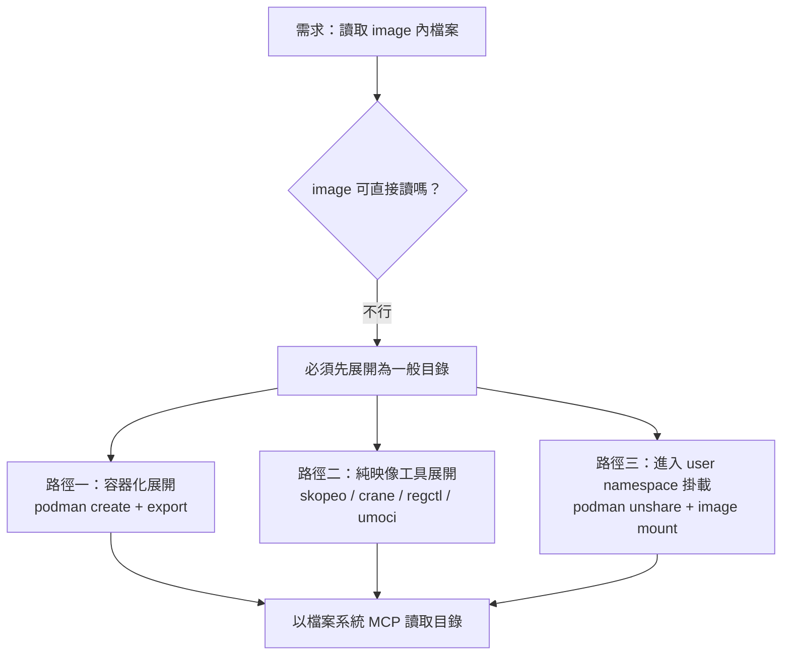
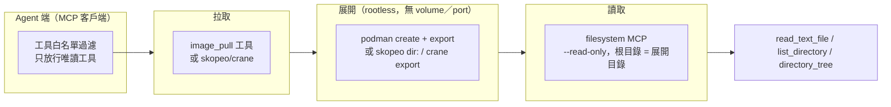
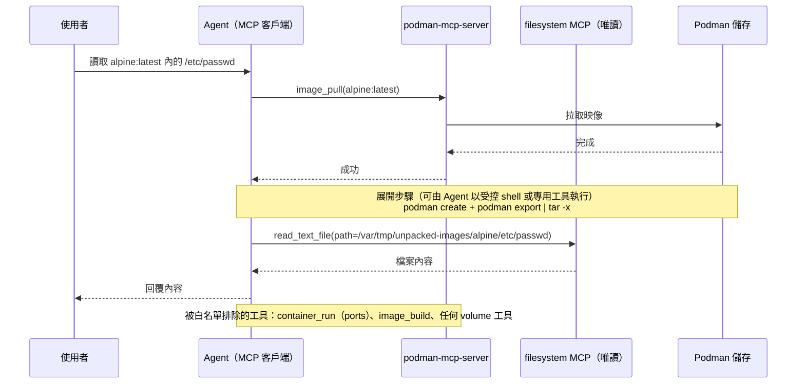

# 以 FOSS MCP 方案讓 Agent 讀取 Podman 容器映像內檔案（禁止掛載 Volume 與綁定 Port）

## 摘要

本報告回答一個具體的工程問題：**在不得掛載宿主端 volume、不得綁定 port、不得 build 映像的前提下，如何讓 AI Agent 透過自由開源軟體（FOSS）的 MCP（Model Context Protocol）伺服器，完成「讀取映像內檔案」與「拉取映像」兩件事。**

核心結論如下：

1. **截至 2026-11-22，公開的 FOSS MCP 生態中不存在任何一個「直接讀取容器映像（image）內檔案」的專用工具。** 所有容器類 MCP 伺服器都只提供容器生命週期（list / run / stop / logs / inspect）、映像生命週期（pull / list / remove / push）與（部分）容器內執行命令（exec）能力[^manusa][^edtroleis][^knuckles]。
2. 映像（image）不是可讀取的路徑，映像必須先被**展開成一般目錄**才能被檔案系統類工具讀取。因此可行架構必然是「**展開映像 → 以檔案系統 MCP 讀取**」的兩段式組合。
3. 展開映像有數條**完全 rootless、不需要 privileged、不需要掛載 volume、不需要綁定 port**的路徑，其中最單純的是 `podman create` + `podman export`，最乾淨的是 `skopeo copy ... dir:` 或 `crane export`[^podmanexport][^skopeo][^crane]。
4. 「禁止掛載 volume、禁止綁定 port」這項限制**必須在 MCP 客戶端（Agent 端）以工具允許／封鎖清單落實**，因為多數容器類 MCP 伺服器本身仍暴露帶有 `ports` 或 `volumes` 參數的工具（例如 `container_run`）[^manusa]。客戶端層級的工具過濾（例如 Crush 的 `--disabled-tools`／`--enabled-tools`）是唯一可靠的強制點[^crushmcp][^crushcfg]。

---

## 1. 問題界定

### 1.1 需求

Agent 需要具備下列能力：

| 能力 | 說明 |
| --- | --- |
| 拉取映像 | 從 registry 取得映像到本機儲存 |
| 讀取映像內檔案 | 列出映像內目錄、讀取映像內檔案內容 |
| 不建置映像 | 不得執行 build |
| 不掛載 volume | 不得把宿主目錄掛進容器 |
| 不綁定 port | 不得把容器 port 對外暴露 |

### 1.2 為什麼這個需求組合特別棘手

「讀取映像內檔案」在容器工具鏈中不是一等公民操作。Docker／Podman 的檔案複製指令（`docker cp`、`podman cp`）**只作用於容器，不作用於映像**：你必須先由映像建立一個容器，才能從該容器複製檔案出來[^podmanexport]。而「建立容器」與「執行容器」在 MCP 工具設計上通常被綁在一起，且「執行容器」的工具介面往往同時提供 `ports`（port 綁定）與 volume 相關參數，正好撞上本題的禁止項。



---

## 2. 主要發現：沒有任何 MCP 伺服器能直接讀映像內檔案

經對 GitHub 全站檢索與各專案 README／原始碼核對，容器相關 FOSS MCP 伺服器的能力如下。

### 2.1 純 Podman 導向的 MCP 伺服器

| 專案 | Stars | 語言 | 授權 | 關鍵工具 | 能否讀映像內檔案 |
| --- | --- | --- | --- | --- | --- |
| `manusa/podman-mcp-server` | 87 | Go | Apache-2.0 | `container_list`、`container_run`、`container_stop`、`container_remove`、`container_inspect`、`container_logs`、`image_list`、`image_pull`、`image_push`、`image_remove`、`image_build`、`network_list`、`volume_list` | **否** |
| `edtroleis/podman-mcp` | 1 | Python | MIT | 上述之外另有 `exec_in_container`、`copy_to_container`、`container_diff`、`image_history`、`save_image`、`load_image` | **否**（僅能 exec 進「已執行中的容器」讀檔） |
| `Knuckles-Team/container-manager-mcp` | 7 | Python | MIT | `cm_container_operations`（含 exec、複製檔案、diff）、`cm_image_operations`（pull、push、build、save、load）等 23 個動作路由工具與 292 個細粒度工具 | **否**（僅容器層級複製） |
| `UML-Friendly-Fedora/podman-mcp-server` | 2 | Python | MIT | 未於 README 列出工具 | **否** |
| `bjeans/homelab-mcp` | 46 | Python | MIT | `list_containers`、`get_container_logs`、`get_stats` 等，僅唯讀監控 | **否**（且不提供 run／pull／build） |

`manusa/podman-mcp-server` 是目前最被採用的 Podman MCP 伺服器，它以 Go 撰寫、同時支援 Podman 與 Docker，可透過 Podman REST API（Unix socket，優先）或 CLI 包裝（fallback）運作，並支援 STDIO／Streamable HTTP／SSE 三種傳輸模式[^manusa]。其完整工具清單中**沒有**任何讀取檔案內容的工具，`container_inspect` 只回傳容器組態，`image_build` 反而提供了 build 能力（本題須停用）。

`edtroleis/podman-mcp` 的工具面最完整，包含 `exec_in_container`（在容器內執行命令）、`container_diff`（顯示容器檔案系統變更）、`copy_to_container`（主機與容器間複製檔案）[^edtroleis]。**注意：`copy_to_container` 的文件敘述為「Copy files between host and container」，但工具簽章為 `src`／`dest` 兩參數，是否支援「從容器複製回主機」需以原始碼為準；本報告不對其未經確認的行為背書。** 即使支援雙向複製，其對象仍是「已執行中的容器」，而非映像。

### 2.2 Dagger `container-use`：唯一具備「容器內檔案讀寫工具」的 MCP 伺服器

`dagger/container-use` 是一個以 Go 撰寫、Apache-2.0 授權的 MCP 伺服器（4,102 stars），以 Dagger 引擎為底層，為每個 Agent 建立獨立的 git 分支與容器環境[^containeruse]。

其 15 個 MCP 工具中包含**真正的檔案層級工具**：

| 工具 | 用途 |
| --- | --- |
| `environment_create` / `environment_open` / `environment_list` | 建立／開啟／列出環境 |
| `environment_config` | 變更基礎映像、setup 指令、環境變數 |
| `environment_run_cmd` | 在環境中執行命令（支援前景／背景、port 暴露） |
| `environment_file_read` | **讀取檔案內容（含行範圍）** |
| `environment_file_list` | **列出目錄內容** |
| `environment_file_write` / `environment_file_edit` / `environment_file_delete` | 寫入／搜尋取代／刪除 |
| `environment_add_service` | 加入服務容器（如資料庫） |
| `environment_checkpoint` | 將環境狀態存成映像並推送到 registry |
| `environment_log` / `environment_diff` / `environment_update_metadata` | 檢視歷史與差異 |

`environment_file_read` 是**目前唯一能讓 Agent 直接以 MCP 工具讀取「容器內檔案」的公開實作**[^containeruse]。它拉取映像的方式是隱式的：建立環境時以 `Container().From(baseImage)` 指定基礎映像，Dagger 會自動拉取[^containeruse]。

不過有兩點與本題限制衝突，必須留意：

1. **`environment_run_cmd` 支援 `ports` 參數**（用於背景命令）並可將容器 port 透過 `Host().Tunnel()` 轉送到宿主，`environment_add_service` 亦同[^containeruse]。這正是本題禁止的 port 綁定行為，必須以客戶端工具過濾停用這兩個工具。
2. **它讀取的是「環境容器」而非「既有映像」**。也就是說它適合「用指定的基礎映像開一個乾淨環境，讓 Agent 在裡面讀寫程式碼」，而不是「把 registry 上某個既有映像的內容攤開來檢視」。

### 2.3 其他 Docker 導向與沙箱導向的 MCP 伺服器

| 專案 | Stars | 授權 | 與本題的關係 |
| --- | --- | --- | --- |
| `docker/mcp-gateway` | 1,643 | MIT | Docker 官方 MCP Gateway／CLI plugin。管理的是「把 MCP 伺服器跑在容器裡」，不提供讀取任意映像檔案的工具[^dockergw] |
| `Automata-Labs-team/code-sandbox-mcp` | 328 | MIT | 以 Docker 映像開沙箱執行碼，檔案寫入為主，讀回僅能經由 log 資源[^codesandbox] |
| `elusznik/mcp-server-code-execution-mode` | 344 | GPL-3.0 | 在 rootless 容器中執行 Python，可代理既有 MCP 伺服器（含檔案系統類），藉此間接讀檔 |
| `54rt1n/container-mcp` | 22 | Apache-2.0 | **反向模式**：MCP 伺服器本身跑在 Podman 容器內，因此其 `fs_read` 讀的是「自己所在容器」的檔案系統 |
| `agent-infra/sandbox` | 6,373 | Apache-2.0 | 同上，單一容器內提供 browser／file／shell 等 MCP 服務 |

**沒有任何一個提供 `docker cp` 等價的映像檔案讀取工具**[^dockergw]。

---

## 3. 推薦架構：展開映像 + 檔案系統 MCP

既然映像無法直接讀取，正確做法是把映像**展開成宿主上的一般目錄**，再讓檔案系統類 MCP 伺服器（唯讀模式）去讀那個目錄。這個架構同時天然滿足「不掛載 volume、不綁定 port、不 build」。

### 3.1 步驟一：拉取映像

拉取映像本身完全沒有爭議，所有 Podman 類 MCP 伺服器都有 `image_pull` 或等價工具[^manusa][^edtroleis]：

- `manusa/podman-mcp-server`：`image_pull(imageName)`
- `edtroleis/podman-mcp`：`pull_image(image)`
- `Knuckles-Team/container-manager-mcp`：`cm_image_operations` 的 pull 動作

或者完全繞過 MCP，直接用 CLI／函式庫拉取（見 3.2 的 `skopeo copy`／`crane export`，這兩個工具連「先拉進本機儲存」都不需要）。

### 3.2 步驟二：把映像展開成目錄（六條 rootless 路徑）

以下所有指令都**不需要 root、不需要 privileged、不需要掛載宿主 volume、不需要綁定 port**，也不涉及 build。

#### (A) `podman create` + `podman export`（最單純、Podman 原生）

`podman export` 把「容器的檔案系統」匯出成單層 tar（不含映像分層、歷史與標籤），且容器**不需要執行中**，`podman create` 之後即可匯出[^podmanexport]：

```bash
podman create --name inspect-tmp docker.io/library/alpine:latest
podman export inspect-tmp | tar -tvf -            # 列出全部檔案
podman export inspect-tmp | tar -xOf - etc/passwd # 讀單一檔案到 stdout
podman rm inspect-tmp
```

優點：Podman 原生、語意單純、`tar -xOf` 即為「讀檔案」。缺點：`podman create` 會在本機留下一個容器物件（需自行清理），且 `podman export` 只給單層平面視圖，看不到分層歷史。

#### (B) `podman save --format oci-dir` / `--format docker-archive`

`podman save` 作用於**映像**（非容器），會保留分層、歷史與標籤；支援 `docker-archive`（預設）、`oci-archive`、`oci-dir`、`docker-dir` 四種格式，其中 `oci-dir` 直接產生可瀏覽的目錄[^podmansave]：

```bash
podman save --format oci-dir -o ./alpine-oci docker.io/library/alpine:latest
ls ./alpine-oci/blobs/sha256/
```

#### (C) `skopeo copy ... dir:` 或 `oci:`（不需先拉進本機儲存）

`skopeo` 是 Apache-2.0 授權的 Go 工具（11,426 stars），可直接從 registry 複製映像到本機目錄，完全 rootless[^skopeo]：

```bash
skopeo copy docker://docker.io/library/alpine:latest dir:/tmp/alpine-dir
tar -xOf /tmp/alpine-dir/<layer-hash>.tar etc/passwd

skopeo copy docker://docker.io/library/alpine:latest oci:/tmp/alpine-oci:latest
```

#### (D) `crane export`（go-containerregistry，單一指令最省事）

`crane export` 直接從 registry 取得映像並把「攤平後的檔案系統」以 tar 串流到 stdout，單一 Go 靜態二進位、無 daemon、完全 rootless[^crane]：

```bash
crane export alpine:latest - | tar -tvf - | less
crane export alpine:latest - | tar -xOf - etc/passwd
crane export --platform linux/arm64 alpine:latest /tmp/alpine-fs.tar
```

`go-containerregistry` 為 Apache-2.0、4,139 stars[^gcr]。

#### (E) `regctl image export`（regclient）

`regclient` 為 Apache-2.0、1,977 stars，其 `regctl image export` 可輸出合併後的 tar，另有 `regctl image diff` 可比較兩個映像的檔案差異[^regclient]：

```bash
regctl image export alpine:latest /tmp/alpine.tar
tar -xOf /tmp/alpine.tar etc/passwd
```

#### (F) `umoci unpack --rootless`（OCI 原生、可取得完整 rootfs）

`umoci` 為 Apache-2.0、968 stars，可把 OCI layout 解成完整 rootfs 目錄；`--rootless` 會自動設定 UID／GID 映射，避免非特權使用者解開時發生權限錯誤[^umoci]：

```bash
skopeo copy docker://docker.io/library/alpine:latest oci:./alpine-oci:latest
umoci unpack --rootless --image ./alpine-oci:latest ./bundle
ls ./bundle/rootfs/
```

#### (G) 補充：`podman unshare` + `podman image mount`（直接掛載，但有 rootless 限制）

`podman image mount` 可直接把映像 rootfs 掛到宿主路徑，但官方文件明確指出：

> Rootless mode only supports mounting VFS driver, unless podman is run in a user namespace. Use the `podman unshare` command to enter the user namespace. All other storage drivers fail to mount.[^podmanimagemount]

亦即：**在 rootless 環境下，若不進入 `podman unshare` 的 user namespace，只有 VFS 驅動能掛載**；在 `podman unshare` 內，overlay（含 `fuse-overlayfs`）才能運作[^podmanunshare]。此路徑雖仍屬 rootless 且不涉及 volume 與 port，但對「容器中的容器」（podman-in-podman）情境不友善，因為內層 Podman 通常無法取得 subuid／subgid 映射。**因此本報告不建議把此路徑當作主要方案。**

#### 路徑比較

| 路徑 | 需先拉進本機儲存 | 需網路 | 需要 `podman unshare` | 輸出形態 | 適用情境 |
| --- | --- | --- | --- | --- | --- |
| `podman create` + `export` | 是 | 否 | 否 | 單層 tar | 只要看內容，最簡單 |
| `podman save --format oci-dir` | 是 | 否 | 否 | 分層目錄 | 需保留分層資訊 |
| `skopeo copy dir:` / `oci:` | **否** | 是 | 否 | 分層目錄／OCI layout | 不想污染本機儲存 |
| `crane export` | **否** | 是 | 否 | 單層 tar（stdout） | 一行指令、CI 腳本 |
| `regctl image export` | **否** | 是 | 否 | 單層 tar | 需要 diff 能力 |
| `umoci unpack --rootless` | 需先有 OCI layout | 是 | 否 | 完整 rootfs | 需完整檔案樹 |
| `podman unshare` + `image mount` | 是 | 否 | **是** | 即時掛載點 | 不建議（rootless 限制多） |

### 3.3 步驟三：用檔案系統 MCP 讀取展開後的目錄

展開後的目錄就是普通目錄，因此可交給任何「受限根目錄」的檔案系統 MCP 伺服器，並以唯讀模式啟動。

| 專案 | Stars | 語言 | 授權 | 根目錄設定方式 | 唯讀模式 |
| --- | --- | --- | --- | --- | --- |
| `modelcontextprotocol/servers`（filesystem） | 92,150（monorepo） | TypeScript | MIT | 命令列參數：`mcp-server-filesystem /path` | `--read-only`、`--read-only-dir`[^mcpfs] |
| `mark3labs/mcp-filesystem-server` | 699 | Go | MIT | 命令列參數：`mcp-filesystem-server /path` | 需以工具白名單限制[^mark3labs] |
| `rust-mcp-stack/rust-mcp-filesystem` | 186 | Rust | MIT | 命令列參數：`rust-mcp-filesystem /path` | 預設唯讀[^rustfs] |
| `cyanheads/filesystem-mcp-server` | 55 | TypeScript | Apache-2.0 | 環境變數 `FS_BASE_DIRECTORY` | 需以工具白名單限制[^cyanheads] |

官方參考實作（`@modelcontextprotocol/server-filesystem`）提供 `read_text_file`、`read_multiple_files`、`list_directory`、`list_directory_with_sizes`、`directory_tree`、`search_files`、`get_file_info`、`list_allowed_directories` 等唯讀工具，以及 `write_file`、`edit_file`、`move_file`、`copy_file` 等寫入工具；`--read-only` 會移除所有寫入工具，`--read-only-dir <path>` 可把特定目錄標記為唯讀，且所有寫入都經過驗證過的目錄 handle（防 TOCTOU）[^mcpfs]。

`rust-mcp-filesystem` 是純 Rust 重寫版，**預設唯讀**、單一靜態二進位、無需 Node.js 執行環境，工具集與官方參考實作對齊並額外支援 ZIP 壓縮檔[^rustfs]。對於本題「只讀不寫」的需求，它是最低摩擦的選擇。



---

## 4. 若需自建 MCP：底層可用的 Podman REST API

若決定自行開發 MCP 伺服器以取得最精確的權限控制，Podman 的 REST API 提供了容器檔案讀取端點。此端點同時註冊於 Docker 相容命名空間與 libpod 命名空間，兩者指向同一個 handler（`pkg/api/handlers/compat/containers_archive.go`）[^podmanarchive]。

| 方法 | 端點 | 用途 | 關鍵參數 |
| --- | --- | --- | --- |
| `HEAD` | `/containers/{name}/archive` 與 `/libpod/containers/{name}/archive` | 對容器內路徑做 stat（檔案資訊置於 `X-Docker-Container-Path-Stat` 標頭） | `path`（必填） |
| `GET` | 同上 | 從容器取出 tar 串流（`Content-Type: application/x-tar`），即 `podman cp` 的讀取方向 | `path`（必填） |
| `PUT` | 同上 | 把 tar 寫入容器（`podman cp` 的寫入方向） | `path`（必填）、`rename`、`copyUIDGID`、`noOverwriteDirNonDir` |

對應的 Go 綁定函式為 `Stat`、`CopyToArchive`、`CopyFromArchiveWithOptions`[^podmanapi]。

**兩個關鍵限制：**

1. **此端點的第一段路徑是 `/containers/...`，API 中不存在 `/images/{name}/archive` 或等價的映像檔案端點**[^podmanarchive]。也就是說它只能讀「容器」的檔案系統。自建 MCP 若要讀映像，仍需先 `POST /libpod/containers/create`（由映像建立容器）再 `GET /libpod/containers/{name}/archive`，本質上就是 3.2 路徑 (A) 的 API 版本。
2. **容器不需要處於執行中狀態。** `podman cp` 的官方文件明確指出容器可為 running 或 stopped[^podmancp]；archive 端點對 created／stopped／exited 等狀態同樣有效。這正好滿足「不執行容器即可讀檔」的需求。

這種自建路線的優勢在於：**端點本身就沒有 volume 與 port 參數**，只要不對外暴露 create 的 host config 選項，即能在伺服器層級徹底滿足限制，不必依賴客戶端過濾。

---

## 5. 如何落實「禁止掛載 volume、禁止綁定 port、禁止 build」

這項限制無法靠「選擇一個乾淨的 MCP 伺服器」完全達成，因為主流伺服器都帶有越界工具：

- `manusa/podman-mcp-server` 的 `container_run` 接受 `ports`（格式 `<hostPort>:<containerPort>`）與 `environment`，並提供 `image_build`[^manusa]。
- `dagger/container-use` 的 `environment_run_cmd` 與 `environment_add_service` 接受 `ports` 並會把 port 轉送到宿主[^containeruse]。
- `edtroleis/podman-mcp` 的 `run_container` 接受 `args`（等於任意 CLI 旗標），並提供 `build_image`[^edtroleis]。

因此必須在 MCP 客戶端（Agent 端）做工具層級的過濾。以 Crush 為例，其 MCP 設定支援 `--disabled-tools`（黑名單）與 `--enabled-tools`（白名單），兩者皆為可重複旗標[^crushcfg]：

```bash
# 只放行「拉取映像」與「讀取目錄」所需的最小工具集
mcp add podman --type stdio --command podman-mcp-server \
  --enabled-tools image_pull \
  --enabled-tools image_list

mcp add imagefs --type stdio \
  --command rust-mcp-filesystem --args /var/tmp/unpacked-images \
  --enabled-tools read_text_file \
  --enabled-tools read_multiple_files \
  --enabled-tools list_directory \
  --enabled-tools directory_tree \
  --enabled-tools search_files \
  --enabled-tools get_file_info \
  --enabled-tools list_allowed_directories
```

要點：

1. **白名單優先於黑名單。** `--enabled-tools` 是封閉集合，未來伺服器新增工具不會自動被放行；黑名單則會隨伺服器升級而失效。Crush 的 `permissions deny` 亦會把工具**從 Agent 視野中完全隱藏**，而非僅跳出確認[^crushcfg]。
2. **以檔案系統伺服器的唯讀開關做第二道防線。** 例如官方參考實作的 `--read-only`、`--read-only-dir`，或 `rust-mcp-filesystem` 的預設唯讀行為[^mcpfs][^rustfs]。
3. **若採 Gateway 架構**，可在閘道層以 CEL 運算式拒絕特定工具，例如 `mcp.tool.name != "docker_exec"`，且被拒絕的工具不會出現在工具清單中。此類能力見於 AgentGateway 之類的 MCP 閘道[^agentgateway]。



---

## 6. 限制、風險與批判性評估

### 6.1 生態缺口是真實的，不是搜尋不足

本報告以 GitHub 全站檢索（`mcp podman`、`mcp container filesystem`、`container image mcp server` 等）與逐專案 README／原始碼核對，交叉驗證了「不存在直接讀映像檔案的 MCP 伺服器」這一結論。多個獨立來源給出相同判斷：容器類 MCP 伺服器普遍缺少 `docker cp` 等價工具[^manusa][^edtroleis][^knuckles]。因此**任何聲稱「裝一個 MCP 就能讀映像」的方案都應被質疑**。

### 6.2 低星數專案的可靠性風險

`edtroleis/podman-mcp`（1 star）、`UML-Friendly-Fedora/podman-mcp-server`（2 stars）等專案星數極低、提交數少、維護者單一。本主題屬於小眾領域，低星專案的存在是合理的，但**不建議在生產環境依賴它們**。相對地，`skopeo`（11,426）、`dive`（54,755）、`go-containerregistry`（4,139）、`container-use`（4,102）、`regclient`（1,977）皆為高星且持續維護的專案，適合作為展開映像的基礎[^skopeo][^dive][^gcr][^containeruse][^regclient]。

### 6.3 `container-diff` 已封存

`GoogleContainerTools/container-diff`（3,792 stars）已於 2024-03 進入封存狀態（`archived: true`），且其 `--type=file` 只輸出檔案清單與大小，**不支援把檔案系統解出到磁碟**。不建議採用[^containerdiff]。

### 6.4 「展開映像」會佔用磁碟

`podman export`／`crane export`／`umoci unpack` 都會產生完整的檔案系統副本。對大型映像（數 GB）而言，磁碟用量與展開時間是實務瓶頸。若只需讀取單一檔案，`tar -xOf` 的串流方式（不落地）優於先展開再讀。

### 6.5 展開目錄的信任邊界

把映像內容解到宿主目錄後交給檔案系統 MCP 讀取，等同讓 Agent 讀取**未受信任的映像內容**。雖然 MCP 伺服器有根目錄限制與 symlink 解析防護[^mcpfs]，但映像內可能含有指向根目錄外的 symlink。實務上應將展開目錄放在專用路徑（如 `/var/tmp/unpacked-images`），並確認所用伺服器會解析 symlink 後再驗證是否仍在允許根目錄內[^mcpfs][^rustfs]。

### 6.6 客戶端過濾是唯一可靠的強制點

必須強調：MCP 協定本身不定義伺服器端的工具過濾機制，工具過濾是**客戶端（Agent 宿主）**的職責。若 Agent 宿主沒有工具白名單能力，則「禁止 volume／port」的要求在技術上無法保證。本報告以 Crush 為例示範，其他宿主（如 Claude Code 的 `permissions.deny: ["mcp__podman__*"]`）機制類似[^crushcfg][^claudecode]。

---

## 7. 建議方案

### 7.1 最小可行組合（推薦）

| 角色 | 選擇 | 理由 |
| --- | --- | --- |
| 拉取映像 | `manusa/podman-mcp-server` 的 `image_pull`，或直接 `crane export`／`skopeo copy` | 高星、Go 單一靜態二進位、Apache-2.0 |
| 展開映像 | `podman create` + `podman export`（若已裝 Podman）或 `crane export`（單一指令、不需本機儲存） | 兩者皆完全 rootless、無 volume、無 port、無 build |
| 讀取檔案 | `rust-mcp-filesystem`（預設唯讀、單一 Rust 二進位）或官方 `@modelcontextprotocol/servers` filesystem（`--read-only`） | 根目錄受限、symlink 防護、可完全唯讀 |
| 強制限制 | MCP 客戶端 `--enabled-tools` 白名單 | 唯一可靠的強制點 |

### 7.2 若要求「單一 MCP 伺服器完成讀取容器內檔案」

則可考慮 `dagger/container-use`（`environment_file_read`／`environment_file_list`），但必須：

1. 停用 `environment_run_cmd`（其 `ports` 參數會綁定 port）與 `environment_add_service`；
2. 理解它讀的是「Dagger 為 Agent 新建的環境容器」，不是任意既有映像；
3. 接受它會以 Dagger 引擎為額外依賴。

### 7.3 若要求「在伺服器層級徹底禁止 volume／port」

則需自建 MCP 伺服器，只暴露三類端點：`POST /libpod/containers/create`（請求主體不含 host config 的 volume／port 欄位）、`GET /libpod/containers/{name}/archive?path=`、`POST /libpod/images/pull`，並在伺服器端硬性拒絕任何 volume／port 參數。此路線的工作量最大，但保證最強[^podmanapi][^podmanarchive]。

---

## 8. 結論

1. **不存在「直接讀取容器映像內檔案」的 FOSS MCP 伺服器**（截至 2026-11-22）。映像必須先展開為一般目錄。
2. **展開映像有多條完全 rootless、不需 privileged、不掛載 volume、不綁定 port、不 build 的路徑**：`podman create` + `podman export`、`podman save --format oci-dir`、`skopeo copy dir:`／`oci:`、`crane export`、`regctl image export`、`umoci unpack --rootless`。
3. **讀取展開目錄應交給唯讀的檔案系統 MCP 伺服器**，官方參考實作、`mark3labs/mcp-filesystem-server`、`rust-mcp-filesystem`、`cyanheads/filesystem-mcp-server` 皆可用，其中 `rust-mcp-filesystem` 預設唯讀、單一二進位，最契合本題。
4. **「禁止 volume／port／build」必須在 MCP 客戶端以工具白名單強制**，因為主流伺服器（含 `manusa/podman-mcp-server`、`container-use`、`edtroleis/podman-mcp`）仍暴露 `container_run`（`ports` 參數）與 `image_build`。
5. 若需伺服器層級的硬保證，可自建 MCP 伺服器，僅暴露 `POST /libpod/containers/create`、`GET /libpod/containers/{name}/archive`、映像拉取三類端點[^podmanapi][^podmanarchive]。

---

## 參考文獻

[^manusa]: Manusa, M. (2026). *podman-mcp-server: Model Context Protocol (MCP) server for container runtimes (Podman and Docker)* [Computer software]. Retrieved 2026-11-22, from https://github.com/manusa/podman-mcp-server

[^edtroleis]: Edtroleis. (2026). *podman-mcp: Podman mcp server* [Computer software]. Retrieved 2026-11-22, from https://github.com/edtroleis/podman-mcp

[^knuckles]: Knuckles-Team. (2026). *container-manager-mcp: Manage containers on docker, podman, compose, and docker swarm through an MCP Server for Agentic AI* [Computer software]. Retrieved 2026-11-22, from https://github.com/Knuckles-Team/container-manager-mcp

[^containeruse]: Dagger. (2026). *container-use: Development environments for coding agents* [Computer software]. Retrieved 2026-11-22, from https://github.com/dagger/container-use

[^dockergw]: Docker. (2026). *mcp-gateway: docker mcp CLI plugin / MCP Gateway* [Computer software]. Retrieved 2026-11-22, from https://github.com/docker/mcp-gateway

[^codesandbox]: Automata-Labs-team. (2025). *code-sandbox-mcp: An MCP server to create secure code sandbox environment for executing code within Docker containers* [Computer software]. Retrieved 2026-11-22, from https://github.com/Automata-Labs-team/code-sandbox-mcp

[^podmanexport]: Podman. (n.d.). *podman-export — Export a container's filesystem contents as a tar archive*. Retrieved 2026-11-22, from https://docs.podman.io/en/latest/markdown/podman-export.1.html

[^podmansave]: Podman. (n.d.). *podman-save — Save image to an archive*. Retrieved 2026-11-22, from https://docs.podman.io/en/latest/markdown/podman-save.1.html

[^podmanimagemount]: Podman. (n.d.). *podman-image-mount — Mount an image's root filesystem*. Retrieved 2026-11-22, from https://docs.podman.io/en/latest/markdown/podman-image-mount.1.html

[^podmanunshare]: Podman. (n.d.). *podman-unshare — Run a command in a new user namespace*. Retrieved 2026-11-22, from https://docs.podman.io/en/latest/markdown/podman-unshare.1.html

[^podmanapi]: Podman. (2026). *pkg/bindings/containers/archive.go* [Source code]. Retrieved 2026-11-22, from https://github.com/containers/podman/blob/main/pkg/bindings/containers/archive.go

[^podmanarchive]: Podman. (2026). *pkg/api/handlers/compat/containers_archive.go* [Source code]. Retrieved 2026-11-22, from https://github.com/containers/podman/blob/main/pkg/api/handlers/compat/containers_archive.go

[^podmancp]: Podman. (n.d.). *podman-cp — Copy files/folders between a container and the local filesystem*. Retrieved 2026-11-22, from https://docs.podman.io/en/latest/markdown/podman-cp.1.html

[^skopeo]: podman-container-tools. (2026). *skopeo: Work with remote images registries — retrieving information, images, signing content* [Computer software]. Retrieved 2026-11-22, from https://github.com/podman-container-tools/skopeo

[^crane]: Google. (2026). *crane export* [Source code documentation]. Retrieved 2026-11-22, from https://github.com/google/go-containerregistry/blob/main/cmd/crane/doc/crane_export.md

[^gcr]: Google. (2026). *go-containerregistry: Go library and CLIs for working with container registries* [Computer software]. Retrieved 2026-11-22, from https://github.com/google/go-containerregistry

[^regclient]: regclient. (2026). *regclient: Docker and OCI Registry Client in Go and tooling using those libraries* [Computer software]. Retrieved 2026-11-22, from https://github.com/regclient/regclient

[^umoci]: opencontainers. (2026). *umoci modifies Open Container images* [Computer software]. Retrieved 2026-11-22, from https://github.com/opencontainers/umoci

[^dive]: Wagoodman. (2026). *dive: A tool for exploring each layer in a docker image* [Computer software]. Retrieved 2026-11-22, from https://github.com/wagoodman/dive

[^mcpfs]: Model Context Protocol. (2026). *Filesystem — Model Context Protocol servers* [Computer software]. Retrieved 2026-11-22, from https://github.com/modelcontextprotocol/servers/tree/main/src/filesystem

[^rustfs]: rust-mcp-stack. (2026). *rust-mcp-filesystem: Blazing-fast, asynchronous MCP server for seamless filesystem operations* [Computer software]. Retrieved 2026-11-22, from https://github.com/rust-mcp-stack/rust-mcp-filesystem

[^mark3labs]: mark3labs. (2025). *mcp-filesystem-server: Go server implementing Model Context Protocol (MCP) for filesystem operations* [Computer software]. Retrieved 2026-11-22, from https://github.com/mark3labs/mcp-filesystem-server

[^cyanheads]: cyanheads. (2025). *filesystem-mcp-server: A Model Context Protocol (MCP) server for platform-agnostic file capabilities* [Computer software]. Retrieved 2026-11-22, from https://github.com/cyanheads/filesystem-mcp-server

[^containerdiff]: GoogleContainerTools. (2024). *container-diff: Diff your Docker containers* [Computer software]. Retrieved 2026-11-22, from https://github.com/GoogleContainerTools/container-diff

[^crushcfg]: Charm. (2026). *Crush configuration* [Skill documentation]. Retrieved 2026-11-22, from https://github.com/charmbracelet/crush

[^crushmcp]: Charm. (2026). *mcp add — Crush CLI reference*. Retrieved 2026-11-22, from https://github.com/charmbracelet/crush

[^claudecode]: Anthropic. (2026). *Claude Code settings reference*. Retrieved 2026-11-22, from https://docs.anthropic.com/en/docs/claude-code/settings-reference

[^agentgateway]: AgentGateway. (2026). *MCP authorization* [Documentation]. Retrieved 2026-11-22, from https://agentgateway.dev/docs/standalone/latest/documentation/configuration/security/mcp-authz/
