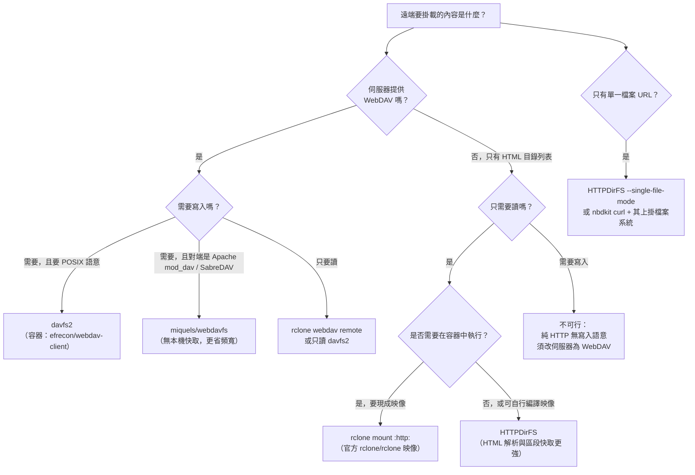

# 以 HTTP 網路伺服器為來源掛載檔案系統的自由軟體方案調查

## 摘要

本研究調查「把遠端 HTTP 網站上的檔案，掛載成本機檔案系統」的自由軟體（FOSS）方案，並額外確認各方案在 Docker / 容器環境中執行的可行性。

核心結論有三點：

1. **純 HTTP 目錄列表（HTML directory listing）只能做到唯讀掛載**。HTTP 沒有標準的寫入語意，任何「可讀可寫」的需求都必須改用 WebDAV（RFC 4918）或自訂 API。
2. **HTTPDirFS 與 rclone 的 `:http:` backend + `rclone mount` 是純 HTTP 目錄列表的兩個主力方案**；前者專精於 HTML 目錄解析與區段快取，後者勝在生態、容器映像與跨平台支援。
3. **容器化可行，但門檻都在 FUSE 而非工具本身**：需要 `/dev/fuse`、`CAP_SYS_ADMIN`（或 `--privileged`）、放寬 AppArmor，並且掛載點要以 `rshared` 傳播回宿主。rclone 有官方映像；davfs2 有社群維護的成熟映像；HTTPDirFS 只有社群映像，且相當老舊。

---

## 1. 問題定義與分類

### 1.1 三種截然不同的「HTTP 上的檔案」

在挑選工具前，必須先分辨遠端伺服器實際提供的介面，因為支援與否差別極大：

| 類型 | 伺服器行為 | 可否目錄瀏覽 | 可否寫入 |
| --- | --- | --- | --- |
| 純 HTTP 目錄列表 | `GET /dir/` 回傳 HTML 的 `<a href>` 清單（Apache `DirectoryIndex`、nginx `autoindex`、Caddy file_server 等） | 需要客戶端解析 HTML | 不可（標準 HTTP 無寫入方法） |
| WebDAV | 支援 `PROPFIND` / `PUT` / `MKCOL` / `MOVE` 等 | 是（結構化 XML） | 是（視伺服器授權） |
| 單一檔案 URL | 只給你一個檔案路徑，無目錄概念 | 否 | 否 |

HTTP 只是傳輸協定，目錄結構是「人類可讀的 HTML」而非機器可讀的協定，因此純 HTTP 客戶端必須靠 HTML 解析器推導樹狀結構；這正是 HTTPDirFS 存在的理由[^httpdirfs-readme]。

### 1.2 掛載層的兩種實作路線

- **FUSE（Filesystem in Userspace）**：在使用者空間實作 POSIX 介面，掛載點對所有程式透明。本調查中的主力工具全部走這條路。
- **NBD（Network Block Device）+ 其上再掛真檔案系統**：把 URL 當成「區塊裝置」而非檔案樹，只能處理單一檔案（例如遠端 ISO）。`nbdkit-curl-plugin` 屬於此類[^nbdkit-curl]。

---

## 2. 純 HTTP 目錄列表方案

### 2.1 HTTPDirFS（建議首選）

| 項目 | 內容 |
| --- | --- |
| 專案 | HTTPDirFS（`fangfufu/httpdirfs`） |
| 語言 | C（C11，Meson 建置） |
| 授權 | GPL-3.0-or-later |
| 星數 | 約 980（2026-11-22 查詢） |
| 最新版本 | 1.3.3（2026-06-11 發佈） |
| FUSE | libfuse3 |
| 寫入 | 不支援（唯讀） |

HTTPDirFS 以 libcurl 抓取頁面、以 Gumbo HTML5 解析器解析目錄列表，並從 `<a>` 的錨文字取出「人類看得懂」的檔名，遇到同名衝突時會逐步把 URL 路徑片段附加到檔名上以消除歧義，同時會丟棄指回父目錄的連結以避免無限遞迴[^httpdirfs-readme]。

主要能力：

- **區段快取**：`--cache` 啟用，持久化於 `${XDG_CACHE_HOME}/httpdirfs` 或 `~/.cache/httpdirfs`，以 HTTP `Last-Modified` 與內容長度作為失效依據，目錄列表超過 `--refresh-timeout`（預設 3600 秒）視為過期；快取依賴稀疏檔案（sparse file）配置[^httpdirfs-readme]。
- **單檔模式**：`--single-file-mode` 可把單一 URL 掛成「只有一個檔案的虛擬目錄」，用來取代已停止維護的 `httpfs`[^httpdirfs-readme]。
- **網站模式**：`--website-mode` 會檢查 `Content-Type: text/html`，把一般網頁「升級」為可瀏覽的虛擬目錄，並從 ``、`<video>`、`<script>` 等標籤抽取資源[^httpdirfs-readme]。
- **漸進式目錄預載**：`--progressive-directory-preload` 用背景 worker 預抓子目錄，避免圖形檔案管理器計算檔案數時一次灌爆請求[^httpdirfs-readme]。
- **除錯用虛擬目錄**：每個目錄下都有隱藏的 `.httpdirfs/`，內含 `CONTENT`（原始 HTML）與 `HEADER`（原始回應標頭）[^httpdirfs-readme]。

發行與容器狀況：

- Debian 13（Trixie）與 unstable 已收錄套件 `httpdirfs`（1.3.3-1+b1），原始碼套件名為 `httpdirfs-fuse`[^debian-httpdirfs]。
- **上游沒有官方 Dockerfile 或官方映像**；Docker Hub 上可查到 `geoscienceaustralia/httpdirfs`（約 500 次拉取）與 `deepprojects/httpdirfs`（約 130 次拉取，版本停在 1.0.1 附近），皆非上游維護[^dockerhub-httpdirfs]。容器化需自行以 Debian 基底編譯，並安裝 `libgumbo-dev libfuse3-dev libssl-dev libcurl4-openssl-dev uuid-dev libexpat1-dev pkg-config meson` 等相依[^httpdirfs-readme]。

### 2.2 rclone `:http:` backend + `rclone mount`

| 項目 | 內容 |
| --- | --- |
| 專案 | rclone |
| 語言 | Go |
| 授權 | MIT |
| 星數 | 約 61,169（2026-11-22 查詢） |
| 最新版本 | v1.76.0（2026-11-06） |
| FUSE | `rclone mount`（macOS / Windows 需 `cmount` build tag） |
| 寫入 | 不支援（HTTP backend 唯讀） |

rclone 的 HTTP remote 自 v1.37 起提供，被官方標為 **Tier 3**（「可用於多數情境，但有已知限制」）。官方文件明言「HTTP remote 是唯讀 remote」，無法上傳檔案；它會讀取網頁伺服器提供的目錄列表並轉成 remote，實測可對 Apache / Nginx / Caddy 的列表運作[^rclone-http]。

關鍵行為與旗標：

- 路徑結尾有 `/` 視為目錄；沒有 `/` 時會先送 `HEAD` 判斷是檔案還是目錄。加 `--http-no-head` 可跳過 HEAD，但會失去檔案大小與時間，且列表可能出現不存在的檔案[^rclone-http]。
- `--http-no-slash`：伺服器目錄路徑不補尾斜線時使用，此時所有 `Content-Type: text/html` 的資源都會被視為目錄；官方提醒可能把真正的 HTML 檔誤判成目錄[^rclone-http]。
- `--http-headers` 可帶自訂標頭（例如 `Cookie` 或 `Authorization`），且標頭只送往設定的主機，遇到跨主機重新導向不會外洩[^rclone-http]。
- HTTP backend 不儲存 checksum，也不支援 `rclone about`（因此無法回報可用空間，也不能作為 `union` 的 `mfs` 成員）[^rclone-http]。

容器化是 rclone 的最大優勢：官方映像 `rclone/rclone` 以精簡 Alpine 建置，隨發佈流程產出，`:latest` 指向最新穩定版[^rclone-install]。官方文件直接給出在容器內 `rclone mount` 並回拋給宿主的範例，條件為 `--device /dev/fuse`、`--cap-add SYS_ADMIN`、`--security-opt apparmor:unconfined`、掛載點用 `:shared`，並需要把宿主的 `/etc/passwd`、`/etc/group` 以唯讀方式掛進容器[^rclone-install]。

### 2.3 其他純 HTTP 方案（多為停滯或小眾）

| 專案 | 語言 | 授權 | 狀態 | 說明 |
| --- | --- | --- | --- | --- |
| `httpfs`（SourceForge，即 httpfs2 上游） | C | GPL-2.0 | 停滯 | 僅能掛載**單一 URL**，伺服器需支援 byte range；Debian 套件 `httpfs2` 已於 2024-09-05 自 testing 移除[^httpfs2-tracker] |
| `httpfs`（PyPI, moremoban） | Python | MIT | 停滯（0.0.1，2020-05-01） | 提供 PyFilesystem2 介面（`fs.open_fs('https://…')`）以讀取 HTTP 檔案，**不是** FUSE 掛載[^pypi-httpfs] |
| `fuse-http`（Rust） | Rust | Apache-2.0 OR MIT | 小眾 | 單檔掛載 + LRU 快取；星數極低，屬實驗性質 |
| `ratarmount` | Python | MIT | 活躍 | 主要是「掛載壓縮檔 / 映像」，但可接受 `http(s)://` 來源（靠 range request + fsspec），把遠端壓縮檔掛成檔案樹[^ratarmount] |
| `fsspec` + `fsspec.fuse` | Python | BSD-3-Clause | 實驗性 | 官方文件自稱「Mount anything with FUSE」為 experimental；行為取決於後端提供多少中繼資料，唯讀後端的寫入會晚期失敗並回傳晦澀錯誤[^fsspec-fuse] |
| `nbdkit-curl-plugin` | C | BSD-3-Clause | 活躍 | 把 URL 變成 NBD 區塊裝置，而非目錄樹；支援寫入（會發 PUT），加 `-r` 才強制唯讀[^nbdkit-curl] |

---

## 3. WebDAV 方案（唯一可寫路線）

若需求包含「寫回遠端」，HTTP 目錄列表沒有出路，必須改用 WebDAV。RFC 4918 定義了 `PROPFIND`、`PUT`、`MKCOL`、`MOVE` 等方法，才足以表達檔案系統語意[^davfs2-man]。

### 3.1 davfs2（成熟度最高）

| 項目 | 內容 |
| --- | --- |
| 專案 | davfs2（上游 GitHub：`alisarctl/davfs2`） |
| 語言 | C（FUSE + neon） |
| 授權 | GPL-3.0-or-later |
| 版本 | 1.7.3（Debian 1.7.3-1 於 2026-06-04 進入 testing） |
| 寫入 | 支援（讀寫） |

davfs2 把 WebDAV 資源掛成一般檔案系統，讓沒有 WebDAV 支援的標準程式也能直接編輯遠端文件；它全面整合 Unix 掛載語意（`mount`、`umount`），並以大量快取换取效能與容錯[^debian-davfs2]。

實務上要注意的操作特性[^davfs2-man]：

- 需要 root 才能掛載，但守護行程進入 daemon 模式後會降到 `davfs2` 使用者；以一般使用者掛載則需屬於 `davfs2` 群組，且必須在 `/etc/fstab` 有對應項目。
- 憑證放在 `~/.davfs2/secrets` 或 `/etc/davfs2/secrets`（權限 600），也可用環境變數 `DAVFS_PASSWORD`，官方明言後者是為了「CI runner 之類的 scripted 掛載」而設[^davfs2-man]。
- 快取目錄預設 `~/.davfs2/cache`（root 掛載為 `/var/cache/davfs2`），`cache_size` 預設 50 MiB；**所有開啟中的檔案都必須有本機複本**，因此需要預留磁碟空間[^davfs2-man][^davfs2-conf]。
- `delay_upload`（預設 10 秒）會延後上傳剛關閉的檔案；`gui_optimize` 可用單一 `PROPFIND` 一次取得整個目錄的版本資訊，改善圖形介面的開啟延遲[^davfs2-conf]。
- 上傳前會檢查伺服器端版本，若無法上傳（例如鎖定衝突）會把本機修改放進 `lost+found` 備份目錄[^davfs2-man]。

**容器化**：davfs2 沒有官方映像，但社群映像 `efrecon/webdav-client` 相當成熟（BSD-2-Clause、約 89 星、6.6 萬次拉取、2026-11 仍有提交）。它把所有 `davfs2.conf` 選項以 `DAVFS2_*` 環境變數暴露，用 `WEBDRIVE_URL` / `WEBDRIVE_USERNAME` / `WEBDRIVE_PASSWORD_FILE` 傳參，並在容器終止時自動卸載；官方範例明確要求 `--device /dev/fuse`、`--cap-add SYS_ADMIN`、`--security-opt apparmor=unconfined`，且宿主掛載點必須是 `rshared` 才能把內容回拋給宿主與其他容器[^webdav-docker]。

### 3.2 miquels/webdavfs（Go，行為最像真正的網路檔案系統）

| 項目 | 內容 |
| --- | --- |
| 專案 | `miquels/webdavfs` |
| 語言 | Go（FUSE） |
| 授權 | MIT |
| 星數 | 約 263 |
| 狀態 | 活躍度偏低（最後 push 2023-12-06），無正式 tag |

作者的出發點是批評多數 WebDAV 驅動「像鏡像」：讀檔要整份下載、寫檔可能要先下載再上傳。webdavfs 不本機快取，只送出部分讀寫請求，因此行為接近真正的網路檔案系統[^webdavfs-readme]。

它的致命限制寫得很清楚：**部分寫入（partial write）沒有標準**。只有在偵測到對端是 Apache `mod_dav` 或 SabreDAV（Nextcloud 等使用）時才啟用該實作；若偵測不到，程式會警告並**自動改成唯讀掛載**，此時可用 `rwdirops` 讓目錄操作（`rm`/`mv`/`mkdir`/`rmdir`）可用，但仍不能寫檔案內容[^webdavfs-readme]。已知不支援：鎖定、權限變更、裝置檔 / FIFO、以及把檔案截短到 1 到現有大小之間的長度[^webdavfs-readme]。

### 3.3 fusedav（Pantheon 分支）

原始 `fusedav` 來自 0pointer.de，現以 `pantheon-systems/fusedav` 為後繼（GPL-2.0、C、約 46 星）。此分支由 Pantheon 內部維護，README 標示為「Pantheon-Unsupported」，屬公司內部用途對外釋出，不建議作為一般使用者的首選[^fusedav]。同名的 `AndyA/FuseDAV` 自 2011 年後未再更新。

### 3.4 桌面環境整合：GVfs 與 KIO FUSE

這兩者不是「拿來跑伺服器」的工具，但若目標是桌面使用者的透明存取，它們其實是系統預設路徑。

**GVfs**（GNOME Virtual Filesystem，LGPL-2.0-or-later）內含 HTTP 與 DAV backend，並透過 `gvfsd-fuse` 把 GVfs 掛載點以 FUSE 暴露給非 GIO 程式（Debian 打包為 `gvfs-fuse`，unstable 為 1.62.0-3）[^debian-gvfs]。其架構是「每個掛載各自一個行程，透過 D-Bus 溝通」[^debian-gvfs]。原始碼顯示 HTTP backend 的 `try_mount` 只接受單一 `uri`，實作範圍是 `open_for_read` / `read` / `seek` / `query_info`（用 `HEAD` 取大小與 `Last-Modified`），**沒有 `readdir`**，因此 `http://` 在 GVfs 裡是「開啟單一遠端檔案」，目錄瀏覽要交給 DAV backend（`dav://`、`davs://`）[^gvfs-http-source][^archwiki-gvfs]。由於重度依賴 D-Bus 與桌面 session，GVfs 不適合容器化。

**KIO FUSE**（GPL-3.0-or-later，5.1.1 於 2025-10-13 發佈）把 KIO 的任何 URL 掛成本機目錄，是所有 KIO-aware 與非 KIO 程式的橋樑。它是 D-Bus 啟動的服務，掛載方式為送出 `org.kde.KIOFuse.VFS.mountUrl` 方法呼叫，掛載點會落在 `$dir/<scheme>/<user>@<server>/<path>`[^kiofuse-readme]。支援哪個協定取決於安裝了哪些 KIO worker，`http://` / `webdav://` 需要 `kio-extras`[^kiofuse-readme]。其設計文件指出，只有支援 `KIO::open`（隨機存取）的協定如 `file://`、`sftp://`、`smb://` 能有效率地讀寫；其他協定（含 http、WebDAV）走「整份下載到暫存檔、寫入時標記 dirty 再上傳」的模式。容器化可行但沉重：需要 FUSE 裝置、Qt6 + KF6 + `kio-extras` 整套相依，還要自備 dbus session（或繞過 D-Bus 直接以 `-f` 前景執行）。

---

## 4. 決策流程

---

## 5. 容器化可行性總表

| 方案 | 官方映像 | 現成映像 | 需要 `/dev/fuse` | 需要 `SYS_ADMIN` | 其他容器障礙 |
| --- | --- | --- | --- | --- | --- |
| HTTPDirFS | 無 | 有，但老舊且非上游 | 是 | 是 | 需自行編譯；AppArmor 可能封鎖 `fusermount3` |
| rclone `mount` | 有（`rclone/rclone`） | 官方 | 是 | 是 | 官方要求掛 `/etc/passwd`、`/etc/group`；需 `apparmor:unconfined` |
| davfs2 | 無 | 有（`efrecon/webdav-client`，成熟） | 是 | 是 | 掛載點需 `rshared` 才能回拋宿主 |
| miquels/webdavfs | 無 | 無 | 是 | 是 | 需自行 `go build`；無 tag 可固定版本 |
| GVfs | 無 | 無 | 是（`gvfsd-fuse`） | 是 | 需 session D-Bus 與 GNOME 堆疊，實務上不可行 |
| KIO FUSE | 無 | 無 | 是 | 是 | 需 Qt6 + KF6 + `kio-extras` + D-Bus，映像體積大 |
| nbdkit curl | 發行版套件（無 Docker 官方映像） | 無 | 否（走 NBD，不經 FUSE） | 否 | 需在客戶端做 NBD 連線與其上掛檔案系統的權限 |

容器化共通陷阱（與工具無關，屬 Docker / 核心層）：

1. 宿主掛載來源必須是「shared propagation」的掛載點，否則 Docker 會靜默退回 `slave`，掛載結果回不到宿主；因此常需要先 `mount --bind` 再 `mount --make-shared`[^rclone-install][^webdav-docker]。
2. Ubuntu / Debian 上 `fusermount3` 的 AppArmor profile 即使在 `--privileged` 下仍會生效，只允許在 `$HOME/**`、`/mnt/**`、`/media/**`、`/tmp/**` 掛載；繞法是先在允許路徑掛載，再 bind mount 到目標路徑。
3. 使用端容器若要即時看到掛載變化，需以 `rslave` 傳播。

---

## 6. 建議

- **唯讀、純 HTTP 目錄、重視快取與解析品質** → HTTPDirFS。它對 HTML 目錄的解析（錨文字、同名消歧、父目錄迴圈防護）是同類中最完整的，Debian 亦有套件。
- **唯讀、純 HTTP 目錄、且必須跑在容器裡** → rclone：官方映像、成熟文件、明確給出 FUSE-in-Docker 的參數組合。代價是 Tier 3 後端，需要處理 `--http-no-head` / `--http-no-slash` 的取捨。
- **需要寫入** → 只能選 WebDAV 路線。優先 davfs2（生態最成熟、有現成容器映像），次選 `miquels/webdavfs`（不本機快取，但寫入能力受限於伺服器實作）。
- **桌面環境、不想自己掛載** → GVfs 或 KIO FUSE 已經是系統預設行為，但兩者都不適合放進容器。
- **只要讀遠端 ISO 之類的單一大檔** → `nbdkit-curl-plugin` 反而比 FUSE 方案更貼合（區塊裝置 + 其上掛真實檔案系統），但它不提供目錄語意。

---

## 7. 資料來源

[^httpdirfs-readme]: Fang, F. (n.d.). *HTTPDirFS - HTTP Directory Filesystem* (README). Retrieved 2026-11-22, from https://github.com/fangfufu/httpdirfs

[^debian-httpdirfs]: Debian Project. (n.d.). *Package: httpdirfs (1.3.3-1 and others)*. Retrieved 2026-11-22, from https://packages.debian.org/sid/httpdirfs

[^dockerhub-httpdirfs]: Docker, Inc. (n.d.). *Docker Hub search results for httpdirfs*. Retrieved 2026-11-22, from https://hub.docker.com/search?q=httpdirfs

[^rclone-http]: Craig-Wood, N. (n.d.). *HTTP Remote*. rclone documentation. Retrieved 2026-11-22, from https://rclone.org/http/

[^rclone-install]: Craig-Wood, N. (n.d.). *Install*. rclone documentation. Retrieved 2026-11-22, from https://rclone.org/install/

[^debian-davfs2]: Debian Project. (n.d.). *Package: davfs2 (1.7.3-1 and others)*. Retrieved 2026-11-22, from https://packages.debian.org/sid/davfs2

[^davfs2-man]: Debian Project. (n.d.). *mount.davfs(8) - Mount a WebDAV resource as davfs2 file system* (davfs2 1.7.3). Retrieved 2026-11-22, from https://manpages.debian.org/unstable/davfs2/mount.davfs.8.en.html

[^davfs2-conf]: Debian Project. (n.d.). *davfs2.conf(5) - Configuration file for mount.davfs* (davfs2 1.7.3). Retrieved 2026-11-22, from https://manpages.debian.org/unstable/davfs2/davfs2.conf.5.en.html

[^webdav-docker]: Efrecon. (n.d.). *Dockerised WebDAV Client* (README). Retrieved 2026-11-22, from https://github.com/efrecon/docker-webdav-client

[^webdavfs-readme]: Miquel van Smoorenburg. (n.d.). *webdavfs - A FUSE filesystem for WEBDAV shares* (README). Retrieved 2026-11-22, from https://github.com/miquels/webdavfs

[^fusedav]: Pantheon Systems. (n.d.). *fusedav - Successor to git://git.0pointer.de/fusedav.git*. Retrieved 2026-11-22, from https://github.com/pantheon-systems/fusedav

[^debian-gvfs]: Debian Project. (n.d.). *Package: gvfs-fuse (1.62.0-3 and others)*. Retrieved 2026-11-22, from https://packages.debian.org/sid/gvfs-fuse

[^gvfs-http-source]: GNOME Project. (n.d.). *gvfs/daemon/gvfsbackendhttp.c*. Retrieved 2026-11-22, from https://gitlab.gnome.org/GNOME/gvfs/-/blob/master/daemon/gvfsbackendhttp.c

[^archwiki-gvfs]: ArchWiki contributors. (2026, May 18). *File manager functionality*. ArchWiki. Retrieved 2026-11-22, from https://wiki.archlinux.org/title/File_manager_functionality

[^kiofuse-readme]: KDE Community. (n.d.). *KIO FUSE* (README). Retrieved 2026-11-22, from https://invent.kde.org/system/kio-fuse/-/blob/master/README.md

[^httpfs2-tracker]: Debian Project. (n.d.). *httpfs2 - Debian Package Tracker*. Retrieved 2026-11-22, from https://tracker.debian.org/pkg/httpfs2

[^pypi-httpfs]: Chfw. (2020, May 1). *httpfs 0.0.1*. PyPI. Retrieved 2026-11-22, from https://pypi.org/project/httpfs/

[^ratarmount]: Malik, M. (n.d.). *Random Access To Archived Resources (Ratarmount)* (README). Retrieved 2026-11-22, from https://github.com/mxmlnkn/ratarmount

[^fsspec-fuse]: Fsspec developers. (n.d.). *Features of fsspec - Mount anything with FUSE*. Retrieved 2026-11-22, from https://filesystem-spec.readthedocs.io/en/latest/features.html

[^nbdkit-curl]: Jones, R. W. M. (n.d.). *nbdkit-curl-plugin - nbdkit curl plugin (HTTP, FTP and other protocols)*. Retrieved 2026-11-22, from https://libguestfs.org/nbdkit-curl-plugin.1.html