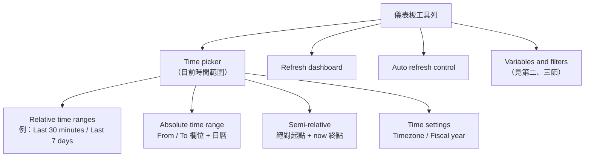
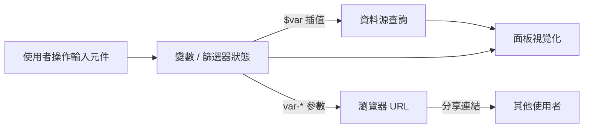
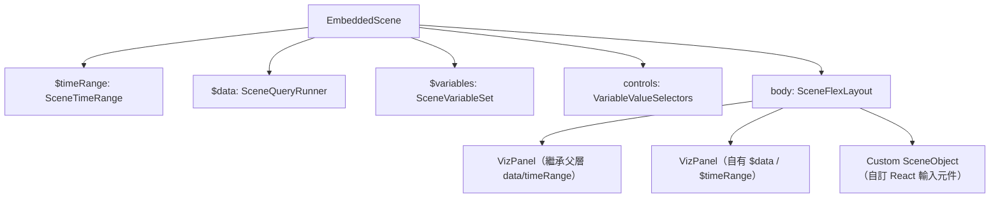

# Grafana 的 datetime filter 與自訂輸入／篩選元件能力

## 摘要

Grafana 是一套開源的觀測性與資料視覺化平台，其 GitHub 儲存庫 `grafana/grafana` 累積約 78,033 顆星，主要語言為 TypeScript，授權為 AGPL-3.0[^gh-grafana]。在 Grafana 儀表板的操作介面中，**時間範圍選擇器（time picker）**確實是最核心的全域控制項之一：官方文件將「Current dashboard time range and time picker」列為儀表板使用者介面的第 9 號功能，並說明「Select relative time range options or set custom absolute time ranges」[^use-dashboards]。因此「Grafana 的 UX/UI 建立於 datetime filter 之上」這個觀察大致成立，但並不完整——Grafana 的全域控制層其實包含**時間範圍（time range）**與**變數／篩選器（variables / filters）**兩大類機制[^use-dashboards]。

本報告要回答的核心問題是：**Grafana 是否支援自訂的輸入元件（custom input）與篩選元件（custom filter widget / component）？** 答案是肯定的，而且至少有四條不同層次的路徑：

1. **官方內建變數系統**——8 種變數型別，會自動渲染成下拉選單、文字輸入框或開關等輸入元件[^variables][^add-vars]。
2. **官方內建篩選器（Filter and Group by）**——一種可動態增減 key/operator/value 的篩選器建構介面[^filter-group-by]。
3. **內建視覺化面板中的互動元素**——Text 面板可嵌入 HTML、Canvas 面板可放置 Button 與 Action 等互動元件[^text][^canvas]。
4. **外掛（plugin）與 Scenes 開發框架**——可用 React + `@grafana/ui` 自行打造全新的面板、輸入元件，或透過 UI Extensions 注入 Grafana 核心介面[^plugin-tools][^scenes-core]。

---

## 一、時間範圍選擇器：Grafana 的全域控制核心

### 1.1 使用介面

官方文件以「time picker」稱呼目前的時間範圍控制項，並描述其行為：「Click the current time range to change it. You can change the current time using a *relative time range*, such as the last 15 minutes, or an *absolute time range*, such as `2020-05-14 00:00:00 to 2020-05-15 23:59:59`.」[^use-dashboards]

Grafana 支援的時間單位包含 `s`、`m`、`h`、`d`、`w`、`M`、`Q`、`y`，並支援減號回溯（`now-5m`）、加號前推、以及對齊到週期起點（例如 `now/d`、`now/w`、`now/M`、`now/Y`）等相對語法[^use-dashboards]。



圖中「Variables and filters」亦被官方列為儀表板工具列的既有功能：「Use **variables** and **filters**, to create more interactive and dynamic dashboards.」[^use-dashboards]

### 1.2 三種時間範圍型態

| 型態 | 說明 | 範例 |
|---|---|---|
| 相對（Relative） | 相對於 `now` 的位移 | `from=now-5m`、`to=now`[^use-dashboards] |
| 絕對（Absolute） | 明確的起訖時間戳 | `2020-05-14 00:00:00` 至 `2020-05-15 23:59:59`[^use-dashboards] |
| 半相對（Semi-relative） | 起點固定、終點跟隨現在 | 起點 `now/d+8h`、終點 `now`[^use-dashboards] |

半相對時間範圍的官方說明指出其效果：「Using a semi-relative time range, as time progresses, your dashboard will automatically and progressively zoom out to show more history and fewer details.」[^use-dashboards]

### 1.3 前端實作：`TimeRangePicker`

在 Grafana 前端原始碼中，時間選擇器的 React 元件 `TimeRangePicker` 定義於 `@grafana/ui` 套件，檔案為 `packages/grafana-ui/src/components/DateTimePickers/TimeRangePicker.tsx`；其 props 介面包含 `value: TimeRange`、`onChange`、`timeZone`、`quickRanges`、`onZoom`、`onMoveBackward / onMoveForward` 等，並以 `hideQuickRanges`、`widthOverride` 等旗標控制外觀[^trp-src]。這表示時間選擇器本身就是一個可被重複引用的共用 UI 元件，而非只能存在於工具列的單例控制項。

時間範圍除了以 UI 操作，也可用 URL query 參數控制：`from`、`to`、`time` 與 `time.window`、`timezone`；官方特別註明「Since these aren't variables, they don't require the `var-` prefix.」[^use-dashboards][^url-vars]

### 1.4 時間範圍相關的內建變數

Grafana 另有內建（built-in）變數供查詢使用，例如 `$__from` / `$__to`（預設為 epoch 毫秒，可格式化為 ISO 8601）、`$__interval`、`$__range`、`$__timezone`、`$__url_time_range`（僅供連結使用）等[^builtin-vars]。其中 `$__timeFilter` 會回傳「the active time range selection as an expression」，例如 `time > now() - 7d`[^builtin-vars]。這說明時間範圍不只是 UI 狀態，而是會向下滲透到查詢語意的全域參數。

---

## 二、官方內建變數：真正意義上的「可自訂輸入／篩選元件」

Grafana 文件中對變數的定位非常明確：「Variables display as drop-down lists—or in some cases text fields—at the top of the dashboard. These controls let viewers change what the dashboard displays without editing the dashboard.」[^variables]

也就是說，**Grafana 原生就把變數當成「輸入控制項」來設計**。官方文件列出 8 種變數型別[^variables][^add-vars]：

| 變數型別 | 渲染出的輸入元件 | 說明 | 主要來源 |
|---|---|---|---|
| Query | 下拉選單 | 由資料源查詢產生選項，如 metric 名稱、label 值、伺服器名稱 | [^add-vars] |
| Custom | 下拉選單 | 手動定義的固定清單（CSV 或 JSON 陣列） | [^add-vars] |
| Text box | 文字輸入框 | 「the most flexible variable, because you can enter any value」 | [^add-vars] |
| Constant | 無（隱藏） | 隱藏常數，「you can't update it unless you update the variable settings」 | [^add-vars] |
| Data source | 下拉選單 | 切換整個儀表板的資料源實例 | [^add-vars] |
| Interval | 下拉選單 | 時間區間（`1m`、`1h`、`1d`），概念上是全儀表板的 group by time | [^add-vars] |
| Filters | 篩選器建構器 | 舊名 Ad hoc filters，13.1 起更名擴充為 Filter and Group by | [^add-vars][^filter-group-by] |
| Switch | 開關（toggle） | 「Display a switch that allows you to toggle between two configurable values for enabled and disabled states」 | [^add-vars] |

### 2.1 變數的顯示位置（Display 選項）

變數不只是輸入元件，其**放置位置**也可以被控制。官方文件定義四種 Display 選項[^add-vars]：

- `Above dashboard`（預設，顯示於儀表板頂部）
- `Above dashboard, label hidden`（不顯示標籤）
- `Controls menu`（收進工具列的控制選單按鈕）
- `Hidden`（完全不顯示）

### 2.2 變數的選取行為

Query 與 Custom 變數支援額外的選取選項，包括 `Multi-value`、`Include All value`、`Allow custom values`[^add-vars]。其中「Allow custom values」在 Custom 變數上的意義是「Enables users to add custom values to the list」[^add-vars]，也就是讓使用者在下拉選單中輸入清單以外的值。

### 2.3 Text box 與 Switch：最接近「自由輸入」的原生型別

若需求是「讓使用者在儀表板上輸入任意文字或切換開關」，官方原生即可達成：

- Text box 變數：「Display a free text input field with an optional default value.」官方補充「If you don't enter anything in this field, then Grafana displays an empty text box for users to type text into.」[^add-vars]
- Switch 變數可用於條件式查詢，例如官方範例 `up{job="my-service"} and ($debug_mode == "true" or on() vector(0))`[^add-vars]

### 2.4 變數值如何進入查詢與 URL

變數值會透過 `$var`、`${var}`、`${var:format}` 等語法插值進查詢；同時預設會同步到 URL，語法為 `var-<varname>=value`；可用 `skipUrlSync: true` 關閉同步[^variables][^url-vars]。多值變數在 URL 中以重複參數表示：「Grafana interprets `var-example=value1&var-example=value2` as the dashboard variable `example` with two values」[^url-vars]。



---

## 三、Filter and Group by：官方內建的動態篩選器元件

「Filter and Group by」是 Grafana 中最貼近「自訂篩選元件」的原生機制。官方描述其定位：「Instead of creating a variable for each dimension by which you want to filter, it automatically queries your data source for available dimensions and lets users add or remove filters and group by dimensions on the dashboard dynamically.」[^filter-group-by]

幾個關鍵事實：

- 支援的資料源包含 Prometheus、Loki（兩者另支援 group by）、InfluxDB、Elasticsearch、OpenSearch，以及特殊的 Dashboard 資料源[^filter-group-by]。
- 使用者可在儀表板上新增 key / operator / value 的篩選條件，這些條件「are automatically added to all queries that use the specified data source」[^filter-group-by]。
- 儀表板工具列提供 **Filters overview** 抽屜，可一次檢視與調整所有生效中的篩選條件[^filter-group-by]。
- 支援 **Cross-filtering**：在 Bar chart、Histogram、Table、Time series 等視覺化上點選某個值，即可「Filter on this value / Filter out this value」；需在該欄位設定 `filterable` override 才能啟用[^filter-group-by]。
- 13.1 版起更名並擴充，但在儀表板 JSON schema 中仍寫作 `"kind": "AdhocVariable"`[^add-vars][^filter-group-by]。
- 可透過 URL 傳入篩選條件，語法為 `var-filter=key|=|value`，並需 URL 編碼（`|` → `%7C`、`=` → `%3D`）[^url-vars]。

這代表使用者不需撰寫外掛，就能獲得一個「由資料源驅動、可動態增減」的篩選器 UI。

---

## 四、內建面板中的互動輸入元素

除了頂部控制列，Grafana 也允許在面板內容中放置互動元素。

### 4.1 Text 面板：可嵌入 HTML

Text 視覺化支援三種模式：`Markdown`、`HTML`、`Code`；其中 HTML 模式「Renders the content as sanitized HTML」，若要突破限制則需設定 `disable_sanitize_html` 旗標[^text]。

官方對 `disable_sanitize_html` 的說明指出，啟用後「you can directly enter HTML」，但這是安全上的取捨，且不建議在正式環境使用[^text]。此外，如需嵌入 iframe 與外部網站，還需設定 `allow_embedding = true`[^text]。內建變數 `$__theme` 甚至提供主題色票，可用於讓自訂 HTML 元件與 Grafana 佈景主題一致[^builtin-vars]。

### 4.2 Canvas 面板：Button 與 Action

Canvas 的定位是「extensible visualizations that allow you to add and arrange elements wherever you want」[^canvas]。其可互動的元素包含：

- **Button**：可觸發「basic, unauthenticated API calls」，支援 GET / POST / PUT、Content-Type、Query parameters、Header parameters、Payload 與成功訊息，並可在 API 編輯器中傳入 template variables；需開啟 **Experimental element types**（預設開啟）[^canvas]。Button 有四種 variant：primary、secondary、success、destructive[^canvas]。
- **Action / Data links**：任何元素都能設定 data link 或 action；action 可選擇「Direct from browser」或經由已設定的資料源路由，並支援 confirmation message 與 one-click 模式[^canvas]。
- 官方註記「A button click will only trigger an API call when inline editing is disabled.」[^canvas]

Canvas 因此可視為 Grafana 內建的「低程式碼互動面板」，能用來兜出按鈕類的輸入元件，但仍無法直接改寫頂部控制列的變數 UI。

---

## 五、外掛生態：完整自訂輸入／篩選元件的主要路徑

### 5.1 面板外掛與 `@grafana/ui`

Grafana 官方提供三種外掛型別：「**Panel plugin** - a new way of visualizing data.」、「**Data-source plugin** - a connection to a new database or other source of data.」、「**App plugin** - an integrated out-of-the-box experience.」[^plugin-types]。其中 App 外掛可巢狀包含其他外掛型別：「The app plugin type allows you to nest other plugins inside it; in other words, to bundle or include multiple plugins in the same package.」[^plugin-types] 官方也提到 App 外掛可提供「custom pages, Scenes, and UI extensions」[^plugin-types]。

建立外掛的標準流程使用 `@grafana/create-plugin`：

```bash
npx @grafana/create-plugin@latest
```

官方說明「Grafana plugin development allows you to create many different types of user experiences」，並要求使用 Go、Mage、LTS 版 Node.js、Docker 與 npm/pnpm/yarn[^plugin-tools]。面板外掛本質上是 React 元件，官方描述「Panels are ReactJS components and can be scaffolded with the `create-plugin` tool」，其 `src/module.ts` 需匯出一個繼承 `GrafanaPlugin` 的類別（`PanelPlugin`、`DataSourcePlugin` 或 `AppPlugin`）[^build-panel]。面板元件接收 `options`、`data`、`width`、`height` 等 props，並可用 `replaceVariables` 進行變數插值[^build-panel]。

外掛開發文件另有一系列面板外掛指南，涵蓋 datalinks、value mappings、**custom panel option editors**、field overrides、變數插值、事件訂閱與 transformations 等[^panel-plugins]。

### 5.1.1 自訂面板選項編輯器（custom panel option editor）

這是「自訂輸入元件」最直接的原生延伸點。官方文件說明：「The standard editors cover the most common types of options, such as text input and boolean switches. **If you don't find the editor you're looking for, you can build your own.**」[^custom-editor] 自訂編輯器就是一個接收 `value` 與 `onChange` 兩個 props 的 React 元件[^custom-editor]：

```tsx
import { Button } from '@grafana/ui';
import { StandardEditorProps } from '@grafana/data';

export const SimpleEditor = ({ value, onChange }: StandardEditorProps<boolean>) => {
  return <Button onClick={() => onChange(!value)}>{value ? 'Disable' : 'Enable'}</Button>;
};
```

註冊方式為 `builder.addCustomEditor({ id, path, name, editor })`[^custom-editor]。這表示外掛作者可以讓終端使用者在 Grafana 的面板編輯側欄中，操作完全自製的輸入控制項。

### 5.1.2 `@grafana/ui` 與 `@grafana/runtime`

`@grafana/ui` 是 Grafana 自身的共用 React 元件庫，官方說明「@grafana/ui is a collection of components used by Grafana」且「Our goal is to deliver Grafana's common UI elements for plugins developers and contributors」，並提供元件目錄 Storybook[^grafana-ui]。`@grafana/runtime` 則是執行期服務存取層，官方註記「This package allows access to grafana services. It requires Grafana to be running already and the functions to be imported as externals.」，且該套件當時標示為 BETA[^grafana-runtime]。

一個重要的機制細節是：這些 `@grafana/*` 套件**不在外掛中打包**，而是在執行期與 Grafana 版本動態連結——「while a plugin specifies the expected versions of these dependencies in its `package.json` file, they are dynamically linked to the Grafana version at runtime」[^npm-deps]。這意味著外掛可用的 UI 元件取決於使用者實際安裝的 Grafana 版本。

### 5.2 UI Extensions：把自訂 UI 注入 Grafana 核心

Grafana 的 UI Extensions 機制讓 App 外掛可把 link、component、function 注入既有的 **extension points**。官方定義其核心概念為三項：**Content providers**（提供內容的 App 外掛）、**Content consumers**（使用內容的 Grafana 或外掛）、**Extension points**（「The specific locations in the UI where content can be placed.」）[^ui-ext-concepts]。官方並指出外掛開發者可同時扮演提供者與消費者兩種角色[^ui-ext-concepts]。

官方區分兩種分享內容的方式[^ui-ext-concepts]：

- **`add`（Registering）**：「A push method where you decide exactly where your content appears.」例如「Adding a menu item to the Grafana panel menu.」、「Adding a new tab to a page in Grafana.」、「Contributing a button to a dashboard toolbar.」
- **`expose`（Exposing）**：「A pull method where you offer a component for other plugins to use as they see fit.」

其中 `expose` 的官方使用案例之一，正是本報告關切的主題：「Building a **custom form field or input control** for other plugins to use in their configuration pages.」、「Offering a complex UI widget, like an incident declaration modal, that can be triggered from anywhere.」[^ui-ext-concepts]

官方列出的 Grafana Core extension points 包含（節錄）[^ext-points]：

| Extension Point | 型別 | 說明 |
|---|---|---|
| `DashboardPanelMenu` | Link | 「Extend the panel menu with custom actions.」（最常被使用） |
| `AlertingHomePage` | Component | 「Extend the alerting home page with custom alert-creation experience.」 |
| `UserProfileTab` | Component | 「Extend the user profile page with custom tabs.」 |
| `CommandPalette` | Link | 「Extend the command palette with custom actions.」 |
| `ExploreToolbarAction` | Link | 「Extend the Add button on the Explore page with custom actions.」 |
| `AlertInstanceAction` | Link | 「Extend the alert instances table with custom actions.」 |
| `AlertingAlertingRuleAction` / `AlertingRecordingRuleAction` | Link | 擴充告警規則／記錄規則選單動作 |

實作上需同時（a）在 `plugin.json` 宣告 `addedLinks` / `addedComponents` 等中繼資料，以及（b）在 `AppPlugin` 上呼叫 `addLink()` / `addComponent()`；官方強調「You must update your `plugin.json` metadata to list any registered extensions.」[^ui-ext-concepts]。外掛亦可自行定義新的 extension point 供其他外掛擴充（`exposeComponent()` 與 `usePluginComponent()`）[^ui-ext-concepts]。

需注意的限制是：UI Extensions 只能注入**既有的具名位置**（如面板選單、個人頁籤、告警首頁、命令面板），**不能**把任意 React 元件塞進儀表板面板網格；若要全新的面板型別，正確做法是撰寫**面板外掛**[^ui-ext-concepts]。同時，官方文件亦說明外掛可用的 `@grafana/*` 套件會與實際 Grafana 版本動態連結，因此可用元件取決於部署版本[^npm-deps]。

### 5.3 Grafana Scenes：以程式碼組裝儀表板級 UI

`@grafana/scenes` 是 Grafana Labs 的官方 TypeScript 函式庫，用於在 App 外掛中建構互動式儀表板體驗。其 GitHub 儲存庫 `grafana/scenes` 約 205 顆星、66 個 fork、授權 Apache-2.0[^gh-scenes]。

Scenes 的核心是**場景物件樹（object tree）**：官方說明場景由 scene objects 組成，代表資料、時間範圍、變數、版面與視覺化，且「Things like data, time ranges, or variables can be added to any object in the tree, making them available to that object and all descendant objects.」[^scenes-core]

自訂元件（custom scene object）的標準寫法為三件套：State 介面（extends `SceneObjectState`）、Model 類別（extends `SceneObjectBase`）、以及 React 渲染元件（掛在靜態屬性 `Component`）[^scenes-core]。官方範例：

```tsx
interface CounterState extends SceneObjectState {
  count: number;
}

export class Counter extends SceneObjectBase<CounterState> {
  public static Component = CounterRenderer;
  public constructor() {
    super({ count: 0 });
  }
  public onIncrement = () => {
    this.setState({ count: this.state.count + 1 });
  };
}

function CounterRenderer({ model }: SceneComponentProps<Counter>) {
  const { count } = model.useState();
  return (
    <div>
      <div>Counter: {count}</div>
      <button onClick={model.onIncrement}>Increase</button>
    </div>
  );
}
```

官方並在原始碼註解中附上「https://developers.grafana.com/ui/latest/index.html?path=/docs/date-time-pickers-timerangepicker--docs」作為時間選擇器的 Storybook 參照[^trp-src]；`@grafana/ui` 的 README 亦指向同一 Storybook 目錄[^grafana-ui]，顯示該元件與其餘 UI 元件均可被外掛重複引用。

Scenes 支援的變數型別包含 `QueryVariable`、`DataSourceVariable`、`CustomVariable`、`ConstantVariable`、`TextBoxVariable`[^scenes-vars]。搭配 `SceneVariableSet` 與 `controls: [new VariableValueSelectors({})]`，即可自行組合出變數選取輸入介面[^scenes-vars]。`SceneTimeRange` 則提供時間範圍物件，並可依層級覆寫[^scenes-core]。



### 5.4 社群與官方收編的外掛實例

若不想自行開發，社群／官方已有現成的「表單輸入」與「變數面板」外掛：

| 外掛 | 功能 | 授權 | 備註 |
|---|---|---|---|
| Business Forms（`volkovlabs-form-panel`） | 在儀表板內建立可提交 API 的表單，支援 GET / POST / PUT / PATCH / DELETE；含 section、條件顯示、動態表單、REST API、自訂程式碼 | Apache-2.0[^gh-bf-new] | 原由 Volkov Labs 開發，2025-10 由 Grafana Labs 接手並以相同 plugin ID 重新發布[^bf-catalog][^gh-bf-new]；官方統計「Running on 11,363 active Grafana instances」[^bf-catalog] |
| Business Variable（`volkovlabs-variable-panel`） | 把 Grafana 變數以專屬面板呈現，提供 Table / Minimize / Button / Slider / TreeView 等版面，並支援「Input Box: Support for text input variables with custom validation」 | Apache-2.0[^bv-catalog] | 同樣由 Volkov Labs 貢獻後轉由 Grafana Labs 維護[^bv-catalog]；官方統計「Running on 12,511 active Grafana instances」[^bv-catalog] |

Business Forms 官方列出的表單元素型別相當完整，包含 Custom button、Checkbox List、Code Editor、Color Picker、Date、Date and Time、File、Link、Multi-select、Number Input、Number Slider、Password Input、Radio Group、Read-only、String Input、Select、Text Area、Time 等[^bf-elements]。其中「Select options from a query」可讓下拉選項由查詢動態產生，「Custom Values」則允許使用者輸入清單以外的值；此外每個元素都可設定 JS 條件式顯示（Show If）[^bf-elements]。

需要注意的守門條件：Business Forms 目錄頁標示版本 6.3.6、相依 `Grafana >=12.3.0`、最後更新 2026-11-03[^bf-catalog]；Business Variable 目錄頁標示版本 5.2.0、相依 `Grafana >=12.3.0`、最後更新 2026-05-22[^bv-catalog]。兩者的原始 Volkov Labs 儲存庫（`VolkovLabs/business-forms`、`VolkovLabs/business-variable`）皆已於 2025 年標記為 archived、read-only[^gh-bf-old][^gh-bv]，後續維護分別移至 `grafana/business-forms` 與 `grafana/business-variable`（兩者皆建立於 2025-10-20）[^gh-bf-new][^gh-bv-new]。

---

## 六、綜合比較

| 路徑 | 是否為原生 | 可自訂程度 | 輸入元件範例 | 能否寫回外部系統 |
|---|---|---|---|---|
| Time picker | 原生 | 不可換元件，可設定 quick ranges 與 URL | 時間範圍選擇器 | 否 |
| 變數（8 型別） | 原生 | 中（可選型別、Display、選取選項） | 下拉、文字框、開關 | 否（僅影響查詢） |
| Filter and Group by | 原生 | 中（可加 key/value、group by、cross-filter） | 篩選器建構器 | 否 |
| Text 面板 HTML | 原生（需視設定） | 高（但無回寫機制） | 任意 HTML 表單元素 | 否 |
| Canvas Button / Action | 原生 | 中高（低程式碼） | 按鈕、可點擊圖形 | 可（HTTP API） |
| 面板／App 外掛 | 需安裝或自行開發 | 極高 | 完全自訂 React 元件 | 可 |
| Grafana Scenes | 需自行開發 | 極高 | 完全自訂 React 元件 | 可 |

### 決策建議

- 只需「讓使用者切換查詢條件」→ 使用原生變數（Query / Custom / Text box / Switch）[^add-vars]。
- 需要「跨面板、由資料源動態產生的標籤篩選」→ 使用 Filter and Group by[^filter-group-by]。
- 需要「表單式輸入並提交到後端 API」→ Business Forms 外掛[^bf-catalog][^bf-elements]，或自建面板外掛[^plugin-tools]。
- 需要「與 Grafana 核心介面整合的自訂 UI 或注入點」→ UI Extensions[^ext-points][^ui-ext-concepts]。
- 需要「整套自訂儀表板體驗、多時間範圍、巢狀變數」→ `@grafana/scenes`[^scenes-core][^scenes-vars]。

---

## 七、批判性反思與來源評估

1. **官方文件的權威性高，但版本綁定需注意。** 本報告引用的 Grafana 官方文件頁面，其頁尾的「Suggest an edit in GitHub」連結指向 `release-13.3.2` 分支[^use-dashboards]，顯示文件對應的版本線為 13.3.x。而「Switch 變數」與「13.1 更名 Ad hoc filters 為 Filter and Group by」屬於較新的功能，舊版 Grafana 可能不支援[^add-vars]。引用時應確認目標部署版本。
2. **「變數」在 Grafana 的語意與一般 UI 框架的「元件」不同。** Grafana 的變數確實會渲染成輸入元件，但其值主要用於查詢插值，而非一般表單的資料繫結。若把它當成通用的受控元件（controlled component）來設計，會與其資料流模型衝突。官方對變數的定義仍是「A variable is a placeholder for a value that you can use in dashboard queries, panel titles, links, and other dashboard elements」[^variables]。
3. **`@grafana/scenes` 的星數偏低但不代表不重要。** 205 顆星相對於 `grafana/grafana` 的 78,033 顆星差距極大[^gh-scenes][^gh-grafana]，但 Scenes 是 Grafana Labs 官方維護、且被用於 Grafana 自身的 App 外掛開發範式，屬「官方函式庫」而非社群專案，因此不宜以星數衡量其成熟度。官方 `plugin-types-usage` 文件亦明確背書：「With the recent introduction of Grafana Scenes, you can use any installed plugin of type `panel` as a visualization within a Scenes implementation.」[^plugin-types]
4. **Business Forms／Business Variable 的星數與維護狀態出現落差，且需注意接手後的星數資料。** 原儲存庫 `VolkovLabs/business-forms` 有 101 顆星但已封存[^gh-bf-old]，接手後的 `grafana/business-forms` 僅 10 顆星卻仍活躍（2026-11 仍有 push）[^gh-bf-new]；`grafana/business-variable` 接手後更只有 7 顆星[^gh-bv-new]。然而外掛目錄顯示兩者分別運行於 11,363 與 12,511 個活躍 Grafana 實例[^bf-catalog][^bv-catalog]。這說明**此類外掛的實際採用度與 GitHub 星數嚴重脫鉤**，僅以星數篩選會系統性低估成熟外掛。
5. **GitHub 上同名短名儲存庫的誤用風險。** 外掛目錄頁的「Repository」連結在 Business Variable 指向 `github.com/volkovlabs/business-variable`（無 `VolkovLabs/` 大寫組織名）[^bv-catalog]，而實際存在的是 `grafana/business-variable` 與已封存的 `VolkovLabs/business-variable`[^gh-bv-new][^gh-bv]。GitHub 組織名稱大小寫不敏感但顯示路徑可能誤導，引用時應以 API 回傳的 `full_name` 為準。
6. **「可自訂輸入元件」有真實限制。** 官方文件明確指出 UI Extensions 是「contribute content (like links and components) to **specific areas** of the Grafana interface」[^ui-ext-concepts]，可用的 extension points 是列舉式的固定集合[^ext-points]，無法把任意元件注入儀表板面板網格。Text 面板的 HTML 模式則受 sanitize 限制，且官方未提供把面板內輸入回寫到儀表板變數的機制[^text]。因此在規劃架構時，不應假設 Grafana 的內建控制列可被任意替換。
7. **未取得的資訊。** 本報告未能取得 Grafana 官方對於「替換儀表板原生工具列」的公開機制說明；若此需求存在，最接近的官方路徑是 Scenes 的 `controls` 屬性[^scenes-vars]與 UI Extensions 的既有 extension points[^ext-points]，而非改寫儀表板工具列。此外，`@grafana/runtime` 的 README 標示「currently in BETA」[^grafana-runtime]，其 API 穩定度承諾尚不明確，屬未解風險。

---

## 參考文獻

[^gh-grafana]: GitHub. (2026). *grafana/grafana* [Source code]. Retrieved 2026-11-22, from https://github.com/grafana/grafana

[^gh-scenes]: GitHub. (2026). *grafana/scenes* [Source code]. Retrieved 2026-11-22, from https://github.com/grafana/scenes

[^gh-bf-old]: GitHub. (2026). *VolkovLabs/business-forms* [Source code]. Retrieved 2026-11-22, from https://github.com/VolkovLabs/business-forms

[^gh-bf-new]: GitHub. (2026). *grafana/business-forms* [Source code]. Retrieved 2026-11-22, from https://github.com/grafana/business-forms

[^gh-bv]: GitHub. (2026). *VolkovLabs/business-variable* [Source code]. Retrieved 2026-11-22, from https://github.com/VolkovLabs/business-variable

[^gh-bv-new]: GitHub. (2026). *grafana/business-variable* [Source code]. Retrieved 2026-11-22, from https://github.com/grafana/business-variable

[^use-dashboards]: Grafana Labs. (n.d.). Use dashboards. *Grafana documentation*. Retrieved 2026-11-22, from https://grafana.com/docs/grafana/latest/visualizations/dashboards/use-dashboards/

[^variables]: Grafana Labs. (n.d.). Variables. *Grafana documentation*. Retrieved 2026-11-22, from https://grafana.com/docs/grafana/latest/visualizations/dashboards/variables/

[^add-vars]: Grafana Labs. (n.d.). Add variables. *Grafana documentation*. Retrieved 2026-11-22, from https://grafana.com/docs/grafana/latest/visualizations/dashboards/variables/add-template-variables/

[^builtin-vars]: Grafana Labs. (n.d.). Built-in variables. *Grafana documentation*. Retrieved 2026-11-22, from https://grafana.com/docs/grafana/latest/visualizations/dashboards/variables/built-in-variables/

[^filter-group-by]: Grafana Labs. (n.d.). Filter and group by controls. *Grafana documentation*. Retrieved 2026-11-22, from https://grafana.com/docs/grafana/latest/visualizations/dashboards/build-dashboards/filter-group-by/

[^url-vars]: Grafana Labs. (n.d.). Dashboard URL variables. *Grafana documentation*. Retrieved 2026-11-22, from https://grafana.com/docs/grafana/latest/visualizations/dashboards/build-dashboards/create-dashboard-url-variables/

[^text]: Grafana Labs. (n.d.). Text. *Grafana documentation*. Retrieved 2026-11-22, from https://grafana.com/docs/grafana/latest/visualizations/panels-visualizations/visualizations/text/

[^canvas]: Grafana Labs. (n.d.). Canvas. *Grafana documentation*. Retrieved 2026-11-22, from https://grafana.com/docs/grafana/latest/visualizations/panels-visualizations/visualizations/canvas/

[^plugin-tools]: Grafana Labs. (n.d.). Get started. *Grafana Plugin Tools*. Retrieved 2026-11-22, from https://grafana.com/developers/plugin-tools/

[^panel-plugins]: Grafana Labs. (n.d.). Panel plugins. *Grafana Plugin Tools*. Retrieved 2026-11-22, from https://grafana.com/developers/plugin-tools/how-to-guides/panel-plugins/

[^plugin-types]: Grafana Labs. (n.d.). Grafana plugin types and usage. *Grafana Plugin Tools*. Retrieved 2026-11-22, from https://grafana.com/developers/plugin-tools/key-concepts/plugin-types-usage

[^build-panel]: Grafana Labs. (n.d.). Build a panel plugin. *Grafana Plugin Tools*. Retrieved 2026-11-22, from https://grafana.com/developers/plugin-tools/tutorials/build-a-panel-plugin

[^custom-editor]: Grafana Labs. (n.d.). Build a custom panel option editor. *Grafana Plugin Tools*. Retrieved 2026-11-22, from https://grafana.com/developers/plugin-tools/how-to-guides/panel-plugins/custom-panel-option-editors

[^grafana-ui]: Grafana Labs. (2026). *Grafana UI components library* [Source code]. Retrieved 2026-11-22, from https://github.com/grafana/grafana/blob/main/packages/grafana-ui/README.md

[^grafana-runtime]: Grafana Labs. (2026). *Grafana Runtime library* [Source code]. Retrieved 2026-11-22, from https://github.com/grafana/grafana/blob/main/packages/grafana-runtime/README.md

[^npm-deps]: Grafana Labs. (n.d.). Frontend NPM dependencies in a Grafana plugin. *Grafana Plugin Tools*. Retrieved 2026-11-22, from https://grafana.com/developers/plugin-tools/key-concepts/npm-dependencies

[^ext-points]: Grafana Labs. (n.d.). Extension points in Grafana. *Grafana Plugin Tools*. Retrieved 2026-11-22, from https://grafana.com/developers/plugin-tools/reference/ui-extensions-reference/extension-points

[^ui-ext-concepts]: Grafana Labs. (n.d.). UI extensions concepts. *Grafana Plugin Tools*. Retrieved 2026-11-22, from https://grafana.com/developers/plugin-tools/how-to-guides/ui-extensions/ui-extensions-concepts

[^scenes-core]: Grafana Labs. (n.d.). Core concepts. *Grafana Scenes*. Retrieved 2026-11-22, from https://grafana.com/developers/scenes/core-concepts

[^scenes-vars]: Grafana Labs. (n.d.). Variables. *Grafana Scenes*. Retrieved 2026-11-22, from https://grafana.com/developers/scenes/variables

[^trp-src]: Grafana Labs. (2026). *TimeRangePicker.tsx* [Source code]. Retrieved 2026-11-22, from https://raw.githubusercontent.com/grafana/grafana/main/packages/grafana-ui/src/components/DateTimePickers/TimeRangePicker.tsx

[^bf-catalog]: Grafana Labs. (n.d.). Business Forms panel plugin for Grafana. *Grafana plugin catalog*. Retrieved 2026-11-22, from https://grafana.com/grafana/plugins/volkovlabs-form-panel/

[^bf-elements]: Grafana Labs. (n.d.). Form elements. *Business Forms documentation*. Retrieved 2026-11-22, from https://grafana.com/docs/plugins/volkovlabs-form-panel/latest/form-elements/

[^bv-catalog]: Grafana Labs. (n.d.). Business Variable panel plugin for Grafana. *Grafana plugin catalog*. Retrieved 2026-11-22, from https://grafana.com/grafana/plugins/volkovlabs-variable-panel/
