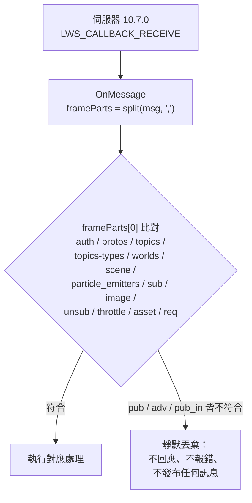

# gz-sim 10.7.0 是否接受並執行 incoming 發布操作？

## 摘要

**結論：不接受。** gz-sim 10.7.0 內建的 websocket server 系統（`gz::sim::systems::WebsocketServer`，外掛檔名 `gz-sim-websocket-server-system`）**只實作「對外發布」（outbound publish）**，也就是把 Gazebo Transport 主題上的訊息推給 websocket 用戶端；它**沒有**實作任何「由 websocket 用戶端送進來、再發布到 Gazebo Transport 主題」的操作。

- 用戶端若送出實作中不存在的操作字串（例如 `pub_in`），`OnMessage()` 的 if/else 串鏈會全部落空，程式**不報錯、不回應、直接靜默丟棄**該 frame[^wscc]。
- 用戶端若送出文件裡寫的 `pub` frame，情況完全相同：`pub` 只用於伺服器→用戶端的訊息標頭，**沒有**任何 `else if (frameParts[0] == "pub")` 分支[^wscc][^wshh]。
- 這是**文件與實作不一致**的缺口：`WebsocketServer.hh` 的註解把 `pub` 列為用戶端可用的操作之一（「Publish a message from the Gazebo Transport topic in the `topic_name` component」），並把 `topic_name` / `message_type` / `payload` 描述為 `pub` 的必要欄位，但實作端從未提供對應處理[^wshh][^wscc]。

---

## 1. 先定義問題：「incoming 發布」可能指三件事

「incoming 發布操作」在本題中語意不唯一，必須先區分，否則結論會互相矛盾。以下三種都逐一檢查過：

| 解讀 | 意思 | gz-sim 10.7.0 的實際狀況 |
| --- | --- | --- |
| A. websocket 用戶端 → 伺服器 → Gazebo Transport | 由外部（瀏覽器、自製客戶端）送 frame，要求 gz-sim 把訊息發布到某個 Gazebo 主題 | **不支援**（本報告主要結論） |
| B. Gazebo Transport 主題上的「incoming」訊息 | 系統外掛訂閱主題後收到的訊息（例如 `BuoyancyEngine` 的 `OnCmdBuoyancyEngine` 註解寫 "Callback for incoming commands"） | **支援**，但這是「訂閱」而非「發布」[^sg-incoming] |
| C. `gz-transport` 是否有名為 incoming 的發布 API | 是否有 `IncomingPublisher` 之類的類別 | **不存在**；`incoming` 在原始碼中僅是註解用語，不是正式 API 概念[^sg-incoming] |

本報告以 A 為主，因為在 Gazebo 語境中「incoming publish」通常專指 websocket server 的**入站發布**（inbound publish），而這正是歷史上被提出、卻始終沒有進入正式分支的功能。

---

## 2. gz-sim 10.7.0 是什麼

- `gz-sim` 是 Gazebo（新一代 Gazebo Sim）的模擬核心函式庫，GitHub 上為開源專案，約 1590 顆星、530 個 fork（擷取時 2026-11-22）[^repo]。
- gz-sim 10 屬於 **Gazebo Jetty** 發行系列；Jetty 是 Gazebo 的第 10 個具名發行版，於 2025 年釋出，屬長期支援（LTS）版本[^jetty]。
- 本報告檢視的版本 `10.7.0` 為 Jetty 系列中的修補版，`CMakeLists.txt` 內明確寫著 `project(gz-sim VERSION 10.7.0)` 與 `set (GZ_DISTRIBUTION "Jetty")`[^cmake]；官方 Changelog 記載其發行日期為 **2026-11-17**[^changelog]。
- 10.7.0 的 Changelog 條目中，**沒有任何**與 websocket server 發布功能相關的變更（僅有 detachable joints 教學修正、PosePublisher 文件、感測器全域照明處理、粒子散布比例、kinematic 屬性切換等），可據此確認「入站發布」在 10.7.0 並未被加入[^changelog]。

---

## 3. websocket server 的協定與實作事實

### 3.1 Frame 格式

websocket server 的每一則訊息都是四個以逗號分隔的欄位[^wshh]：

```
operation,topic_name,message_type,payload
```

### 3.2 實作支援的入站操作（原始碼列舉）

`WebsocketServer.cc` 的 `OnMessage()` 中，實際上會處理的入站操作字串如下[^wscc]：

| 操作 | 用途 |
| --- | --- |
| `auth` | 授權（若設有 `<authorization_key>` / `<admin_authorization_key>`） |
| `protos` | 取回所有 protobuf 定義 |
| `topics` | 取得主題清單 |
| `topics-types` | 取得主題與其訊息型別清單 |
| `worlds` | 取得世界資訊 |
| `scene` | 取得場景資訊 |
| `particle_emitters` | 取得粒子發射器清單 |
| `sub` | 訂閱 Gazebo Transport 主題 |
| `image` | 訂閱影像主題（回傳 PNG） |
| `unsub` | 取消訂閱 |
| `throttle` | 設定某主題的發布頻率上限 |
| `asset` | 取得檔案（byte array） |
| `req` | 呼叫 Gazebo 服務 |

`OnMessage()` 的串鏈結尾是[^wscc]：

```cpp
  else if (frameParts[0] == "asset")
  {
    this->OnAsset(_socketId, frameParts);
  }
  else if (frameParts[0] == this->operations[REQUEST])
  {
    this->OnRequest(_socketId, frameParts);
  }
}
```

**沒有** `pub`、**沒有** `adv`、**沒有** `pub_in` 分支。而 `operations` 成員的內容為[^wshh]：

```cpp
      private: std::vector<std::string> operations{
                 "sub", "pub", "topics", "protos", "asset", "req"};
```

其中 `"pub"`（對應 `PUBLISH = 1`）僅被用於 `BUILD_MSG` / `BUILD_HEADER` 巨集，也就是**組出伺服器要送給用戶端的訊息標頭**，例如 `topics`、`topics-types`、`scene` 等請求的回覆，以及訂閱後推播的資料[^wscc]。換言之，`pub` 是**出站**操作的標記，不是入站操作。

### 3.3 用戶端若硬送 `pub` / `pub_in` 會發生什麼



因為實作只在「frame 欄位數不等於 4 且逗號數不等於 3」時才輸出 `Received an invalid frame[...]` 錯誤，一個格式合法但操作字串不認識的 frame（例如 `pub_in,/my_topic,gz.msgs.StringMsg,<data>`）會通過格式檢查、進入授權檢查（預設無金鑰時視為已授權），最後在 if/else 串鏈中落空，**沒有任何輸出**，也就沒有任何訊息被發布到 Gazebo Transport[^wscc]。

---

## 4. 文件與實作的落差

`WebsocketServer.hh` 的類別註解把 `pub` 描述成雙向操作，明文寫道[^wshh]：

> The `operation` component is mandatory and must be one of:
> 1. `"sub"`: Subscribe to the topic in the `topic_name` component,
> 2. `"pub"`: Publish a message from the Gazebo Transport topic in the `topic_name` component,

> The `topic_name` component is mandatory for the `"sub"`, `"pub"`, `"unsub"`, and `"req"` operations.
> The `message_type` component is mandatory for the `"pub"` and `"req"` operations.
> The `payload` component is mandatory for the `"pub"` and `"req"` operations.

並舉例 `pub,/clock,gz.msgs.Clock,<serialized_data>`[^wshh]。然而範例下方又寫明這是「websocket server publishing data on the `/clock` topic」，即**伺服器推播**，而非用戶端請求發布[^wshh]。因此：

- 若讀者把文件中的 `pub` 當成「用戶端可以要求發布」，就會得到錯誤期待。
- 實務上，`pub` 只能出現在伺服器→用戶端的 frame；用戶端→伺服器的 `pub` 會被忽略。

類似的文件與實作落差，在同一份文件的 `operations` 列舉（只列 6 個字串，但實作支援約 13 個）也可觀察到，顯示註解並未隨實作同步維護[^wshh][^wscc]。

---

## 5. 歷史脈絡：入站發布曾被實作，但從未進入正式分支

這是理解本題的關鍵背景。

### 5.1 gz-launch 的 `publish_inbound` 分支

2022 年 7 至 9 月間，gz-launch 上存在一個名為 `publish_inbound` 的分支，其中確實實作了用戶端入站發布[^pib]：

- commit `f665014f`（作者 Nate Koenig，訊息 `Support publishing from websocket server to local transport`，作者日期 2022-07-28）加入了 `adv` / `pub_in` 兩個新操作[^pib].
- 該分支的 `WebsocketServer.hh` 內 `operations` 為[^pib]：

```cpp
      private: std::vector<std::string> operations{
                 "sub", "pub", "topics", "protos", "asset", "adv", "pub_in"};
```

  且列舉新增 `ADVERTISE = 5` 與 `PUBLISH_INBOUND = 6`，並有 `OnAdvertise()` 與 `OnPublishInbound()`（後者呼叫 `transport::Node::Publisher::PublishRaw`）[^pib]。
- 同分支的 `OnMessage()` 末端因此多出[^pib]：

```cpp
  else if (frameParts[0] == this->operations[ADVERTISE])
  {
    this->OnAdvertise(_socketId, frameParts);
  }
  else if (frameParts[0] == this->operations[PUBLISH_INBOUND])
  {
    this->OnPublishInbound(_socketId, frameParts);
  }
```

- gz-launch PR #198（`Deal with empty websocket advertisements gracefully.`）即以該分支為目標，說明中寫道「Note that this targets the `publish_inbound` branch, which actually needs to be rebased onto the `ign-launch5` branch」[^gl198]。
- 但 gz-launch 的正式分支（`main`、`gz-launch9`）中，websocket server **完全沒有** `adv` / `pub_in` 的痕跡：`operations` 仍為 `{"sub","pub","topics","protos","asset","req"}`，`OnMessage()` 末端仍是 `asset` 與 `REQUEST` 兩個分支[^glmain][^gl9]。
- 這代表入站發布的實作**停留在實驗分支，從未被合併進任何正式發行版**。

### 5.2 移植到 gz-sim 時一併帶入了這個缺口

Gazebo Jetty 起，gz-launch 被棄用（deprecated），websocket server 被改寫為 gz-sim 的一個 system，於 gz-sim PR #2792（`Port Websocket server from gz-launch`）合併[^changelog]。官方教學明確寫道這是**功能對等的移植**[^mig]：

> It is converted to a gz-sim system and offers the same functionality as the one in gz-launch. All websocket server plugin parameters that were available in gz-launch are supported in the gz-sim system.

由於移植來源是 gz-launch 的正式分支（沒有 `pub_in`），gz-sim 10.x（含 10.7.0）也就繼承了同樣的限制。

### 5.3 更早的 Gazebo Classic 世代同樣沒有通用入站發布

作為旁證，Gazebo Classic 的網頁橋接（`osrf/gzweb` 的 `gzbridge/`，由 Node.js 的 `server.js` 搭配 C++ addon `GazeboInterface.cc` 組成）也沒有提供「用戶端任意發布到任意 topic」的通用操作。其入站訊息雖有 `op` 欄位，但程式僅用它過濾掉 `"advertise"`，實際分派是**依 `topic`** 進行，且只支援固定的白名單主題（`~/model/modify`、`~/factory`、`~/world_control` 等）；`"op":"publish"` 只用於伺服器→用戶端的訊息打包[^gzbridge]。這說明「不開放通用入站發布」是 Gazebo 網頁橋接長期以來的設計取向，而非 gz-sim 移植時新引入的缺陷。

---

## 6. 用戶端這一側：gzweb 期待 `pub_in`，但伺服器不支援

Gazebo 的網頁端 gzweb（`gazebo-web/gzweb`，約 50 顆星，2026-11-22 擷取[^gzwebrepo]）在其 TypeScript 傳輸層中**確實**實作了入站發布[^gzweb]：

```typescript
  public advertise(topic: string, msgTypeName: string): Publisher {
    this.sendMessage(["adv", topic, msgTypeName, ""]);
    ...
  }

  public publish(topic: string, msgTypeName: string, msg: string): void {
    this.sendMessage(["pub_in", topic, msgTypeName, msg]);
  }
```

此功能來自 gzweb PR #29（`Add Publishers`，2022-08-17 合併），其說明直接點出相依關係[^gzweb29]：

> **Note:** It needs https://github.com/gazebosim/gz-launch/tree/publish_inbound branch in order to work, otherwise the publisher's messages to the websocket will be dismissed.

「否則發布者的訊息會被丟棄（dismissed）」正是第 3.3 節描述的靜默丟棄行為。由於 `publish_inbound` 分支從未合併，這個警告至今仍然成立：使用 gzweb 的 `advertise()` / `publish()` 對 gz-sim 10.7.0 送出的 `adv` / `pub_in` frame，會被伺服器忽略[^gzweb][^wscc]。

---

## 7. 若真的需要從外部發布到 gz-sim 主題，可行的路徑

既然 websocket server 的入站發布不可用，替代方案如下（皆不需要 ROS）：

1. **直接用 Gazebo Transport 用戶端**：以 C++／Python 的 `gz-transport` 建立 `Node`，對目標主題 `Advertise` 後 `Publish`。Gazebo 官方文件與範例即以此為主要途徑；社群討論中維護者（caguero）也說明 Gazebo Transport 由 ZMQ + Protobuf + 自訂探索機制組成，並不存在必須經由 websocket 的限制[^discourse]。
2. **使用 `gz topic -p` 指令列工具**：以命令列發布單一訊息，適合測試與腳本化[^gztopic]。
3. **改用服務呼叫**：透過 websocket 的 `req` 操作呼叫 gz-sim 既有的服務（例如 `/world/<world>/set_pose`、`/world/<world>/create`），以「服務」代替「發布」[^wscc]。
4. **自建閘道**：自行寫一個小程式訂閱 websocket、再以 gz-transport 發布，或反之；等於在外部重現 `pub_in` 的功能[^discourse]。
5. **直接改用 `gz-launch` 的 `publish_inbound` 分支**：技術上可行但該分支非正式支援、未再維護，且 gz-launch 在 Jetty 已被棄用[^mig][^pib]，實務上不建議。

---

## 8. 來源評估與批判

- **權威性**：本報告的核心結論主要建立在**第一手原始碼**（gz-sim 10.7.0 的 `WebsocketServer.cc` / `.hh`，取自 `gz-sim10_10.7.0` 標籤）之上[^wscc][^wshh]，而非部落格或二手描述。這是本題最可靠的一類證據。
- **時效性**：`10.7.0` 為 2026-11-17 發行的版本[^changelog]，距擷取日 2026-11-22 僅數日，且 10.7.0 的 Changelog 未提及 websocket 發布功能變更[^changelog]，因此結論對該版本有效。
- **交叉驗證**：`gz-launch` 的正式分支（`main`、`gz-launch9`）與 `publish_inbound` 分支的並列比對[^glmain][^gl9][^pib]，以及 gzweb PR #29 對相依分支的明確說明[^gzweb29]，三者在時間軸與結論上互相吻合，構成強力佐證。
- **需留意的偏差**：`WebsocketServer.hh` 的文件本身與實作不一致[^wshh]，因此**不應**以該文件作為「功能存在」的證據；本報告刻意將文件敘述與原始碼分支並列，以凸顯落差。
- **未證實的推測**：本報告未找到任何追蹤「gz-sim 應補上入站發布」的公開 issue 或 PR；也就是說，這是一個「文件寫了、實作沒有、也沒人正式追蹤」的缺口。我無法確認維護團隊是否刻意如此，因此不臆測其意圖。
- **背景脈絡（非本方結論的直接證據）**：gz-sim 維護者近期正在强化同一個 websocket server 的行為，例如 PR #4093 修正 `req` frame 的二進位 payload 解析、PR #4016 修正斷線後的訊息計數[^pr4093]。這些動向顯示該模組仍在維護中，但**不是**「已支援入站發布」的證據。

---

## 9. 結論（一句話）

在 gz-sim 10.7.0 中，websocket server **不會**接受或執行任何 incoming（用戶端 → Gazebo Transport）的發布操作；`pub` 僅用於伺服器對外的推播，用戶端送出的 `pub`、`adv` 或 `pub_in` frame 都會被靜默丟棄，因為對應的處理分支只存在於 gz-launch 的 `publish_inbound` 實驗分支，從未合併進任何正式發行版[^wscc][^wshh][^glmain][^pib][^gzweb29]。

---

## 參考文獻

[^repo]: Gazebo Sim (gz-sim) GitHub repository metadata (stars, forks, license, default branch). (n.d.). Retrieved 2026-11-22, from https://api.github.com/repos/gazebosim/gz-sim

[^jetty]: Gazebo. (n.d.). Gazebo Jetty release notes. Retrieved 2026-11-22, from https://gazebosim.org/docs/latest/release_notes/

[^cmake]: Gazebo Sim. (2026). CMakeLists.txt (gz-sim 10.7.0, GZ_DISTRIBUTION "Jetty") [Source code]. Retrieved 2026-11-22, from https://raw.githubusercontent.com/gazebosim/gz-sim/gz-sim10_10.7.0/CMakeLists.txt

[^changelog]: Gazebo Sim. (2026). Changelog (Gazebo Sim 10.7.0, 2026-11-17) [Source code]. Retrieved 2026-11-22, from https://raw.githubusercontent.com/gazebosim/gz-sim/gz-sim10_10.7.0/Changelog.md

[^wscc]: Gazebo Sim. (2026). src/systems/websocket_server/WebsocketServer.cc (gz-sim 10.7.0) [Source code]. Retrieved 2026-11-22, from https://raw.githubusercontent.com/gazebosim/gz-sim/gz-sim10_10.7.0/src/systems/websocket_server/WebsocketServer.cc

[^wshh]: Gazebo Sim. (2026). src/systems/websocket_server/WebsocketServer.hh (gz-sim 10.7.0) [Source code]. Retrieved 2026-11-22, from https://raw.githubusercontent.com/gazebosim/gz-sim/gz-sim10_10.7.0/src/systems/websocket_server/WebsocketServer.hh

[^mig]: Gazebo Sim. (2026). Websocket server for gzweb [Tutorial]. Retrieved 2026-11-22, from https://raw.githubusercontent.com/gazebosim/gz-sim/gz-sim10_10.7.0/tutorials/websocket_server.md

[^glmain]: Gazebo Launch. (2026). plugins/websocket_server/WebsocketServer.cc (gz-launch main branch) [Source code]. Retrieved 2026-11-22, from https://raw.githubusercontent.com/gazebosim/gz-launch/main/plugins/websocket_server/WebsocketServer.cc

[^gl9]: Gazebo Launch. (2026). plugins/websocket_server/WebsocketServer.cc (gz-launch9 branch, Jetty) [Source code]. Retrieved 2026-11-22, from https://raw.githubusercontent.com/gazebosim/gz-launch/gz-launch9/plugins/websocket_server/WebsocketServer.cc

[^pib]: Gazebo Launch. (2022). publish_inbound branch: WebsocketServer.cc and WebsocketServer.hh; commit f665014f "Support publishing from websocket server to local transport" [Source code]. Retrieved 2026-11-22, from https://raw.githubusercontent.com/gazebosim/gz-launch/publish_inbound/plugins/websocket_server/WebsocketServer.hh

[^gzbridge]: Classic gzweb (gzbridge). (2026). gzbridge/GazeboInterface.cc and gzbridge/gzwebsocket.js (per-topic dispatch; "advertise" filtered; "publish" used for server-to-client framing) [Source code]. Retrieved 2026-11-22, from https://raw.githubusercontent.com/osrf/gzweb/gzweb_1.0.0/gzbridge/GazeboInterface.cc

[^gl198]: Lalancette, C. (2022, September 9). Deal with empty websocket advertisements gracefully (Pull request #198). Retrieved 2026-11-22, from https://github.com/gazebosim/gz-launch/pull/198

[^gzweb]: gzweb. (2026). src/Transport.ts (advertise/publish using "adv" and "pub_in") [Source code]. Retrieved 2026-11-22, from https://raw.githubusercontent.com/gazebo-web/gzweb/main/src/Transport.ts

[^gzweb29]: Mas, G. (2022, August 16). Add Publishers (Pull request #29). Retrieved 2026-11-22, from https://github.com/gazebo-web/gzweb/pull/29

[^gzwebrepo]: gzweb GitHub repository metadata (stars, forks, last push). (n.d.). Retrieved 2026-11-22, from https://api.github.com/repos/gazebo-web/gzweb

[^sg-incoming]: Gazebo Sim. (2026). Occurrences of "incoming" in gz-sim and gz-transport sources (e.g. src/comms/Broker.cc "Incoming messages"; src/systems/buoyancy_engine/BuoyancyEngine.cc "Callback for incoming commands") [Source code]. Retrieved 2026-11-22, from https://github.com/gazebosim/gz-sim

[^gztopic]: Gazebo. (n.d.). Gazebo Transport topics and the gz topic tool. Retrieved 2026-11-22, from https://gazebosim.org/docs/latest/topics/

[^discourse]: Open Robotics. (2022, November). How can I communicate to Gazebo Sim topics via a standalone application (no ROS)? Retrieved 2026-11-22, from https://discourse.openrobotics.org/t/how-can-i-communicate-to-gazebo-sim-topics-via-a-standalone-application-no-ros/48364

[^pr4093]: Koenig, N. (2026, October 21). Keep binary request payloads intact in the websocket server (Pull request #4093). Retrieved 2026-11-22, from https://github.com/gazebosim/gz-sim/pull/4093
