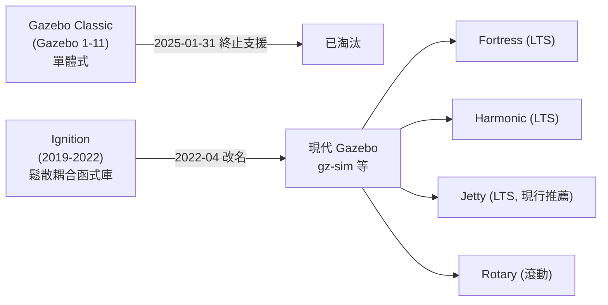
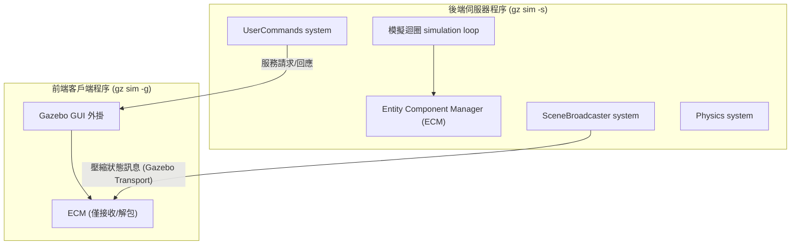
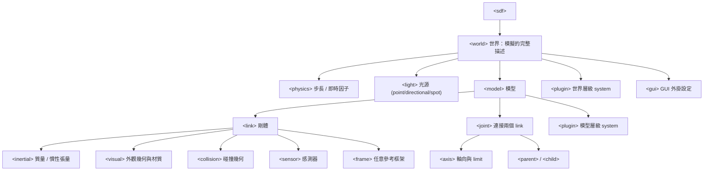
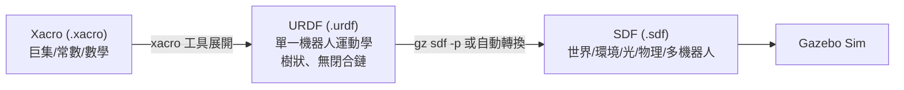
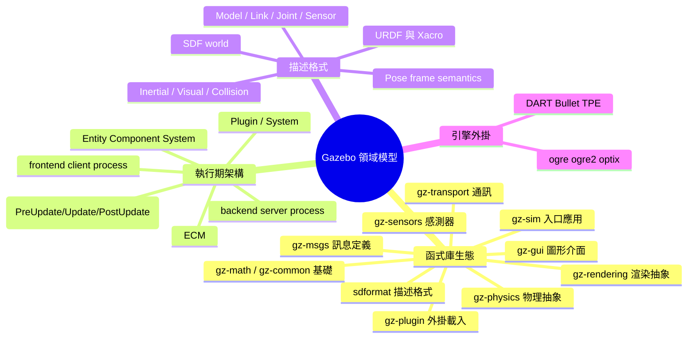
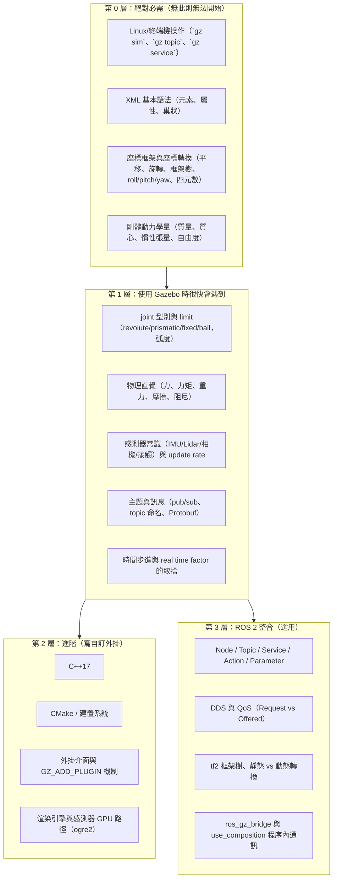

# 學習 Gazebo 所需的領域模型、心智模型與先備知識

## 摘要

本報告回答一個學習規劃問題：**一個想學會 Gazebo（現代 Gazebo，非 Gazebo Classic）的人，需要先具備哪些領域知識、建立哪些心智模型、補足哪些先備能力？**

本報告的結論是：Gazebo 本身不是「一個軟體」而是一組鬆散耦合的函式庫集合（collection of loosely coupled libraries），其中 `gz-sim` 是入口應用程式[^libs]。因此學習 Gazebo 的門檻並非來自 Gazebo 的 API 複雜度，而是來自四個外圍領域的知識疊合：**(1) 描述格式（SDFormat/URDF）與座標框架語意、(2) 剛體動力學與時間步進、(3) 訊息傳遞（Gazebo Transport）與外掛系統、(4) 若與 ROS 2 整合則再加上 ROS 2 的圖（graph）與中介層概念**。本報告逐一拆解這四層，並以官方文件原文佐證。

---

## 1. 先釐清學習對象：Gazebo 的命名史與版本策略

在談先備知識之前，必須先建立**「你學的是哪一個 Gazebo」**的心智模型，因為網路上大量教學、部落格與 Stack Overflow 答案仍指向已終止支援的舊架構。

Gazebo 專案自 2002 年開始發展，早期版本（Gazebo 1 至 Gazebo 11）被官方描述為因「超過 15 年的發展後需要一次重大升級與現代化」，並「把握機會從單體式架構轉向一組鬆散耦合的函式庫」，這些舊版本現統稱為 **Gazebo Classic**[^classicmig]。2019 年起專案以「Ignition」之名展開現代化重寫；2022 年 4 月官方宣布退場「Ignition」名稱、改回「Gazebo」，理由是遇到商標障礙[^ign2gz]。Gazebo Classic（即 Gazebo 11）已於 **2025 年 1 月 31 日（星期五）** 正式終止支援；現代 Gazebo 的第一個 LTS「Citadel」則於 2024 年 12 月 30 日終止[^eol]。`classic.gazebosim.org` 網站本身即顯示警語：「**End-of-life Warning! This version of Gazebo, now called Gazebo classic, reaches end-of-life in January 2025.** Users are highly encouraged to migrate to the new Gazebo using our migration guides.」[^classicb1]

官方對 End of Life 的定義是：Gazebo 團隊「將不再支援該特定 Gazebo 版本」，具體而言不再提供**新功能或新能力、安全更新、錯誤修正／修補或支援、更新的二進位檔案**。但**二進位檔不會突然消失**，使用者**不需要立即遷移**，專案也**不會在 2025 年 1 月 31 日突然停止運作**。官方並指出終止支援的理由之一是 Gazebo Classic 所依賴的作業系統基底（Ubuntu Focal）亦於 2025 年 4 月終止支援[^eol]。

> **日期不一致的說明**：Gazebo 開發團隊在 2024-12-02 的公告中寫的是「**Friday, January 31st, 2025**」[^eol]；但 Gazebo 11 於 2019-01-30 的**原始發布公告**寫的是「This version of Gazebo has long term support **with an end-of-life on January 29, 2025**」[^gz11blog]，而 `classic.gazebosim.org` 頁面的警語僅寫「**in January 2025**」[^classicb1]。換言之，官方自身對確切日期有兩種說法（1 月 29 日 vs 1 月 31 日）。就學習規劃而言，**「2025 年 1 月已終止支援」這一事實無爭議**；確切日期的歧異不影響任何學習決策。

版本以**字母序代號（codename）**命名，且以字母順序遞增，並「鬆散地落在建築領域」[^releases]：

| 版本 | 發布 | 終止支援 | 狀態 |
|---|---|---|---|
| Acropolis | 2019-02 | 2019-09 | EOL |
| Blueprint | 2019-05 | 2020-12 | EOL |
| Citadel | 2019-12 | 2024-12 | EOL |
| Dome | 2020-09 | 2021-12 | EOL |
| Edifice | 2021-03 | 2022-03 | EOL |
| Fortress | 2021-09 | 2027-05 | LTS |
| Garden | 2022-09 | 2024-11 | EOL |
| Harmonic | 2023-09 | 2029-05 | LTS |
| Ionic | 2024-09 | 2026-12 | 一般版 |
| **Jetty** | **2025-09** | **2031-05** | **LTS（目前推薦）** |
| Rotary | 滾動發布 | — | 實驗性 |

官方建議：新使用者應安裝 **Jetty**（最新 LTS），除非被特定 ROS 2 版本綁定（例如 ROS 2 Jazzy 對應 Harmonic、Humble 對應 Fortress）[^getstarted]。另有滾動發布流 **Rotary**，每晚由各函式庫 `main` 分支連續建置，僅供維護者、CI 系統與早期採用者使用[^releases]。



**先備心智模型 #1**：把「Gazebo」理解為**一個由多個獨立函式庫組成的生態系**，而不是單一執行檔。這決定了後續所有學習路徑的分岔（見第 6 節）。

---

## 2. 領域模型：Gazebo 的系統架構

### 2.1 客戶端／伺服器雙程序架構

Gazebo Sim 作為一個執行檔，會啟動**兩個程序**[^arch]：

- **後端伺服器程序（backend server process）**：載入名為 **systems** 的伺服器外掛，執行模擬迴圈（模擬物理、記錄日誌、接收使用者指令等）。
- **前端客戶端程序（frontend client process）**：即 GUI，由多個外掛組成，負責視覺化與互動。

兩者之間所有跨越程序邊界的資訊，都必須經由 **Gazebo Transport**（通訊函式庫）傳遞[^arch]。



### 2.2 實體—組件—系統（ECS）架構

後端採用 **entity-component system（ECS）** 架構。官方術語定義如下[^terminology]：

- **World（世界）**：「模擬的完整描述，包含所有機器人、可動與靜態物件、外掛、場景與 GUI。對應於一個 SDF `<world>` 標籤。」
- **Entity（實體）**：「世界中的每一個『物件』，例如 model、link、collision、visual、light、joint 等。實體**只是一個數字 ID**，其上可掛載數個 component。實體 ID 於執行期指派。」
- **Component（組件）**：「為實體增添某種功能或特徵（例如 pose、name、material 等）。」組件是純資料，不含邏輯。
- **System（系統）**：「作用於所有擁有特定組件集合之實體的邏輯。System 是可在執行期載入的外掛。」
- **Entity-component manager（ECM）**：「提供查詢、建立、移除與更新實體與組件之功能的物件。」

官方架構文件進一步說明，**伺服器外掛之間不直接互相呼叫**，而是透過修改實體上的組件來溝通：「實體與組件的修改，就是伺服器外掛彼此溝通的方式。」例如使用者寫一個 system 對某實體施加力（透過設定組件），物理 system 便會接手並實際讓實體移動[^arch]。

**先備心智模型 #2（ECS）**：可用遊戲引擎的資料導向設計來類比——**Entity 是裸 ID、Component 是純資料標籤、System 是每幀執行的唯一邏輯所在**。

### 2.3 模擬迴圈與四個生命週期介面

後端存在一個迴圈持續執行 systems，「有些 system 提出對實體與組件的變更，其他 system 則處理並套用這些變更。這被稱為『模擬迴圈』」[^arch]。

每個 system 外掛可實作以下介面[^sysplugin]：

| 介面 | 存取權 | 執行時機與用途 |
|---|---|---|
| `ISystemConfigure` | 讀寫 | 外掛載入時執行一次；可讀取 SDF 自訂設定、註冊事件、修改實體與組件 |
| `ISystemPreUpdate` | 讀寫 | system「說明它希望在此時發生什麼」；可在物理運行前修改狀態（施加控制訊號、網路同步） |
| `ISystemUpdate` | 讀寫 | 用於物理模擬步進 |
| `ISystemPostUpdate` | **唯讀** | 捕捉本次模擬步階發生的所有結果；用於讀取結果供感測器或控制器使用 |
| `ISystemReset` | 讀寫 | 外掛被重置時執行一次 |

其中一個關鍵細節：`gz::sim::UpdateInfo::simTime` **不是指當前時間，而是 PreUpdate 與 Update 呼叫結束後所到達的時間**。因此若模擬暫停時呼叫 `*Update`，時間不會推進[^sysplugin]。

System 可掛載於以下實體類型：**World、Model、Sensor、Actor**[^sysplugin]。預設會啟動的後端 system 有 **Physics、User Commands、Scene Broadcaster**[^arch]。

**先備心智模型 #3（迴圈三階段）**：`PreUpdate`＝「我希望發生 X」→ `Update`＝「物理引擎讓 X 發生」→ `PostUpdate`＝「讓我觀察發生了什麼」。

---

## 3. 先備知識第一層：描述格式與座標框架語意

### 3.1 SDFormat（SDF）：世界的描述語言

**SDFormat（Simulation Description Format，常縮寫為 SDF）是一種 XML 格式，用以描述機器人模擬器、視覺化與控制所需的物件與環境。** 它最初作為 Gazebo 的一部分而開發，設計上以科學機器人應用為出發點，「多年來已成為一種穩定、穩健且可擴充的格式，能描述機器人、靜態與動態物件、光照、地形，甚至物理」[^sdfwhat]。

Gazebo 官方教學明確指出：「**SDF 用來指定模擬的內容**」[^getstarted]。因此**先備能力 #1：XML 基本語法**（元素、屬性、巢狀結構）是硬需求——教學中明言「需要具備基本 XML 熟悉度」[^tutorials]。

### 3.2 模型（Model）的階層結構

SDF 的核心巢狀結構為 World → Model → Link → Joint / Sensor。官方術語對 World 的定義已見於 2.2 節[^terminology]。在建模教學中，官方對 model 與 link 的說明如下[^buildrobot]：

- 「每一個 model 是一群以 **joint** 彼此相連的 **link**（可以只有一個 link）。」
- 「每個 model 可以指定一個 link 作為 `canonical_link`，model 的隱含框架即附著於此 link。若未定義，則第一個 `<link>` 會被選為 canonical link。」
- 範例中同時展示了 `canonical_link` 與 `relative_to` 屬性的用法[^buildrobot]。



### 3.3 Link 的必備資料：質量、質心、慣性張量

官方建模教學中，chassis link 的 `<inertial>` 區塊包含 `<mass>` 與 `<inertia>` 矩陣（ixx/ixy/ixz/iyy/iyz/izz）[^buildrobot]：

```xml
<inertial>
  <mass>1.14395</mass>
  <inertia>
    <ixx>0.095329</ixx> <ixy>0</ixy> <ixz>0</ixz>
    <iyy>0.381317</iyy> <iyz>0</iyz>
    <izz>0.476646</izz>
  </inertia>
</inertial>
```

教學並未直接教導如何計算慣性張量，而是外連一個「質量慣性矩計算器」[^buildrobot]。這意味著學習者被**隱性假設**已理解：質量（mass）、質心（center of mass）、慣性張量（inertia tensor）與其在 3D 剛體運動中的角色。

**先備能力 #2：剛體動力學的基本量**——質量、質心、慣性張量、自由度（DOF）。每個未受約束的 3D 剛體有 6 個自由度（3 平移 + 3 旋轉）；joint 的作用就是**約束**這些自由度。

### 3.4 Joint 與自由度約束

官方建模教學定義 joint「連接兩個 link，並定義它們如何相對運動」，並示範了 `revolute`（1 個旋轉自由度、含 limit）與 `ball`（3 個旋轉自由度）[^buildrobot]：

- `revolute`：「提供 1 個帶有 joint 限制的旋轉自由度。」
- `ball`：「提供 3 個旋轉自由度。」
- `<axis>` 的 `<xyz>` 可用 `expressed_in` 指定表達框架：「旋轉軸可以是任何框架，不只是 parent 或 child link。」
- revolute 的 limit 必須以**弧度（radians）**指定[^buildrobot]。

URDF 的官方 XML Schema 則列出了 6 種 joint 型別：`revolute`、`continuous`、`prismatic`、`fixed`、`floating`、`planar`[^urdfxsd]。學習者需建立「joint 型別 → 自由度數量」的對應心智模型。

### 3.5 URDF 與 SDFormat 的關係

**URDF（Unified Robot Description Format）是 ROS 用來指定機器人幾何與組織的檔案格式**，採用 XML[^urdfdoc]。由官方 XSD 可知，URDF 的根元素恆為 `<robot>`，包含 `<link>`、`<joint>`、`<material>`、`<transmission>`、`<gazebo>` 與 `<sensor>`[^urdfxsd]。其中 `<gazebo>` 元素被註記為「Gazebo 擴充，非標準支援」，其內容允許任意結構——這正是 URDF 與 Gazebo 的橋接點（見 SDFormat 的 "SDFormat extensions to URDF (the 'gazebo' tag)" 教學）[^urdfxsd][^sdfdocs]。

由於 Gazebo 可直接透過服務生成 URDF，學習者常會遇到**兩套格式並存**的情境。官方 "Spawn URDF" 教學開頭即點明此分工：「**URDF 檔在 ROS 中常用來表示機器人模型。SDF 可以描述一個含多個機器人模型的世界，而 URDF 只能描述一個機器人模型。**」[^spawnurdf] 該教學的做法是啟動一個空世界後，呼叫世界的 `create` 服務（請求型別為 `EntityFactory`），並把 URDF 檔路徑填進 `sdf_file_name` 欄位；「**[libsdformat](https://gazebosim.org/libs/sdformat) 函式庫接著會在內部把 URDF 檔轉換為 SDF 表示，並載入到執行中的世界。**」[^spawnurdf] 該教學亦明言「此教學假設讀者**已經有一個想載入的 URDF 檔**」，並建議以 `xacro` 套件把 `.xacro` 轉為 `.urdf`[^spawnurdf]。

**先備心智模型 #4（兩種格式的分工）**：



Xacro 是 XML 的巨集語言，提供**常數（constants）、簡單數學（simple math）、巨集（macros）**三項能力，以減少 URDF 的重複與維護負擔[^xacro]。**先備能力 #3：以巨集與變數思考模型描述**（可類比為程式語言的預處理器）。

### 3.6 座標框架與 pose 語意（最容易出錯的一層）

SDFormat 文件明確將 "Pose frame semantics"（pose 框架語意）列為獨立的主題，並有專門的 proposal 文件[^sdfdocs]。官方建模教學展示了幾種疊加方式[^buildrobot]：

- `<pose relative_to='world'>0 0 0 0 0 0</pose>`：pose 相對世界。
- `<link name='chassis'><pose relative_to='__model__'>...</pose>`：相對 model 框架。
- `<frame name="caster_frame" attached_to='chassis'><pose>0.8 0 -0.2 0 0 0</pose></frame>`：定義**任意框架**，需兩個屬性 `name` 與 `attached_to`；此時 pose 相對於 `attached_to` 所指的框架。
- pose 的數值意義：`<pose>X Y Z R P Y</pose>`，前三個是位置，後三個是**roll、pitch、yaw** 姿態，角度單位為**弧度**[^buildrobot]。

**先備能力 #4：座標轉換（coordinate transforms）**——平移與旋轉的合成、框架樹（frame tree）、roll/pitch/yaw 與旋轉矩陣／四元數的對應。這是 Gazebo 學習中最高頻的錯誤來源，因為同一個數字在不同 `relative_to` 下意義完全不同。

**先備心智模型 #5**：SDF 中的所有框架構成一棵**樹**。要判斷一個 pose 的實際位置，必須沿著樹向上追溯至世界框架。

### 3.7 物理設定與時間步進

世界層級的 `<physics>` 標籤定義動態引擎的型別與屬性[^sdfworlds]：

```xml
<physics name="1ms" type="ignored">
  <max_step_size>0.001</max_step_size>
  <real_time_factor>1.0</real_time_factor>
</physics>
```

- `<max_step_size>`：「模擬中每個 system 能與世界狀態互動的最大時間。值越小，計算越精確，但需要更多計算資源。」[^sdfworlds]
- `<real_time_factor>`：「模擬時間與真實時間的比值。」[^sdfworlds]
- `<physics>` 的 `type` 設為 `ignored`，因為「透過此標籤選擇物理引擎型別**尚未**實作」——實際引擎是透過 plugin 選擇[^sdfworlds]。

**先備心智模型 #6（時間步進）**：模擬以固定步長 `dt` 離散推進；`max_step_size` 是精度與效能的取捨旋鈕。real time factor（RTF）是模擬跑得比現實快或慢的指標。

---

## 4. 先備知識第二層：物理引擎與感測器

### 4.1 物理引擎是可插拔外掛

**Gazebo 中物理引擎以 plugin 形式整合，因此任何引擎都能在不改動核心原始碼的情況下被整合**，這與 Gazebo Classic 不同[^comparison]。官方文件指出「Gazebo 預設使用 **DART** 物理引擎」，且「Gazebo 會**自動尋找所有隨 Gazebo Physics 安裝的物理引擎外掛**」[^physicsengines]。

| 引擎 | 說明 |
|---|---|
| **DART** | 預設；Dynamic Animation and Robotics Toolkit |
| **Bullet** | 即時碰撞偵測；剛體 API |
| **Bullet Featherstone** | 多體（multibody）API |
| **TPE** | 「由 Open Robotics 建立、可在**大規模**下對實體進行快速、低成本的運動學模擬」；「支援**無真實物理**（例如重力、力、約束等）的高階編隊動態，以及多機同步」[^physicsplugin] |

官方物理概念教學具體展示了引擎差異的行為後果：「**Dartsim 透過對關節施力來移動車輛，而 TPE 則直接設定模型的速度。**」[^physicsconcepts] 同一份文件也用示範世界展示了碰撞、升力／阻力（joint force/torque/pressure）、浮力（依體積施力）、單擺（慣性與重力）、多旋翼（重力、致動器、慣性）等概念[^physicsconcepts]。

**先備能力 #5：牛頓力學的直覺**——力與力矩、重力、摩擦、阻尼、慣性如何決定運動。Gazebo 的示範世界本質上是這些概念的視覺化教材[^physicsconcepts]。

### 4.2 渲染引擎同樣是可插拔外掛

Gazebo Rendering 是一個「設計來為不同渲染引擎提供抽象層的 C++ 函式庫」，其特性明列：「支援包含 OGRE 與 OptiX（實驗性）的渲染引擎」以及「外掛式架構。可在執行期載入多個渲染引擎外掛」[^renderinglib]。原始碼中渲染引擎外掛實作各自獨立存放於目錄：`ogre`（OGRE 1.x）、`ogre2`（OGRE-Next 2.x）、`optix`（OptiX）[^renderinglib]。在世界檔案中透過 GUI 的 `MinimalScene` 外掛指定，例如 `<engine>ogre2</engine>`[^sdfworlds]。

感測器教學則要求 GPU Lidar 使用 `ogre2`：「`<plugin filename="gz-sim-sensors-system" name="gz::sim::systems::Sensors"><render_engine>ogre2</render_engine></plugin>`」[^sensors]。

**先備心智模型 #7**：**物理引擎與渲染引擎是兩條獨立的外掛軸線**。物理算運動，渲染算像素；需要「看得見的感測器」（相機、Lidar）時才需要渲染引擎。

### 4.3 感測器：定義在 link 上、經 system 產生資料、發佈到 topic

官方感測器教學以 IMU、Contact、Lidar 三種感測器為例[^sensors]。感測器通常加在模型的某個 link 之下（範例加在 `chassis` link）[^sensors]：

```xml
<sensor name="imu_sensor" type="imu">
    <always_on>1</always_on>
    <update_rate>1</update_rate>
    <visualize>true</visualize>
    <topic>imu</topic>
</sensor>
```

- `<always_on>`：若為 true，感測器會依 update rate 持續更新。
- `<update_rate>`：產生感測資料的頻率。
- `<visualize>`：若為 true，感測器會在 GUI 中被視覺化。
- `<topic>`：資料發佈的 topic 名稱。[^sensors]

Lidar 的設定展示了 ray 的取樣參數：`<samples>`（每次完整掃描要產生的模擬雷射射線數）、`<resolution>`（「此數值乘上 samples 決定範圍資料點數量」）、`<min_angle>`／`<max_angle>`，以及 `<range>` 的 min/max/resolution[^sensors]。LaserScan 訊息的欄位包含 `angle_min`、`angle_max`、`angle_step`、`range_min`、`range_max`、`ranges`、`intensities` 等[^sensors]。

官方也提醒一個重要陷阱：「當在一個原本不含 plugin 的 SDF 檔中加入 plugin 時，**預設外掛不會被載入**」，因此必須手動補上 Physics 與 SceneBroadcaster 等邏輯預設值，否則 GUI 將無法運作[^sensors]。

**先備能力 #6：感測器物理常識**——IMU 輸出什麼（orientation 四元數、angular_velocity、linear_acceleration）、Lidar 的「光偵測與測距」原理與角度／距離解析度、接觸感測器的布林語意[^sensors]。這些不必精通，但需能讀懂訊息欄位。

---

## 5. 先備知識第三層：訊息傳遞與外掛系統

### 5.1 Gazebo Transport：純分散式發布／訂閱

**Gazebo Transport 是一個開源通訊函式庫，讓客戶端之間共享資料**；在此脈絡下客戶端稱為 **node**，節點可執行於同一程序、同一機器，或世界各地的不同機器[^transportintro]。

其架構特點是「**純分散式架構。沒有中央程序、broker 或類似的中心結構。**」網路中的所有節點都可扮演發布者、訂閱者、提供服務與請求服務[^transportnodes]。訊息以 **Google Protocol Buffers** 作為資料型別；目前已提供兩種中介層後端：**ZeroMQ（預設，生產環境推薦）與 Zenoh**，由環境變數 `GZ_TRANSPORT_IMPLEMENTATION` 選擇[^transportintro]。

Topic 命名規則：允許英數字加上零或多個斜線（`/image`、`head_position`、`/robot1/joints/HeadPitch`）；**`@`、`:=`、`~` 不允許**；空字串、含空白、連續兩個 `//`、單獨 `/` 皆無效[^transportnodes]。

另有兩個隔離機制[^transportnodes]：

- **Partition（分區）**：隔離一組共享同一 partition 名稱的節點。預設 partition 由 `hostname:username` 組合而成（例如 `bb8:caguero`），可用環境變數 `GZ_PARTITION` 覆寫。
- **Namespace（命名空間）**：可套用於節點中所宣告的部分 topic/service 的前綴。例如 namespace `ns1` 下的 `t1`、`t2` 會成為 `/ns1/t1`、`/ns1/t2`，但絕對路徑 `/t3` 不受影響。

Topic 亦可有 scope：`Process`（僅同程序可見）、`Host`（僅同機器可見）、`All`（任何節點可見）[^transportnodes]。

### 5.2 Service：請求／回應

官方定義：「**你可以把 service 視為一個將在不同節點中執行的函式。**」Service 有兩個主要元件：服務提供者（provider）與服務消費者（consumer）。Gazebo Transport 中服務的位置是隱藏的，由探索層負責維護可用服務清單[^transportservices]。若多個節點宣告同一服務，請求只會由其中一個 provider 處理，且不保證是哪一個；若某 provider 失效，其餘 provider 仍可處理後續請求[^transportservices]。

變體包含：同步請求（阻塞直到回應或逾時，逾時以毫秒計）、非同步請求（以 callback 接收）、oneway（單向、無回應）、無輸入參數的服務[^transportservices]。

### 5.3 官方 CLI 工具的操作心智模型

學會 Gazebo 的一大半是學會用命令列觀察與注入訊息。官方教學示範[^movingrobot][^sdfworlds][^sensors]：

```bash
gz sim building_robot.sdf                    # 啟動（同時開 server 與 GUI）
gz sim shapes.sdf -v 4                       # 加詳細度
gz sim -s shapes.sdf -v 4                    # 只跑 server（headless）
gz sim -g                                    # 只跑 GUI
gz topic -t "/cmd_vel" -m gz.msgs.Twist \
    -p "linear: {x: 0.5}, angular: {z: 0.05}"  # 發佈訊息
gz topic -e -t /imu                          # 監看 topic
gz service ...                               # 呼叫服務
gz launch sensor_launch.gzlaunch             # 以檔案一次啟動多個執行檔
```

**先備能力 #7：終端機／命令列操作**。官方教學橫跨全系列都預設學習者能執行 `gz sim`、`gz topic`、`gz service` 等指令[^tutorials]。此外 macOS 上必須開兩個終端機分別跑 server 與 GUI[^getstarted]。

### 5.4 外掛（Plugin／System）：Gazebo 的擴充機制

官方定義：「**外掛是編譯為共享函式庫並插入模擬中的一段程式碼。外掛讓我們控制模擬的許多面向，例如世界、模型等。**」[^movingrobot] 且「因為外掛在執行期載入，**Gazebo 不需重新編譯**即可新增或移除外掛」[^arch]。

外掛在 SDF 中需要兩個屬性：`filename`（函式庫檔名）與 `name`（外掛名稱）[^movingrobot]：

```xml
<plugin filename="gz-sim-diff-drive-system"
        name="gz::sim::systems::DiffDrive">
    <left_joint>left_wheel_joint</left_joint>
    <right_joint>right_wheel_joint</right_joint>
    <wheel_separation>1.2</wheel_separation>
    <wheel_radius>0.4</wheel_radius>
    <odom_publish_frequency>1</odom_publish_frequency>
    <topic>cmd_vel</topic>
</plugin>
```

撰寫自訂 system 外掛的技術前提是 **C++17 與 CMake**[^sysplugin]：

- 標頭需 `#include <gz/sim/System.hh>`，類別需繼承 `gz::sim::System` 及欲實作的介面。
- 以 `GZ_ADD_PLUGIN(...)` 註冊；若同一函式庫含多個外掛，後續使用 `gz/plugin/RegisterMore.hh`。
- CMake 需 `find_package(gz-plugin REQUIRED COMPONENTS register)`、`find_package(gz-sim REQUIRED)`、`set_property(TARGET ... PROPERTY CXX_STANDARD 17)`。
- 外掛可透過環境變數 `GZ_SIM_SYSTEM_PLUGIN_PATH` 被尋得。[^sysplugin]

**先備能力 #8：C++ 與建置系統（CMake）**——官方明言感測器教學中撰寫 lidar_node 需要 C++ 知識，並需要 CMake 建置[^tutorials]。這是 Gazebo「使用者 → 開發者」路徑的分水嶺。

---

## 6. 先備知識第四層（選用）：ROS 2 整合

Gazebo 可獨立運作，但實務上多與 ROS 2 併用。官方將文件分為兩條路徑：**Users**（跑標準工具、編輯 SDF、使用既有外掛、從外部以 topic/服務與模擬互動）與 **Developers**（直接使用個別 Gazebo 函式庫寫 C++ 應用，或開發自訂外掛）[^getstarted]。

### 6.1 兩種中介層與一座橋

**Gazebo 有自己的中介層 Gazebo Transport**，其暴露的 topic 與 service 與 ROS 相當類似；`ros_gz` 這座橋「讓你能在 Gazebo 與你的 ROS 系統之間建立橋接，視需要翻譯 Gazebo Transport 與 ROS 2」[^ros2overview]。

官方列出三種整合型態[^ros2overview]：

1. **用 ROS 啟動 Gazebo**（透過 ROS 的 launch 機制編排）。
2. **用 ROS 透過 `ros_gz` bridge 與 Gazebo topic 互動**。
3. **用 ROS 在執行期生成 Gazebo 模型**。

`ros_gz` 倉庫（GitHub 552 stars）[^rosgz] 包含[^rosgz]：
- `ros_gz`：metapackage。
- `ros_gz_image`：**單向**影像傳輸橋（Gazebo Transport → ROS）。
- `ros_gz_bridge`：**雙向**傳輸橋。
- `ros_gz_sim`：便於搭配 ROS 使用 Gazebo Sim 的 launch 檔與執行檔。
- `ros_gz_sim_demos`、`ros_gz_point_cloud`。

教學並提醒，搭配 `ros_gz` 的 launch 檔時，建議把 `use_composition` 設為 `True`，使 Gazebo、bridge 與其他 ROS 節點之間的通訊成為**程序內（intraprocess）**通訊[^ros2overview]。

### 6.2 ROS 2 的基礎圖概念

若走 ROS 2 路線，學習者需先具備以下概念（官方文件定義）：

- **Node（節點）**：ROS 2 graph 中的參與者，使用客戶端函式庫與其他節點溝通；節點可在相同程序、不同程序或不同機器上；「節點通常是 ROS graph 中的計算單元；**每個節點應只做一件邏輯上的事**」[^rosnodes]。一個執行檔（C++ 或 Python 程式）可以包含一個或多個節點[^rosnodes]。
- **Topic（主題）**：以具名主題連接發布者與訂閱者的連續資料流；任何主題可以有零或多個發布者與零或多個訂閱者，形成「bus」架構；具**匿名性**與**強型別**（欄位值有型別、欄位語意有明確定義）[^rostopics]。
- **Service（服務）**：遠端程序呼叫，同步、預期快速返回；每個服務名稱**只能有一個** server，但可有任意多個 client；若計算耗時應改用 action[^rosservices]。
- **Action（動作）**：長時間執行的遠端程序呼叫，具回饋（feedback）與可取消／搶占（preempt）能力；訊息結構為 goal / result / feedback 三段[^rosactions]。
- **Parameter（參數）**：與個別節點關聯的設定值，可於啟動時與執行期設定；節點必須宣告它接受的參數（除非開啟 `allow_undeclared_parameters`），且參數型別於宣告後固定[^rosparams]。
- **DDS 與 QoS**：ROS 2 建構於 **DDS/RTPS** 之上作為中介層，提供探索、序列化與傳輸；DDS 是端到端中介層，提供對 ROS 系統相關的特性，例如**分散式探索**（不像 ROS 1 是集中式）以及對不同「**Quality of Service**」選項的控制[^roswareness]。預設 RMW 為 Fast DDS。QoS 採 **Request vs. Offered** 模型：訂閱「請求」一組 QoS，發布者「提供」一組 QoS；只有當所請求的每一項政策都**不比**所提供的更嚴格時，連線才會建立[^rosqos]。
- **tf2（transform library）**：「讓使用者能隨時間追蹤多個座標框架。tf2 以時間緩衝的**樹狀結構**維護座標框架之間的關係，讓使用者能在任兩個座標框架之間、於任意時間點轉換點、向量等」[^tftwo]。框架樹中每個框架恰有一個 parent。**靜態轉換**只發布一次且不儲存歷史；**動態轉換**持續發布並附時間戳、保留歷史[^tftwo]。

**先備心智模型 #8（兩層中介層）**：Gazebo Transport 與 ROS 2 DDS 是**兩個獨立的中介層**，必須靠 bridge 顯式翻譯；沒有 bridge，ROS 節點發的 `/cmd_vel` 對 Gazebo 毫無意義。

### 6.3 為何 tf2 的概念會回流到 Gazebo

Gazebo 的 SDF 框架語意（3.6 節）與 ROS 2 的 tf2 框架樹在**概念上同構**。學會其中一個，另一個就只是語法差異。這是本報告認為跨領域遷移效益最高的一組心智模型。

---

## 7. 官方教學路徑：事實上的先備條件清單

官方模擬教學列出 10 篇，並有明確的互相引用順序[^tutorials]。依序為：

1. **Understanding the GUI**（需先安裝 Gazebo）
2. **Manipulating Models**（需先完成 GUI）
3. **Model Insertion from Fuel**（需先完成 Manipulating Models）
4. **Building your own robot**
5. **Moving the robot**（重用第 4 篇產出的 SDF）
6. **SDF worlds**
7. **Sensors**（由 Moving the robot 續接）
8. **Actors**
9. **Keyboard Shortcuts**（參考頁）
10. **Spawn URDF**（獨立進階）

綜合各篇實際動用的能力，可反推出一份**官方隱性先備清單**[^tutorials][^buildrobot][^movingrobot][^sdfworlds][^sensors][^actors][^spawnurdf]：

| 先備能力 | 被哪些教學要求 |
|---|---|
| 基本終端機操作 | 全部（`gz sim`、`gz topic`、`gz service`） |
| Gazebo 已安裝 | GUI 教學（明確前置） |
| XML 語法熟悉度 | Building your own robot（SDF 為 XML） |
| 基本物理／向量（pose、roll/pitch/yaw、慣性） | Building your own robot |
| 鍵盤按鍵碼對應 | Moving the robot（如方向鍵 16777235 等） |
| **C++ 程式設計** | Sensors（撰寫 `lidar_node`） |
| **CMake 建置系統** | Sensors（建置 `lidar_node`） |
| ROS URDF 知識（有幫助） | Spawn URDF |
| 3D 動畫概念（骨架、COLLADA、BVH） | Actors |

值得注意的是，**官方教學本身並未列出任何數學或力學前置課程**——它直接要求學習者填寫慣性張量數值、設定 joint limit 的弧度值、判斷 pose 的 relative_to 語意。這正是本報告的核心觀察：**Gazebo 官方文件的先備條件是隱性的**，學習者若在這些環節卡住，問題通常不在 Gazebo，而在底層領域知識。

---

## 8. 彙整：三類先備知識與八個心智模型

### 8.1 領域模型（Domain Model）：Gazebo 由什麼構成



各函式庫的官方一句話說明[^libs]：

| 函式庫 | 官方說明 |
|---|---|
| **gz-sim** | 「Gazebo 在 3D 環境中模擬多個機器人，物件之間有廣泛的動態互動。」 |
| **gz-transport** | 「結合 ZeroMQ 與 Protobufs，建立快速高效的訊息傳遞系統。提供非同步的訊息發布與訂閱，以及服務呼叫與探索。」 |
| **gz-msgs** | 「標準訊息定義集合，供 Gazebo Transport 及其他應用使用。」 |
| **gz-rendering** | 「對渲染引擎（如 OGRE 與 Optix）的外掛式介面。」 |
| **gz-physics** | 「對物理引擎（如 ODE、Bullet、DART）的外掛式介面。」 |
| **gz-sensors** | 「大量適合在模擬中產生真實資料的感測器與雜訊模型。」 |
| **gz-gui** | 「以 QT 為中心的圖形使用者介面框架。Gazebo GUI 中每個元件都是獨立外掛。」 |
| **gz-plugin** | 「外掛載入函式庫。」 |
| **sdformat** | 「Simulation Description Format 解析器與描述檔。」 |
| **gz-common** | 「一組處理許多常見任務的實用類別與函式集合。包含解析 3D 網格檔、管理主控台輸出，以及使用 PID 控制器。」 |
| **gz-math** | 「一個小而快的高效能數學函式庫。此函式庫是一組自足、適合機器人應用的類別與函式。」 |
| **gz-fuel_tools** | 「與 Gazebo Fuel 伺服器互動的 C++ 客戶端函式庫與命令列工具」 |
| **gz-launch** | 「執行與管理外掛及程式的系統。可用設定腳本指定要執行哪些程式與外掛，或從命令列個別執行。」 |
| **gz-tools** | 「Gazebo tools 提供接受多個子命令的 `gz` 命令列工具。」 |
| **gz-utils** | 「相依性極低的通用類別與函式。包含命令列解析、實作 PIMPL 模式的輔助類別、抑制警告的巨集等。」 |
| **gz-cmake** | 「提供用於尋找 Gazebo 專案相依性，並為 Gazebo 專案的使用者產生可連結之 CMake target 的模組。」 |

### 8.2 心智模型（Mental Models）：八個必須內化的框架

| # | 心智模型 | 一句話 | 佐證 |
|---|---|---|---|
| 1 | **Gazebo 是生態系不是程式** | 「Gazebo」是鬆散耦合函式庫集合，`gz-sim` 只是入口 | [^arch][^libs] |
| 2 | **ECS（實體—組件—系統）** | Entity 是裸 ID、Component 是純資料、System 是每幀的唯一邏輯 | [^terminology][^arch] |
| 3 | **迴圈三階段** | PreUpdate「我想要」→ Update「物理讓它發生」→ PostUpdate「我觀察」 | [^sysplugin] |
| 4 | **兩種格式分工** | URDF/描述「一個機器人」，SDF 描述「整個世界」 | [^sdfwhat][^urdfdoc] |
| 5 | **框架樹與 pose 疊加** | 同一個 pose 數字在不同 `relative_to` 下意義完全不同 | [^buildrobot][^sdfdocs] |
| 6 | **時間步進與 RTF** | 模擬以固定 `dt` 離散推進；`max_step_size` 是精度／效能旋鈕 | [^sdfworlds] |
| 7 | **兩條外掛軸線** | 物理引擎與渲染引擎是獨立的外掛選擇 | [^physicsengines][^renderinglib] |
| 8 | **兩層中介層** | Gazebo Transport 與 ROS 2 DDS 各自獨立，須靠 bridge 翻譯 | [^transportintro][^ros2overview][^roswareness] |

### 8.3 先備知識（Prerequisites）：分層清單



**第 0 層（絕對必需）**：Linux 終端機操作、XML 語法、座標框架與座標轉換、剛體動力學基本量。缺其中任何一項，Gazebo 官方教學的前四篇就會卡住。

**第 1 層（使用階段）**：joint 型別與限制、牛頓力學直覺、感測器常識、主題／訊息概念、時間步進取捨。

**第 2 層（開發階段）**：C++17、CMake、外掛註冊機制、渲染引擎知識。官方明言撰寫 system 外掛需 C++17 與 CMake[^sysplugin]，感測器教學的 `lidar_node` 需 C++ 與 CMake[^tutorials]。

**第 3 層（ROS 2 整合，選用）**：ROS 2 圖概念、DDS/QoS、tf2、`ros_gz` bridge。**若只學 Gazebo 本身，此層可完全略過**。

### 8.4 與通用機器人學教科書先備條件的對照

為了替「Gazebo 需要多少數學」提供外部參照，可對照經典教科書《Modern Robotics: Mechanics, Planning, and Control》（Lynch & Park, Cambridge University Press, 2017）所列的先備條件。該書自述「為修習典型大一工程課程之後的工程學生所寫」，要求學生理解[^modrob]：

- 大一程度物理，包括 $f = ma$；含有質量、彈簧與阻尼器的自由體圖；向量力與向量力矩（或力矩，即距離向量與力的外積）；
- 線性代數，包括矩陣運算、矩陣的正定性、行列式、複數、特徵值與特徵向量；
- 部分微積分、導數與偏導數；
- 基本線性常微分方程。

並強調「學生也應準備好寫程式，但只需要基本程式設計能力」[^modrob]。該書軟體以 Python、MATLAB、Mathematica 撰寫，並推薦學習者搭配機器人模擬環境（該書使用 CoppeliaSim）來實驗運動學、逆運動學、動態模擬與控制器[^modrob]。

**對照結論**：Gazebo 官方教學所需的數學深度**明顯低於**通用機器人學教科書。Gazebo 入門真正需要的是「**座標轉換 + 剛體基本量 + XML + 終端機**」這四項的**操作熟悉度**，而非推導能力。但若要理解為何模擬行為不如預期（例如物件抖動、慣性張量不正定、joint limit 設定錯誤），則會一路回退到上述教科書層級的知識。

### 8.5 第三方佐證：外部課程明列的先備條件

第 7 節的清單是本報告由官方教學**反推**所得，含推論成分。本節補充外部教育機構**明文列出**的先備條件，作為交叉驗證。

**（a）Gazebo Classic 官方入門教學的自我定位**：Gazebo Classic 的 Beginner 模組明確表示「這些教學是為 Gazebo 新手與／或**沒有程式設計或 Linux 經驗**的人所寫」（原文："These tutorials are intended for those new to Gazebo and/or folks with **no programming or Linux experience**."），並註明「每個教學建立在前一個之上，因此建議依序進行」[^classicb1]。該模組亦列出系統需求：專用 GPU（Nvidia 在 Ubuntu 上通常運作良好）、至少 Intel i5 等級的 CPU、至少 500MB 可用磁碟空間、Ubuntu Trusty 或更新版本[^classicb1]。

此定位界定了**第 0 層的下限**：**純 GUI 操作確實可以零程式與零 Linux 先備條件**。但該模組僅涵蓋 GUI 與模型擺放，且 Gazebo Classic 已於 2025-01 終止支援[^classicb1][^classicmig]。

**（b）The Construct — "Mastering Gazebo Simulator" 線上課程**：The Construct Robotics Institute 為專營 ROS 與機器人學的線上教育平台（亦稱 ROS Development Studio 的營運方），其 Gazebo 課程頁面明列**三項先備條件**[^construct]：

1. **ROS Basics (Python)**——節點、主題等基本 ROS 概念。
2. **Linux Basics**——對應其「Linux for Robotics」課程。
3. **C++ for Robotics**——C++ 程式設計基礎。

該課程標示難度為 **Intermediate**，完成時數約 **20 小時**，且明確聲明「**不需要設定 ROS，一切都在線上進行**」（"No ROS setup is required. Everything is online."）[^construct]。課程大綱包含：Gazebo GUI、以 URDF 建立機器人、連接機器人至 ROS、建立自訂 Gazebo 世界、**撰寫 Gazebo plugins**、期末專案[^construct]。

**交叉驗證結果**：The Construct 的先備條件清單與本報告第 8.3 節**高度吻合**——它把「Linux」對應第 0 層、「ROS 基礎」與 Gazebo 概念對應第 1 層、「C++」對應第 2 層。唯一差異是：The Construct 將「ROS 基礎」列為**前置**，而本報告將 ROS 歸入「選用第 3 層」。原因是 The Construct 的教學設計以「ROS + Gazebo」為一體（課程名即為「connect them to your ROS environment」）[^construct]，而 Gazebo 本身（`gz sim`、`gz topic`、`gz service`）確實可完全脫離 ROS 運行[^transportintro][^ros2overview]。

因此可下一個精確的結論：**「是否需要先學 ROS」取決於學習目標，而非 Gazebo 的內在要求。** 若目標是「Gazebo 作為獨立模擬器」（建世界、建模型、寫外掛、觀察 topic），則 ROS 不必是前置；若目標是「Gazebo 與 ROS 整合應用」（自駕、導航、MoveIt），則 ROS 基礎幾乎必然前置。

**（c）ROS2Lab — "ROS 2 Jazzy: Zero to MoveIt 2 with Gazebo & ros2_control"**：這是一門明確以**現代 Gazebo**（Gazebo Harmonic、`gz sim 8`）為環境的線上課程，課程頁設有「**Who it is for, and who it is not for**」段落[^ros2lab]。其自述的**適格條件**為（原文）：

- "You are an engineering student, a graduate or a working engineer who is new to ROS 2."
- "**You can read a little Python, or are willing to learn it as you go.**"
- "You have a laptop or desktop with a current browser."

其**排除條件**中，最關鍵的一條直接對應本報告的第 0 層（原文）：

- "**You have never used a terminal: take ROS 2 Fundamentals first** (free if you register by 31 Dec 2026)."

課程的 Level 2 章節名稱本身即是一份先備知識清單的縮影：「Model & Simulate Robots — Describe `my_bot` in URDF and Xacro, see its frames in RViz 2, and drive it with a lidar in Gazebo Harmonic」，其 Lesson 2.2 標題為「**The TF tree and the problem it solves**」[^ros2lab]。這印證了本報告 3.6 節與 6.2 節的主張：**框架樹（frame tree / TF tree）是 SDF 與 ROS 兩側共同的先備核心概念**，且外部課程會把它獨立成一個教學單元來處理。

**（d）University of Toronto — CSC477: Introduction to Mobile Robotics（Fall 2026）**：此課程**並非 Gazebo 課程**，引用它是為了佐證本報告第 0 層中「座標轉換 + 剛體運動」的**實質內容**。其先備條件為[^csc477]：

> "Required: CSC209H5; STA256H5; MAT223H5/MAT240H5; MAT232H5; CSC376"
> "Recommended: MAT224H5; CSC384H5; CSC311H5"

（對照：CSC209 為程式設計、STA256 為機率統計、MAT223/MAT240 為線性代數、MAT232 為多變數微積分、CSC376 為計算機圖學。）

更值得注意的是其 Week 2「Kinematics / Dynamics」單元所列的「**Things to know**」，幾乎逐條對應本報告的座標轉換清單[^csc477]：

- "Euler angles, quaternions, rotation matrices, and axis-angle representations"
- "How to convert points from one frame to another"
- "How to convert vectors from one frame to another"
- "What is an inertial frame?"
- "What is forward and backward kinematics?"

**交叉驗證結論（更新）**：三個獨立來源一致指向同一組核心先備條件——**Linux 終端機、程式設計（Python/C++）、XML/SDF 或 URDF 描述格式、座標框架與座標轉換、剛體運動基本量**。這與本報告第 8.3 節的分層清單高度吻合。

唯一系統性差異是：外部課程多半把「ROS 基礎」列為 Gazebo 的**前置**[^construct][^ros2lab]，而本報告將 ROS 歸入「選用第 3 層」。原因是外部課程幾乎都以「ROS + Gazebo」為一體來教學，而 Gazebo 本身（`gz sim`、`gz topic`、`gz service`）確實可完全脫離 ROS 運行[^transportintro][^ros2overview]。因此可下一個精確結論：**「是否需要先學 ROS」取決於學習目標，而非 Gazebo 的內在要求。** 若目標是「Gazebo 作為獨立模擬器」（建世界、建模型、寫外掛、觀察 topic），則 ROS 不必是前置；若目標是「Gazebo 與 ROS 整合應用」（自駕、導航、MoveIt），則 ROS 基礎幾乎必然前置。

值得注意的一個反例：ROS2Lab 的適格條件中**並未要求線性代數或座標轉換的先備知識**，而是把「TF tree」直接編入課程內容（Lesson 2.2）[^ros2lab]。這暗示一種**替代學習路徑**：不預先補齊數學，而是在「先動手、再理解」的節奏中，由課程內容就地引入座標框架概念。本報告第 8.3 節的清單是「理解型」路徑；ROS2Lab 代表「操作型」路徑。兩者皆可行，但操作型路徑在遇到模擬行為異常時，仍會回退到理解型路徑所需的知識。

**（e）Johns Hopkins University — 665.684 Capstone Robotic Systems Development（2025 夏季）**：此為研究所層級課程，課程簡介明言內容涵蓋「Robot Operating System（ROS 2）」的架構與通訊（套件、節點、主題、服務、動作、發布—訂閱模型、訊息型別、行程間通訊），以及「**模擬**」主題，涵蓋「**Gazebo、RViz 及其他視覺化工具**，用以測試與視覺化機器人行為」[^jhucap]。

其**先備課程**明列四門[^jhucap]：

- EN.685.621 Algorithms for Data Science（資料科學演算法）
- EN.535.641 Mathematical Methods For Engineers（工程師數學方法）
- EN.605.613 Introduction to Robotics（機器人學導論）
- EN.535.630 Kinematics & Dynamics of Robots（機器人運動學與動力學）

**這是本報告所找到最強的第三方佐證**，且方向明確：**當 Gazebo 被放在「研究所機器人系統開發」的脈絡中使用時，其先備條件被校方明文設定為「機器人學導論 + 運動學與動力學 + 工程數學」**。這正好對應本報告對第 0 層「座標轉換 + 剛體基本量」的主張，並說明為何 Gazebo 官方教學可以「隱性假設」學習者已具備慣性張量與 pose 語意的知識——因為學術社群的實際做法是要求先修機器人學與運動學／動力學課程。

**（f）通用機器人學教科書的獨立佐證**：第 8.4 節引用的 *Modern Robotics* 明列「線性代數（含矩陣運算、矩陣正定性、行列式、複數、特徵值與特徵向量）、部分微積分與偏導數、基本線性常微分方程、大一物理（含自由體圖、向量力與力矩）」為先備，並強調「**學生也應準備好寫程式，但只需要基本程式設計能力**」[^modrob]。這份清單可視為第 0 層中「座標轉換 + 剛體基本量」的**上游教材級**定義。

---

## 9. 批判性反思（Critical Reflection）

### 9.1 來源權威性評估

本報告的**主要來源**為 `gazebosim.org` 官方文件（架構、術語、教學、發布、版本對照）、`sdformat.org`（SDFormat 官方規格與教學）與 `docs.ros.org`（ROS 2 官方概念文件）。這些屬**第一手且具權威性**的來源：Gazebo 與 SDFormat 由 Open Source Robotics Foundation / Open Robotics 維護，ROS 2 由 Open Robotics 與 ROS 2 技術指導委員會維護。官方文件在定義類內容上可直接引用。

### 9.2 已辨識的偏誤與限制

1. **官方文件未明列程式語言／數學先備條件**：Gazebo 教學中對先備知識的陳述是**零散且隱性**的——例如慣性張量數值直接給定、外連一個第三方計算器[^buildrobot]。因此「官方教學需要什麼先備知識」這一問題，本報告是以**反推各教學實際動用的能力**得出，而非取自官方明示。這是本報告主要的**推論性成分**，讀者應據此理解第 7 節表格的性質。

2. **教學清單的分層來自第三方摘要風險**：Gazebo 教學頁面本身由多個子頁組成，其「前置／後續」關係是由頁面內文互相連結推得[^tutorials]。不同版本（Fortress/Harmonic/Jetty）的教學順序可能略有差異；本報告以 **Jetty（現行 LTS）** 為主。

3. **版本時效性**：Gazebo 發布週期以字母序推進（下一個一般版代號為 M，預計 2027-03；J 已用之，K、L 未出現）[^releases]。本報告的版本表格於 2026-11 擷取，屬當時有效。

4. **ROS 2 文件的取得方式**：`docs.ros.org` 部分頁面受到防爬蟲保護（Anubis proof-of-work），本報告改由 ROS 2 官方文件的原始 `.rst` 來源取得內容[^rosnodes][^rostopics]，內容等同官方發布版。REP-0103（座標慣例）頁面同樣受保護，因此本報告**未直接引用 REP-0103 原文**，改以 Gazebo 官方文件自身的框架說明為依據。

5. **實務知識的來源缺口**：「學習者實際上最常在 Gazebo 卡在哪裡」這類**經驗性**主張缺乏權威來源。本報告僅能指出官方文件中**最可能造成混淆的技術點**（pose frame semantics 被 SDFormat 獨立列為主題與 proposal[^sdfdocs]；外掛加入後預設外掛不再載入[^sensors]），而不宣稱這是統計上的常見錯誤。

6. **曾被撤回的引用（方法論自我修正）**：本報告草稿階段曾根據一則**未經核實的二手摘要**，寫入若干大學課程與線上課程的先備條件（例如 Johns Hopkins University 的 ROS Short Course「中階 Linux C++ 程式設計」、Udacity Robotics Nanodegree、若干大學 2025 年課綱）。經逐一查證後發現：該 JHU 課程頁面回傳 **HTTP 403**、Wayback Machine 亦**無封存版本**，其引文**無法在任何可取得的來源中驗證**。這些引用已**全數刪除**，並改以能**直接抓取原始頁面並逐字核對**的來源替代（Gazebo Classic 官方教學、The Construct 課程頁、ROS2Lab 課程頁、University of Toronto CSC477 課綱、*Modern Robotics* 教科書頁）。此事件說明：**二手摘要即使語氣具體、引文看似精確，仍可能完全無法溯源**。本報告最終保留的所有引用，均以「能取得原始頁面並核對原文」為門檻。

7. **本報告未涵蓋的替代方案**：機器人模擬領域尚有 MuJoCo、Isaac Sim、CoppeliaSim、Webots 等，各有不同的先備知識曲線。本報告**僅針對 Gazebo**，不對「該不該學 Gazebo」作建議。

### 9.3 交叉驗證情況

「Gazebo 採用 ECS 架構、system 以四階段介面參與模擬迴圈」這一核心主張，同時出現在 **官方架構文件**[^arch]、**官方術語頁**[^terminology] 與 **官方外掛開發教學**[^sysplugin] 三處，彼此一致，可信度高。

「Gazebo Classic 已終止支援」這一主張，同時由**官方終止支援公告**[^eol]、**官方遷移指南**[^classicmig] 與**版本對照頁**[^comparison] 三方支持；其中終止日期與「EOL 代表什麼」的定義均取自 Gazebo 開發團隊於 2024-12-02 的公開公告[^eol]。

「ROS 2 與 Gazebo 是兩套獨立中介層、需 bridge」這一主張，由 **Gazebo ROS 2 整合總覽**[^ros2overview]、**`ros_gz` 倉庫說明**[^rosgz] 與 **ROS 2 DDS 文件**[^roswareness] 三方支持。

---

## 10. 結論

學習 Gazebo 所需的先備知識可濃縮為一句話：**「用 XML 描述一棵帶有質量與慣性張量的框架樹，讓它在一段段固定時間步裡被物理引擎推進，並透過主題與外界交換訊息。」**

拆解為可執行的學習順序：

1. **先補第 0 層**：Linux 終端機、XML、座標轉換（含 roll/pitch/yaw 與框架樹）、質量／質心／慣性張量／自由度。這四項缺一不可，且與 Gazebo 版本無關。
2. **再建立八個心智模型**：Gazebo 是生態系、ECS、迴圈三階段、URDF 與 SDF 分工、框架樹與 pose 疊加、時間步進、兩條外掛軸線、兩層中介層。
3. **照官方教學走一次**：GUI → Manipulating Models → Fuel → Building your own robot → Moving the robot → SDF worlds → Sensors。此時才需要第 1 層知識。
4. **要走開發者路線再補第 2 層**：C++17 與 CMake，然後讀 "Create System Plugins"[^sysplugin]。
5. **要做 ROS 2 整合才補第 3 層**：ROS 2 圖概念、DDS/QoS、tf2、`ros_gz` bridge。

換言之，**Gazebo 本身的學習曲線是平緩的，真正的陡坡在它外圍的四個領域**。任何「學不會 Gazebo」的挫敗，都應先診斷是哪一層先備知識缺席，而非繼續鑽研 Gazebo 的 API。

---

## 參考文獻（References）

[^libs]: Gazebo. (n.d.). *Gazebo libraries*. Retrieved 2026-11-22, from https://gazebosim.org/libs
[^classicmig]: Gazebo. (n.d.). *Gazebo Classic migration*. Retrieved 2026-11-22, from https://gazebosim.org/docs/latest/gazebo_classic_migration/
[^ign2gz]: Gazebo. (n.d.). *Migration from Ignition*. Retrieved 2026-11-22, from https://gazebosim.org/docs/latest/migration_from_ignition/
[^eol]: Gazebo Dev Team. (2024, December 2). *Gazebo Classic and Citadel End of Life*. Gazebo Community. Retrieved 2026-11-22, from https://discourse.openrobotics.org/t/gazebo-classic-and-citadel-end-of-life/48152
[^gz11blog]: Gazebo Development Team. (2019, January 30). *Gazebo 11.0.0 release*. Retrieved 2026-11-22, from https://classic.gazebosim.org/blog/gazebo11
[^classicb1]: Open Source Robotics Foundation. (n.d.). *Gazebo: Tutorial: Beginner: Overview*. Retrieved 2026-11-22, from https://classic.gazebosim.org/tutorials?tut=guided_b1
[^releases]: Gazebo. (n.d.). *Gazebo releases*. Retrieved 2026-11-22, from https://gazebosim.org/docs/latest/releases/
[^getstarted]: Gazebo. (n.d.). *Getting started with Gazebo?* Retrieved 2026-11-22, from https://gazebosim.org/docs/latest/getstarted/
[^arch]: Gazebo. (n.d.). *Gazebo Sim architecture*. Retrieved 2026-11-22, from https://gazebosim.org/docs/latest/architecture/
[^terminology]: Gazebo. (n.d.). *Terminology*. Retrieved 2026-11-22, from https://gazebosim.org/api/sim/10/terminology.html
[^sysplugin]: Gazebo. (n.d.). *Create system plugins*. Retrieved 2026-11-22, from https://gazebosim.org/api/sim/10/createsystemplugins.html
[^sdfwhat]: Open Source Robotics Foundation. (n.d.). *What is SDFormat*. Retrieved 2026-11-22, from http://sdformat.org/
[^sdfdocs]: Open Source Robotics Foundation. (n.d.). *SDFormat documentation*. Retrieved 2026-11-22, from http://sdformat.org/tutorials
[^tutorials]: Gazebo. (n.d.). *Simulation tutorials*. Retrieved 2026-11-22, from https://gazebosim.org/docs/latest/tutorials/
[^buildrobot]: Gazebo. (n.d.). *Building your own robot*. Retrieved 2026-11-22, from https://gazebosim.org/docs/latest/building_robot/
[^movingrobot]: Gazebo. (n.d.). *Moving the robot*. Retrieved 2026-11-22, from https://gazebosim.org/docs/latest/moving_robot/
[^sdfworlds]: Gazebo. (n.d.). *SDF worlds*. Retrieved 2026-11-22, from https://gazebosim.org/docs/latest/sdf_worlds/
[^sensors]: Gazebo. (n.d.). *Sensors*. Retrieved 2026-11-22, from https://gazebosim.org/docs/latest/sensors/
[^actors]: Gazebo. (n.d.). *Actors*. Retrieved 2026-11-22, from https://gazebosim.org/docs/latest/actors/
[^spawnurdf]: Gazebo. (n.d.). *Spawn URDF*. Retrieved 2026-11-22, from https://gazebosim.org/docs/latest/spawn_urdf/
[^comparison]: Gazebo. (n.d.). *Feature comparison*. Retrieved 2026-11-22, from https://gazebosim.org/docs/latest/comparison/
[^physicsengines]: Gazebo. (n.d.). *Physics engines*. Retrieved 2026-11-22, from https://gazebosim.org/api/sim/9/physics.html
[^physicsplugin]: Gazebo. (n.d.). *Understanding the physics plugin*. Retrieved 2026-11-22, from https://gazebosim.org/api/physics/9/physicsplugin.html
[^physicsconcepts]: Gazebo. (n.d.). *Physics simulation concepts*. Retrieved 2026-11-22, from https://gazebosim.org/api/physics/9/physicsconcepts.html
[^renderinglib]: Gazebo. (n.d.). *rendering*. Retrieved 2026-11-22, from https://gazebosim.org/libs/rendering/
[^transportintro]: Gazebo. (n.d.). *Gazebo Transport introduction*. Retrieved 2026-11-22, from https://gazebosim.org/api/transport/15/introduction.html
[^transportnodes]: Gazebo. (n.d.). *Nodes and topics*. Retrieved 2026-11-22, from https://gazebosim.org/api/transport/15/nodestopics.html
[^transportservices]: Gazebo. (n.d.). *Services*. Retrieved 2026-11-22, from https://gazebosim.org/api/transport/15/services.html
[^urdfxsd]: Open Source Robotics Foundation. (n.d.). *URDF XML Schema, version 1.0*. Retrieved 2026-11-22, from https://raw.githubusercontent.com/ros/urdfdom/master/xsd/urdf.xsd
[^urdfdoc]: ROS 2 Documentation. (n.d.). *URDF*. Retrieved 2026-11-22, from https://docs.ros.org/en/jazzy/Tutorials/Intermediate/URDF/URDF-Main.html
[^xacro]: ROS 2 Documentation. (n.d.). *Using Xacro to clean up your code*. Retrieved 2026-11-22, from https://docs.ros.org/en/jazzy/Tutorials/Intermediate/URDF/Using-Xacro-to-Clean-Up-a-URDF-File.html
[^ros2overview]: Gazebo. (n.d.). *ROS 2 integration overview*. Retrieved 2026-11-22, from https://gazebosim.org/docs/latest/ros2_overview/
[^rosgz]: Gazebo. (n.d.). *ros_gz*. Retrieved 2026-11-22, from https://github.com/gazebosim/ros_gz
[^rosnodes]: ROS 2 Documentation. (n.d.). *Understanding nodes*. Retrieved 2026-11-22, from https://docs.ros.org/en/jazzy/Tutorials/Beginner-CLI-Tools/Understanding-ROS2-Nodes/Understanding-ROS2-Nodes.html
[^rostopics]: ROS 2 Documentation. (n.d.). *About topics*. Retrieved 2026-11-22, from https://docs.ros.org/en/jazzy/Concepts/Basic/About-Topics.html
[^rosservices]: ROS 2 Documentation. (n.d.). *About services*. Retrieved 2026-11-22, from https://docs.ros.org/en/jazzy/Concepts/Basic/About-Services.html
[^rosactions]: ROS 2 Documentation. (n.d.). *About actions*. Retrieved 2026-11-22, from https://docs.ros.org/en/jazzy/Concepts/Basic/About-Actions.html
[^rosparams]: ROS 2 Documentation. (n.d.). *About parameters*. Retrieved 2026-11-22, from https://docs.ros.org/en/jazzy/Concepts/Basic/About-Parameters.html
[^roswareness]: ROS 2 Documentation. (n.d.). *About different middleware vendors*. Retrieved 2026-11-22, from https://docs.ros.org/en/jazzy/Concepts/Intermediate/About-Different-Middleware-Vendors.html
[^rosqos]: ROS 2 Documentation. (n.d.). *About quality of service settings*. Retrieved 2026-11-22, from https://docs.ros.org/en/rolling/ROS-Framework/interfaces/topics/About-Quality-of-Service-Settings.html
[^tftwo]: ROS 2 Documentation. (n.d.). *About tf2*. Retrieved 2026-11-22, from https://docs.ros.org/en/jazzy/Concepts/Intermediate/About-Tf2.html
[^modrob]: Lynch, K. M., & Park, F. C. (2017). *Modern robotics: Mechanics, planning, and control*. Cambridge University Press. Retrieved 2026-11-22, from https://hades.mech.northwestern.edu/index.php/Modern_Robotics
[^construct]: The Construct Robotics Institute. (2026). *Mastering Gazebo Simulator*. Retrieved 2026-11-22, from https://www.theconstruct.ai/robotigniteacademy_learnros/ros-courses-library/mastering-gazebo-simulator-online-course/
[^ros2lab]: ROS2Lab. (2026, November 19). *ROS 2 Jazzy: Zero to MoveIt 2 with Gazebo & ros2_control*. Retrieved 2026-11-22, from https://www.ros2lab.com/zero-to-moveit2.html
[^csc477]: Shkurti, F. (2026). *CSC477: Introduction to Mobile Robotics, Fall 2026*. University of Toronto. Retrieved 2026-11-22, from https://csc477.github.io/2026F_website/
[^jhucap]: Johns Hopkins University, Engineering for Professionals. (2025). *Capstone Robotic Systems Development - 665.684*. Retrieved 2026-11-22, from https://web.archive.org/web/20250429221449/https://ep.jhu.edu/courses/665684-capstone-robotic-systems-development/
