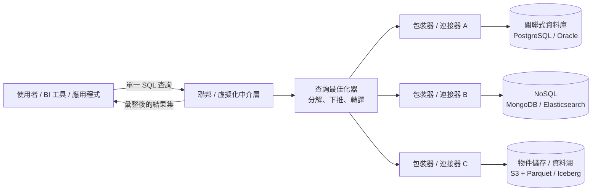

# 資料聯邦 (Data Federation)

## 摘要

資料聯邦 (Data Federation) 是一種資料管理架構手法，讓使用者可以跨越多個、異質 (heterogeneous) 的資料來源進行查詢與合併，而不需要把所有資料實際搬移或複製到單一儲存庫[^starburst]。它透過一個中介層 (middleware) 把分散的資料來源在邏輯上呈現為單一來源，讓查詢看起來像是在對一個虛擬資料庫 (virtual database) 操作[^denodo]。資料聯邦的學術根源可追溯到 1980 年代的「聯邦式資料庫系統 (Federated Database System, FDBS)」[^fdbs-wiki]。本報告說明其定義、運作原理、與相關概念的差異、優缺點、實作技術與應用場景，並對所引用的來源進行批判性反思。

---

## 1. 定義

資料聯邦是一種資料管理技術，其核心目標是讓多個資料來源「看起來像是單一來源」[^denodo]。更具體地說：

- 資料聯邦是一種架構手法，讓你跨越多個異質來源查詢並合併資料，而**不需要**把所有資料實體搬移或複製到單一儲存庫[^starburst]。
- 資料聯邦是資料虛擬化 (data virtualization) 軟體所提供的一項能力，用來「合併來自多個來源系統的結果集 (result sets)」[^dv-wiki]。
- 資料聯邦是一個中介層，連接並統一分散的資料來源，典型流程包含資料來源連線、資料虛擬化、查詢最佳化、安全與存取控制、結果彙整[^denodo]。

其學術前身「聯邦式資料庫系統 (FDBS)」被定義為一種「中介資料庫管理系統 (meta-DBMS)」，它透明地把多個**自主 (autonomous)** 的資料庫系統對映成單一的聯邦資料庫；各組成資料庫透過電腦網路互連，可能在地理上是分散的[^fdbs-wiki]。由於各組成資料庫仍維持自主性，資料聯邦是可替代「合併多個互異資料庫」這項艱鉅任務的另一種方案[^fdbs-wiki]。重點是：**資料聯邦本身並不會對各來源資料庫進行實際的資料整合 (data integration)**[^fdbs-wiki]。

---

## 2. 歷史脈絡

資料聯邦概念的學術起源是 1980 年代中期的聯邦式資料庫系統研究：

- McLeod 與 Heimbigner 在 1980 年代中期率先定義聯邦式資料庫系統[^fdbs-wiki]。
- 他們所描述的聯邦資料庫是「一組自主的元件，透過發布匯出綱要 (export schema) 與存取操作，使資料可供聯邦其他成員使用；並不存在一個涵蓋所有成員資訊的統一中央綱要」[^fdbs-wiki]。
- Sheth 與 Larson 在 1990 年發表的調查則將聯邦式資料庫定義為「一組合作、自主、且可能異質的元件系統」[^fdbs-wiki]。

值得注意的是，「企業資訊整合 (Enterprise Information Integration, EII)」與「聯邦式資料庫系統」都被部分廠商用來描述資料虛擬化的核心要素，即「在聯邦檢視 (federated VIEW) 中建立關聯式 JOIN」的能力[^dv-wiki]。這顯示「資料聯邦」與「資料虛擬化」在產業語彙上長期交疊。

---

## 3. 運作原理

### 3.1 高階流程

資料聯邦的中介層運作可拆解為下列步驟[^denodo]：

1. **資料來源連線 (Data Source Connectivity)**：與關聯式與非關聯式資料庫、雲端儲存、API 建立虛擬連線。
2. **資料虛擬化 (Data Virtualization)**：建立一個邏輯資料層，呈現資料的統一檢視。
3. **查詢最佳化 (Query Optimization)**：有效率地在各聯邦來源之間轉譯與執行使用者查詢。
4. **安全與存取控制 (Security and Access Controls)**：確保資料治理與角色為基礎的存取管理。
5. **結果彙整 (Results Aggregation)**：把整合後的查詢結果回傳給終端使用者或應用程式。

### 3.2 查詢分解與結果合成

在技術層次，聯邦式資料庫系統必須能[^fdbs-wiki]：

- 把查詢**分解 (decompose)** 成子查詢，提交給相關的組成 DBMS；
- 把各子查詢的**結果集合成 (composite)** 起來。

由於不同資料庫管理系統使用不同的查詢語言，聯邦式資料庫系統可以套用**包裝器 (wrappers)** 把子查詢轉譯成對應的查詢語言[^fdbs-wiki]。透過資料抽象 (data abstraction)，聯邦式系統能提供一致的介面，讓使用者與用戶端以**單一查詢**存取多個不相鄰、甚至異質的資料庫[^fdbs-wiki]。

### 3.3 查詢下推 (Query Pushdown)

效能關鍵之一是把運算盡量**下推 (pushdown)** 到資料來源端執行，而非全部拉到中介層處理。資料虛擬化的好處之一即「允許查詢處理被下推到資料來源，而非在中介層執行」[^dv-wiki]。以 PostgreSQL 的 `postgres_fdw` 為例，它會嘗試把 `WHERE` 子句送到遠端伺服器執行，並避免抓取查詢不需要的欄位，以降低資料傳輸量；當遇到同一遠端伺服器上多個外部表之間的 JOIN 時，還會把整個 JOIN 送到遠端執行[^pgfdw]。

Azure Databricks 的 Lakehouse Federation 也把「自動查詢下推 (automatic query pushdown)」列為核心特性：查詢會透過 JDBC 下推到外部資料庫，同時在 Databricks 與遠端運算上執行[^databricks]。

### 3.4 三步驟機制

另一種常見的簡化描述把聯邦資料系統的運作歸納為三步[^fivetran]：

1. **查詢轉譯 (Query Translation)**：使用者提交查詢時，聯邦引擎把它分解成針對各相關來源系統的子查詢。
2. **查詢處理 (Query Processing)**：引擎把子查詢送到各來源，由各來源獨立處理。
3. **資料組裝 (Data Assembly)**：收集結果後，引擎調和綱要與資料型別的差異，並把一切組裝成單一回應。

整個過程即時發生，使用者只看到一個結果集，但背後聯邦層正在協調整條技術堆疊的資訊。該層同時維護各來源的中介資料，包含綱要定義、資料型別與存取模式，並理解如何在系統之間轉譯這些資訊[^fivetran]。

### 3.5 架構示意圖

---

## 4. 三個關鍵維度：分散、異質、自主

聯邦式資料庫系統被歸類為多重資料庫系統 (MDBS) 的一種，可沿三個維度刻畫：**分散 (Distribution)**、**異質 (Heterogeneity)**、**自主 (Autonomy)**[^fdbs-wiki]。

### 4.1 分散 (Distribution)

資料分散是多個資料庫在建立聯邦之前就已存在所造成的。資料可能分布在單一電腦或多台電腦上，這些電腦可能位於不同地理位置但透過網路互連。資料分散的好處包括提升可用性、可靠性以及改善存取時間[^fdbs-wiki]。

### 4.2 異質 (Heterogeneity)

異質性來自結構、資料語意、支援的約束條件或查詢語言等差異。語意異質 (semantic heterogeneity) 出現在對資料的意義、解讀或預期用途存在分歧時，其分類包括[^fdbs-wiki]：

- **命名衝突**：不同資料庫用不同名稱表示同一概念。
- **值域衝突／資料表示衝突**：用不同值表示同一概念。
- **精度衝突**：同一資料值來自不同基數 (cardinality) 的值域。
- **中介資料衝突**：同一概念分別在綱要層與實例層被表示。
- **資料衝突**：例如缺少屬性。
- **綱要衝突**：例如表對表的衝突，包含命名衝突、資料衝突等。

### 4.3 自主 (Autonomy)

自主性是區分聯邦式與非聯邦式多重資料庫系統的關鍵。文獻列出四種自主性[^fdbs-wiki]：

| 自主性類型 | 說明 |
|---|---|
| 設計自主 (Design Autonomy) | 有能力獨立選擇其設計，不受資料、查詢語言或概念化、系統實作功能影響。 |
| 通訊自主 (Communication Autonomy) | 決定是否與其他 DBMS 通訊。 |
| 執行自主 (Execution Autonomy) | 由元件 DBMS 控制本地與外部請求的操作。 |
| 關聯自主 (Association Autonomy) | 有能力退出聯邦，使 FDBS 可不依賴任何單一 DBS 運作。 |

### 4.4 緊耦合與鬆耦合

聯邦架構依與元件資料庫系統的整合程度及聯邦所提供的服務範圍而不同，可分為[^fdbs-wiki]：

- **鬆耦合 (Loosely Coupled)**：元件資料庫需自行建構聯邦綱要；使用者通常以多資料庫語言 (multidatabase language) 存取其他元件，因此喪失位置透明性 (location transparency)，需直接了解聯邦綱要。使用者自行匯入所需資料並整合成聯邦綱要。
- **緊耦合 (Tightly Coupled)**：元件系統使用獨立程序來建構並公布一個整合的聯邦綱要。

### 4.5 五層綱要架構

標準的三層架構 (概念、內部、外部綱要) 不足以描述 FDBS，因此被擴充為五層，以容納分散、自主與異質三個維度[^fdbs-wiki]：

1. **本地綱要 (Local Schema)**：元件資料庫以原生資料模型表達的概念模型。
2. **元件綱要 (Component Schema)**：本地綱要中擁有者組織願意分享的子集，被轉譯成共同資料模型。
3. **匯出綱要 (Export Schema)**：元件綱要中可供特定聯邦使用的子集，可包含存取控制資訊。
4. **聯邦綱要 (Federated Schema)**：多個匯出綱要的整合，包含整合時產生的資料分布資訊。
5. **外部綱要 (External Schema)**：從聯邦綱要萃取，為特定聯邦的使用者／應用程式定義。

### 4.6 綱要對映：GaV 與 LaV

在非由上而下規劃的系統中，一個普遍問題是如何匹配不同綱要中「語意等價但名稱不同」的部件。若對 n 個屬性做兩兩對映，會產生 n(n−1)/2 條對映規則，實務上很快變得不可行。常見解法是提供一個包含所有成員綱要相關部件的**全域綱要 (global schema)**，並以資料庫檢視 (views) 的形式提供對映。兩種主要方向為[^fdbs-wiki]：

- **Global as View (GaV)**：全域綱要以底層綱要來定義。
- **Local as View (LaV)**：本地綱要以全域綱要來定義。

兩者都屬於資料整合中的**綱要匹配 (schema matching)** 問題[^fdbs-wiki]。

---

## 5. 與相關概念的差異

### 5.1 資料聯邦 vs 資料虛擬化

廠商文件指出：資料聯邦是一種技術或能力，建立跨異質來源的統一虛擬檢視，讓查詢不需實際搬移資料；而**資料虛擬化是更廣的概念**，除聯邦外還涵蓋中介資料管理 (metadata management)、資料抽象、安全等服務，提供一個把應用程式與資料來源隔離的完整層[^starburst]。換言之，**資料聯邦是資料虛擬化的一個組成部分，聚焦於為查詢而整合資料**[^starburst]。

另一種表述是：資料虛擬化是一套軟體能力，包含抽象、虛擬化資料存取、資料轉換、**資料聯邦**與資料交付等，其中資料聯邦負責「合併跨多個來源系統的結果集」[^dv-wiki]。

### 5.2 資料聯邦 vs ETL

傳統 ETL (Extract, Transform, Load) 會把資料抽取、轉換後載入到集中的資料倉儲。資料虛擬化／聯邦則相反：**資料留在原處 (data remains in place)**，並對來源系統提供即時存取[^dv-wiki]。這可降低資料錯誤風險、避免搬移可能永遠不會被使用的資料，且不試圖對資料強加單一資料模型[^dv-wiki]。資料虛擬化也可被視為 ETL 與資料倉儲的替代方案，但基於效能考量，並不建議用於非常大的資料倉儲[^dv-wiki]。

### 5.3 與資料倉儲、資料湖的互補關係

企業環境常充斥多個資料倉儲、資料超市 (data mart) 與資料湖。資料虛擬化能有效率地在這些系統之間搭橋，而不需另建一個全新的實體整合平台；既有資料基礎設施可繼續執行其核心功能，虛擬化層只是取其資料來用[^dv-wiki]。

### 5.4 概念比較表

| 概念 | 資料是否搬移 | 主要目的 | 與資料聯邦的關係 |
|---|---|---|---|
| 資料聯邦 | 否（留在原處） | 跨來源查詢與結果合併 | 本體 |
| 資料虛擬化 | 否 | 抽象、治理、安全的完整隔離層 | 聯邦是其子能力[^starburst][^dv-wiki] |
| ETL / 資料倉儲 | 是（複製到中央） | 集中儲存、歷史快照 | 互補或替代[^dv-wiki] |
| 資料湖 | 是（集中存放原始資料） | 大量原始資料儲存 | 可作為聯邦來源之一[^starburst] |

Fivetran 另提供一份三方比較，指出資料聯邦與資料虛擬化皆**不搬移資料**、且**永遠是最新的 (always current)**，而資料倉儲則需完整複製 (ETL/ELT)，且新鮮度取決於同步頻率[^fivetran]：

| 面向 | 資料聯邦 | 資料虛擬化 | 資料倉儲 |
|---|---|---|---|
| 資料搬移 | 無 | 無 | 完整複製 (ETL/ELT) |
| 查詢速度 | 取決於來源系統 | 取決於來源系統 | 為分析最佳化 |
| 最適用於 | 即時營運查詢 | 廣泛的虛擬存取層 | 大量歷史分析 |
| 資料新鮮度 | 永遠最新 | 永遠最新 | 取決於同步頻率 |
| 設定複雜度 | 中 | 中至高 | 高 |

此比較表來源為 Fivetran，該公司主業為 ETL/ELT 資料搬移工具（自稱 700 多個連接器），其內容雖坦承聯邦與倉儲應並行使用，但結論仍導向其自家產品，閱讀時需留意其商業立場[^fivetran]。

---

## 6. 優點

資料聯邦被歸納出以下商業與技術優點[^denodo][^starburst]：

- **即時資料存取**：不需 ETL 即可隨需取得資料[^denodo]。
- **成本效益**：消除資料重複與儲存基礎設施，降低儲存成本[^denodo][^starburst]。
- **資料一致性**：跨多系統提供單一真實來源 (single source of truth)[^denodo]。
- **更快決策**：即時取得整合後的資料集，改善決策準確度[^denodo][^starburst]。
- **安全與合規**：資料留在原始儲存位置，降低合規風險；避免建立含個人資訊的新資料庫，有利於遵循隱私法規[^denodo][^dv-wiki]。
- **降低資料錯誤風險、提升即時存取速度**：因為不需搬移資料[^dv-wiki]。
- **宣告式 (declarative) 方法**：使用者只需描述想要的結果，軟體自動產生必要步驟；需求改變時只需更新描述。此彈性可將流程加速最多達五倍[^dv-wiki]。

Fivetran 另補充以下效益[^fivetran]：

- **即時資料存取**：分析師可查詢線上生產資料，不需等待批次載入。
- **降低儲存成本**：不需把資料複製到第二個系統，降低基礎設施負載與成本。
- **更快的洞察時間**：不需等待資料傳輸與最佳化，簡單查詢數秒內回傳。
- **簡化合規**：敏感資料留在來源系統，受既有存取控制治理；聯邦資料治理不需為副本另建權限層，較易滿足駐留與隱私要求。
- **更容易加入新來源**：把新的 SaaS 工具或資料庫加入聯邦層變成設定任務而非遷移專案。

---

## 7. 挑戰與缺點

### 7.1 效能與延遲

- 執行分散式查詢可能影響回應時間[^denodo]。
- 即時整合可能因資料來源而引入延遲[^denodo]。
- 最佳化跨多系統的複雜查詢是顯著的障礙，需要仔細調校[^starburst]。
- 可能影響營運系統的回應時間，尤其在資源不足或未及早調校時[^dv-wiki]。

### 7.2 連線可用性

由於沒有資料的本地副本，所有必要資料來源的連線都必須處於可用狀態，這是此方法的主要缺點之一。在複雜系統中，連線問題更常發生。「智慧型資料緩衝 (smart data buffering)」例如在虛擬化系統緩衝區保留最近幾次請求的資料，有助於緩解此問題[^dv-wiki]。

### 7.3 安全與治理

資料虛擬化解決方案可能使用大量網路連線讀取原始資料，並透過網路把虛擬化表提供給其他解決方案，因此系統安全需要比傳統資料湖更多的考量。在傳統資料湖中，資料可依特定程序在單一環境匯入；使用虛擬化系統時，環境必須分別與每個通常位於不同環境的資料來源建立安全連線[^dv-wiki]。此外，跨多系統管理存取政策相當複雜[^denodo]，且異質環境的授權協定與多樣化的資料治理政策都需要縝密規劃與持續管理[^starburst]。

### 7.4 其他限制

- 資料虛擬化**不強加**異質資料模型，因此除非結合資料聯邦與對資料的商業理解，否則使用者必須自行解讀資料[^dv-wiki]。
- 不適合記錄資料的歷史快照，資料倉儲較適合[^dv-wiki]。
- 變更管理是巨大負擔，因為任何變更都需被所有共用同一虛擬化套件的應用程式與使用者接受[^dv-wiki]。
- 不建議用於：存取營運資料系統、聯邦化或集中化組織所有資料、建構非常大的虛擬資料倉儲、作為 ETL 程序、或只有一兩個資料來源時[^dv-wiki]。

### 7.5 併發控制

異質性與自主性對併發控制 (concurrency control) 造成特殊挑戰，這對正確執行並行交易至關重要。在這些要求下達成全域可序列化 (global serializability) 這個主要正確性準則，被形容為非常困難且尚未解決[^fdbs-wiki]。

### 7.6 其他實務挑戰

另一份業界指南補充了以下挑戰[^fivetran]：

- **效能延遲**：聯邦查詢的速度取決於最慢的來源。例如要把雲端資料倉儲與地端舊版 Oracle 資料庫的資料合併檢視時，Oracle 端會拖慢整體速度。
- **資料品質與一致性**：由於查詢直接檢視來源系統資料，若來源有重複、空值或其他不一致，也會出現在聯邦層。
- **複雜的查詢最佳化**：撰寫高效查詢需理解每個系統的效能特性，需要團隊的專業知識。
- **治理複雜度**：每個來源系統有各自的存取控制、稽核日誌與安全政策；對多個系統而非單一集中來源施加治理要困難得多。
- **綱要漂移 (Schema Drift)**：需監控並適應數十個來源，營運負擔可能超出預期。

該來源也強調，對多數公司而言，聯邦與資料倉儲最好並行使用：**聯邦處理即時營運查詢，倉儲處理較重的分析工作**[^fivetran]。

---

## 8. 實作技術與產品

### 8.1 開源查詢引擎

**Trino** 是常見的聯邦查詢引擎。Trino 是為使用分散式查詢有效率地查詢海量資料而設計的工具，並非通用關聯式資料庫，也非為線上交易處理 (OLTP) 設計，而是鎖定資料倉儲與分析 (OLAP) 工作負載[^trino]。Starburst 的文件說明明確指出，Trino 的 SQL 查詢引擎使用連接器同時與多個資料來源通訊，視需要處理並 JOIN 來自互異來源的資料以完成查詢[^starburst]。Starburst 的連接器生態系包含 50 多個連接器，可連接雲端與地端來源，涵蓋 NoSQL 儲存（如 Elasticsearch、MongoDB）、關聯式資料庫（如 PostgreSQL），以及支援 Iceberg、Delta Lake 等表格式的資料湖分析[^starburst]。

**Apache Drill** 是為大規模資料集（含結構化與半結構化／巢狀資料）設計的低延遲分散式查詢引擎，靈感來自 Google 的 Dremel，設計目標是擴展到數千個節點並以互動速度查詢 PB 級資料[^drill]。Drill 可作為檔案、物件儲存與 NoSQL 資料庫之上的查詢層，透過「儲存外掛 (storage plugins)」抽象與各資料來源互動；這些外掛提供來源中的中介資料、讀寫介面、資料位置，以及針對特定來源最佳化查詢執行的規則[^drill]。Drill 的特色包括：去中心化中介資料，使用者不需在單一中介資料庫中建表或檢視，即可跨多個 Hive 儲存庫查詢並與 HBase 表或分散式檔案系統中的檔案資料結合[^drill]。

### 8.2 關聯式資料庫內建聯邦能力

**Microsoft SQL Server 的 PolyBase** 為 SQL Server 啟用資料虛擬化。它讓 SQL Server 執行個體能以 T-SQL 直接查詢 SQL Server、Oracle、Teradata、MongoDB、Hadoop 叢集、Cosmos DB 與 S3 相容物件儲存中的資料，無需另行安裝用戶端連線軟體，也可使用通用 ODBC 連接器連接更多提供者[^polybase]。PolyBase 允許 T-SQL 查詢把外部來源的資料與 SQL Server 實例中的關聯式表做 JOIN[^polybase]。其關鍵使用情境正是讓資料留在原始位置與格式，透過 SQL Server 實例把外部資料虛擬化，使其能像原生表一樣就地查詢，藉此最小化 ETL 的資料搬移需求[^polybase]。

PolyBase 的連接器涵蓋 Oracle、MongoDB、Teradata、通用 ODBC、Azure Storage、Hadoop、SQL Server 與 S3 相容物件儲存；支援查詢 CSV、Parquet、JSON、Delta Lake 等檔案格式[^polybase]。SQL Server 2022 起，S3 相容物件儲存連接器、Azure Blob Storage 等已不再依賴 PolyBase 服務，但仍需安裝 PolyBase 功能；連接 Oracle、Teradata、MongoDB 與通用 ODBC 仍需 PolyBase 服務運行[^polybase]。

**PostgreSQL 的 `postgres_fdw`** 是 foreign-data wrapper，用於存取儲存在外部 PostgreSQL 伺服器上的資料。使用時需建立外部伺服器物件 (CREATE SERVER)、使用者對映 (CREATE USER MAPPING) 與外部表 (CREATE FOREIGN TABLE)，之後即可用 `SELECT` 存取遠端表，也可用 `INSERT`、`UPDATE`、`DELETE`、`COPY`、`TRUNCATE` 修改遠端表[^pgfdw]。

### 8.3 雲端與資料平台

**Azure Databricks 的 Lakehouse Federation** 提供透過 Unity Catalog 外部目錄 (foreign catalogs) 的受治理、唯讀存取，具備自動查詢下推與表層級的細緻存取控制。它分為兩種[^databricks]：

| 類型 | 查詢路徑 | 適用情境 | 寫入支援 |
|---|---|---|---|
| 查詢聯邦 (Query Federation) | 透過 JDBC 下推到外部資料庫，同時在 Databricks 與遠端運算執行 | 臨時報表、BI、對營運資料庫的概念驗證存取 | 不支援（唯讀）[^databricks] |
| 目錄聯邦 (Catalog Federation) | 直接在物件儲存上以 Databricks 運算執行，不經遠端運算 | 逐步遷移至 Unity Catalog，或維持長期混合模式 | 不支援（唯讀）[^databricks] |

查詢聯邦支援 MySQL、PostgreSQL、Teradata、Oracle、Amazon Redshift、Salesforce Data 360、Snowflake、Microsoft SQL Server、Azure Synapse、Google BigQuery、Databricks；目錄聯邦支援 Hive metastore、Salesforce Data 360、Snowflake、Palantir Foundry、Workday Data Connect、OneLake[^databricks]。當來源同時支援 Lakehouse Federation 與 Lakeflow Connect 時，若重視較大資料量的效能與較低延遲，Azure Databricks 建議使用 Lakeflow Connect[^databricks]。

**Amazon Athena** 透過資料來源連接器 (data source connectors) 支援聯邦查詢。使用者建立儲存連接資訊的 AWS Glue 連線，並為資料來源命名以在 SQL 查詢中引用；可透過主控台或 `CreateDataCatalog` API 建立與設定[^athena]。Athena 亦支援跨帳號的聯邦查詢 (cross-account federated queries)[^athena]。

### 8.4 商業資料虛擬化平台

**Denodo Platform** 以資料虛擬化引擎為核心，執行資料聯邦，使兩個或多個資料來源能呈現並表現得像單一統一來源[^denodo]。**TIBCO** 的資料虛擬化工具被 Novartis 採用，讓研究人員能快速把內外部來源的資料組合成可搜尋的虛擬資料存放區[^dv-wiki]。其他列名的資料虛擬化解決方案與廠商包括 IBM Data Virtualization、Data Virtuality、Delphix、Teiid（JBoss 生態系）、Red Hat JBoss Data Virtualization（已停產）等[^dv-wiki]。更完整的清單與使用者排名由 Gartner 彙編[^dv-wiki]。

### 8.5 關鍵元件

資料聯邦的關鍵元件包括[^denodo]：

- **資料虛擬化引擎 (Data Virtualization Engine)**：提供即時資料存取的抽象。
- **中介資料管理 (Metadata Management)**：維護綱要對映、關聯與業務定義。
- **查詢最佳化器 (Query Optimizer)**：透過智慧地分配查詢來提升效能。
- **安全與合規框架 (Security and Compliance Framework)**：提供驗證、授權與加密。
- **與 BI 及分析工具的整合**：支援視覺化與報表的資料取得。

---

## 9. 應用場景

### 9.1 通用應用場景

資料聯邦的典型應用包括[^denodo]：

- **商業智慧與報表 (Business Intelligence & Reporting)**：不需複製資料即可進行跨來源分析。
- **多雲資料整合 (Multi-Cloud Data Integration)**：存取並分析來自多個雲端供應商的資料。
- **醫療資料管理 (Healthcare Data Management)**：統一不同醫院系統間的病患紀錄。
- **金融服務 (Financial Services)**：彙整多家金融機構的資料以進行風險評估。
- **零售與電子商務 (Retail and E-Commerce)**：整合不同平台上的顧客與銷售資料。

Fivetran 補充的具體案例包括[^fivetran]：

- **商業智慧**：BI 團隊過去需資料工程師先建管線才能做跨平台儀表板；聯邦可讓 BI 團隊直接對 CRM、網頁分析與產品資料下查詢，數秒內取得合併結果，進行臨時報表。此方式適合輕量、即時儀表板，較重的分析工作仍可能需資料倉儲。
- **資料科學**：資料科學家常需從支援日誌、產品活動、帳務紀錄等多來源取資料，過去需向多個團隊提出請求等待回覆；聯邦在單一環境提供這些資訊，加速早期探索與特徵測試階段。
- **法規申報**：合規團隊常需彙整來自不同國家資料庫的報表，但資料駐留 (data residency) 法規可能使把資料複製到單一倉儲變成違法；聯邦可跨區域查詢而資料不離開其所在司法管轄區。
- **顧客 360 檢視 (Customer 360)**：銷售與支援團隊需要完整的顧客檢視，但資訊通常分散於三、四個系統；聯邦提供隨需的統一檢視，讓代表以單一查詢取得顧客完整歷程。
- **併購 (Mergers and Acquisitions)**：兩家公司合併時資料系統很少對齊，完整遷移專案可能耗時近一年；聯邦可立即提供雙方系統的檢視，讓銷售與財務先用共享資料運作，資料工程師則在背後進行較長期的整合。

### 9.2 使用者角色

誰會使用資料聯邦[^starburst]：

- **資料管理者**（資料工程師、資料架構師）：建立目錄 (catalogs) 以連接組織的資料來源。
- **資料消費者**（資料科學家、資料分析師）：撰寫查詢以跨來源聯邦資料。

---

## 10. 未來趨勢

資料聯邦的未來趨勢被歸納為[^denodo]：

- **AI 驅動的資料整合**：用 AI 最佳化查詢執行與資料對映。
- **邊緣資料聯邦 (Edge Data Federation)**：把聯邦存取延伸到邊緣運算環境。
- **聯邦學習與 AI 模型**：強化在分散式資料來源上進行隱私保護的 AI 訓練。
- **區塊鏈用於資料信任**：以去中心化帳本保護聯邦資料交易。
- **混合與多雲聯邦**：在地端與雲端環境間實現無縫整合。

---

## 11. 來源批判性反思

本報告的事實來自多種來源，其性質與立場各異，使用時需留意：

1. **維基百科（聯邦式資料庫系統、資料虛擬化）**：提供扎實的學術定義與歷史脈絡，且引用了 McLeod & Heimbigner (1985) 與 Sheth & Larson (1990) 等原始文獻，適合用來建立概念基礎。然而，聯邦式資料庫系統條目本身標註「需要更多引用」(needs more citations)，部分段落缺乏來源；資料虛擬化條目則有多處 `[citation needed]` 與 `[dubious]` 標記（例如「降低資料錯誤風險」「減少系統負載」被標為可疑）。因此引用這些條目時，應區分「有引用支撐的定義」與「未經證實的效益宣稱」。

2. **廠商文件（Starburst、Denodo、Fivetran、Microsoft、Databricks、AWS）**：這些來源對技術運作方式的描述具體且專業，但本質上帶有行銷目的。Starburst 與 Denodo 的頁面同時是產品推廣內容（例如強調自家連接器數量、引導試用），因此其「效益」陳述應視為廠商主張而非中立事實。Fivetran 的立場更為特殊：該公司主業是 ETL/ELT 資料搬移（資料倉儲陣營），其頁面雖承認聯邦的價值，卻以「聯邦處理即時營運查詢、倉儲處理重分析」的二分法，最終導向其自家搬移與轉換產品，屬於利益衝突明顯的來源。Microsoft、PostgreSQL、Trino、Apache Drill 的官方文件偏技術規格，可信度較高，但其涵蓋範圍限於自家產品。

3. **概念定義的分歧**：不同來源對「資料聯邦」與「資料虛擬化」的從屬關係描述並不一致。維基百科把資料聯邦列為資料虛擬化的一項功能[^dv-wiki]；Starburst 也採相同立場[^starburst]；但 Denodo 則把兩者並列為不同層次的術語。這反映產業語彙尚未標準化，讀者應注意語境。

4. **時效性**：部分來源較舊（Starburst 頁面為 2023 年、維基百科的資料虛擬化條目引用多為 2013 年前後），而雲端平台文件（Databricks、Microsoft、PostgreSQL）則持續更新至 2026 年。涉及產品功能時，應以官方最新文件為準。

5. **未涵蓋面向**：本報告未深入探討聯邦學習 (federated learning) 這類「資料不移動、模型移動」的相關但不同技術，也未深入各產品的效能基準比較。這些是後續可再研究的方向。

---

## 參考文獻

[^fdbs-wiki]: Wikipedia. (2026). Federated database system. Retrieved 2026-11-22, from https://en.wikipedia.org/wiki/Federated_database_system

[^dv-wiki]: Wikipedia. (2026). Data virtualization. Retrieved 2026-11-22, from https://en.wikipedia.org/wiki/Data_virtualization

[^starburst]: Smith, E., & Rosas, E. (2023, August 3). How does data federation work? Starburst Data. Retrieved 2026-11-22, from https://www.starburst.io/blog/how-does-data-federation-work/

[^denodo]: Denodo. (n.d.). Data federation: Definition, importance, and best practices. Retrieved 2026-11-22, from https://www.denodo.com/en/data-virtualization/data-federation

[^polybase]: Microsoft. (2026, September 21). PolyBase overview for SQL Server. Microsoft Learn. Retrieved 2026-11-22, from https://learn.microsoft.com/en-us/sql/relational-databases/polybase/polybase-guide

[^databricks]: Microsoft. (2026, November 12). Connect to external databases and catalogs. Microsoft Learn. Retrieved 2026-11-22, from https://learn.microsoft.com/en-us/azure/databricks/query-federation/

[^trino]: Trino. (2026). Use cases. Trino Documentation. Retrieved 2026-11-22, from https://trino.io/docs/current/overview/use-cases.html

[^pgfdw]: The PostgreSQL Global Development Group. (2026). postgres_fdw — access data stored in external PostgreSQL servers. PostgreSQL Documentation. Retrieved 2026-11-22, from https://www.postgresql.org/docs/current/postgres-fdw.html

[^athena]: Amazon Web Services. (2026). Create a data source connection. Amazon Athena User Guide. Retrieved 2026-11-22, from https://docs.aws.amazon.com/athena/latest/ug/connect-to-a-data-source.html

[^fivetran]: Fivetran. (2026, March 2). What is data federation? Architecture and use cases. Retrieved 2026-11-22, from https://www.fivetran.com/learn/data-federation

[^drill]: The Apache Software Foundation. (2026). Architecture. Apache Drill. Retrieved 2026-11-22, from https://drill.apache.org/architecture/
