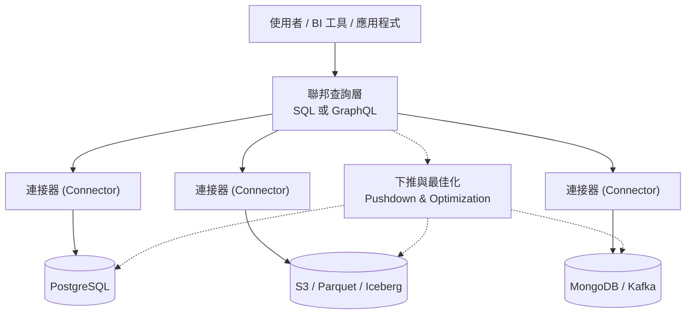
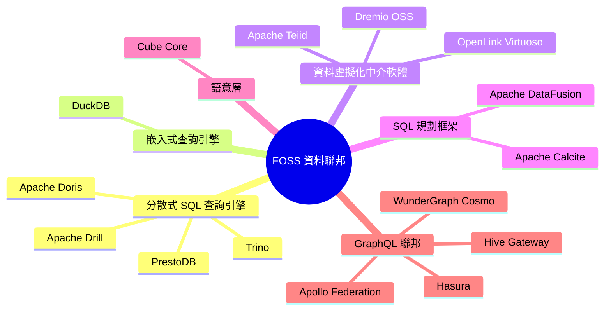
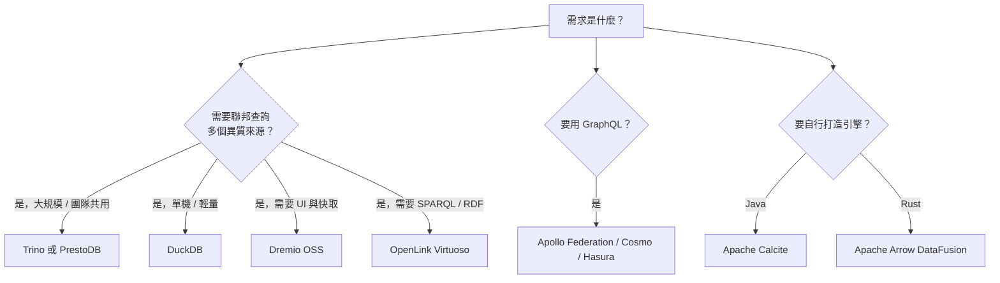

# 資料聯邦 (Data Federation) 的自由開源軟體 (FOSS) 解決方案調查

## 摘要

本報告調查「資料聯邦 (data federation)」領域可用的自由開源軟體 (FOSS, Free and Open-Source Software) 解決方案。資料聯邦指的是一種能力：讓使用者以單一查詢介面 (通常是 SQL 或 GraphQL) 存取、查詢與合併多個異質 (heterogeneous) 資料來源，而不需要事先把資料實體集中搬移 (ETL) 到同一個儲存庫[^def]。

本報告將可用方案分為六大類：(1) 分散式 SQL 查詢引擎、(2) 嵌入式查詢引擎、(3) 資料虛擬化中介軟體、(4) SQL 查詢規劃框架、(5) 語意層 (semantic layer) 與 (6) GraphQL 聯邦，並逐一列出授權條款、GitHub 儲存庫、星號數與最新版本。

---

## 一、背景：資料聯邦與資料虛擬化的區別

**資料聯邦 (Data Federation)** 通常指「查詢當下才把多個來源的結果合併」的技術，也常被稱為「聯邦查詢 (federated query)」。其核心價值是**免除實體資料搬移**，讓資料留在原處 (data stays in place)，由查詢引擎負責下推 (pushdown)、合併 (join) 與聚合 (aggregation)[^federation-def]。

**資料虛擬化 (Data Virtualization)** 是資料聯邦的超集合概念，除了聯邦查詢外，還包含語意層、快取、資料治理、權限控制與統一的資料目錄 (catalog)[^dv-def]。本報告同時涵蓋這兩者。

上圖說明聯邦查詢引擎的典型運作方式：使用者送出單一查詢，引擎透過連接器把查詢片段下推到各來源執行，再把結果合併回傳[^arch]。

---

## 二、方案分類總覽

---

## 三、分散式 SQL 查詢引擎

這類工具是資料聯邦最主流、最成熟的路線。它們以「連接器 (connector)」外掛架構支援數十種資料來源，並以分散式 MPP (Massively Parallel Processing) 架構提供高效能查詢。

### 3.1 Trino

| 項目 | 內容 |
| --- | --- |
| 授權 | Apache-2.0 |
| 儲存庫 | https://github.com/trinodb/trino |
| 星號數 | 約 13.5k |
| 最新版本 | Trino 484 (2026-10-16) |
| 語言 | Java |

Trino (舊名 PrestoSQL) 是專為資料聯邦與大數據分析設計的分散式 SQL 查詢引擎，可在單一 SQL 介面下聯邦查詢 Hive、Iceberg、Delta Lake、MySQL、PostgreSQL、Kafka、MongoDB、Cassandra、Elasticsearch 等數十種來源[^trino]。它擁有連接器架構與成本導向最佳化器 (cost-based optimizer)，被視為互動式異質資料查詢的事實標準。Trino 亦是 2019 年由 Presto 分叉 (fork) 而來[^trino-fork]。

### 3.2 Presto (PrestoDB)

| 項目 | 內容 |
| --- | --- |
| 授權 | Apache-2.0 |
| 儲存庫 | https://github.com/prestodb/presto |
| 星號數 | 約 16.8k |
| 最新版本 | Presto 0.300 (2026-11-04) |
| 語言 | Java |

Presto 是最初在 Meta (Facebook) 開發、現由 Linux Foundation 治理的原始分散式 SQL 查詢引擎[^presto]。它支援 Hive、Iceberg、Delta Lake、MySQL、PostgreSQL、Elasticsearch、MongoDB 等來源，並具有以 Velox 為基礎的 C++ 原生執行引擎以提升效能[^presto-velox]。PrestoDB 與 Trino 系出同源，PrestoDB 採「大帳篷 (big tent)」治理模式，Trino 則為治理較集中的活躍分叉[^trino-vs-presto]。

### 3.3 Apache Drill

| 項目 | 內容 |
| --- | --- |
| 授權 | Apache-2.0 |
| 儲存庫 | https://github.com/apache/drill |
| 星號數 | 約 2.0k |
| 最新版本 | 1.22.0 (2024-06-29) |
| 語言 | Java |

Drill 是受 Google Dremel 啟發的分散式 MPP 查詢引擎，最大特色是**無結構描述 (schema-free) 查詢**，可直接查詢自描述資料 (JSON、Parquet、NoSQL) 而不需結構定義或 ETL[^drill]。它支援 HDFS、S3、HBase、MongoDB、Kafka 與透過 JDBC 的關聯式資料庫。需注意其開發活動已明顯趨緩 (最後一次發行為 2024 年 6 月)，選型時應評估維護風險[^drill-slow]。

### 3.4 Apache Doris

| 項目 | 內容 |
| --- | --- |
| 授權 | Apache-2.0 |
| 儲存庫 | https://github.com/apache/doris |
| 星號數 | 約 16.3k |
| 最新版本 | 持續發行中 |

Doris 是即時分析資料庫，具備湖倉查詢加速與多目錄 (multi-catalog) 聯邦能力，可跨越 Iceberg、Hudi、Delta Lake 與外部資料庫進行查詢[^doris]。雖然它本質上是儲存引擎，但其多目錄功能使其同樣具備聯邦查詢能力。

---

## 四、嵌入式查詢引擎：DuckDB

| 項目 | 內容 |
| --- | --- |
| 授權 | MIT |
| 儲存庫 | https://github.com/duckdb/duckdb |
| 星號數 | 約 43.3k |
| 最新版本 | v2.0.1 (2026-11-20) |
| 語言 | C++ |

DuckDB 是高效能的**嵌入式**分析型 (OLAP) 資料庫，雖然主要定位為行程內 (in-process) 引擎，但具備極佳的資料聯邦能力[^duckdb]。它可透過 `ATTACH` 指令與 `postgres_scanner`、`mysql_scanner`、`sqlite_scanner` 等擴充套件，以零複製 (zero-copy) 方式就地查詢 PostgreSQL、MySQL 與 SQLite，並能直接讀取本機或遠端 (S3、HTTP、Azure、GCS) 的 CSV、Parquet、JSON、Excel、Iceberg 與 Delta Lake 檔案[^duckdb-attach]。其「無需管理伺服器」的簡潔性，加上豐富的 SQL 方言，使其成為獨樹一格的輕量聯邦工具。

---

## 五、資料虛擬化中介軟體

### 5.1 Apache Teiid

| 項目 | 內容 |
| --- | --- |
| 授權 | Apache-2.0 |
| 儲存庫 | https://github.com/teiid/teiid |
| 星號數 | 約 320 |
| 最新版本 | 16.0.0 (2020-12-28) |
| 語言 | Java |

Teiid 是源自 JBoss (Red Hat) 的成熟資料虛擬化系統，可讓應用程式把多個異質資料存放區視為單一資料庫使用，支援 JDBC、REST、Salesforce、檔案等異質來源，並提供 SQL/OData/REST 統一介面、查詢最佳化器與實體化檢視 (materialized view)。其虛擬資料庫 (VDB) 概念可抽象並組合多來源資料[^teiid]。其 Teiid WildFly 發行版以 JBoss WildFly 應用程式伺服器子系統形式提供 JEE 交易管理、連線池與安全機制，亦可部署於 OpenShift、Spring Boot 或內嵌 Java[^teiid-wildfly]。然而其**開發已實質停止**，最後一版 16.0.0 發行於 2020 年 12 月 28 日 (基於 WildFly 19.1.0)，已逾 5 年未發行新版，專案處於實質終止 (end-of-life) 狀態，選型上僅具歷史意義[^teiid-stale]。此專案星號數雖低 (約 320)，但因其在此領域的歷史地位仍予收錄，並提醒讀者注意維護狀態。

### 5.2 Dremio (Community Edition / OSS)

| 項目 | 內容 |
| --- | --- |
| 授權 | Apache-2.0 |
| 儲存庫 | https://github.com/dremio/dremio-oss |
| 星號數 | 約 1.5k |
| 語言 | Java |

Dremio 是資料湖倉引擎，提供跨資料湖 (S3、HDFS、ADLS) 與關聯式資料庫的 SQL 查詢聯邦。其特色包含**資料反射 (data reflections)** (自動實體化檢視/快取以加速查詢)、Apache Arrow Flight 高效資料傳輸，以及資料目錄與治理的使用者介面[^dremio]。其商業版本另提供 LDAP/AD 驗證、RBAC、工作負載管理 (WLM) 等企業功能。需注意 OSS 版本建置流程複雜，且在 GitHub 上的活動近期較少[^dremio-build]。

### 5.3 OpenLink Virtuoso (Open Source Edition)

| 項目 | 內容 |
| --- | --- |
| 授權 | GPL-2.0 |
| 儲存庫 | https://github.com/openlink/virtuoso-opensource |
| 星號數 | 約 980 |
| 最新版本 | v7.2.17 (2026-05-07) |
| 語言 | C |

Virtuoso 是**多模型 (multi-model)** 軟體，在單一執行檔中同時提供關聯式資料庫、RDF 圖形資料庫、資料整合中介軟體與 HTTP 應用程式伺服器[^virtuoso]。其資料聯邦能力包含以 ODBC/JDBC 連接並查詢異質 SQL 資料庫、SPARQL 聯邦 (查詢多個 SPARQL 端點)，以及內建的 Linked Data 部署能力。此專案已維護超過 20 年，由 OpenLink Software 持續維護，商業版本另提供企業級連接器與支援[^virtuoso-20y]。需注意 GPL-2.0 授權對商業整合可能有傳染性 (copyleft) 的影響。

---

## 六、SQL 查詢規劃框架

### 6.1 Apache Calcite

| 項目 | 內容 |
| --- | --- |
| 授權 | Apache-2.0 |
| 儲存庫 | https://github.com/apache/calcite |
| 星號數 | 約 5.2k |
| 最新版本 | 1.42.0 (2026-05-31) |
| 語言 | Java |

Calcite 並非獨立的資料聯邦引擎，而是**許多引擎的共同基礎**：它提供 SQL 解析器、驗證器與可插拔規則的成本導向最佳化器，並內建 Cassandra、Druid、Elasticsearch、MongoDB、Kafka、Redis、Splunk 等轉接器 (adapter)[^calcite]。Drill、Hive、Flink、Kylin、Samza 等專案都在內部使用 Calcite 進行 SQL 解析與最佳化，因此 Calcite 是「SQL 與多後端之間的標準中介層」[^calcite-users]。

### 6.2 Apache Arrow DataFusion

| 項目 | 內容 |
| --- | --- |
| 授權 | Apache-2.0 |
| 儲存庫 | https://github.com/apache/datafusion |
| 星號數 | 約 9.7k |
| 最新版本 | 56.0.0 (2026-11) |
| 語言 | Rust |

DataFusion 是以 Rust 撰寫、以 Apache Arrow 為記憶體模型的可擴充查詢引擎，提供 SQL 與 DataFrame API、完整查詢規劃器、向量化多執行緒執行引擎，並原生支援 CSV、Parquet、JSON 與 Avro[^datafusion]。它透過連接遠端資料庫與物件儲存 (S3、GCS、Azure) 來達成聯邦。其生態系中的 **DataFusion Federation** 專案 (https://github.com/datafusion-contrib/datafusion-federation) 進一步讓查詢可跨遠端引擎解析並下推運算[^df-fed]。DataFusion 也是 InfluxDB IOx 的底層引擎，其 Python、Java 與 Ballista (分散式) 子專案使其成為極具彈性的聯邦建構積木[^datafusion-iox]。

---

## 七、語意層：Cube Core

| 項目 | 內容 |
| --- | --- |
| 授權 | Apache-2.0 (後端) / MIT (用戶端) |
| 儲存庫 | https://github.com/cube-js/cube |
| 星號數 | 約 21.3k |

Cube Core 是開源的 headless 語意層，讓使用者以單一處定義指標 (metrics) 與維度 (dimensions)，並透過 SQL、REST 與 GraphQL API 對外提供，供 BI 與 AI 應用使用[^cube]。它本身的定位接近資料虛擬化的上層 (語意層)，常與聯邦查詢引擎搭配使用。

---

## 八、GraphQL 聯邦

除了 SQL 路線外，GraphQL 生態系亦發展出成熟的聯邦 (federation) 機制，用於把多個微服務的子圖 (subgraph) 組合成單一的「超圖 (supergraph)」。

| 專案 | 授權 | 星號數 | 用途 |
| --- | --- | --- | --- |
| Apollo Federation | Elastic License 2.0 / MIT | 約 729 | 業界標準的 GraphQL 聯邦架構，含查詢規劃閘道[^apollo-fed] |
| WunderGraph Cosmo | Apache-2.0 | 約 1.3k | 完整 GraphQL 聯邦生命週期平台：結構註冊、組合檢查、路由器、指標與追蹤[^cosmo] |
| Hasura GraphQL Engine | Apache-2.0 | 約 32.1k | 對資料庫即時產生 GraphQL API，並支援遠端結構 join 以達成跨來源聯邦[^hasura] |
| Hive Gateway (The Guild) | MIT | 約 122 | 輕量 GraphQL 聯邦與代理閘道，可執行於 Node.js/Bun/Deno/Cloudflare Workers[^hive-gateway] |

需注意 Apollo Federation 使用 Elastic License 2.0 (ELv2)，**並非 OSI 認可的開源授權**，商用時須特別檢視條款[^apollo-license]。

---

## 九、其他相關工具

### 9.1 Apache Kyuubi

Kyuubi 是分散式多租戶 JDBC/ODBC SQL 閘道，在資料倉儲與湖倉上提供 serverless SQL (以 Spark、Flink、Hive 為底層)[^kyuubi]。它較偏向存取閘道 (gateway) 而非純聯邦引擎。

### 9.2 Apache Linkis

Linkis 是運算中介軟體層，把上層應用與底層引擎 (Spark、Hive、Presto、Trino、Flink) 連接起來，並提供治理與編排[^linkis]。其定位偏向聯邦查詢的資源治理層。

### 9.3 Apache Wayang

Wayang 是跨平台資料處理系統，具備成本導向最佳化器，可將同一條管線的不同步驟路由到 Spark、Flink、Postgres、SQLite、Kafka 等平台執行[^wayang]。星號數僅約 284，屬小眾但概念獨特的方案。

### 9.4 Vitess

Vitess 是雲原生 MySQL 橫向分片與叢集系統，屬於儲存層的「資料庫聯邦」[^vitess]，與查詢層聯邦著重不同。

### 9.5 Denodo (非 FOSS，僅供對照)

Denodo 是**商業**資料虛擬化市場的領導者，提供 SQL/MQL 聯邦、語意層、治理、快取與廣泛的連接器。其核心引擎為專有軟體，GitHub 上僅有 AI SDK 與社群資源，**沒有開源核心**[^denodo]。收錄於此僅作對照。

---

## 十、選型建議

| 情境 | 建議方案 | 理由 |
| --- | --- | --- |
| 大規模、團隊共用、異質來源聯邦 | Trino / PrestoDB | 最成熟、連接器最廣、社群活躍 |
| 單機、嵌入式、輕量快速 | DuckDB | 無需伺服器、MIT 授權、ATTACH 直連多來源 |
| 需要 UI、快取加速與資料治理 | Dremio OSS | 資料反射、Arrow Flight、圖形介面 |
| RDF / 知識圖譜 / SPARQL 聯邦 | OpenLink Virtuoso | 多模型、SPARQL 聯邦、長期維護 |
| 自行打造查詢引擎 (Java) | Apache Calcite | 業界標準 SQL 解析與最佳化框架 |
| 自行打造查詢引擎 (Rust) | Apache Arrow DataFusion | 現代化、高效能、生態系活躍 |
| 微服務 GraphQL 超圖 | Apollo Federation / Cosmo | 標準化子圖組合與查詢規劃 |
| 直接以 GraphQL 查資料庫 | Hasura | 即時 API、遠端結構 join |

**評估要點：**
- **授權風險**：優先選 Apache-2.0 / MIT；Virtuoso (GPL-2.0) 有 copyleft 顧慮，Apollo Federation (ELv2) 非 OSI 開源[^gpl][^apollo-license]。
- **維護活躍度**：Teiid (2021 停更) 與 Drill (2024 停更) 需審慎評估；Trino、DataFusion、DuckDB 活躍度高。
- **部署複雜度**：DuckDB 最低 (嵌入式)；Trino、Dremio、Virtuoso 需架設服務。
- **資料安全**：聯邦查詢會把查詢下推到來源，需注意跨來源的權限控管與資料落地 (data residency) 合規[^security]。

---

## 十一、結論

就純 FOSS 資料聯邦而言，**Trino** 與 **PrestoDB** 是分散式 SQL 路線最成熟且社群最活躍的選擇；**DuckDB** 是單機與嵌入式情境的最佳輕量方案；若需要自行打造引擎，**Apache Calcite** (Java) 與 **Apache DataFusion** (Rust) 是兩大主流基礎框架。資料虛擬化中介軟體方面，**Dremio OSS** 提供較完整的 UI 與快取能力，但 **Apache Teiid** 已停滯、**Virtuoso** 有 GPL 授權顧慮。GraphQL 生態則以 **Apollo Federation** 與 **WunderGraph Cosmo** 為主要選項。實務上，多數團隊會以 Trino 或 DuckDB 為核心，再依需求疊加語意層 (Cube) 或 GraphQL 聯邦層。

---

## 參考文獻

[^def]: Gartner. (n.d.). Data federation. Retrieved 2026-11-24, from https://www.gartner.com/en/information-technology/glossary/data-federation
[^federation-def]: IBM. (n.d.). What is data federation? Retrieved 2026-11-24, from https://www.ibm.com/think/topics/data-federation
[^dv-def]: Denodo. (n.d.). Data virtualization. Retrieved 2026-11-24, from https://www.denodo.com/en/data-virtualization/overview
[^arch]: Trino Software Foundation. (n.d.). Trino architecture. Retrieved 2026-11-24, from https://trino.io/docs/current/overview/architecture.html
[^trino]: Trino Software Foundation. (2026). trinodb/trino [Computer software]. Retrieved 2026-11-24, from https://github.com/trinodb/trino
[^trino-fork]: Trino Software Foundation. (n.d.). Trino history. Retrieved 2026-11-24, from https://trino.io/docs/current/release/release-300.html
[^presto]: Presto Foundation. (2026). prestodb/presto [Computer software]. Retrieved 2026-11-24, from https://github.com/prestodb/presto
[^presto-velox]: Meta Engineering. (n.d.). Presto with Velox. Retrieved 2026-11-24, from https://prestodb.io/
[^trino-vs-presto]: Starburst. (n.d.). Presto vs. Trino. Retrieved 2026-11-24, from https://www.starburst.io/blog/trino-vs-presto/
[^drill]: Apache Software Foundation. (n.d.). Apache Drill. Retrieved 2026-11-24, from https://drill.apache.org/
[^drill-slow]: Apache Software Foundation. (2024). apache/drill [Computer software]. Retrieved 2026-11-24, from https://github.com/apache/drill/releases
[^doris]: Apache Software Foundation. (2026). apache/doris [Computer software]. Retrieved 2026-11-24, from https://github.com/apache/doris
[^duckdb]: DuckDB Foundation. (2026). duckdb/duckdb [Computer software]. Retrieved 2026-11-24, from https://github.com/duckdb/duckdb
[^duckdb-attach]: DuckDB Foundation. (n.d.). ATTACH statement and extensions. Retrieved 2026-11-24, from https://duckdb.org/docs/
[^teiid]: Teiid Community. (2020). teiid/teiid [Computer software]. Retrieved 2026-11-24, from https://github.com/teiid/teiid
[^teiid-wildfly]: Red Hat. (n.d.). Teiid WildFly. Retrieved 2026-11-24, from https://teiid.io/teiid-wildfly/
[^teiid-stale]: Teiid Community. (2020-12-28). Teiid 16.0.0 release. Retrieved 2026-11-24, from https://github.com/teiid/teiid/releases
[^dremio]: Dremio. (2026). dremio/dremio-oss [Computer software]. Retrieved 2026-11-24, from https://github.com/dremio/dremio-oss
[^dremio-build]: Dremio. (n.d.). Build instructions. Retrieved 2026-11-24, from https://github.com/dremio/dremio-oss/blob/master/README.md
[^virtuoso]: OpenLink Software. (2026). virtuoso-opensource [Computer software]. Retrieved 2026-11-24, from https://github.com/openlink/virtuoso-opensource
[^virtuoso-20y]: OpenLink Software. (n.d.). Virtuoso home. Retrieved 2026-11-24, from https://virtuoso.openlinksw.com/
[^calcite]: Apache Software Foundation. (2026). apache/calcite [Computer software]. Retrieved 2026-11-24, from https://github.com/apache/calcite
[^calcite-users]: Apache Software Foundation. (n.d.). Who uses Calcite? Retrieved 2026-11-24, from https://calcite.apache.org/docs/
[^datafusion]: Apache Software Foundation. (2026). apache/datafusion [Computer software]. Retrieved 2026-11-24, from https://github.com/apache/datafusion
[^df-fed]: DataFusion Contrib. (2026). datafusion-federation [Computer software]. Retrieved 2026-11-24, from https://github.com/datafusion-contrib/datafusion-federation
[^datafusion-iox]: InfluxData. (n.d.). InfluxDB IOx. Retrieved 2026-11-24, from https://github.com/influxdata/influxdb
[^cube]: Cube Dev. (2026). cube-js/cube [Computer software]. Retrieved 2026-11-24, from https://github.com/cube-js/cube
[^apollo-fed]: Apollo GraphQL. (2026). apollographql/federation [Computer software]. Retrieved 2026-11-24, from https://github.com/apollographql/federation
[^apollo-license]: Apollo GraphQL. (n.d.). Elastic License v2 (ELv2). Retrieved 2026-11-24, from https://www.elastic.co/licensing/elastic-license
[^cosmo]: WunderGraph. (2026). wundergraph/cosmo [Computer software]. Retrieved 2026-11-24, from https://github.com/wundergraph/cosmo
[^hasura]: Hasura. (2026). hasura/graphql-engine [Computer software]. Retrieved 2026-11-24, from https://github.com/hasura/graphql-engine
[^hive-gateway]: The Guild. (2026). graphql-hive/gateway [Computer software]. Retrieved 2026-11-24, from https://github.com/graphql-hive/gateway
[^kyuubi]: Apache Software Foundation. (2026). apache/kyuubi [Computer software]. Retrieved 2026-11-24, from https://github.com/apache/kyuubi
[^linkis]: Apache Software Foundation. (2026). apache/linkis [Computer software]. Retrieved 2026-11-24, from https://github.com/apache/linkis
[^wayang]: Apache Software Foundation. (2026). apache/wayang [Computer software]. Retrieved 2026-11-24, from https://github.com/apache/wayang
[^vitess]: Vitess. (2026). vitessio/vitess [Computer software]. Retrieved 2026-11-24, from https://github.com/vitessio/vitess
[^denodo]: Denodo. (n.d.). Denodo platform licensing. Retrieved 2026-11-24, from https://www.denodo.com/
[^gpl]: Open Source Initiative. (n.d.). GNU General Public License, version 2. Retrieved 2026-11-24, from https://opensource.org/license/gpl-2-0
[^security]: NIST. (n.d.). Data residency and security considerations. Retrieved 2026-11-24, from https://www.nist.gov/
