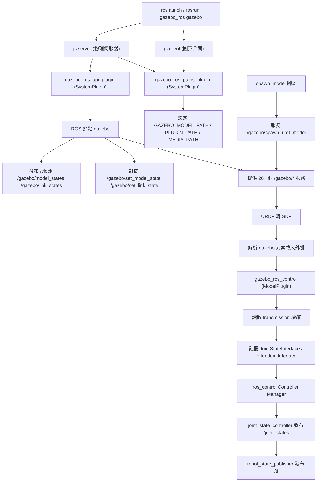
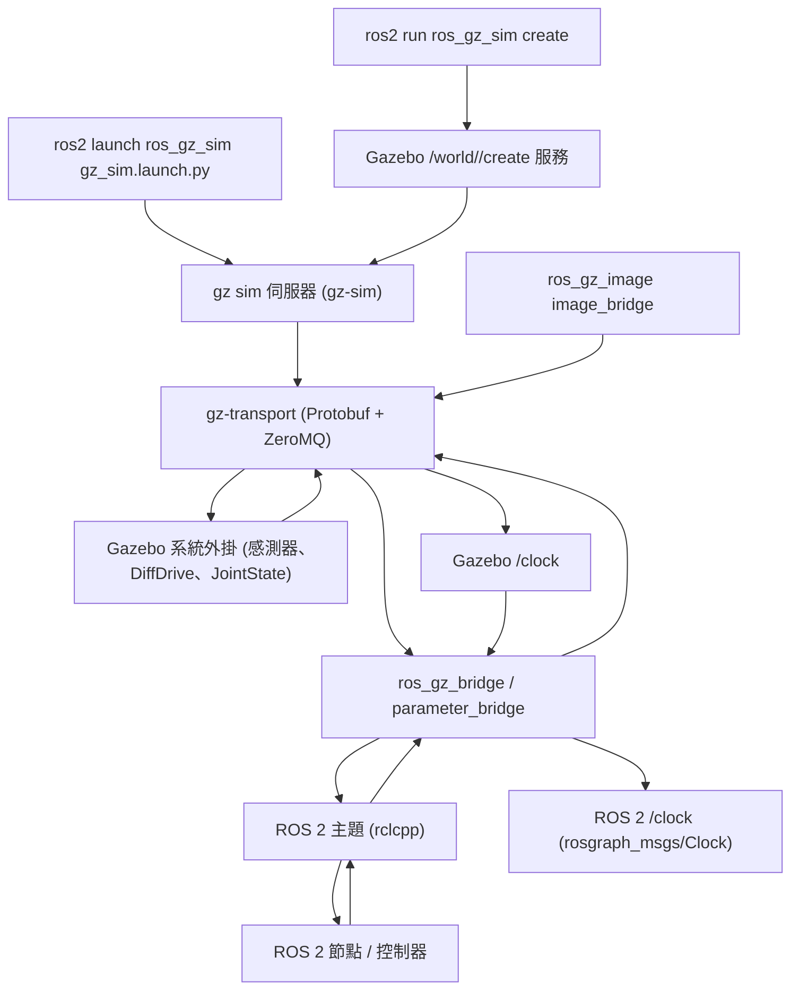
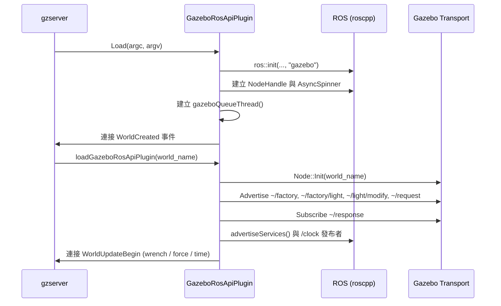
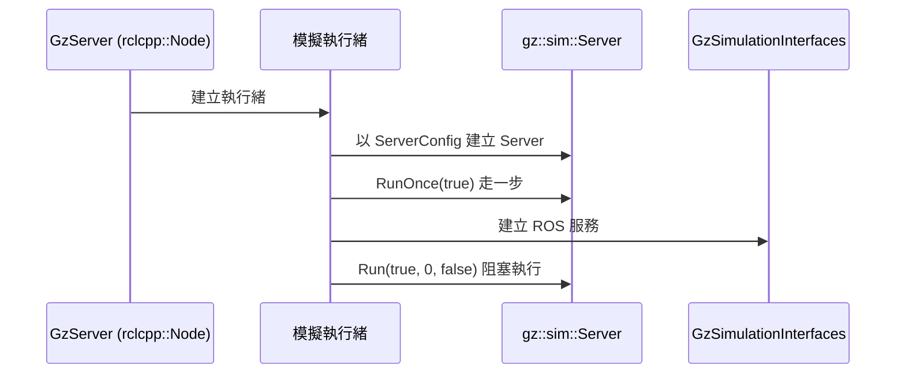
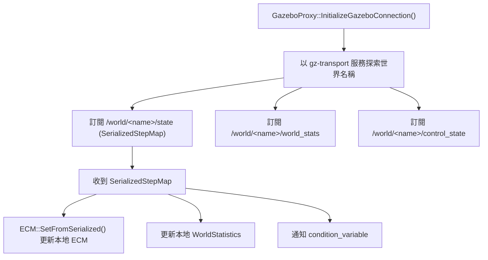

# ROS 與 Gazebo 之間的通訊機制

## 摘要

Gazebo 是機器人領域最廣泛使用的開源物理模擬器，而 ROS（Robot Operating System）是機器人軟體的事實標準中介軟體，兩者的整合方式在 2018 年前後發生了根本性的轉變。本文說明兩代整合架構：

1. **Gazebo Classic × ROS 1**：以 `gazebo_ros_pkgs` 為核心，把 ROS 外掛**直接載入模擬器行程（gzserver）內部**，由 `gazebo_ros_api_plugin` 這個系統外掛在 Gazebo 內部傳輸層與 ROS 傳輸層之間手動搬運資料[^gzclassic_roscomm][^gazebo_ros_pkgs]。
2. **新版 Gazebo（gz-sim）× ROS 2**：以 `ros_gz` 為核心，模擬器**不再內嵌 ROS**，而是改用 Gazebo 自己的中介軟體 `gz-transport`（Protocol Buffers + ZeroMQ），再由 `ros_gz_bridge` 這個獨立行程做訊息轉譯[^ros2_integration][^gz_transport][^bridge_readme]。

本文涵蓋兩代的通訊層、外掛與節點、服務與主題介面、時鐘同步、機器人描述檔載入流程、底層類別實作，以及兩代的對照比較，並對來源進行批判性反思。

---

## 1. 背景：兩代 Gazebo 與兩種整合哲學

在深入細節之前，必須先釐清命名與世代，因為「Gazebo」一詞在不同時期指涉不同軟體：

- **Gazebo Classic**：最初的 Gazebo，最終版本為 Gazebo 11，其 ROS 整合由 `gazebo_ros_pkgs` 提供[^gazebo_ros_pkgs]。
- **新版 Gazebo**：原名 **Ignition Gazebo**，自 Fortress 版本起更名為 **Gazebo**，其模擬器核心為 `gz-sim`；其 ROS 2 整合由 `ros_gz` 提供[^ros2_integration][^migration]。

兩者的整合哲學差異，是理解所有技術細節的關鍵：

| 面向 | Gazebo Classic | 新版 Gazebo（gz-sim） |
| --- | --- | --- |
| ROS 外掛位置 | 載入模擬器行程內（in-process） | 模擬器完全不依賴 ROS，外部橋接 |
| 傳輸層 | Gazebo Transport + ROS 傳輸層並存於同一行程 | 僅 `gz-transport`；ROS 2 端由 bridge 轉譯 |
| ROS 版本 | ROS 1（roscpp） | ROS 2（rclcpp） |
| 整合套件 | `gazebo_ros_pkgs` | `ros_gz` |

Gazebo Classic 的整合屬於「侵入式」：ROS 節點與 Gazebo 世界物件共用同一個行程與記憶體空間，因此外掛可以直接取得 `gazebo::physics::World*` 指標並直接讀寫物理狀態[^api_plugin_h]。新版 Gazebo 則屬於「鬆耦合」：模擬器與 ROS 是兩個獨立行程，透過訊息中介軟體通訊，模擬器本身不需要知道 ROS 的存在[^ros2_integration][^migration]。

### 1.1 專案活躍度與生命週期（GitHub 星數與封存狀態）

在評估兩代架構時，專案的維護狀態是不可忽略的現實因素。截至本次查證（2026-11-24）：

| 倉庫 | GitHub 星數 | 是否封存 | 狀態 |
| --- | --- | --- | --- |
| `gazebosim/ros_gz` | 553 | 否 | 活躍維護中，支援 Humble、Jazzy、Kilted、Rolling 等多個 ROS 2 發行版[^gh_ros_gz] |
| `ros-simulation/gazebo_ros_pkgs` | 865 | **是**（2025-07-10 封存） | **已棄用／終止支援**（2025-01 起）[^gh_gazebo_ros_pkgs] |
| `gazebosim/gz-transport` | 56 | 否 | 活躍維護中，最新版本 v15.0.0（2025-10-14）[^gh_gz_transport] |
| `ros-controls/ros2_control` | 1,070 | 否 | 活躍維護中[^gh_ros2_control] |
| `ros-controls/ros_control` | 535 | 否 | ROS 1（Noetic）控制器框架，維護模式[^gh_ros_control] |

`gazebo_ros_pkgs` 的 README 明確聲明：自 2025 年 1 月起，隨著 Gazebo Classic 11 到達生命終點，此套件已被棄用，官方不再提供支援、不再處理 issue、也不再合併 pull request，並強烈建議使用者遷移到新版 Gazebo[^gh_gazebo_ros_pkgs]。此倉庫已於 2025-07-10 被設為唯讀封存[^gh_gazebo_ros_pkgs]。

在 ROS 2 發行版層面，**ROS 2 Jazzy Jalisco**（2024 年 5 月發布）是第一個完全移除 Gazebo Classic 的發行版：Humble（2022 年 5 月）與 Iron（2023 年 5 月）的相依表中仍並列「Gazebo Classic 11.x.x」與「Gazebo (Ignition) Fortress」，但 Jazzy 的相依表僅列出「Gazebo: Harmonic」[^rep2000]。Jazzy 同時引入了新的 **ROS 2 Gazebo Vendor Packages**（`gz_*_vendor`）機制，把 Gazebo 函式庫透過 ROS buildfarm 發布[^rep2000]。這意味著自 Jazzy 之後，官方支援的模擬器是新版 Gazebo，而非 Gazebo Classic。

---

## 2. Gazebo Classic 與 ROS 1 的通訊架構

### 2.1 `gazebo_ros_pkgs` 套件群

Gazebo Classic 的 ROS 整合由 meta-package **`gazebo_ros_pkgs`**（早期稱為 `simulator_gazebo`）提供，位於 `ros-simulation/gazebo_ros_pkgs` 倉庫[^gazebo_ros_pkgs]。它包含五個子套件[^gazebo_ros_pkgs]：

- `gazebo_dev`：開發標頭檔與 CMake 設定。
- `gazebo_msgs`：ROS 訊息與服務定義（例如 `ModelState`、`SpawnModel`）[^gazebo_msgs]。
- `gazebo_plugins`：各種感測器與致動器外掛（相機、雷射、差速驅動、力/力矩等）[^gzclassic_gzplugins]。
- `gazebo_ros`：核心橋接外掛與 `spawn_model` 等工具[^wiki_gazebo_ros]。
- `gazebo_ros_control`：連接 `ros_control` 控制器框架[^gazebo_ros_control_idx]。

### 2.2 `gazebo_ros` 啟動方式

使用者以 `rosrun gazebo_ros gazebo` 或 `roslaunch` 啟動。這個進入點實際上會啟動 Gazebo 的兩個原生執行檔：**`gzserver`**（物理伺服器，無圖形介面）與 **`gzclient`**（圖形介面）。所謂「Gazebo 與 ROS 通訊」，本質上是外掛被載入 `gzserver` 後，在該行程內同時與 Gazebo 與 ROS 兩個中介軟體互動[^gzclassic_roscomm][^wiki_gazebo_ros]。

### 2.3 兩個關鍵系統外掛（SystemPlugin）

Gazebo Classic 的整合依賴兩個以 `SystemPlugin` 形式載入的共享函式庫：

#### (a) `gazebo_ros_api_plugin`

- **套件**：`gazebo_ros`
- **類別**：`gazebo::GazeboRosApiPlugin`（繼承 `gazebo::SystemPlugin`）[^api_plugin_h]
- **載入者**：僅 `gzserver`
- **函式庫**：`libgazebo_ros_api_plugin.so`[^api_plugin_cpp]

這是整個橋接的核心。它在 `Load()` 階段執行以下工作[^api_plugin_cpp]：

1. 呼叫 `ros::init(argc, argv, "gazebo", ros::init_options::NoSigintHandler)`，因此 ROS 圖中會出現一個名為 **`gazebo`** 的節點。
2. 建立 `ros::NodeHandle("~")` 與 `ros::AsyncSpinner`。
3. 建立一個專屬的 `ros::CallbackQueue` 與背景執行緒（`gazeboQueueThread()`），把 ROS 的回呼排程與 Gazebo 事件驅動排程整合起來。
4. 將 ROS 參數 `/use_sim_time` 設為 `true`。
5. 在 `loadGazeboRosApiPlugin()` 中建立一個 Gazebo 內部傳輸節點 `gazebo::transport::Node`，並開啟以下 Gazebo 通道[^api_plugin_cpp]：
   - `~/factory`（發布 `gazebo::msgs::Factory`，用於生成模型）
   - `~/factory/light`（發布光源）
   - `~/light/modify`（修改光源）
   - `~/request`（發布 `gazebo::msgs::Request`，用於刪除等操作）
   - 訂閱 `~/response`
6. 連接 Gazebo 的 `WorldUpdateBegin` 事件，用於每個物理步進前施加力/力矩與發布模擬時間。

換言之，`gazebo_ros_api_plugin` 是一個**單體式橋接器**：它同時持有 `gazebo::transport::Node`（Gazebo 端）與 `ros::NodeHandle`（ROS 端），並在各個回呼函式中**手動轉換訊息**。其資料流可歸納為三種模式[^api_plugin_cpp]：

- **ROS 服務 → Gazebo 主題**：ROS 服務回呼收到請求後，轉成 Gazebo protobuf 訊息並發布到 Gazebo 內部通道。例如 `spawn_sdf_model` 會透過 `factory_pub_` 發布 `gazebo::msgs::Factory`。
- **Gazebo 主題 → ROS 主題**：Gazebo 訂閱回呼收到 protobuf 訊息後，轉成 ROS 訊息並發布。
- **直接存取世界物件**：部分服務（如 `get_model_state`）直接讀寫 `gazebo::physics::World` 指標，完全不經過傳輸層。

此外，`link_states` 與 `model_states` 採用**延遲連接（lazy connect）** 策略：透過 ROS 的 `AdvertiseOptions` 註冊 connect/disconnect 回呼，第一個 ROS 訂閱者出現時才連接 `WorldUpdateBegin` 事件，最後一個訂閱者離開時即斷開，並以 `pub_link_states_connection_count_` 這類參考計數管理[^api_plugin_cpp]。

#### (b) `gazebo_ros_paths_plugin`

- **類別**：`gazebo::GazeboRosPathsPlugin`[^api_plugin_h]
- **載入者**：`gzserver` 與 `gzclient` 皆載入

此系統外掛負責解析 ROS 套件路徑，讓 Gazebo 能找到模型與材質資源。它會自動設定以下 Gazebo 環境變數[^gzclassic_urdf]：

- `GAZEBO_MODEL_PATH`：由匯出 `gazebo_model_path` 屬性的 ROS 套件路徑組成。
- `GAZEBO_PLUGIN_PATH`：由匯出 `plugin_path` 屬性的套件路徑組成。
- `GAZEBO_MEDIA_PATH`：由匯出 `gazebo_media_path` 屬性的套件路徑組成。

這使得 URDF/SDF 中可以使用 `package://my_package/meshes/model.dae` 這類 URI，Gazebo 會透過 `ros::package::getPath()` 解析成實際檔案路徑[^gzclassic_urdf]。

### 2.4 Gazebo Classic 對外暴露的 ROS API

所有服務與主題都掛在 `/gazebo/` 命名空間下（即 ROS 節點名稱）[^gzclassic_roscomm][^api_plugin_h]。

**主要服務**（型別皆為 `gazebo_msgs/...`，除特別註明外）[^gzclassic_roscomm][^gazebo_msgs]：

| 服務名稱 | 型別 | 功能 |
| --- | --- | --- |
| `/gazebo/spawn_urdf_model` | `SpawnModel` | 以 URDF 生成模型 |
| `/gazebo/spawn_sdf_model` | `SpawnModel` | 以 SDF 生成模型 |
| `/gazebo/delete_model` | `DeleteModel` | 刪除模型 |
| `/gazebo/get_world_properties` | `GetWorldProperties` | 列出世界中的模型與模擬時間 |
| `/gazebo/get_model_properties` | `GetModelProperties` | 取得模型的連結、關節、幾何 |
| `/gazebo/get_model_state` | `GetModelState` | 取得模型的位姿與速度 |
| `/gazebo/get_link_state` | `GetLinkState` | 取得連結的位姿與速度 |
| `/gazebo/get_joint_properties` | `GetJointProperties` | 取得關節位置、力矩、限制 |
| `/gazebo/get_physics_properties` | `GetPhysicsProperties` | 取得重力、時間步長、ODE 參數 |
| `/gazebo/set_model_state` | `SetModelState` | 設定模型位姿與速度 |
| `/gazebo/set_link_state` | `SetLinkState` | 設定連結位姿與速度 |
| `/gazebo/set_model_configuration` | `SetModelConfiguration` | 不經動力學直接設定關節位置 |
| `/gazebo/set_physics_properties` | `SetPhysicsProperties` | 設定物理參數 |
| `/gazebo/apply_body_wrench` | `ApplyBodyWrench` | 對物體施加力與力矩[^apply_wrench] |
| `/gazebo/apply_joint_effort` | `ApplyJointEffort` | 對關節施力 |
| `/gazebo/clear_body_wrenches` | `BodyRequest` | 清除物體上的所有力 |
| `/gazebo/clear_joint_forces` | `JointRequest` | 清除關節上的所有力 |
| `/gazebo/pause_physics` | `std_srvs/Empty` | 暫停物理模擬 |
| `/gazebo/unpause_physics` | `std_srvs/Empty` | 恢復物理模擬 |
| `/gazebo/reset_simulation` | `std_srvs/Empty` | 重置整個模擬（含時間） |
| `/gazebo/reset_world` | `std_srvs/Empty` | 僅重置模型位姿 |

**發布的主題**[^gzclassic_roscomm]：

| 主題名稱 | 型別 | 功能 |
| --- | --- | --- |
| `/clock` | `rosgraph_msgs/Clock` | 模擬時間，搭配 `/use_sim_time` 參數 |
| `/gazebo/model_states` | `gazebo_msgs/ModelStates` | 世界中所有模型的位姿與速度 |
| `/gazebo/link_states` | `gazebo_msgs/LinkStates` | 世界中所有連結的位姿與速度 |
| `/gazebo/performance_metrics` | `gazebo_msgs/PerformanceMetrics` | 模擬效能指標（Gazebo 9.15+/11.2+） |

其中 `ModelStates` 由三個平行陣列組成：`name[]`、`pose[]`、`twist[]`；`LinkStates` 結構類似，但名稱採用 Gazebo 範圍限定格式，如 `"model_name::link_name"`[^gzclassic_roscomm]。

**訂閱的主題**（用於高速率設定狀態）[^gzclassic_roscomm]：

| 主題名稱 | 型別 | 功能 |
| --- | --- | --- |
| `/gazebo/set_model_state` | `gazebo_msgs/ModelState` | 以高頻率設定模型位姿（繞過動力學） |
| `/gazebo/set_link_state` | `gazebo_msgs/LinkState` | 以高頻率設定連結位姿 |

主題版本的設定方式比服務版本更輕量，適合以高頻率（例如 `-r 20`）連續發布[^gzclassic_roscomm]。

### 2.5 `gazebo_ros_control`：與 `ros_control` 的橋接

`gazebo_ros_control` 是把 `ros_control` 控制器框架接上 Gazebo 物理模擬的關鍵外掛[^gazebo_ros_control_idx][^gzclassic_roscontrol]：

- **套件**：`gazebo_ros_control`
- **函式庫**：`libgazebo_ros_control.so`
- **外掛型別**：Gazebo `ModelPlugin`（在 URDF/SDF 中逐機器人載入）

資料流為[^gzclassic_roscontrol]：

```
ROS 控制器 ←→ ros_control Controller Manager ←→ gazebo_ros_control 外掛 ←→ Gazebo 模擬器
```

在 URDF 中的啟用方式如下[^gzclassic_roscontrol]：

```xml
<gazebo>
  <plugin name="gazebo_ros_control" filename="libgazebo_ros_control.so">
    <robotNamespace>/MYROBOT</robotNamespace>
    <controlPeriod>0.01</controlPeriod>
    <robotParam>/robot_description</robotParam>
    <robotSimType>gazebo_ros_control/DefaultRobotHWSim</robotSimType>
  </plugin>
</gazebo>
```

若不指定自訂 `<robotSimType>`，外掛會解析 URDF 中所有 `<transmission>` 元素，並向控制器管理器暴露以下 `ros_control` 硬體介面[^gzclassic_roscontrol]：

- `hardware_interface::JointStateInterface`：讀取關節位置、速度、力矩。
- `hardware_interface::EffortJointInterface`：對關節下達力矩指令。
- `hardware_interface::VelocityJointInterface`：在預設外掛中**未完整實作**。

進階使用者可透過 pluginlib 撰寫自訂的 `RobotHWSim` 子類別（繼承 `gazebo_ros_control::RobotHWSim`），直接存取 Gazebo 的 `Joint` 與 `Link` 物件，以支援非線性彈簧、液壓致動器等複雜機構[^gzclassic_roscontrol]。另有 `gazebo_ros_control_select_joints` 變體，可透過 `<joints>` 標籤只控制部分關節[^gzclassic_roscontrol]。

### 2.6 Transmissions（`<transmission>` 元素）

`<transmission>` 把**關節**連到**致動器**，並宣告**硬體介面型別**，定義於 URDF 中[^gzclassic_roscontrol]：

```xml
<transmission name="tran1">
  <type>transmission_interface/SimpleTransmission</type>
  <joint name="joint1">
    <hardwareInterface>EffortJointInterface</hardwareInterface>
  </joint>
  <actuator name="motor1">
    <hardwareInterface>EffortJointInterface</hardwareInterface>
    <mechanicalReduction>1</mechanicalReduction>
  </actuator>
</transmission>
```

規則如下[^gzclassic_roscontrol][^ros_control_issue]：

- `<joint name="">` 必須對應 URDF 中既有的關節。
- `<type>` 目前支援 `transmission_interface/SimpleTransmission`。
- `<hardwareInterface>` 必須**同時**出現在 `<joint>` 與 `<actuator>` 內。
- 合法介面值為 `EffortJointInterface`、`VelocityJointInterface`、`PositionJointInterface`。
- `gazebo_ros_control` 會讀取所有 transmission 標籤，以得知哪些關節要註冊到控制器管理器。

### 2.7 關節狀態發布

關節狀態由 `joint_state_controller` 套件中的控制器發布，於 YAML 中設定[^gzclassic_roscontrol]：

```yaml
rrbot:
  joint_state_controller:
    type: joint_state_controller/JointStateController
    publish_rate: 50
```

執行時由 `controller_manager` 載入：

```bash
rosrun controller_manager spawner joint_state_controller
```

它會發布到 `/joint_states`（或帶命名空間，如 `/rrbot/joint_states`），再交由 `robot_state_publisher` 計算 TF 轉換。`gazebo_ros_control` 的 `JointStateInterface` 直接從 Gazebo 物理引擎讀取位置、速度、力矩並傳給此控制器[^gzclassic_roscontrol]。

### 2.8 機器人描述檔（URDF/SDF）的載入流程

主要有兩條路徑[^gzclassic_urdf]：

**路徑 A：`spawn_model` 工具腳本**

`gazebo_ros` 提供一個名為 `spawn_model` 的 Python 腳本：

```bash
# 從檔案生成 URDF：
rosrun gazebo_ros spawn_model -file `rospack find rrbot_description`/urdf/rrbot.xml -urdf -model rrbot1

# 從線上模型資料庫生成 SDF：
rosrun gazebo_ros spawn_model -database coke_can -sdf -model coke_can

# 從參數伺服器生成（roslaunch 常見用法）：
rosrun gazebo_ros spawn_model -param robot_description -urdf -model my_robot
```

此腳本內部呼叫 **`/gazebo/spawn_urdf_model`** 或 **`/gazebo/spawn_sdf_model`** 服務。`gazebo_ros_api_plugin` 在服務回呼中收到 XML 字串，以 `isURDF()`/`isSDF()` 判斷型別後[^api_plugin_cpp]：

- **URDF**：送入 Gazebo 的 URDF→SDF 轉換流程，`<gazebo>` 擴充元素會被解析並合併進 SDF 的 `<model>` 標籤，外掛則以 `ModelPlugin`、`SensorPlugin`、`VisualPlugin` 形式載入。
- **SDF**：直接透過 Gazebo 的 `factory` 傳輸通道插入世界。

**路徑 B：`roslaunch`**

典型 launch 檔如下[^gzclassic_urdf]：

```xml
<launch>
  <param name="robot_description" command="$(find xacro)/xacro $(find rrbot_description)/urdf/rrbot.xacro" />

  <node name="spawn_urdf" pkg="gazebo_ros" type="spawn_model"
        args="-param robot_description -urdf -model rrbot" />

  <include file="$(find gazebo_ros)/launch/empty_world.launch">
    <arg name="paused" value="false"/>
  </include>
</launch>
```

URDF 中的 `<gazebo>` 擴充元素依 `reference` 屬性而有不同作用範圍[^gzclassic_urdf]：

- **無 `reference` 屬性** → 作用於整個機器人模型（例如模型層級的 `<plugin>`、`<static>` 旗標）。
- **`reference="link_name"`** → 作用於特定連結（材質、摩擦、感測器外掛）。
- **`reference="joint_name"`** → 作用於特定關節（動力學、彈簧、回授）。

未被明確解析的任意 XML 片段會直接傳入產生的 SDF，這也是 `libgazebo_ros_camera.so`、`libgazebo_ros_diff_drive.so`、`libgazebo_ros_control.so` 等外掛取得設定的方式[^gzclassic_urdf]。

### 2.9 Gazebo Classic 整合的全域資料流



---

## 3. 新版 Gazebo（gz-sim）與 ROS 2 的通訊架構

### 3.1 `gz-transport`：Gazebo 的原生中介軟體

新版 Gazebo 使用自家的 **Gazebo Transport（`gz-transport`）** 作為內部通訊層，位於 `gazebosim/gz-transport` 倉庫[^gz_transport]。其特性為[^gz_transport]：

- 使用 **Google Protocol Buffers** 做訊息序列化。
- 使用 **ZeroMQ** 做訊息傳遞。
- 提供發布/訂閱主題與請求/回應服務。
- 跨平台（Linux、macOS、Windows）。
- 是所有現代 Gazebo（gz-sim）元件的原生中介軟體。

Gazebo 的感測器、系統外掛（DiffDrive、JointStatePublisher 等）與模擬核心，全都以 `gz.msgs.*` protobuf 訊息發布到 `gz-transport` 主題上[^gz_transport][^migration]。可用 `gz` 命令列工具檢視：

```bash
gz topic -l            # 列出所有主題
gz topic -i -t /scan   # 查詢主題型別與發布/訂閱者
gz topic -e -t /scan   # 回顯訊息內容
```

### 3.2 `ros_gz` 套件群

新版 Gazebo 的 ROS 2 整合由 meta-package **`ros_gz`** 提供，位於 `gazebosim/ros_gz`，是 `gazebo_ros_pkgs` 的替代品[^ros_gz][^migration]。主要子套件包括[^ros_gz][^bridge_readme][^ros_gz_sim][^ros_gz_image]：

- `ros_gz_bridge`：主題與服務轉譯的核心。
- `ros_gz_sim`：啟動 Gazebo 與生成實體的套件。
- `ros_gz_image`：影像專用的高效能橋接。
- `ros_gz_interfaces`：ROS 2 端的訊息與服務定義。

### 3.3 `ros_gz_bridge`：核心主題橋接

`ros_gz_bridge` 是整個架構的翻譯層：它訂閱一個 Gazebo Transport 主題並轉發到 ROS 2 主題（或反向），在 protobuf 與 ROS 2 訊息型別之間轉換[^ros2_integration][^bridge_readme]。

**主要執行檔**[^bridge_readme]：

- **`parameter_bridge`**：透過命令列參數、YAML 設定檔或 launch 檔設定橋接的主要工具。
- **`static_bridge`**：硬編碼的示範用橋接執行檔。

**命令列語法**[^ros2_integration]：

```
ros2 run ros_gz_bridge parameter_bridge /TOPIC@ROS_MSG_TYPE@GZ_MSG_TYPE
```

方向符號位於 ROS 型別之後，決定資料流向[^ros2_integration]：

| 符號 | 方向 |
| --- | --- |
| `@` | 雙向 |
| `[` | 僅 Gazebo → ROS |
| `]` | 僅 ROS → Gazebo |

範例[^ros2_integration]：

```bash
# 把 ROS 的 /cmd_vel 橋接到 Gazebo（雙向）
ros2 run ros_gz_bridge parameter_bridge /cmd_vel@geometry_msgs/msg/Twist@gz.msgs.Twist

# 把 Gazebo 的 /scan 橋接到 ROS（單向）
ros2 run ros_gz_bridge parameter_bridge /scan@sensor_msgs/msg/LaserScan[gz.msgs.LaserScan
```

**YAML 設定檔**[^bridge_readme][^ros2_integration]：

```yaml
- ros_topic_name: "odom"
  gz_topic_name: "odom"
  ros_type_name: "nav_msgs/msg/Odometry"
  gz_type_name: "gz.msgs.Odometry"
  direction: GZ_TO_ROS

- ros_topic_name: "cmd_vel"
  gz_topic_name: "cmd_vel"
  ros_type_name: "geometry_msgs/msg/Twist"
  gz_type_name: "gz.msgs.Twist"
  direction: ROS_TO_GZ
```

執行方式[^bridge_readme]：

```bash
ros2 run ros_gz_bridge parameter_bridge --ros-args -p config_file:=/path/to/your/bridge.yaml
```

每個項目的欄位包含[^bridge_readme]：

- `ros_topic_name` / `gz_topic_name`：主題名稱。
- `ros_type_name` / `gz_type_name`：訊息型別。
- `direction`：`BIDIRECTIONAL`（預設）、`GZ_TO_ROS`、`ROS_TO_GZ`。
- `subscriber_queue` / `publisher_queue`：ROS 端佇列大小（預設 10）。
- `lazy`：若為 `true`，僅在輸出端有訂閱者時才訂閱輸入端（預設 `false`）。
- `qos_profile`：例如 `SENSOR_DATA`、`CLOCK`。
- `frame_id`：覆寫訊息標頭中的 `frame_id`。

**XML launch 設定**[^bridge_readme]：

```xml
<launch>
  <arg name="world_name" default="empty" />
  <ros_gz_bridge bridge_name="my_bridge">
    <topic ros_topic_name="/clock" gz_topic_name="/clock"
           ros_type_name="rosgraph_msgs/msg/Clock" gz_type_name="gz.msgs.Clock"
           lazy="False" direction="GZ_TO_ROS" qos_profile="CLOCK" />
    <service service_name="/world/$(var world_name)/control"
             ros_type_name="ros_gz_interfaces/srv/ControlWorld"
             gz_req_type_name="gz.msgs.WorldControl" gz_rep_type_name="gz.msgs.Boolean" />
  </ros_gz_bridge>
</launch>
```

**Python launch 設定**[^bridge_readme]：

```python
from launch import LaunchDescription
from ros_gz_bridge.actions import RosGzBridge

def generate_launch_description():
    return LaunchDescription([
        RosGzBridge(
            bridge_name='my_bridge',
            config_file='/path/to/bridge.yaml',
        ),
    ])
```

### 3.4 服務橋接

除了主題，`ros_gz_bridge` 也支援把 ROS 2 服務橋接到 Gazebo 服務。官方 README 列出四種服務配對[^bridge_readme]：

| ROS 2 服務型別 | Gazebo 請求 | Gazebo 回應 | 用途 |
| --- | --- | --- | --- |
| `ros_gz_interfaces/srv/ControlWorld` | `gz.msgs.WorldControl` | `gz.msgs.Boolean` | 暫停/恢復模擬 |
| `ros_gz_interfaces/srv/DeleteEntity` | `gz.msgs.Entity` | `gz.msgs.Boolean` | 刪除實體 |
| `ros_gz_interfaces/srv/SpawnEntity` | `gz.msgs.EntityFactory` | `gz.msgs.Boolean` | 生成實體 |
| `ros_gz_interfaces/srv/SetEntityPose` | `gz.msgs.Pose` | `gz.msgs.Boolean` | 設定實體位姿 |

範例：透過橋接的服務解除暫停[^bridge_readme]：

```bash
# 終端機 A：啟動服務橋接
ros2 run ros_gz_bridge parameter_bridge /world/shapes/control@ros_gz_interfaces/srv/ControlWorld

# 終端機 B：啟動 Gazebo（預設為暫停）
gz sim shapes.sdf

# 終端機 C：發出 ROS 服務呼叫
ros2 service call /world/shapes/control ros_gz_interfaces/srv/ControlWorld \
  "{world_control: {pause: false}}"
```

ROS 端的服務名稱遵循 `/world/<world_name>/control` 模式[^bridge_readme]。

### 3.5 時鐘橋接

Gazebo 透過 `gz-transport` 在 `/clock` 主題發布模擬時間。要在 ROS 2 中使用，**必須**以 Gazebo→ROS 單向橋接[^bridge_readme]：

```bash
ros2 run ros_gz_bridge parameter_bridge /clock@rosgraph_msgs/msg/Clock[gz.msgs.Clock
```

官方 README 特別提醒：若啟動時 Gazebo 偵測到 `/clock` 上已有其他發布者，它只會建立完整限定名稱的 `/world/<worldname>/clock` 主題；Gazebo 會是唯一的 `/clock` 發布者，也是時鐘資訊的唯一來源[^bridge_readme]。另有一個參數 `override_timestamps_with_wall_time`（預設 `false`），可讓外送訊息改用牆鐘時間而非模擬時間，適合模擬器需與要求真實時間戳的外部系統通訊時使用[^bridge_readme]。

### 3.6 `ros_gz_sim`：模擬管理套件

`ros_gz_sim` 提供 launch 檔、生成實體的 `create` 執行檔與相關工具[^ros_gz_sim]。

**啟動 Gazebo**[^ros_gz_sim]：

```bash
ros2 launch ros_gz_sim gz_sim.launch.py gz_args:="shapes.sdf"
```

`gz_args` 參數接受命令列旗標[^ros_gz_sim]：

- `-s`：僅伺服器
- `-g`：僅圖形用戶端
- `-r`：立即開始執行（不暫停）
- `-v4`：詳細程度等級

**生成實體**：Gazebo Classic 使用 `spawn_entity` 節點與 `/spawn_entity` 服務；新版 Gazebo 改用 `ros_gz_sim` 的 **`create`** 執行檔[^ros2_spawn][^ros_gz_sim]：

```bash
ros2 run ros_gz_sim create -world default \
  -file 'https://fuel.gazebosim.org/1.0/openrobotics/models/Gazebo'

ros2 run ros_gz_sim create -world default -file /path/to/model.sdf \
  -name my_robot -x 1.0 -y 2.0 -z 0.5
```

參數包括 `-world`、`-file`（或 `-string` 直接內嵌 SDF）、`-name`、`-x`、`-y`、`-z`、`-R`、`-P`、`-Y`（roll、pitch、yaw）[^ros_gz_sim]。也可用 launch 檔[^ros_gz_sim]：

```bash
ros2 launch ros_gz_sim gz_spawn_model.launch.py \
  world:=empty \
  file:=/path/to/model.sdf \
  entity_name:=my_vehicle \
  x:=5.0 y:=5.0 z:=0.5
```

**資源路徑管理**：Gazebo Classic 以 `package.xml` 的 `<export>` 自動設定 `GAZEBO_MODEL_PATH`；新版 Gazebo 則在 `<export>` 中使用 `<gazebo_ros>` 填充 `GZ_SIM_RESOURCE_PATH`[^ros_gz_sim][^migration]：

```xml
<export>
   <gazebo_ros gazebo_model_path="${prefix}/models"/>
   <gazebo_ros gazebo_media_path="${prefix}/media"/>
   <gazebo_ros plugin_path="${prefix}/plugins"/>
</export>
```

或在 launch 檔中手動設定[^ros_gz_sim]：

```python
from launch.actions import AppendEnvironmentVariable
set_env_vars_resources = AppendEnvironmentVariable(
    'GZ_SIM_RESOURCE_PATH',
    os.path.join(get_package_share_directory('my_pkg'), 'models'))
```

### 3.7 `ros_gz_image`：影像專用橋接

雖然 `ros_gz_bridge` 也能橋接 `sensor_msgs/msg/Image` ↔ `gz.msgs.Image`，但相機影像建議使用專用的 `image_bridge` 執行檔以提升效率[^ros_gz_image]：

```bash
ros2 run ros_gz_image image_bridge /camera/image_raw
ros2 run ros_gz_image image_bridge /camera/image_raw /rgbd_camera/depth_image
```

參數包含[^ros_gz_image]：

- `qos`：`default`、`sensor_data`、`system_default`
- `lazy`：若為 `true`，僅在 ROS 訂閱者存在時才訂閱
- `subscription_heartbeat`：lazy 模式的檢查間隔（預設 1000ms）

此橋接在底層使用 `image_transport`，因此只要安裝 `compressed_image_transport`，壓縮影像傳輸即自動可用[^ros_gz_image]。

### 3.8 新版 Gazebo 整合的全域資料流



---

## 4. 兩代架構的完整對照

以下對照整理自官方遷移指南[^migration]：

| 面向 | Gazebo Classic（`gazebo_ros_pkgs`） | 新版 Gazebo（`ros_gz`） |
| --- | --- | --- |
| 外掛架構 | 外掛載入模擬器行程，直接對 ROS 主題發布/訂閱 | 模擬器解耦；透過 `gz-transport`，由 `ros_gz_bridge` 外部橋接 |
| 套件 | `gazebo_ros_pkgs` | `ros_gz`（含 `ros_gz_bridge`、`ros_gz_sim`、`ros_gz_image`） |
| 生成實體 | `spawn_entity` 節點、`/spawn_entity` 服務 | `ros2 run ros_gz_sim create` 或 `gz_spawn_model.launch.py` |
| 啟動 Gazebo | `gazebo_ros` launch 檔（`gzserver`、`gzclient`） | `ros_gz_sim` 的 `gz_sim.launch.py` 搭配 `gz_args` |
| 模型路徑 | `GAZEBO_MODEL_PATH` | `GZ_SIM_RESOURCE_PATH`（透過 `<gazebo_ros>` 或 `AppendEnvironmentVariable`） |
| 感測器外掛 | 逐模型的 ROS 外掛（`libgazebo_ros_camera.so` 等） | 通用世界層級外掛（`gz-sim-sensors-system`、`gz-sim-imu-system`），感測器發布到 gz-transport 再橋接 |
| 差速驅動 | `libgazebo_ros_diff_drive.so` 搭配 ROS 參數 | `gz-sim-diff-drive-system` 發布到 gz-transport 主題（`cmd_vel`、`odom`） |
| 關節狀態 | `libgazebo_ros_joint_state_publisher.so` | `gz-sim-joint-state-publisher-system` |
| 相機 | `libgazebo_ros_camera.so` 搭配 ROS camera info manager | 通用感測器外掛 + `ros_gz_image` 的 `image_bridge` |
| 模型 URI | `model://` 表示法 | `https://fuel.gazebosim.org/1.0/...` 或 `package://my_pkg/models/...` |
| 通訊方式 | 模擬器行程內直接 ROS pub/sub | gz-transport protobuf ↔ ROS 2 DDS，經 bridge |
| 服務介面 | `/gazebo/spawn_sdf_model` 等 Classic 服務 | ROS 2 Simulation Interfaces：`ros_gz_interfaces/srv/ControlWorld`、`SpawnEntity`、`DeleteEntity`、`SetEntityPose` |
| 組合（composition） | 不原生支援 | 支援 ROS 2 composition；bridge 節點可載入 component container 進行行程內通訊[^ros2_overview] |

### 4.1 支援的訊息型別對照（節錄）

官方 README 記載 **70 種以上**的訊息型別配對[^bridge_readme]。常見者如下[^bridge_readme]：

| ROS 2 型別 | Gazebo Transport 型別 |
| --- | --- |
| `sensor_msgs/msg/LaserScan` | `gz.msgs.LaserScan` |
| `sensor_msgs/msg/Image` | `gz.msgs.Image` |
| `sensor_msgs/msg/CameraInfo` | `gz.msgs.CameraInfo` |
| `sensor_msgs/msg/Imu` | `gz.msgs.IMU` |
| `sensor_msgs/msg/JointState` | `gz.msgs.Model` |
| `nav_msgs/msg/Odometry` | `gz.msgs.Odometry` |
| `sensor_msgs/msg/PointCloud2` | `gz.msgs.PointCloudPacked` |
| `geometry_msgs/msg/Twist` | `gz.msgs.Twist` |
| `geometry_msgs/msg/TransformStamped` | `gz.msgs.Pose` |
| `tf2_msgs/msg/TFMessage` | `gz.msgs.Pose_V` |
| `rosgraph_msgs/msg/Clock` | `gz.msgs.Clock` |
| `std_msgs/msg/String` | `gz.msgs.StringMsg` |
| `std_msgs/msg/Bool` | `gz.msgs.Boolean` |
| `std_msgs/msg/Empty` | `gz.msgs.Empty` |

---

## 5. 底層機制：Classic 與 gz-sim 的實作差異

本節聚焦於 C++ 類別層級的實作差異，說明兩代架構「為何」不同。

### 5.1 Gazebo Classic：`GazeboRosApiPlugin`

`gazebo::GazeboRosApiPlugin` 繼承 `gazebo::SystemPlugin`，由 `gzserver` 在啟動時載入，並非由任何模型 SDF 載入；CMake 將其建置為共享函式庫 `libgazebo_ros_api_plugin.so`[^api_plugin_h][^api_plugin_cpp]。

載入流程為[^api_plugin_cpp]：



關鍵在於：Classic 的外掛同時持有 Gazebo 傳輸節點與 ROS 節點，並在各回呼中**手工轉換**訊息，且可直接取得 `gazebo::physics::World*` 指標，不需經過傳輸層即可讀寫世界狀態[^api_plugin_h][^api_plugin_cpp]。

以逐模型外掛 `GazeboRosForce` 為例，它繼承 `gazebo::ModelPlugin`，以 `GZ_REGISTER_MODEL_PLUGIN(GazeboRosForce)` 註冊，建置為 `libgazebo_ros_force.so`。它從 SDF 讀取 `<bodyName>`、`<topicName>`、`<robotNamespace>`，取得 `physics::LinkPtr`，訂閱 `geometry_msgs::Wrench`，並在每個 `WorldUpdateBegin` 的 `UpdateChild()` 中呼叫 `link_->AddForce()` 與 `link_->AddTorque()`[^force_h][^force_cpp]。

### 5.2 歷史外掛 `gazebo_ros_init` 與 `gazebo_ros_factory`

這兩個外掛存在於 ROS hydro/indigo 時期的 `gazebo_plugins` 套件，在 `noetic-devel` 分支已**不存在**，其功能被併入 `gazebo_ros_api_plugin`[^gazebo_ros_pkgs]：

- **`GazeboRosInit`**（`ModelPlugin`）：呼叫 `ros::init()` 並為模型命名空間建立 `ros::NodeHandle`；現在由 `gazebo_ros_api_plugin` 在啟動時呼叫一次 `ros::init()` 取代。
- **`GazeboRosFactory`**（`ModelPlugin`）：透過 Gazebo 內部 `~/factory` 與 `~/request` 通道提供 `spawn_model` 與 `delete_model` 服務；現在由 `gazebo_ros_api_plugin::advertiseServices()` 提供。
- **`GazeboRosForce`**：仍存在。

`gazebo_ros` 中的 Python 腳本 `gazebo_interface.py` 與 `gazebo_plugins` 中的 `gazebo_plugins_interface.py`，是呼叫 `gazebo_ros_api_plugin` 所暴露服務的薄客戶端[^gazebo_ros_pkgs]。

### 5.3 新版 Gazebo：`ros_gz_sim::GzServer` 與 `GazeboProxy`

`ros_gz_sim::GzServer` 繼承 `rclcpp::Node`，是以 `RCLCPP_COMPONENTS_REGISTER_NODE` 註冊的 ROS 2 元件節點。其運作方式為[^gzserver_cpp]：

1. 建立一個**獨立執行緒**來承載 `gz::sim::Server`。
2. 以 `gz::sim::ServerConfig`（來自 SDF 檔或字串）建立伺服器。
3. 先呼叫 `server->RunOnce(true)`（暫停狀態下走一步）。
4. 建立 `GzSimulationInterfaces`（ROS 服務）。
5. 再呼叫 `server->Run(true, 0, false)`（阻塞式執行，不暫停）。



`ros_gz_sim::gz_simulation_interfaces::GzSimulationInterfaces` 會建立一個 `GazeboProxy` 並實例化服務與動作處理器[^gz_sim_interfaces]：

```cpp
void CreateInterfaces() {
  AddInterface<services::DeleteEntity>();
  AddInterface<services::GetEntities>();
  AddInterface<services::GetEntityInfo>();
  AddInterface<services::GetEntityState>();
  AddInterface<services::GetEntitiesStates>();
  AddInterface<services::GetSimulationState>();
  AddInterface<services::GetSimulatorFeatures>();
  AddInterface<services::ResetSimulation>();
  AddInterface<services::SetEntityState>();
  AddInterface<services::SetSimulationState>();
  AddInterface<services::SpawnEntity>();
  AddInterface<services::StepSimulation>();
  AddInterface<actions::SimulateSteps>();
}
```

`GazeboProxy` 是 ROS 2 與 gz-sim 之間的**中央代理**，其職責為[^gazebo_proxy]：

1. 建立 `gz::transport::Node` 與 Gazebo 伺服器通訊。
2. 維護一份**本地 EntityComponentManager（ECM）副本**，透過訂閱 `gz::msgs::SerializedStepMap` 訊息與 Gazebo 同步。
3. 維護本地 `gz::msgs::WorldStatistics` 快取。
4. 以 `std::mutex` 提供執行緒安全存取（`WithEcm()`、`Stats()`）。

其初始化與同步流程為[^gazebo_proxy]：



值得注意的是：與 Classic 可直接取得 `gazebo::physics::World*` 不同，新版 Gazebo 的 gz-sim 世界**無法**在行程內以 C++ 直接存取。`GazeboProxy` 改以本地 ECM 副本搭配 gz-transport **服務呼叫**（而非直接 API 呼叫）與伺服器互動[^gazebo_proxy]。

### 5.4 新版 Gazebo：`ros_gz_bridge` 的橋接處理器

`ros_gz_bridge::RosGzBridge` 繼承 `rclcpp::Node`，是雙向主題橋接節點。它[^bridge_handle]：

1. 建立 `gz::transport::Node`（`gz_node_`）。
2. 從 YAML 設定檔（`config_file` 參數）或個別參數（`bridge_names`、`bridges.<name>.*`）讀取橋接設定。
3. 依方向為每個設定建立一到兩個 `BridgeHandle` 物件。

`BridgeHandle` 是抽象基底類別，儲存[^bridge_handle]：

- ROS 節點的弱指標（`rclcpp::Node::WeakPtr`）
- `gz::transport::Node` 的共享指標
- `BridgeConfig`（主題名稱、型別、方向、QoS、lazy 旗標）
- `FactoryInterface`（樣板生成的型別化工廠）

子類別實作 `StartPublisher()`、`StartSubscriber()`、`StopSubscriber()`、`NumSubscriptions()`、`HasPublisher()`、`HasSubscriber()` 等虛擬方法。若橋接為 lazy 模式，初始只建立輸出（發布）端，輸入（訂閱）端要等到 `Spin()` 偵測到輸出端有下游消費者（`NumSubscriptions()`）時才建立[^bridge_handle]。

**`BridgeHandleGzToRos`（Gazebo→ROS）**[^bridge_handle]：

```
Gazebo 訂閱（輸入）──→ ROS 發布者（輸出）
成員：std::shared_ptr<gz::transport::Node> gz_subscriber_
      rclcpp::PublisherBase::SharedPtr      ros_publisher_
```

- `StartSubscriber()` 在 GZ 主題上建立 `gz::transport::Node::Subscriber`；回呼收到 protobuf 訊息後透過 `FactoryInterface` 轉換並發布到 ROS。
- `StartPublisher()` 在 ROS 主題上建立 `rclcpp::PublisherBase`。
- 每則 GZ 訊息進來即呼叫 `factory_->convert_and_publish(gz_msg, ros_publisher_)`。

**`BridgeHandleRosToGz`（ROS→Gazebo）**[^bridge_handle]：

```
ROS 訂閱（輸入）──→ Gazebo 發布者（輸出）
成員：rclcpp::SubscriptionBase::SharedPtr  ros_subscriber_
      gz::transport::Node::Publisher       gz_publisher_
```

- `StartSubscriber()` 在 ROS 主題上建立 `rclcpp::SubscriptionBase`；回呼把 ROS 訊息轉成 GZ protobuf 後發布到 gz-transport。
- `StartPublisher()` 透過 `gz_node_->Advertise(...)` 在 GZ 主題上建立 `gz::transport::Node::Publisher`。

型別轉換由 `FactoryInterface` 負責：它是一個樣板生成的類別，知道具體的 ROS ↔ GZ 訊息型別配對，並由 `get_factory()` 函式把 `("sensor_msgs/msg/Image", "gz.msgs.Image")` 這類字串配對映射到正確的樣板轉換器；轉換器實作位於 `src/convert/`[^bridge_handle]。

服務橋接同樣由 `RosGzBridge` 支援，透過 `add_service_bridge()` 建立[^bridge_handle]：

```cpp
services_.push_back(factory->create_ros_service(
    shared_from_this(), gz_node_, service_name));
```

這會建立一個 ROS 2 服務伺服器，其回呼向 gz-transport 發出服務請求[^bridge_handle]。

### 5.5 兩代底層實作對照

| 面向 | Gazebo Classic（`gazebo_ros_pkgs`） | Gazebo Sim（`ros_gz`） |
| --- | --- | --- |
| 進入點 | 載入 gzserver 的 `gazebo::SystemPlugin` | 以執行緒承載 gz-sim 的 `rclcpp::Node` 元件（`GzServer`）[^gzserver_cpp] |
| 對模擬器的傳輸 | `gazebo::transport::Node`，行程內 protobuf 主題 pub/sub | `gz::transport::Node`，行程外 pub/sub 與服務呼叫[^gazebo_proxy] |
| 世界存取 | 直接持有 `gazebo::physics::World*` | 本地 ECM 副本，經 `SerializedStepMap` 同步[^gazebo_proxy] |
| ROS 整合 | 同行程內 `ros::NodeHandle`（ROS 1） | 獨立的 `rclcpp::Node`（ROS 2），bridge 可作為元件[^bridge_handle] |
| 訊息轉換 | 在 `GazeboRosApiPlugin` 回呼中手工編寫 | 樣板生成的 `FactoryInterface` 搭配 `convert/` 函式庫[^bridge_handle] |
| 逐模型外掛模式 | 逐模型 `ModelPlugin`（如 `GazeboRosForce`）搭配自訂回呼佇列[^force_cpp] | 由 `ros_gz_bridge` 處理主題橋接；模型專屬邏輯改由 gz-sim System 外掛承擔 |

---

## 6. 批判性來源反思

本報告的來源可歸為三類，可信度與侷限如下：

1. **官方文件（Gazebo 官方教學與遷移指南）**[^gzclassic_roscomm][^ros2_integration][^migration][^ros2_spawn][^gzclassic_roscontrol][^gzclassic_urdf][^gzclassic_gzplugins]：這類來源為一手資料，權威性最高。然而，`classic.gazebosim.org` 的文件描述的是已凍結的 Gazebo Classic（最終版 Gazebo 11），內容可能停留在 ROS 1 Noetic 時代；而 `gazebosim.org/docs/latest` 會隨發行版滾動更新，本次查證時頁面標示為「Gazebo jetty documentation」並引用 ROS 2 Jazzy，因此**具體套件名稱與 API 可能隨版本變動**，讀者應以自身安裝的發行版文件為準[^ros2_integration]。

2. **原始碼與 README（GitHub）**[^gazebo_ros_pkgs][^api_plugin_h][^api_plugin_cpp][^ros_gz][^bridge_readme][^gz_transport][^ros_gz_sim][^ros_gz_image][^gzserver_cpp][^gazebo_proxy][^gz_sim_interfaces][^bridge_handle][^force_h][^force_cpp]：原始碼是行為的最終依據，權威性高，但風險在於**分支與版本**。`gazebo_ros_pkgs` 的觀察對象是 `noetic-devel` 分支，`ros_gz` 的觀察對象是 `ros2` 分支；不同分支的類別名稱與行為可能不同。此外，`ros_gz` 正處於快速演進期（例如 `gz_simulation_interfaces` 為較新的子系統），今日的實作細節在未來版本可能改變。

3. **社群索引與 Wiki（ROS Index、ROS Wiki）**[^gazebo_msgs][^gazebo_ros_control_idx][^wiki_gazebo_ros][^apply_wrench]：這類來源便於快速查得套件與訊息定義，但更新頻率不一，部分頁面可能落後於原始碼。本報告僅以其佐證套件與訊息的存在性，關鍵行為描述均回歸官方文件或原始碼。

**偏誤與未解之處**：

- 本報告未實測驗證任何行為，所有描述均為文件與原始碼的綜合，屬二手整理。
- 效能比較（例如 bridge 相對 in-process 外掛的延遲開銷）在官方文件中僅以「建議使用 `image_bridge` 以提升效率」等形式間接提及[^ros_gz_image]，缺乏量化數據，本報告不做推測。
- Gazebo Classic 已於 2025 年 1 月棄用、2025 年 7 月封存，且自 ROS 2 Jazzy 起已從官方相依表中移除；`gazebo_ros_pkgs` 的長期支援前景已然結束[^gh_gazebo_ros_pkgs][^rep2000]。

---

## 7. 結論

- **Gazebo Classic** 的通訊本質是「同行程內雙中介軟體並存」：`gazebo_ros_api_plugin` 同時持有 Gazebo Transport 節點與 ROS 節點，在 20 餘個服務與 4 個主題上手動搬運資料，並可直接存取 `gazebo::physics::World`[^api_plugin_h][^api_plugin_cpp]。
- **新版 Gazebo** 的通訊本質是「跨行程橋接」：模擬器只講 `gz-transport`（Protobuf + ZeroMQ），ROS 2 只講 DDS，兩者由 `ros_gz_bridge` 的 `BridgeHandle` 與 `FactoryInterface` 對接；模擬管理則由 `ros_gz_sim` 的 `GzServer` 與 `GazeboProxy`（本地 ECM 副本）承擔[^gz_transport][^bridge_handle][^gzserver_cpp][^gazebo_proxy]。
- 對使用者的實務意涵：Classic 需要 `gazebo_ros_pkgs`、`transmission` 標籤與 `gazebo_ros_control`；新版 Gazebo 需要 `ros_gz_bridge` 設定檔、`ros_gz_sim` 的 `create`，以及 `GZ_SIM_RESOURCE_PATH`[^migration][^ros2_spawn][^bridge_readme]。

---

## 參考文獻

[^gzclassic_roscomm]: Gazebo Classic. (n.d.). *Connect to ROS*. Retrieved 2026-11-24, from https://classic.gazebosim.org/tutorials?tut=ros_comm&cat=connect_ros

[^gzclassic_roscontrol]: Gazebo Classic. (n.d.). *ROS control*. Retrieved 2026-11-24, from https://classic.gazebosim.org/tutorials?tut=ros_control

[^gzclassic_urdf]: Gazebo Classic. (n.d.). *Using URDF in Gazebo*. Retrieved 2026-11-24, from https://classic.gazebosim.org/tutorials?tut=ros_urdf

[^gzclassic_gzplugins]: Gazebo Classic. (n.d.). *Gazebo ROS plugins*. Retrieved 2026-11-24, from https://classic.gazebosim.org/tutorials?tut=ros_gzplugins

[^gazebo_ros_pkgs]: ros-simulation. (n.d.). *gazebo_ros_pkgs*. GitHub. Retrieved 2026-11-24, from https://github.com/ros-simulation/gazebo_ros_pkgs

[^api_plugin_h]: ros-simulation. (n.d.). *gazebo_ros_api_plugin.h* [Source code]. GitHub. Retrieved 2026-11-24, from https://github.com/ros-simulation/gazebo_ros_pkgs/blob/noetic-devel/gazebo_ros/include/gazebo_ros/gazebo_ros_api_plugin.h

[^api_plugin_cpp]: ros-simulation. (n.d.). *gazebo_ros_api_plugin.cpp* [Source code]. GitHub. Retrieved 2026-11-24, from https://github.com/ros-simulation/gazebo_ros_pkgs/blob/noetic-devel/gazebo_ros/src/gazebo_ros_api_plugin.cpp

[^force_h]: ros-simulation. (n.d.). *gazebo_ros_force.h* [Source code]. GitHub. Retrieved 2026-11-24, from https://github.com/ros-simulation/gazebo_ros_pkgs/blob/noetic-devel/gazebo_plugins/include/gazebo_plugins/gazebo_ros_force.h

[^force_cpp]: ros-simulation. (n.d.). *gazebo_ros_force.cpp* [Source code]. GitHub. Retrieved 2026-11-24, from https://github.com/ros-simulation/gazebo_ros_pkgs/blob/noetic-devel/gazebo_plugins/src/gazebo_ros_force.cpp

[^gazebo_msgs]: ROS Index. (n.d.). *gazebo_msgs*. Retrieved 2026-11-24, from https://index.ros.org/p/gazebo_msgs/

[^gazebo_ros_control_idx]: ROS Index. (n.d.). *gazebo_ros_control*. Retrieved 2026-11-24, from https://index.ros.org/p/gazebo_ros_control/

[^wiki_gazebo_ros]: ROS Wiki. (n.d.). *gazebo_ros*. Retrieved 2026-11-24, from https://wiki.ros.org/gazebo_ros

[^apply_wrench]: ROS Documentation. (n.d.). *gazebo_msgs/ApplyBodyWrench service*. Retrieved 2026-11-24, from https://docs.ros.org/en/noetic/api/gazebo_msgs/html/srv/ApplyBodyWrench.html

[^ros_control_issue]: ros-controls. (n.d.). *Issue #177* [Issue tracker]. GitHub. Retrieved 2026-11-24, from https://github.com/ros-controls/ros_control/issues/177

[^ros_gz]: gazebosim. (n.d.). *ros_gz*. GitHub. Retrieved 2026-11-24, from https://github.com/gazebosim/ros_gz

[^ros2_integration]: Gazebo. (n.d.). *Use ROS 2 to interact with Gazebo*. Retrieved 2026-11-24, from https://gazebosim.org/docs/latest/ros2_integration/

[^ros2_overview]: Gazebo. (n.d.). *ROS 2 integration overview*. Retrieved 2026-11-24, from https://gazebosim.org/docs/latest/ros2_overview/

[^migration]: Gazebo. (n.d.). *Migrating Gazebo Classic ROS 2 packages*. Retrieved 2026-11-24, from https://gazebosim.org/docs/latest/migrating_gazebo_classic_ros2_packages/

[^ros2_spawn]: Gazebo. (n.d.). *Spawn model from ROS 2*. Retrieved 2026-11-24, from https://gazebosim.org/docs/latest/ros2_spawn_model/

[^bridge_readme]: gazebosim. (n.d.). *ros_gz_bridge README*. GitHub. Retrieved 2026-11-24, from https://github.com/gazebosim/ros_gz/blob/ros2/ros_gz_bridge/README.md

[^ros_gz_sim]: gazebosim. (n.d.). *ros_gz_sim*. GitHub. Retrieved 2026-11-24, from https://github.com/gazebosim/ros_gz/tree/ros2/ros_gz_sim

[^ros_gz_image]: gazebosim. (n.d.). *ros_gz_image*. GitHub. Retrieved 2026-11-24, from https://github.com/gazebosim/ros_gz/tree/ros2/ros_gz_image

[^gz_transport]: gazebosim. (n.d.). *gz-transport*. GitHub. Retrieved 2026-11-24, from https://github.com/gazebosim/gz-transport

[^gzserver_cpp]: gazebosim. (n.d.). *gzserver.cpp* [Source code]. GitHub. Retrieved 2026-11-24, from https://github.com/gazebosim/ros_gz/blob/ros2/ros_gz_sim/src/gzserver.cpp

[^gz_sim_interfaces]: gazebosim. (n.d.). *gz_simulation_interfaces.cpp* [Source code]. GitHub. Retrieved 2026-11-24, from https://github.com/gazebosim/ros_gz/blob/ros2/ros_gz_sim/src/gz_simulation_interfaces/gz_simulation_interfaces.cpp

[^gazebo_proxy]: gazebosim. (n.d.). *gazebo_proxy.hpp* [Source code]. GitHub. Retrieved 2026-11-24, from https://github.com/gazebosim/ros_gz/blob/ros2/ros_gz_sim/src/gz_simulation_interfaces/gazebo_proxy.hpp

[^bridge_handle]: gazebosim. (n.d.). *bridge_handle.hpp / bridge_handle_gz_to_ros.hpp / bridge_handle_ros_to_gz.hpp* [Source code]. GitHub. Retrieved 2026-11-24, from https://github.com/gazebosim/ros_gz/tree/ros2/ros_gz_bridge/src

[^gh_ros_gz]: gazebosim. (n.d.). *ros_gz* [Repository metadata: 553 stars, 32 forks, 36 watchers]. GitHub. Retrieved 2026-11-24, from https://github.com/gazebosim/ros_gz

[^gh_gazebo_ros_pkgs]: ros-simulation. (n.d.). *gazebo_ros_pkgs* [Repository metadata: 865 stars, archived 2025-07-10, deprecated 2025-01]. GitHub. Retrieved 2026-11-24, from https://github.com/ros-simulation/gazebo_ros_pkgs

[^gh_gz_transport]: gazebosim. (n.d.). *gz-transport* [Repository metadata: 56 stars, latest release v15.0.0 on 2025-10-14]. GitHub. Retrieved 2026-11-24, from https://github.com/gazebosim/gz-transport

[^gh_ros2_control]: ros-controls. (n.d.). *ros2_control* [Repository metadata: 1,070 stars]. GitHub. Retrieved 2026-11-24, from https://github.com/ros-controls/ros2_control

[^gh_ros_control]: ros-controls. (n.d.). *ros_control* [Repository metadata: 535 stars]. GitHub. Retrieved 2026-11-24, from https://github.com/ros-controls/ros_control

[^rep2000]: ROS Infrastructure Team. (2024, May 23). *REP 2000: ROS 2 releases and target platforms*. ROS Enhancement Proposals. Retrieved 2026-11-24, from https://www.ros.org/reps/rep-2000.html
