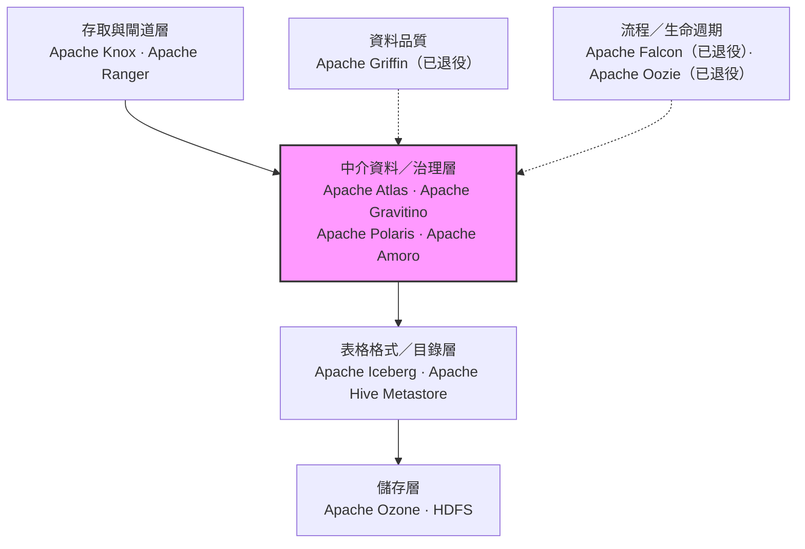
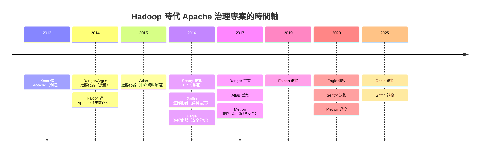
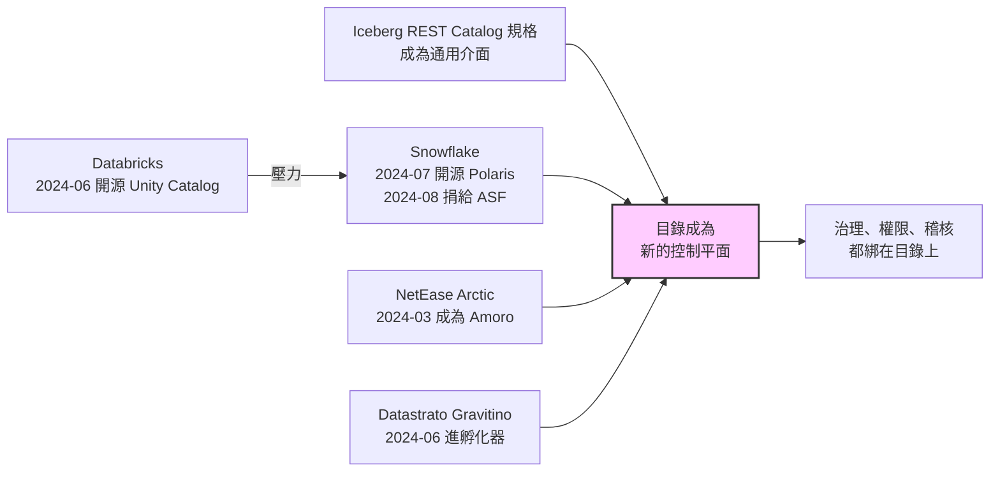
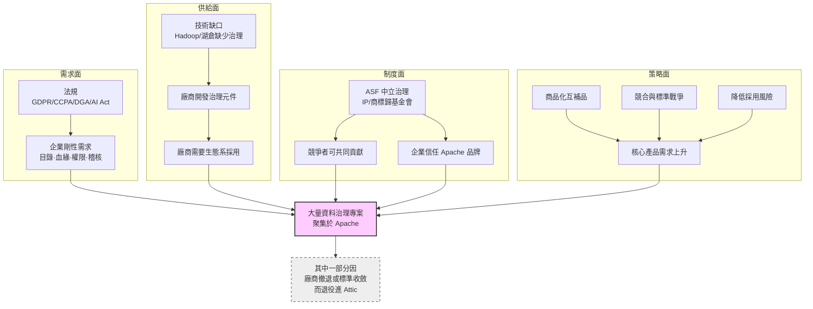

# 為什麼 Apache 底下有這麼多資料治理相關的專案？

> 一份從技術史、開源治理制度、商業策略與法規驅動四個角度切入的獨立研究報告。
> 撰寫日期：2026-11-24。

---

## 摘要

Apache 軟體基金會（Apache Software Foundation，以下簡稱 ASF）旗下確實聚集了異常大量的資料治理（data governance）相關專案：Apache Atlas、Apache Ranger、Apache Knox、Apache Griffin、Apache Sentry（已退役）、Apache Falcon（已退役）、Apache Gravitino、Apache Polaris、Apache Amoro、Apache Iceberg、Apache Hive Metastore 等[^projects]。

這個現象不是巧合，而是四股力量疊加的結果：

1. **技術史因素**：2010 年代 Hadoop 生態系在企業內落地時，發現「治理」是缺失的關鍵拼圖，於是各家廠商（尤其是 Hortonworks）把自己的治理元件捐給 ASF，以換取生態系的信任與採用[^atlas-proposal][^xa-secure]。
2. **治理制度因素**：ASF 的「The Apache Way」提供了一個**廠商中立**、程式碼所有權屬於基金會（而非任何公司）的場域，讓互相競爭的廠商可以在同一張桌子上合作[^apacheway][^independence]。
3. **商業策略因素**：把「互補品」（complement）開源化並交給中立基金會，可以壓低互補品價格、擴大自家核心產品的需求，這是經典的「商品化你的互補品」策略[^strategyv]。
4. **法規驅動因素**：GDPR（2018）、CCPA/CPRA（2020/2023）、歐盟資料治理法（2023 適用）、歐盟 AI 法案（2024 生效）等法規，把資料目錄（data catalog）、資料血緣（data lineage）、存取控制（access control）從「nice to have」變成「法律義務」[^gdpr][^ccpa][^dga][^aiact]。

換句話說：**Apache 之所以有這麼多資料治理專案，是因為「資料治理」剛好同時是一門技術缺口、一個中立治理問題、一筆商業算盤，以及一項法律義務。**

---

## 一、先定義：「資料治理」到底包含什麼？

在討論 Apache 專案之前，必須先定義範疇。業界最通用的框架是 **DAMA-DMBOK**（Data Management Body of Knowledge），由 DAMA International 出版。第二版（2017）把資料管理拆成 11 個知識領域，並以「資料治理」為中心樞紐[^dmbok]：

| 知識領域 | 範圍 | 對應的工具型態 |
|---|---|---|
| **資料治理** | 政策、角色、問責、標準 | 治理章程、資料 stewards |
| 資料架構 | 企業資料模型與藍圖 | 概念／邏輯模型 |
| 資料建模與設計 | 概念／邏輯／實體模型 | ERD、維度模型 |
| 資料儲存與作業 | 資料庫管理、備份、效能 | Runbook、SLA |
| **資料安全** | 存取控制、加密、遮罩、法規遵循 | 存取矩陣、稽核軌跡 |
| 資料整合與互通 | ETL/ELT、API、複寫 | 資料管線、資料契約 |
| 文件與內容管理 | 非結構化資料治理 | 保留政策 |
| **參考資料與主資料管理（MDM）** | 黃金紀錄、單一真實來源 | 主資料中樞 |
| 資料倉儲與 BI | 分析工作負載 | 倉儲、儀表板 |
| **中介資料管理（Metadata Management）** | 血緣、定義、技術／業務中介資料 | 資料目錄、血緣圖 |
| **資料品質管理** | 準確、完整、一致、即時、有效、唯一 | DQ 計分卡 |

註：DAMA-DMBOK 各版本的知識領域數目與名稱略有差異，本表採用第二版（2017）的架構，僅作範疇界定之用，非精確清單[^dmbok]。

[^dmbok]: DAMA International. (n.d.). *DAMA-DMBOK framework: The 11 knowledge areas*. Retrieved 2026-11-24, from https://www.damadmbok.org/dmbok-framework

**關鍵觀察**：資料治理不是「一個」功能，而是**一整組**功能。這解釋了為什麼 Apache 底下會有「很多個」治理專案，而不是一個：每個子功能（安全、血緣、品質、目錄、閘道）都有獨立的技術問題、獨立的貢獻者社群、獨立的生命週期。

下圖呈現這些 Apache 專案如何對應到治理堆疊的不同層：

---

## 二、技術史：Hadoop 落地時發現「治理」是缺口

### 2.1 治理缺口從何而來

2000 年代末到 2010 年代，Hadoop 生態系快速膨脹：HDFS 負責儲存、MapReduce 負責運算、Hive 負責 SQL、HBase 負責隨機存取、Kafka 負責串流。但企業要真正把 Hadoop 用於受監管的場景（金融、醫療、電信），會立刻撞到一道牆：

> 「我可以存下 PB 級的資料，但我說不出這些資料從哪來、誰有權限看、有沒有個資、能不能稽核。」

Apache Atlas 的孵化器提案（2015）把這個問題講得非常直白：**「目前沒有一個簡單或完整的方式，能對需要橫跨 Hadoop 與非 Hadoop 處理的工作流程，提供完整的稽核、血緣與安全可視性與控制。」** 提案並強調「Atlas 填補了 Hadoop 生態系在資料治理與法規遵循管理上長期缺乏的缺口」[^atlas-proposal]。

### 2.2 Hortonworks 把治理元件捐出來

真正的關鍵角色是 **Hortonworks**。Hortonworks 於 2011 年由 Yahoo! 的 Hadoop 團隊成員獨立出來，商業模式是「100% 開源」：提供完全開源的 Hadoop 發行版（HDP），靠支援、服務與管理工具賺錢，刻意與當時販售專有元件的 Cloudera 做出區隔[^hortonworks-wiki]。

在這個策略下，Hortonworks 做了兩次關鍵捐贈：

| 專案 | 原始來源 | 進入 Apache 孵化器 | 畢業為頂級專案 | 備註 |
|---|---|---|---|---|
| **Apache Ranger** | XA Secure（2013 年成立的公司） | 2014-07-24（當時名為 Apache Argus） | 2017-01-18 | Hortonworks 於 2014-05-15 收購 XA Secure[^xa-secure] |
| **Apache Atlas** | Hortonworks 主導的 Data Governance Initiative（DGI） | 2015-05-06 | 2017-06-21 | 與金融、醫療、能源、零售、製藥等跨產業組織共同孵化[^atlas-incubator][^atlas-proposal] |

Hortonworks 收購 XA Secure 時的新聞稿直接說明意圖：**「Hortonworks 將立即把 XA Secure 技術整合進 Hortonworks Data Platform（HDP），同時也把該解決方案轉型為開放的 Apache 社群專案。」** 時任副總裁 Tim Hall 對媒體表示：**「我們承諾 100% 開源，因此我們會把底層軟體元件捐給 Apache 軟體基金會，透過孵化流程開源給所有人。」**[^xa-secure][^zdnet]

值得注意的是，Ranger 在孵化期間從「Argus」改名為「Ranger」，據稱是向美國影集《Walker, Texas Ranger》的主角 Chuck Norris 致敬[^infoworld-ranger]。

### 2.3 一次出現一整批：Hadoop 時代的治理專案群

Atlas 與 Ranger 只是冰山一角。同一時期進入 Apache 的治理／資料管理專案還包括：

| 專案 | 功能 | 進入 Apache | 現況 |
|---|---|---|---|
| Apache Sentry | Hadoop 細粒度授權 | 2016 成為 TLP | **已退役**（2020-12 退役，2021-04 進 Attic）[^sentry] |
| Apache Griffin | 大資料資料品質（批次＋串流） | 2016 進孵化器，2018 成為 TLP | **已退役**（2025 退役）[^griffin] |
| Apache Falcon | 資料生命週期／管線管理 | 2014 | **已退役**（2019-06）[^attic] |
| Apache Eagle | 大資料安全與效能分析 | 2016 | **已退役**（2020-11）[^attic] |
| Apache Metron | 即時大資料安全 | 2017 | **已退役**（2020-12）[^attic] |
| Apache Knox | Hadoop REST 閘道（認證、SSO、稽核） | 2013 | 活躍（TLP）[^knox] |
| Apache Oozie | Hadoop 工作流程排程 | 2012 | **已退役**（2025-02）[^attic] |

[^sentry]: Apache Software Foundation. (2021). *Apache Sentry — Apache Attic*. Retrieved 2026-11-24, from https://attic.apache.org/projects/sentry.html
[^griffin]: Apache Software Foundation. (n.d.). *Apache Griffin*. Retrieved 2026-11-24, from https://griffin.apache.org/
[^knox]: Apache Software Foundation. (n.d.). *Apache Knox*. Retrieved 2026-11-24, from https://knox.apache.org/

這張表同時揭示了本文的核心張力：**Apache 是資料治理專案的聚集地，但也是它們的墳場。** 稍後第七節會回來處理這件事。

### 2.4 為什麼是「很多個」而不是「一個」

用生態系的角度看，答案很簡單：**治理堆疊有多層，每層的技術問題不同，貢獻者社群也不同。**

每一層各自有廠商想「標準化」的東西：Cloudera 想做授權、Hortonworks 想做中介資料、各家都想做目錄。當這些廠商都選擇把元件交給 ASF（原因見第四、五節），結果就是同一個領域在 Apache 底下累積出一大堆專案。

---

## 三、制度面：ASF 為什麼能成為「中立場域」

### 3.1 The Apache Way 的設計就是為了防止單一廠商綁架

ASF 的治理哲學「The Apache Way」有幾個關鍵支柱，每一個都在防止某家公司獨占專案方向[^apacheway][^howitworks]：

| 原則 | 對資料治理的意義 |
|---|---|
| **Earned Authority（功績制）** | 影響力來自個人貢獻，而非僱主。Cloudera 的工程師與 Hortonworks 的工程師票票等值。 |
| **Community of Peers** | 「參與 ASF 的是個人，不是組織。」每個人都以自己的身分參與。 |
| **Consensus Decision Making** | 沒有 BDFL、沒有企業否決權，採 lazy consensus。 |
| **Vendor Independence** | 董事會會關切 PMC 的僱主多樣性；被單一公司主導的 PMC 會被檢視。 |

ASF 官方文件寫得很清楚：**「ASF 嚴格保持廠商中立。任何組織都無法取得特殊特權或控制專案方向，無論它僱用了多少 Committer 或贊助金額多高。」**[^apacheway]

而專案獨立性頁面進一步說明為什麼這件事對「貢獻者」重要：

> 「PMC 被認為是獨立運作、不偏袒任何特定第三方的觀感，對於讓新貢獻者願意加入社群並貢獻成果很重要。一個明顯以某種排他方式偏袒特定廠商的社群，往往會讓競爭廠商的貢獻者卻步。」[^independence]

[^apacheway]: Apache Software Foundation. (n.d.). *The Apache Way*. Retrieved 2026-11-24, from https://www.apache.org/theapacheway/
[^howitworks]: Apache Software Foundation. (n.d.). *How the ASF works*. Retrieved 2026-11-24, from https://www.apache.org/foundation/how-it-works.html
[^independence]: Apache Software Foundation. (n.d.). *Project independence*. Retrieved 2026-11-24, from https://community.apache.org/projectIndependence.html

### 3.2 關鍵機制：基金會擁有程式碼與商標

技術上，讓中立性「可信」的不是口號，而是**法律結構**：

- ASF 是美國 501(c)(3) 非營利組織，專案的**智慧財產權與商標**由基金會持有，不屬於任何公司[^apacheway][^howitworks]。
- 貢獻者必須簽署 CLA（Contributor License Agreement），IP 移轉紀錄可稽核。
- **Apache License 2.0** 是不可撤回的寬鬆授權：允許商業使用、修改、再散布、再授權，並在第 3 條包含**明確的專利授權**[^license]。
- ASF 明確禁止「使用領域限制」（field-of-use restrictions）[^license]。

[^license]: Apache Software Foundation. (2004). *Apache License, Version 2.0*. Retrieved 2026-11-24, from https://www.apache.org/licenses/LICENSE-2.0.html

這組條件合起來的效果是：**競爭廠商可以安全地共同貢獻同一份程式碼，因為沒有人能把它變成專有資產，也沒有人能單方面改變規則。** 這是資料治理這種「橫跨所有廠商」的基礎設施能被共同開發的前提。

### 3.3 為什麼不是 CNCF 或 LF AI & Data

一個自然的疑問是：為什麼這些專案選擇 ASF，而不是 Linux Foundation 體系（CNCF、LF AI & Data）？

- ASF 的治理被普遍認為**較嚴格**：孵化器流程要求 IP 清理、社群多樣性、公開投票，且專案畢業後由基金會持有商標與 IP[^howitworks]。
- Linux Foundation 的專案治理可以較為寬鬆，實務上單一廠商的影響力有時較大。舉例來說，Databricks 在 2024 年把 Unity Catalog 開源並交給 **LF AI & Data**，而 Snowflake 則把 Polaris 捐給 **ASF**；外界普遍解讀這是兩種「中立性強度」的選擇[^unity][^polaris]。
- 對受監管的企業客戶而言，「Apache」這塊招牌在採購與法務盡職調查上，是相對容易通過的信任訊號[^brand][^advocacy]。

[^brand]: Apache Software Foundation. (n.d.). *ASF trademarks*. Retrieved 2026-11-24, from https://www.apache.org/foundation/marks/
[^advocacy]: Apache Software Foundation. (n.d.). *Corporate advocacy and the ASF brand*. Retrieved 2026-11-24, from https://community.apache.org/companies/advocacy.html

---

## 四、商業策略：把「互補品」開源化並捐出去

### 4.1 商品化你的互補品（Commoditize Your Complement）

經濟學上的核心原則是 Joel Spolsky 在 2002 年〈Strategy Letter V〉提出的說法：

> **「當一個產品的互補品價格下降時，對該產品的需求會上升。」**[^strategyv]

[^strategyv]: Spolsky, J. (2002, June 12). *Strategy letter V*. Joel on Software. Retrieved 2026-11-24, from https://www.joelonsoftware.com/2002/06/12/strategy-letter-v/

策略意涵是：**把你核心產品的互補品做得又便宜、又普及、又沒有差異化，你的核心產品就會賣得更好。**

應用到資料治理：

| 捐贈者 | 捐出的專案（互補品） | 真正的利潤中心 |
|---|---|---|
| Hortonworks | Atlas、Ranger（治理與安全層） | HDP 發行版的支援與服務[^hortonworks-wiki] |
| Snowflake | Polaris（Iceberg 目錄） | Snowflake 資料雲與 Horizon Catalog 服務[^polaris] |
| NetEase | Amoro（湖倉管理） | 網易自身的資料平台與雲服務[^amoro] |
| Datastrato | Gravitino（聯邦式中介資料湖） | 多雲資料治理顧問與服務[^gravitino] |

[^hortonworks-wiki]: Wikipedia. (n.d.). *Hortonworks*. Retrieved 2026-11-24, from https://en.wikipedia.org/wiki/Hortonworks
[^gravitino]: Apache Software Foundation. (n.d.). *Apache Gravitino*. Retrieved 2026-11-24, from https://gravitino.apache.org/

以 Hortonworks 為例：把治理層（Atlas）與安全層（Ranger）開源並交給 ASF，等於把「治理」變成免費、普及的商品，讓整個 Hadoop 生態系更容易被企業採用，而 Hortonworks 則在發行版、支援與服務上獲利。

### 4.2 競合（Coopetition）：在共同基礎上合作，在產品上競爭

ASF 官方對企業參與的說法是「**在共同之處合作，在差異之處競爭**」[^benefits]。資料治理剛好是「共同之處」的典型：

- 沒有單一廠商能獨力維護橫跨 Hive、HBase、Kafka、Spark、Trino、Iceberg 的治理層。
- 沒有任何廠商願意採用**競爭對手所控制**的治理工具（因為治理工具掌握權限與稽核，是命脈）。
- 於是「交給中立基金會」成為唯一能讓所有人接受的解。

ASF 對此的官方理由是：**「ASF 對專案的基本要求，主要目的之一是確保專案長壽與穩定：擁有足夠廣泛的社群，即使任何個別志工或任何主要廠商發生劇變，專案仍能維持。」**[^independence]

[^benefits]: Apache Software Foundation. (n.d.). *Benefits of corporate participation*. Retrieved 2026-11-24, from https://community.apache.org/companies/benefits.html

### 4.3 降低採用風險（De-risking）

對企業買方而言，採用「單一廠商擁有的開源專案」有幾種風險：授權可能改變（MongoDB、Redis、Elastic 都改過授權）、公司可能被併購、可能被放棄、可能倒閉。捐給 ASF 等於一次消除這些風險，因為商標與 IP 由基金會持有、授權不可撤回、治理公開可稽核[^independence][^license][^brand]。

學術上，Dirk Riehle 對單一廠商開源模式的分析指出，這類模式的關鍵挑戰在於「如何把免費用戶轉為付費客戶」，這使得廠商與使用者的誘因可能不一致[^riehle]。

[^riehle]: Riehle, D. (2020). Single-vendor open source firms and their intellectual property strategies. Retrieved 2026-11-24, from https://dirkriehle.com/publications/2020-selected/single-vendor-open-source-firms-and-their-intellectual-property-strategies/

### 4.4 標準戰爭（Standards Wars）

最後一層策略是標準之爭。把技術交給基金會，等於宣告「這是任何廠商都能實作的開放標準」，藉此擊敗對手的專有替代方案。Snowflake 把 Polaris 捐給 ASF 就是典型案例：Snowflake 在 2024 年面對 Databricks 剛開源 Unity Catalog 的壓力，選擇把 Polaris 交給中立性更強的 ASF，讓 AWS、Google Cloud、Microsoft、Confluent、Dremio 等 Databricks 的競爭者都願意貢獻[^polaris]。

[^polaris]: Snowflake. (2024). *Apache Polaris: The open, fully-featured catalog for Apache Iceberg*. Snowflake Engineering Blog. Retrieved 2026-11-24, from https://www.snowflake.com/en/blog/engineering/apache-polaris-iceberg-rest-catalog/

---

## 五、第二代浪潮：湖倉目錄之戰

### 5.1 從「Hadoop 治理」到「湖倉目錄」

2018 年之後，資料架構的重心從 Hadoop 轉向雲端湖倉（lakehouse）。Apache Iceberg（2018 進孵化器，2020 畢業）成為開放表格格式的事實標準，於是戰場轉移到**目錄（catalog）**，也就是所有引擎在讀寫資料前必須先溝通的「中介資料控制平面」[^iceberg]。

第二代的 Apache 治理／目錄專案包括：

| 專案 | 捐贈者 | 進入 Apache | 定位 |
|---|---|---|---|
| **Apache Iceberg** | Netflix（社群共同開發） | 2018 進孵化器，2020 畢業 | 開放表格格式＋REST Catalog 規格[^iceberg] |
| **Apache Amoro**（前身 NetEase Arctic） | 網易（NetEase） | 2024-03-11 進孵化器 | 湖倉管理系統（自動 compaction）[^amoro] |
| **Apache Gravitino** | Datastrato | 2024-06 進孵化器 | 聯邦式中介資料湖（catalog of catalogs）[^gravitino] |
| **Apache Polaris** | Snowflake | 2024-08 進孵化器 | Iceberg REST Catalog 的參考實作[^polaris] |

[^iceberg]: Apache Software Foundation. (n.d.). *Apache Iceberg*. Retrieved 2026-11-24, from https://iceberg.apache.org/
[^amoro]: Apache Software Foundation. (n.d.). *Apache Amoro*. Retrieved 2026-11-24, from https://amoro.apache.org/

### 5.2 為什麼一次冒出四個

這四個專案的進入時間高度集中（2024 年 3 月到 8 月），原因不是巧合，而是**目錄層成為新的鎖定點**：

當 Iceberg 贏得「格式之戰」後，各家發現真正的差異化（也就是鎖定客戶的地方）在於：**誰控制目錄，誰就控制治理、權限、憑證發放與稽核。** 於是「目錄」成為兵家必爭之地，而「把目錄交給中立基金會」成為吸引多雲客戶的必要條件[^polaris][^unity]。

[^unity]: Databricks. (2024). *Open sourcing Unity Catalog*. Retrieved 2026-11-24, from https://www.databricks.com/blog/open-sourcing-unity-catalog

### 5.3 為什麼 NetEase 與 Datastrato 也要捐

- **NetEase（Amoro）**：網易本業是消費網路與遊戲，不是資料基礎設施公司。把專案留在自家品牌下，中國的競爭對手（阿里巴巴、騰訊、百度）不會採用；捐給 ASF 才取得中立與國際治理[^amoro]。
- **Datastrato（Gravitino）**：Datastrato 的商業模式是顧問與服務，不是賣 Gravitino 產品。捐給 ASF 讓 AWS、GCP 等雲廠商願意貢獻與採用[^gravitino]。

這兩個案例清楚展示了第四節的邏輯：**當你的利潤中心不在那個軟體層時，把該層中立化、普及化對你最有利。**

---

## 六、法規驅動：為什麼「企業非得買／用」這些東西

技術與商業策略解釋了「供給面」，法規則解釋了「需求面」。資料治理之所以在 2018 年後爆發，是因為一連串法規把治理能力變成法律義務。

| 法規 | 生效時間 | 對治理工具的具體要求 |
|---|---|---|
| **HIPAA** | 1996 制定，2003 隱私規則 | 受保護健康資訊（PHI）的存取控制與稽核軌跡[^hipaa] |
| **BCBS 239** | 2013 發布，2016 生效 | 風險資料聚合與報告的 14 項原則：準確、完整、即時、可調適[^bcbs] |
| **GDPR** | **2018-05-25 生效** | 處理活動紀錄（第 30 條）、資料主體權利、72 小時通報、問責義務[^gdpr] |
| **CCPA／CPRA** | 2020-01 生效／2023-01 生效 | 知情權、刪除權、更正權、敏感資料限制[^ccpa] |
| **歐盟資料治理法（DGA）** | 2022 通過，**2023-09-24 適用** | 資料中介服務、公部門資料再利用、資料利他制度[^dga] |
| **歐盟 AI 法案** | **2024-08-01 生效** | 高風險 AI 的訓練資料必須「相關、具代表性、無錯誤、完整」，需記錄資料來源與血緣[^aiact] |

[^hipaa]: U.S. Department of Health & Human Services. (n.d.). *HIPAA privacy rule*. Retrieved 2026-11-24, from https://www.hhs.gov/hipaa/
[^bcbs]: Wikipedia. (n.d.). *BCBS 239*. Retrieved 2026-11-24, from https://en.wikipedia.org/wiki/BCBS_239
[^gdpr]: GDPR.eu. (n.d.). *What is the GDPR?* Retrieved 2026-11-24, from https://gdpr.eu/what-is-gdpr/
[^ccpa]: Wikipedia. (n.d.). *California Consumer Privacy Act*. Retrieved 2026-11-24, from https://en.wikipedia.org/wiki/California_Consumer_Privacy_Act
[^dga]: Wikipedia. (n.d.). *Data Governance Act*. Retrieved 2026-11-24, from https://en.wikipedia.org/wiki/Data_Governance_Act
[^aiact]: European Union. (2024). *Article 10 — Data and data governance*. EU Artificial Intelligence Act. Retrieved 2026-11-24, from https://artificialintelligenceact.eu/article/10/

GDPR 是轉捩點。它要求企業能回答「這筆個人資料從哪來、流到哪裡、誰看過」，這正好對應到資料目錄（discovery）、資料血緣（lineage）、分類標記（classification）與存取控制。歐盟 AI 法案則更進一步，要求高風險 AI 系統的訓練資料必須可追溯、可證明品質[^aiact]。

市場數據也反映了這個需求：多家研究機構估計資料治理市場在 2024 至 2025 年間約為 **47 至 52 億美元**，並以每年約 **20% 以上**的速度成長，2030 年代初期可能達到 **160 至 230 億美元**[^markets]。資料目錄的細分市場則被估計從 2024 年約 **10.6 億美元**成長到 2032 年約 **45 億美元**[^catalogmarket]。

[^markets]: Strategic Market Research. (2025). *Data governance market report*. Retrieved 2026-11-24, from https://www.strategicmarketresearch.com/market-report/data-governance-market
[^catalogmarket]: Fortune Business Insights. (2025). *Data catalog market size, share and trends*. Retrieved 2026-11-24, from https://www.fortunebusinessinsights.com/data-catalog-market-108640

**需求面的結論**：法規創造了剛性需求，剛性需求創造了市場，市場吸引了廠商投入，而廠商選擇把治理元件交給中立基金會以加速採用。這就是為什麼 Apache 底下會聚集這麼多治理專案。

---

## 七、反面：Apache 也是資料治理專案的墳場

如果只談聚集，這份報告會失真。事實上，Apache 的治理模型也導致大量治理專案**死亡**。

Apache Attic（閣樓）是退役專案的歸宿：專案一旦進入 Attic，程式碼轉為唯讀、停止發布[^attic]。截至 2026 年，Attic 上有超過 100 個專案，其中與資料／Hadoop 生態系直接相關者接近 30 個[^attic]，包括：

- **Apache Sentry**（細粒度授權）：2016-03 成為 TLP，2020-12 退役，2021-04 進 Attic。它被 Ranger 取代，並隨著 Hadoop 生態系衰退而消亡[^sentry]。
- **Apache Griffin**（資料品質）：2016 進孵化器，2018 成為 TLP，2025 退役[^griffin]。
- **Apache Falcon**（資料生命週期管理）：2014 進 Apache，2019-06 退役[^attic]。
- **Apache Eagle**（大資料安全分析）：2016 進孵化器，2020-11 退役[^attic]。
- **Apache Metron**（即時大資料安全）：2017 進孵化器，2020-12 退役[^attic]。
- **Apache Chukwa**（大規模分散式系統的資料收集）：2013 成為 TLP，2020-05 退役[^attic]。
- **Apache Oozie**（工作流程排程）：2012 進 Apache，2025-02 退役[^attic]。

[^attic]: Apache Software Foundation. (n.d.). *Apache Attic — Projects*. Retrieved 2026-11-24, from https://attic.apache.org/projects.html

2020 年 5 月，一批 Hadoop 生態系專案在 11 天內集中退役，被媒體以「11 天內 13 個專案退休，Hadoop 在藤上枯萎」為題報導，解讀為 Hadoop 時代結束的訊號[^nextplatform]。Sentry 的案例尤其說明問題：**當 Ranger 成為事實標準後，Sentry 就失去了存在意義**，即使它是個 Apache 頂級專案也一樣。

必須注意的是，該次「13 個專案」的**具體名單在不同來源間並不一致**，且部分流傳名單有明顯錯誤（例如有報導把 Apache Knox 列入退役，但 Knox 至今仍是活躍的頂級專案）[^knox][^nextplatform]。因此本報告只採用可交叉驗證的部分：**Sentry、Falcon、Eagle、Metron、Chukwa 等 Hadoop 周邊專案確實在 2019 至 2020 年間陸續退役**，但不宜引用未經核實的完整名單。這也提醒讀者：關於 ASF 專案狀態的二手報導經常過時或有誤，應以官方專案清單為準。

### 7.1 贊助廠商的撤退：Hortonworks 併入 Cloudera 與 Cloudera 私有化

退役潮的結構性原因是**贊助廠商本身的消失**。Atlas 與 Ranger 的原始贊助者是 Hortonworks，而 Hortonworks 在 2018 年 10 月宣布與 Cloudera 以全股票方式合併（約 52 億美元，Cloudera 股東持有約 60%、Hortonworks 股東約 40%），並於 2019 年 1 月 3 日完成[^merger]。合併後的新公司擁有約 7.2 億美元年營收與 2,500 家以上客戶[^merger]。

有趣的是，Atlas 與 Ranger **並沒有**在這波退役中消失。相反地，它們被選為合併後 Cloudera Data Platform（CDP）的治理基礎：Cloudera 的 Shared Data Experience（SDX）層以 Atlas 提供中介資料與血緣、以 Ranger 提供細粒度授權，兩者緊密整合[^clearpeaks][^cdp-docs]。Cloudera 的說法是：**「Hadoop 只是支撐 CDP 的 30 多個開源專案之一……從商業角度看它只占一小部分，但仍在。今天我們把 Hadoop 視為一種哲學，而非一種技術。」**[^nextplatform-cloudera]

隨後在 2021 年，Cloudera 被私募基金 **KKR 與 Clayton, Dubilier & Rice（CD&R）** 以約 53 億美元全現金收購並私有化（2021-06-01 宣布，2021-10-08 完成，每股 16 美元，較前收盤溢價約 24%）[^takeprivate]。

[^merger]: Cloudera. (2019, January 3). *Cloudera and Hortonworks complete planned merger* [Press release]. Retrieved 2026-11-24, from https://www.cloudera.com/about/news-and-blogs/press-releases/2019-01-03-cloudera-and-hortonworks-complete-planned-merger.html

[^takeprivate]: TechCrunch. (2021, June 1). *Cloudera to go private as KKR & CD&R grab it for $5.3B*. Retrieved 2026-11-24, from https://techcrunch.com/2021/06/01/cloudera-to-go-private-as-kkr-cdr-grab-it-for-5-3b/

[^clearpeaks]: ClearPeaks. (2023, February). *Data governance with Apache Atlas — Atlas in Cloudera Data Platform (part 2 of 3)*. Retrieved 2026-11-24, from https://www.clearpeaks.com/data-governance-with-apache-atlas-atlas-in-cloudera-data-platform-part-2-of-3/

[^cdp-docs]: Cloudera. (n.d.). *Governance with Atlas and Ranger on CDP*. Retrieved 2026-11-24, from https://docs.cloudera.com/cdp-private-cloud-base/7.1.9/concepts-governance.html

[^nextplatform]: The Next Platform. (2020). *13 projects retired in 11 days: Apache Hadoop withers on the vine*. Retrieved 2026-11-24, from https://www.nextplatform.com/

[^nextplatform-cloudera]: The Next Platform. (2021, March 1). *Cloudera pivots to data management as Hadoop fades*. Retrieved 2026-11-24, from https://www.nextplatform.com/

這段歷史正好補上第七節的因果：**當單一贊助廠商被併購、轉型、甚至下市，仰賴該廠商投入的 Apache 專案就會失去動能。** 而 Atlas 與 Ranger 之所以倖存，是因為它們在新東家（Cloudera CDP）的產品線中仍占據關鍵位置；Sentry 則因為功能被 Ranger 取代而失去存在理由。**專案能否存活，取決於是否仍有廠商在商業上需要它**，而非取決於它是不是 Apache 頂級專案。

同時，Apache 的治理模型也受到批評：

- **The Apache Way 可能流於教條**：ASF 成員 Xuanwo 在〈What did ASF do wrong?〉中指出，「經過 25 年，Apache Way 的本質似乎不再鮮活……許多人與專案開始以教條式的方式遵循 Apache Way」，並批評強制使用郵件列表、發布流程冗長等問題[^xuanwo]。
- **「個人而非組織」的原則可能是虛構**：Apache Samza 創作者、ASF PMC 成員 Chris Riccomini 直言：「Apache 完全否認任何直接的公司參與……這是一場鬧劇。他們許多專案由單一公司主導。」他也指出 Apache 的悖論：「Apache 的矛盾之一是，它把開發者教育得太好，以至於他們最終會『長大』離開它。」[^riccomini]

必須強調，這些批評**不否定**第三節所述「制度設計上追求中立」的事實，而是指出**制度理想與實務落差**：中立性是規則上的目標，但專案實務上仍高度依賴少數贊助廠商的工程資源。這正是第八節模型中「供給面」與「制度面」之間的張力所在。

[^xuanwo]: Xuanwo. (2024). *What did ASF do wrong?* Retrieved 2026-11-24, from https://xuanwo.io/2024/09-what-did-asf-do-wrong/
[^riccomini]: Riccomini, C. (2025). *Comparing Apache, CNCF, and Commonhaus*. Retrieved 2026-11-24, from https://cnr.sh/posts/comparing-apache-cncf-commonhaus/

**為什麼會有這麼多失敗？** 部分原因是 Apache 的「功績制＋共識制」設計，使得專案難以在缺乏足夠社群多樣性時維持動能；當單一贊助廠商撤退（例如 Hortonworks 被 Cloudera 併購、Hadoop 生態系整體衰退），專案便快速失血。換句話說，**聚集與死亡是同一個制度設計的一體兩面**：同一個中立、開放的結構既吸引廠商捐贈，也讓專案在失去多方支持時無法被單一廠商硬撐下去。

---

## 八、綜合解釋模型

把四股力量疊起來，可以得到一個完整的解釋：

用一句話總結：**資料治理是一組「橫跨所有廠商」的基礎設施功能，而 Apache 是唯一能讓互相競爭的廠商共同開發基礎設施的中立場域；當法規在 2018 年後創造出剛性需求時，廠商便把各自的治理元件大量捐給 Apache，於是形成今日的專案群聚。**

---

## 九、來源可信度反思

依研究規範，這裡必須對來源做批判性反思：

1. **官方一手文件可信度高**：ASF 官方頁面（The Apache Way、How It Works、Project Independence、Attic、專案官網）與孵化器狀態頁，是治理制度與時間點的主要依據。這些來源立場上會**正面描述 ASF**，因此「中立性很強」這類敘述應理解為「制度設計如此」，而非「從未發生偏差」；第七節的批評來源正好提供平衡。
2. **廠商部落格（Snowflake、Databricks）帶有商業立場**：描述「捐贈是為了開源精神」時，應理解為同時也是競爭策略。本報告已將其置於「策略面」脈絡中解讀。
3. **市場規模數字分歧大**：不同研究機構對資料治理市場的估計差異可達數倍（2025 年從 34 億到 54 億美元），因此本報告只呈現**量級與成長率趨勢**，不引用單一精確數字。這類市場報告多為付費研究，方法論透明度有限，應謹慎對待。
4. **部分專案狀態存在來源衝突**：例如 Gravitino 的畢業狀態在不同來源說法不一（有來源稱 2025-06 畢業，亦有來源稱仍在孵化），Polaris 的畢業時間亦有 2026-02 之說。由於 ASF 專案狀態變動頻繁，本報告在正文中已盡量標註「截至 2026 年」並避免對單一時間點做強斷言。**建議以 `https://projects.apache.org/` 與 `https://attic.apache.org/projects.html` 的即時資料為最終依據。**
5. **未經證實的軼事**：例如 Ranger 命名向 Chuck Norris 致敬一事，來自媒體報導，屬於趣味軼事而非治理事實，報告中已明確標示其性質。
6. **「13 個專案在 11 天內退役」的名單不可靠**：流傳於二手報導的名單彼此矛盾，且至少有一份名單錯誤地把仍活躍的 Apache Knox 列為退役。因此本報告只採用可與 Apache Attic 官方頁面交叉驗證的個別專案（Sentry、Falcon、Eagle、Metron、Chukwa），並在第七節明確說明此限制。
7. **本報告未逐一驗證所有 GitHub 星數**：由於主題為制度與策略分析而非專案評選，未將星數列為主要指標；若需比較專案熱度，應另以 GitHub API 取得即時數據。

---

## 十、結論

「為什麼 Apache 底下有這麼多資料治理專案？」這個問題的答案，不是單一原因，而是四個層次的疊加：

1. **技術層**：治理是一整組功能（安全、血緣、品質、目錄、閘道），不是單一功能，因此天然會分裂成多個專案。
2. **制度層**：ASF 的廠商中立治理（IP 與商標歸基金會、功績制、共識決）是唯一能讓競爭廠商共同開發治理層的結構。
3. **策略層**：對廠商而言，把治理層商品化並交給中立基金會，能壓低互補品成本、擴大核心產品需求、在標準戰爭中取得正當性、並降低企業客戶的採用風險。
4. **法規層**：2018 年後的 GDPR、CCPA/CPRA、歐盟資料治理法與 AI 法案，把治理能力變成法律義務，創造了足以支撐數十億美元市場的剛性需求。

同時也必須記得：**Apache 的中立治理模型既吸引專案聚集，也導致大量專案在失去多方支持後進入 Attic。** Sentry、Falcon、Eagle、Metron、Griffin 的退役，與 Atlas、Ranger、Iceberg、Polaris 的活躍，是同一套制度在不同條件下的兩種結果。

因此，更精確的說法或許是：**Apache 之所以聚集大量資料治理專案，是因為它同時是「資料治理的技術缺口所在」、「廠商唯一能共同合作的中立場域」、「廠商策略的最佳工具」，以及「法規義務的技術落點」。** 四個條件缺一不可。

---

## 參考文獻

Apache Software Foundation. (2004). *Apache License, Version 2.0*. Retrieved 2026-11-24, from https://www.apache.org/licenses/LICENSE-2.0.html

Apache Software Foundation. (n.d.). *Apache Amoro*. Retrieved 2026-11-24, from https://amoro.apache.org/

Apache Software Foundation. (n.d.). *Apache Attic — Projects*. Retrieved 2026-11-24, from https://attic.apache.org/projects.html

Apache Software Foundation. (n.d.). *Apache Gravitino*. Retrieved 2026-11-24, from https://gravitino.apache.org/

Apache Software Foundation. (n.d.). *Apache Griffin*. Retrieved 2026-11-24, from https://griffin.apache.org/

Apache Software Foundation. (n.d.). *Apache Iceberg*. Retrieved 2026-11-24, from https://iceberg.apache.org/

Apache Software Foundation. (n.d.). *Apache Knox*. Retrieved 2026-11-24, from https://knox.apache.org/

Apache Software Foundation. (n.d.). *Apache Polaris*. Retrieved 2026-11-24, from https://polaris.apache.org/

Apache Software Foundation. (n.d.). *Apache Ranger*. Retrieved 2026-11-24, from https://ranger.apache.org/

Apache Software Foundation. (n.d.). *Apache Sentry — Apache Attic*. Retrieved 2026-11-24, from https://attic.apache.org/projects/sentry.html

Apache Software Foundation. (n.d.). *ASF trademarks*. Retrieved 2026-11-24, from https://www.apache.org/foundation/marks/

Apache Software Foundation. (n.d.). *Benefits of corporate participation*. Retrieved 2026-11-24, from https://community.apache.org/companies/benefits.html

Apache Software Foundation. (n.d.). *Corporate advocacy and the ASF brand*. Retrieved 2026-11-24, from https://community.apache.org/companies/advocacy.html

Apache Software Foundation. (n.d.). *How the ASF works*. Retrieved 2026-11-24, from https://www.apache.org/foundation/how-it-works.html

Apache Software Foundation. (n.d.). *Project independence*. Retrieved 2026-11-24, from https://community.apache.org/projectIndependence.html

Apache Software Foundation. (n.d.). *The Apache Way*. Retrieved 2026-11-24, from https://www.apache.org/theapacheway/

Apache Software Foundation. (n.d.). *The Apache Incubator — Atlas proposal*. Retrieved 2026-11-24, from https://cwiki.apache.org/confluence/display/INCUBATOR/AtlasProposal

Apache Software Foundation. (n.d.). *The Apache Incubator — Ranger incubation status*. Retrieved 2026-11-24, from https://incubator.apache.org/projects/ranger.html

ClearPeaks. (2023, February). *Data governance with Apache Atlas — Atlas in Cloudera Data Platform (part 2 of 3)*. Retrieved 2026-11-24, from https://www.clearpeaks.com/data-governance-with-apache-atlas-atlas-in-cloudera-data-platform-part-2-of-3/

Cloudera. (2019, January 3). *Cloudera and Hortonworks complete planned merger* [Press release]. Retrieved 2026-11-24, from https://www.cloudera.com/about/news-and-blogs/press-releases/2019-01-03-cloudera-and-hortonworks-complete-planned-merger.html

Cloudera. (n.d.). *Governance with Atlas and Ranger on CDP*. Retrieved 2026-11-24, from https://docs.cloudera.com/cdp-private-cloud-base/7.1.9/concepts-governance.html

DAMA International. (n.d.). *DAMA-DMBOK framework: The 11 knowledge areas*. Retrieved 2026-11-24, from https://www.damadmbok.org/dmbok-framework

Databricks. (2024). *Open sourcing Unity Catalog*. Retrieved 2026-11-24, from https://www.databricks.com/blog/open-sourcing-unity-catalog

European Union. (2024). *Article 10 — Data and data governance*. EU Artificial Intelligence Act. Retrieved 2026-11-24, from https://artificialintelligenceact.eu/article/10/

Fortune Business Insights. (2025). *Data catalog market size, share and trends*. Retrieved 2026-11-24, from https://www.fortunebusinessinsights.com/data-catalog-market-108640

GDPR.eu. (n.d.). *What is the GDPR?* Retrieved 2026-11-24, from https://gdpr.eu/what-is-gdpr/

Hortonworks. (2014, May 15). *Hortonworks acquires XA Secure* [Press release]. Retrieved 2026-11-24, from https://www.prnewswire.com/news-releases/hortonworks-acquires-xa-secure-259362351.html

InfoWorld. (2014). *How Apache Ranger and Chuck Norris help secure Hadoop*. Retrieved 2026-11-24, from https://www.infoworld.com/article/2253295/apache-ranger-chuck-norris-hadoop-security.html

Riccomini, C. (2025). *Comparing Apache, CNCF, and Commonhaus*. Retrieved 2026-11-24, from https://cnr.sh/posts/comparing-apache-cncf-commonhaus/

Riehle, D. (2020). *Single-vendor open source firms and their intellectual property strategies*. Retrieved 2026-11-24, from https://dirkriehle.com/publications/2020-selected/single-vendor-open-source-firms-and-their-intellectual-property-strategies/

Snowflake. (2024). *Apache Polaris: The open, fully-featured catalog for Apache Iceberg*. Snowflake Engineering Blog. Retrieved 2026-11-24, from https://www.snowflake.com/en/blog/engineering/apache-polaris-iceberg-rest-catalog/

Spolsky, J. (2002, June 12). *Strategy letter V*. Joel on Software. Retrieved 2026-11-24, from https://www.joelonsoftware.com/2002/06/12/strategy-letter-v/

Strategic Market Research. (2025). *Data governance market report*. Retrieved 2026-11-24, from https://www.strategicmarketresearch.com/market-report/data-governance-market

TechCrunch. (2021, June 1). *Cloudera to go private as KKR & CD&R grab it for $5.3B*. Retrieved 2026-11-24, from https://techcrunch.com/2021/06/01/cloudera-to-go-private-as-kkr-cdr-grab-it-for-5-3b/

The Next Platform. (2020). *13 projects retired in 11 days: Apache Hadoop withers on the vine*. Retrieved 2026-11-24, from https://www.nextplatform.com/

The Next Platform. (2021, March 1). *Cloudera pivots to data management as Hadoop fades*. Retrieved 2026-11-24, from https://www.nextplatform.com/

U.S. Department of Health & Human Services. (n.d.). *HIPAA privacy rule*. Retrieved 2026-11-24, from https://www.hhs.gov/hipaa/

Wikipedia. (n.d.). *BCBS 239*. Retrieved 2026-11-24, from https://en.wikipedia.org/wiki/BCBS_239

Wikipedia. (n.d.). *California Consumer Privacy Act*. Retrieved 2026-11-24, from https://en.wikipedia.org/wiki/California_Consumer_Privacy_Act

Wikipedia. (n.d.). *Data Governance Act*. Retrieved 2026-11-24, from https://en.wikipedia.org/wiki/Data_Governance_Act

Wikipedia. (n.d.). *Hortonworks*. Retrieved 2026-11-24, from https://en.wikipedia.org/wiki/Hortonworks

Xuanwo. (2024). *What did ASF do wrong?* Retrieved 2026-11-24, from https://xuanwo.io/2024/09-what-did-asf-do-wrong/

ZDNet. (2014). *Hadoop security: Hortonworks buys XA Secure and plans to turn it open source*. Retrieved 2026-11-24, from https://www.zdnet.com/article/hadoop-security-hortonworks-buys-xa-secure-and-plans-to-turn-it-open-source/

[^projects]: Apache Software Foundation. (n.d.). *Apache projects list*. Retrieved 2026-11-24, from https://projects.apache.org/projects.html

[^atlas-proposal]: Apache Software Foundation. (n.d.). *The Apache Incubator — Atlas proposal*. Retrieved 2026-11-24, from https://cwiki.apache.org/confluence/display/INCUBATOR/AtlasProposal

[^atlas-incubator]: Apache Software Foundation. (n.d.). *The Apache Incubator — Atlas incubation status*. Retrieved 2026-11-24, from https://incubator.apache.org/projects/atlas.html

[^xa-secure]: Hortonworks. (2014, May 15). *Hortonworks acquires XA Secure* [Press release]. Retrieved 2026-11-24, from https://www.prnewswire.com/news-releases/hortonworks-acquires-xa-secure-259362351.html

[^zdnet]: ZDNet. (2014). *Hadoop security: Hortonworks buys XA Secure and plans to turn it open source*. Retrieved 2026-11-24, from https://www.zdnet.com/article/hadoop-security-hortonworks-buys-xa-secure-and-plans-to-turn-it-open-source/

[^infoworld-ranger]: InfoWorld. (2014). *How Apache Ranger and Chuck Norris help secure Hadoop*. Retrieved 2026-11-24, from https://www.infoworld.com/article/2253295/apache-ranger-chuck-norris-hadoop-security.html
