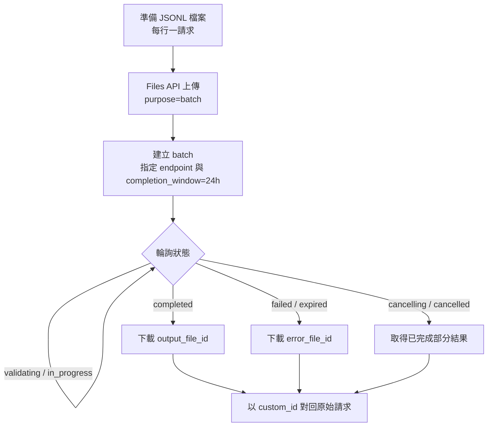

# OpenAI Batch API 與一般 Chat Completions 的差異

## 摘要

OpenAI 的 API 在「同步即時呼叫」之外，另外提供了一條**非同步、以檔案為單位**的處理路徑，稱為 Batch API。兩者的差別不只是「快與慢」，而是整個互動模型、計價方式、流量限制、請求封裝格式、結果取得方式、以及可用的功能子集都不同。本文以 OpenAI 官方文件、官方 FAQ、官方 Cookbook 與開發者社群的第一手錯誤訊息為依據，逐項比較 Batch API 與同步 Chat Completions 的差異，並整理出選擇時的判準。

核心結論是：Batch API 本質上是把「一堆各自獨立的 HTTP POST」打包成一個 JSONL 檔案，交由背景佇列慢慢跑完，因此換得約五折的價格與獨立的流量額度，代價是失去即時性、失去串流、失去跨請求的狀態延續，且部分工具（例如內建網頁搜尋）在批次模式下明確被拒絕[^batch-guide][^faq][^community-websearch]。

---

## 一、兩種模式的定位

### 1.1 同步 Chat Completions

同步 Chat Completions 是「一次請求、一次回應」的呼叫模型：客戶端送出一個 JSON 物件（包含 `model`、`messages` 等），伺服器在同一個 HTTP 連線中回傳完整的 `chat.completion` 物件，或在設定 `stream=true` 時以伺服器推送事件逐段吐出 token[^chat-ref]。這種模型適合聊天機器人、互動式助理、即時補全等「人類在等答案」的情境。

### 1.2 Batch API

Batch API 則是「先把工作排隊，之後再拿結果」的模型。使用者要先把多個請求寫成 `.jsonl` 檔（每行一個請求），透過 Files API 上傳，再建立一個 batch 工作，最後輪詢狀態並下載輸出檔[^batch-guide]。官方對它的描述是：送出**非同步的請求群組**，享有約**五折**的成本、與每分鐘限制分開的排隊 token 額度，以及**二十四小時**的完成窗口[^batch-guide]。

官方文件把好處列為三點：更好的成本效率（相對同步 API 有五折折扣）、更高的流量上限、以及快速完成（每個 batch 在二十四小時內完成，通常更快）[^batch-guide]。

---

## 二、逐項差異對照

| 面向 | 同步 Chat Completions | Batch API |
| --- | --- | --- |
| 互動模型 | 一次請求、一次回應 | 上傳檔案、建立工作、輪詢、下載結果 |
| 延遲 | 毫秒到數秒級 | 分鐘到小時級，合約上限 24 小時 |
| 價格 | 標準價 | 約五折（相對同步 API） |
| 流量限制 | 以 RPM／TPM 等每分鐘、每日配額計算 | 以「已排隊輸入 token 數」計算，與同步限制分開 |
| 輸入封裝 | 單一 HTTP JSON 請求 | JSONL 檔案，每行一請求，需先上傳 |
| 輸出取得 | HTTP 回應內容 | 下載 `output_file_id` 與 `error_file_id` 兩個檔案 |
| 結果順序 | 與請求一一對應 | 不保證與輸入同序，須以 `custom_id` 對應 |
| 串流 | 支援 `stream=true` | 不支援，批次 worker 會拒絕 |
| 模型數量 | 每次請求各自指定 | 同一個 batch 檔案只能對應單一模型 |
| 狀態延續 | 由客戶端自行帶入歷史訊息 | 每行獨立處理，無跨請求狀態 |
| 取消 | 不適用 | 可取消，已完成部分仍計費 |
| 檔案保存 | 不適用 | 輸出與錯誤檔預設 30 天後過期 |

以下分節說明各項差異的細節與出處。

### 2.1 成本：五折折扣

官方 Batch 指南明確寫出「相對同步 API 有五折的成本折扣」[^batch-guide]，官方 FAQ 的措辭是「每個模型都會以相對同步 API 五折的成本折扣提供」[^faq]。定價頁面上，同一模型的 Batch 欄位數值恰為 Standard 欄位的一半，可據此驗證折扣是按模型逐一折半，而非定額減免[^pricing]。

值得注意的是，Batch 並不是唯一的折扣路徑。定價頁面同時列出 Faster（原 Priority）等級約為標準價兩倍、Ultrafast 等級約為標準價六倍，而 Background 模式的兩小時窗口約比標準價低三成、八小時窗口約低四成[^pricing]。換句話說，「便宜」與「快」在 OpenAI 的計價中被拆成兩個獨立的維度：Batch 用「願意等」換折扣，Faster／Ultrafast 用「付更多」換更低延遲，Background 則介於兩者之間。

### 2.2 延遲與完成窗口

Batch 的 `completion_window` 參數目前只接受 `"24h"` 一個值，其他值會導致工作失敗[^batch-guide][^batch-ref]。官方強調「每個 batch 在二十四小時內完成，且通常更快」[^batch-guide]。若工作無法在窗口內完成，狀態會變成 `expired`：未完成的請求被取消，已完成的請求結果仍可透過輸出檔取得，且已完成部分照樣計費，未完成的請求則以 `batch_expired` 錯誤碼寫入錯誤檔[^batch-guide]。

同步 Chat Completions 沒有這種「窗口」概念，單次請求就是一次往返，延遲取決於模型、輸出長度與當下負載。

### 2.3 流量限制：排隊 token 而非每分鐘配額

這是實務上最容易被忽略、但影響架構最大的差異。同步 API 的限制是每分鐘請求數（RPM）、每分鐘 token 數（TPM）等速率型配額；Batch API 的限制則是「你在同一時間內排隊中的輸入 token 總量」，而且**與同步配額完全分開**，Batch 的請求不計入標準的每模型速率限制[^batch-guide][^faq]。

官方 FAQ 進一步說明：每個使用等級都有對應的 batch 速率限制，內容是「一次最多可排隊的輸入 token 數」；Embeddings API 另有「一次最多一百萬筆排隊請求」的限制，其他 API 則沒有限制請求數，只受排隊 token 數約束[^faq]。

對系統設計的意義是：你可以把大量工作一次倒進 Batch，不必自己實作 token bucket 或指數退避；但反過來說，一旦排隊 token 額度用盡，新的 batch 就建不起來，而且這個額度是**依模型**計算的，混合多模型的工作負載需要分別估算。

### 2.4 請求封裝：JSONL 與 `custom_id`

Batch 的輸入是一個 `.jsonl` 檔，每行是一個獨立的請求物件，包含四個欄位[^batch-guide]：

```json
{"custom_id": "request-1", "method": "POST", "url": "/v1/chat/completions", "body": {"model": "...", "messages": [{"role": "user", "content": "..."}]}}
```

- `custom_id`：該請求在此 batch 内的唯一字串，用來在結果回來後把回應對回原始輸入
- `method`：固定為 `"POST"`
- `url`：目標端點路徑，例如 `/v1/chat/completions` 或 `/v1/responses`
- `body`：與該端點同步呼叫時完全相同的請求內容

關鍵在於最後一點：官方明確指出「對給定的輸入檔，每行 `body` 欄位中的參數與底層端點的參數相同」[^batch-guide]。這代表同步 Chat Completions 能用的 `messages`、`temperature`、`max_tokens`、`tools`、`response_format` 等，在 Batch 的 `body` 裡語意一致。

另外，同一個輸入檔只能包含對**單一模型**的請求[^batch-guide]，若要對多個模型跑同一批任務，必須拆成多個檔案與多個 batch。

### 2.5 上傳、建立與取得結果的流程

Batch 的完整生命週期如下：



建立 batch 時的必要參數是 `input_file_id`、`endpoint` 與 `completion_window`；選填參數包含 `metadata`（最多十六組鍵值）與 `output_expires_after`（可設定輸出檔的過期時間）[^batch-ref]。工作物件會回傳 `status`、`output_file_id`、`error_file_id`、`request_counts`（`total`、`completed`、`failed`）等欄位[^batch-ref]。

狀態機共有八種：`validating`、`failed`、`in_progress`、`finalizing`、`completed`、`expired`、`cancelling`、`cancelled`[^batch-ref][^faq]。

官方 Cookbook 特別反覆強調一件事：**結果檔的行序不保證與輸入檔一致**，因此必須用 `custom_id` 來對應，而不能用行號[^cookbook]。這是把同步程式改寫成批次程式時最常見的錯誤來源。

### 2.6 串流：批次模式明確不支援

官方 FAQ 對「Batch API 是否支援串流」的回答是直接的「不支援；批次請求透過輸出檔回傳結果，而不是串流回應」[^faq]。Batch 指南在說明 moderations 端點時也寫明批次 worker 會拒絕設定 `stream=true` 的請求[^batch-guide]。

因此，任何依賴逐 token 輸出以降低首字延遲、或需要邊生成邊顯示的使用者介面，都無法用 Batch 實作。

### 2.7 可用功能子集：本體參數相同，但工具生態不同

由於 `body` 參數與底層端點一致，**結構化輸出是被支援的**。官方結構化輸出文件明確寫道：結構化輸出與 JSON 模式在 Responses API、Chat Completions API、Assistants API、Fine-tuning API 與 **Batch API** 中都受到支援[^structured]。視覺輸入同樣支援，官方 FAQ 對「Batch API 是否支援圖片」的回答是「是，圖片在 Batch API 上受到支援」[^faq]。

但**部分工具在批次模式下被拒絕**。開發者社群有明確的錯誤訊息可佐證：當在 `/v1/responses` 的 batch 請求中帶入網頁搜尋工具時，每一行都會回傳 `code='web_search_unsupported'`、`message='Web search is not supported in the Batch API.'`、`param='body.tools'`[^community-websearch]。這是因為批次工作在背景佇列中長時間排隊執行，無法保證即時的外部網路互動。

同理，需要與外部伺服器即時往返的 MCP 工具、以及依賴 `previous_response_id` 的跨請求狀態延續，在「每行獨立處理」的批次模型下並不適用；批次請求本質上是無狀態的，每一行都必須自帶完整上下文。

### 2.8 取消、過期與資料保存

Batch 可以取消。取消後狀態先進入 `cancelling`，讓已在處理中的請求跑完（官方 Azure 文件說明此階段最長十分鐘），再轉為 `cancelled`；已完成的部分結果會回傳，且照樣計費[^faq][^batch-ref]。

輸出檔與錯誤檔預設在建立後三十天過期，可用 `output_expires_after` 調整，範圍為一小時到三十天[^batch-guide][^batch-ref]。

另一個常被誤解的點是零資料保留（Zero Data Retention, ZDR）。官方 FAQ 明確指出：若組織啟用了零資料保留，**零資料保留不適用於 Batch API**；啟用 ZDR 的組織仍可建立 batch 工作，但 batch 的輸入檔、輸出、錯誤與中間產物會依 Batch、File Service 與 Sediment 的保留政策被保存[^faq]。對合規敏感的場景，這一點必須先確認。

---

## 三、規模上限

Batch 的各項硬性上限如下[^batch-guide][^batch-ref]：

| 項目 | 上限 |
| --- | --- |
| 單一 batch 的請求數 | 50,000 筆 |
| 輸入檔大小 | 200 MB |
| Embeddings 的輸入筆數 | 50,000 筆 |
| batch 建立速率 | 每小時 2,000 個 batch |
| 完成窗口 | 固定 `24h` |
| 輸出 token 數 | 目前無上限 |

官方 FAQ 對請求數的描述略有不同：Embeddings API 是「一次最多一百萬筆排隊請求」，其他 API 則「沒有請求數上限，但受各等級的排隊輸入 token 限制」[^faq]。兩處數字的差異（五萬筆對上一百萬筆）應理解為：單一 batch 檔案的結構性上限是五萬筆，而整個帳戶在佇列中累積的請求總量另受等級配額約束。實務上應以兩者中較嚴格者為準。

同步 Chat Completions 沒有「單次請求數」的概念，但受 RPM／TPM 配額約束，且配額隨使用等級（Build／Launch／Grow 等）提高[^rate-limits]。

---

## 四、如何選擇

### 4.1 適合 Batch 的情境

官方 Cookbook 列出的典型用途包括：大規模的內容標註、分類與充實；客服工單的分類與建議回覆；大量客戶回饋的情感分析；以及文件集合的摘要與翻譯[^cookbook]。共同特徵是「結果不需要立刻被看到」且「量大」。

### 4.2 必須使用同步 Chat Completions 的情境

- 使用者正在等待回應的互動介面
- 需要逐 token 串流以降低感知延遲
- 需要即時外部工具（網頁搜尋、MCP）參與推理
- 需要在多輪對話中延續前一次回應的狀態

### 4.3 混合架構

實務上常見的做法是先用同步 Chat Completions 對少量樣本試跑、確認 prompt 與輸出格式，再把同一組 `body` 複製進 JSONL 批次處理其餘資料[^cookbook]。這種「先驗證、後放大」的流程可以同時取得同步模式的除錯便利與批次模式的成本優勢。

---

## 五、對來源的批判性檢視

支撐本文的核心事實（五折折扣、二十四小時窗口、JSONL 格式、`custom_id` 對應、串流不支援、排隊 token 限制、輸出檔過期）同時出現在三個相互獨立的官方來源：Batch 指南、Batch API FAQ、以及 API 參考文件，且彼此措辭一致，可信度高[^batch-guide][^faq][^batch-ref]。定價頁面對折扣比例的佐證屬於「可由數值反推」的結構性證據，比單一文字敘述更難出錯[^pricing]。

相對較弱的是工具支援範圍。官方文件只正面表述「`body` 參數與底層端點相同」，並未逐一列舉哪些工具被排除；「網頁搜尋不支援」的證據來自開發者社群的錯誤訊息，屬於第一手但非官方文件的來源[^community-websearch]。因此本文對 MCP 工具、file search 等其餘內建工具採取保守表述：可合理推論不適用，但未列為已證實。

另外需留意，批次功能的細節（可用模型、檔案上限、過期政策）變動頻繁，官方 FAQ 與指南之間已出現請求數上限描述不一致的情況[^batch-guide][^faq]。任何生產系統在導入前都應以當下的 API 參考與組織後台的實際配額為準，而非依賴二手整理。

---

## 參考文獻

[^batch-guide]: OpenAI. (n.d.). Batch API. Retrieved 2026-11-24, from https://platform.openai.com/docs/guides/batch

[^batch-ref]: OpenAI. (n.d.). Create batch. In API Reference. Retrieved 2026-11-24, from https://platform.openai.com/docs/api-reference/batch/create

[^faq]: OpenAI. (n.d.). Batch API FAQ. Retrieved 2026-11-24, from https://help.openai.com/en/articles/9197833-batch-api-faq

[^pricing]: OpenAI. (n.d.). Pricing. Retrieved 2026-11-24, from https://platform.openai.com/docs/pricing

[^rate-limits]: OpenAI. (n.d.). Rate limits. Retrieved 2026-11-24, from https://platform.openai.com/docs/guides/rate-limits

[^chat-ref]: OpenAI. (n.d.). Create chat completion. In API Reference. Retrieved 2026-11-24, from https://platform.openai.com/docs/api-reference/chat

[^cookbook]: OpenAI. (n.d.). Batch processing. OpenAI Cookbook. Retrieved 2026-11-24, from https://cookbook.openai.com/examples/batch_processing

[^structured]: OpenAI. (n.d.). Structured model outputs. Retrieved 2026-11-24, from https://developers.openai.com/api/docs/guides/structured-outputs

[^community-websearch]: OpenAI Developer Community. (n.d.). Web search is not supported with Batch API. Retrieved 2026-11-24, from https://community.openai.com/t/web-search-is-not-support-with-batch-api/1306968