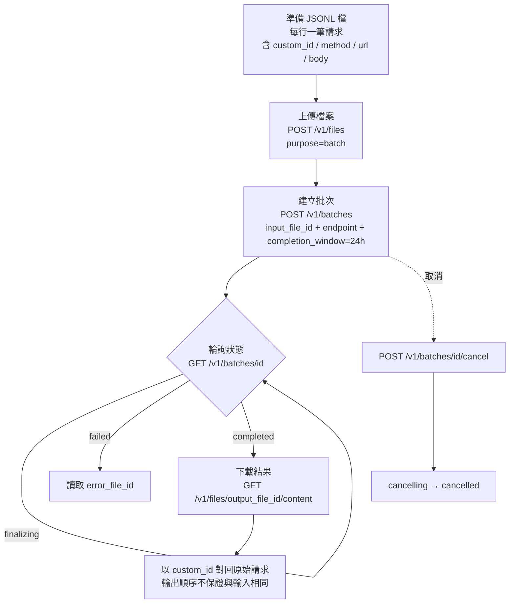
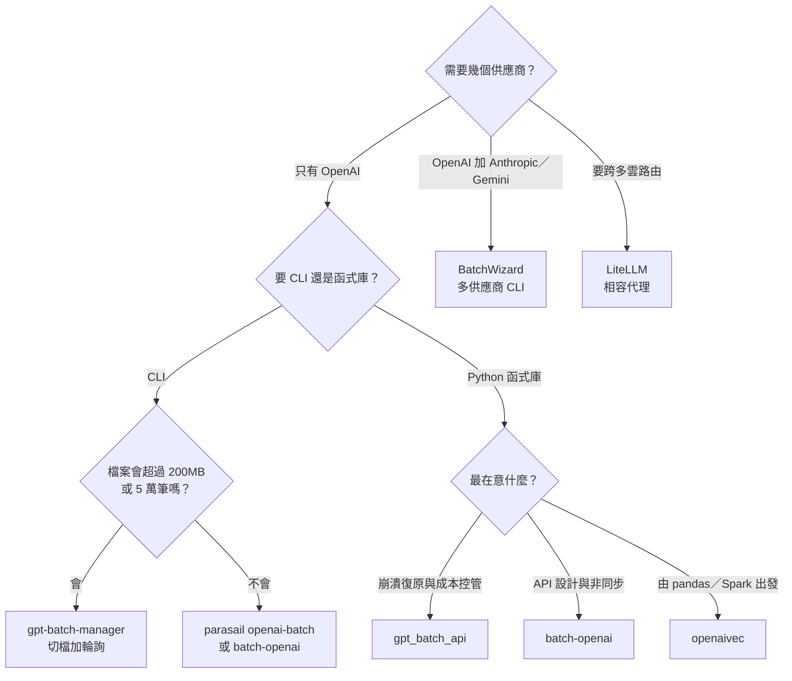

# OpenAI Batch API 的開源（FOSS）管理工具調查

## 摘要

OpenAI 官方 Batch API 的生命週期共有七個步驟：準備 JSONL、上傳檔案、建立批次、輪詢狀態、取回結果、取消批次、列出批次[^oai-batch]。官方文件雖然提供了 `openai` CLI 的逐步驟指令，但**並未**提供任何「送出後自動等待完成、再自動下載結果」的輪詢或拉取（polling / pulling）helper，開發者必須自行以迴圈輪詢 `GET /v1/batches/{batch_id}`，完成後再呼叫 Files API 下載輸出檔[^oai-batch]。因此社群出現了多個開源工具來填補這個缺口。

本報告的結論是：**這類工具確實已經存在，而且不只一個**。其中最具代表性的是多供應商 CLI `batchwizard`（40 顆星、MIT），以及專注於崩潰復原與成本控管的 `gpt_batch_api`。不過，多數工具星數極低（0～4 顆星），生態仍屬零散、缺乏事實上的標準。

---

## 一、背景：OpenAI Batch API 究竟在做什麼

Batch API 讓使用者把大量請求打包成單一 JSONL 檔案一次送出，換取**比同步 API 便宜 50% 的價格**，代價是最長 **24 小時**的非同步完成視窗[^oai-batch]。它適合「不需要即時回應、但量大」的工作負載，例如資料標註、大量分類、離線評估、嵌入向量計算等。

### 生命週期

### 相關端點

| 步驟 | 端點 | 方法 |
|---|---|---|
| 上傳檔案 | `POST https://api.openai.com/v1/files`（multipart/form-data，`purpose=batch`） | POST |
| 建立批次 | `POST https://api.openai.com/v1/batches` | POST |
| 查詢狀態 | `GET https://api.openai.com/v1/batches/{batch_id}` | GET |
| 下載結果 | `GET https://api.openai.com/v1/files/{file_id}/content` | GET |
| 取消批次 | `POST https://api.openai.com/v1/batches/{batch_id}/cancel` | POST |
| 列出批次 | `GET https://api.openai.com/v1/batches?limit=10` | GET |

### 重要限制

| 項目 | 數值 |
|---|---|
| 單一批次最大請求數 | 50,000 筆 |
| 輸入檔最大容量 | 200 MB |
| 建立批次速率 | 每小時 2,000 個批次 |
| 完成視窗（`completion_window`） | 僅允許 `24h` |
| 價格折扣 | 較同步 API 便宜 50% |
| 輸出／錯誤檔保存期 | 預設 30 天（可用 `output_expires_after` 調整為 1 小時～30 天） |
| 可批次化的端點 | `/v1/responses`、`/v1/chat/completions`、`/v1/embeddings`、`/v1/completions`、`/v1/moderations`、`/v1/images/generations`、`/v1/images/edits` |

Batch 任務**不佔用**標準的每模型請求／token 速率限制，但會佔用「每模型排隊輸入 token」配額[^oai-batch]。

### 為什麼「拉取」聽起來很複雜

使用者直覺上會覺得「拉取結果」很麻煩，原因有四[^oai-batch]：

1. **非同步且無 callback**：OpenAI 不提供 webhook，只能輪詢。
2. **狀態機有七種狀態**：`validating`、`failed`、`in_progress`、`finalizing`、`completed`、`expired`、`cancelling`、`cancelled`，每種都要處理。
3. **輸出順序不保證**：必須用 `custom_id` 自行對回輸入，不能依序讀取。
4. **部分失敗是常態**：批次可能「部分成功」，成功的在 output 檔、失敗的在 error 檔（例如 `batch_expired`），必須合併兩份檔案才算完整。

官方僅提供底層端點與 SDK 方法，**沒有**高階的「送出並等待」封裝[^oai-batch][^openai-python]。這正是社群工具存在的理由。

---

## 二、開源工具清單

以下工具皆為免費開源軟體（FOSS）。星數與最新提交日期以 2026-11-24 查得的資料為準[^gh-api]。

### 2.1 多供應商／通用型

| 工具 | 語言 | 星數 | 授權 | 最新提交 | 重點 |
|---|---|---|---|---|---|
| **LiteLLM** (`BerriAI/litellm`) | Python / Rust | ~63,815 | MIT（企業子目錄另有商業授權） | 2026-11-24 | 以 OpenAI 相容代理轉發批次 API 到 OpenAI、Azure、Vertex、Bedrock、Mistral、vLLM、xAI[^litellm-docs] |
| **BatchWizard** (`cmakafui/batchwizard`) | Python | 40 | MIT | 2026-07-31（v0.5.0） | 單一 CLI 管理 OpenAI＋Anthropic＋Gemini 批次，SQLite manifest 持久化[^batchwizard] |
| **llm-d-batch-gateway** (`llm-d/llm-d-batch-gateway`) | Go | 28 | Apache-2.0 | 2026-11-24（v1.0.1） | Kubernetes 原生的批次推論伺服器，實作伺服器端 `/v1/batches` 與 `/v1/files`[^llmbatchgw] |

### 2.2 OpenAI 專用工具

| 工具 | 語言 | 星數 | 授權 | 最新提交 | 重點 |
|---|---|---|---|---|---|
| **oaib** (`EvolvingPrograms/oaib`) | Python | 101 | MIT | 2024-03-02 | 速率限制感知的非同步批次（走直接 API，非 `/v1/batches`）[^oaib] |
| **openai-batch** (`parasail-ai/openai-batch`) | Python | 8 | Apache-2.0 | 2026-07-20（v0.3.4） | `Batch` context manager，`submit_wait_download()` 一行完成送出＋輪詢＋下載[^parasail] |
| **gpt-batch-manager** (`danvk/gpt-batch-manager`) | Python | 3 | Apache-2.0 | 2024-09-17（v1.0.1） | `gpt-batch-splitter` 依 token 上限切檔，`gpt-batch-manager` 逐一送出並輪詢，可續跑[^gptbm] |
| **openai_batch_helper** (`hesenp/openai_batch_helper`) | Python | 3 | MIT | 2026-01-06 | 串接式 API：`init_job().add_task().submit_file().submit_batch_job().wait_for_completion().download_result()`[^obh] |
| **delean-batch-manager** (`adgomant/delean-batch-manager`) | Python | 4 | Apache-2.0 | 2026 | CLI `deleanbm`，含 `track-and-download-loop` 輪詢迴圈，支援 Azure OpenAI[^delean] |
| **batch-openai** (`ktzy0305/batch-openai`) | Python | 0 | MIT | 2026-04-15 | `BatchJob`／`BatchResult`／SQLite `BatchRegistry`，同步＋非同步，Pydantic 結構化輸出[^batchopenai] |
| **gpt_batch_api** (`pallgeuer/gpt_batch_api`) | Python | 0 | GPL-3.0 | 2025-07-03 | 生產級：崩潰與 Ctrl+C 復原、成本上限、wandb 監控、可走本機 LLM[^gptba] |
| **batchkit** (`thesaadfarooq/batchkit`) | Python | 0 | Apache-2.0 | 2026 | `client.map()`／`job.wait()`／`job.retry_failed()`，含結果對帳與重試[^batchkit] |

### 2.3 其他語言與輔助工具

| 工具 | 語言 | 星數 | 授權 | 重點 |
|---|---|---|---|---|
| **openai_batch_manager** (`amazingvince`) | Python | 0 | MIT | 切檔、上傳、輪詢、下載、指數退避重試、清理；含 CSV→JSONL 與驗證工具[^obm] |
| **openai-batch-manager** (`williamwinkler`) | Elixir | 0 | MIT | 自架服務：REST／RabbitMQ 收件、自動批次、輪詢、webhook 回傳結果[^wwobm] |
| **openai-batch-ui** (`Randomblock1`) | TypeScript | 4 | 未標示（已封存） | 純前端 SvelteKit UI，IndexedDB 儲存，已於 2026-02 封存[^batchui] |
| **openai-batch-jsonl** (`anaregdesign`) | Python | 5 | MIT | 只負責由 pandas DataFrame 產生 JSONL（不含送出與輪詢）[^objsonl] |
| **oaib** (`mizoR/oaib`) | Ruby | 0 | MIT | 列出／篩選／監控批次任務，輸出可接 `jq`[^rubyoaib] |
| **batchline** (`Ayubjon/batchline`) | Node.js | 1 | MIT | 離線 JSONL 產生與結果合併，**不**送出也不輪詢[^batchline] |
| **batch-id-coverage** (`maomao-1937`) | Python | 0 | MIT | 以 `custom_id` 對帳 input／output／error 三檔，找出重複、缺漏[^coverage] |
| **openaivec** (`microsoft/openaivec`) | Python | 25 | MIT | pandas／Spark 向量化 LLM 呼叫，內含批次快取與去重[^openaivec] |
| **vLLM `run_batch`** | Python / CUDA | ~97,500 | Apache-2.0 | 自架模型的離線批次推論，吃 OpenAI Batch JSONL 格式[^vllm] |

---

## 三、這些工具真的解決了「拉取」問題嗎

是。下表整理哪些工具同時具備「輪詢」與「下載」能力，以及是否具備持久化狀態（崩潰後可續跑）[^gh-api]。

| 工具 | 輪詢 | 下載結果 | 下載錯誤檔 | 狀態持久化 | 部分失敗重試 |
|---|---|---|---|---|---|
| BatchWizard | ✅ `watch` | ✅ 原子寫入 | ✅ | ✅ SQLite manifest | ⚠️ 需手動重送 |
| gpt_batch_api | ✅ | ✅ | ✅ | ✅ 崩潰復原 | ✅ `--max_retries` |
| batch-openai | ✅ `.wait()` | ✅ | ✅ | ✅ SQLite registry | ✅ 暫時性錯誤自動重試 |
| gpt-batch-manager | ✅ | ✅ | ✅ | ✅ `/tmp/batch-status.json` | ⚠️ 可續跑 |
| openai_batch_helper | ✅ | ✅ | ✅ | ⚠️ 記憶體內 | ❌ |
| parasail openai-batch | ✅ | ✅ | ✅ | ✅ `--resume` | ❌ |
| delean-batch-manager | ✅ | ✅ | ⚠️ | ✅ | ❌ |
| batchkit | ✅ | ✅ | ✅ | ⚠️ | ✅ `retry_failed()` |
| openai_batch_manager (amazingvince) | ✅ | ✅ | ✅ | ✅ | ✅ 指數退避 |
| LiteLLM | ✅ 代理轉發 | ✅ | ✅ | ⚠️ | ❌（代理層不做重試） |
| 官方 `openai` CLI／SDK | ❌ 需自行寫迴圈 | ✅ 需自行呼叫 | ✅ 需自行呼叫 | ❌ | ❌ |

---

## 四、批判性評估

### 4.1 生態的結構性問題

- **缺乏事實標準**：除 LiteLLM（6.3 萬星）與 oaib（101 星）外，其餘專用工具的星數幾乎都在 0～40 之間[^gh-api]。這意味著維護風險高、API 可能隨時變動、社群支援薄弱。
- **多數工具壽命短**：`gpt-batch-manager`（2024-09）、`oaib`（2024-03）已超過一年未更新；`openai-batch-ui` 甚至已被封存[^batchui]。相對地，BatchWizard（2026-07）、`llm-d-batch-gateway`（2026-11）、`openai-batch`（2026-07）仍活躍[^gh-api]。
- **「星數」可能低估成熟度**：`batch-openai` 星數為 0，但其 API 設計（非同步支援、Pydantic 解析、SQLite registry、CLI）在功能上相當完整[^batchopenai]。這類新專案需要自行閱讀原始碼評估，不能只看星數。
- **官方 SDK 是共同底座**：幾乎所有工具都只是對 `openai-python` 的 `files.create`／`batches.create`／`batches.retrieve`／`files.content` 做封裝[^openai-python]，差異在於狀態機、重試與持久化的處理深度。

### 4.2 需要留意的偏誤

- 部分工具的功能描述來自其 README 自述，未必經過第三方驗證；星數為 0 的專案尤其難以確認實際可用性。
- GitHub 星數是「關注度」而非「品質」指標，且會隨時間變動；本報告的數字僅為 2026-11-24 的快照[^gh-api]。
- LiteLLM 的企業功能（如批次成本追蹤）位於 `litellm/enterprise/` 之下，採獨立商業授權，**並非**全 MIT[^litellm-docs]。

### 4.3 直接回答使用者的問題

> 「是否已有現成的 FOSS 工具來處理 OpenAI API 的批次模式？拉取需求聽起來很複雜，應該已經有人做過了吧？」

**是，已經有人做過，而且做了很多次。** 若只是要「送出 JSONL、等它完成、把結果與錯誤檔拉回來」，不需要自己寫輪詢迴圈——`BatchWizard`（多供應商、有 CLI）、`gpt_batch_api`（最強健）或 `batch-openai`（API 最現代）都能直接用。真正需要自己動手的，是**與自身資料管線的整合**：如何把結果對回原始資料、如何處理部分失敗、以及如何在既有的儲存與排程系統中落地。

---

## 五、結論

1. OpenAI 官方**只提供底層端點與 SDK**，沒有「送出即等待」的高階封裝，輪詢與拉取必須自行實作[^oai-batch]。
2. 社群已有**多個**開源工具填補此缺口，涵蓋 Python、Go、Elixir、Ruby、TypeScript 等語言[^gh-api]。
3. 若追求**多供應商與 CLI**：選 `BatchWizard`；若追求**跨雲路由**：選 `LiteLLM`；若追求**生產級強健性與成本控管**：選 `gpt_batch_api`；若追求**現代 Python API 與非同步**：選 `batch-openai`。
4. 選擇時應優先檢視**最近提交日期**與**授權條款**，而非只看星數；本領域多數專案維護週期短，長期維護性是最實際的風險。

---

## 參考文獻

[^oai-batch]: OpenAI. (n.d.). Batch API. Retrieved 2026-11-24, from https://platform.openai.com/docs/guides/batch

[^openai-python]: OpenAI. (n.d.). openai-python [Computer software]. Retrieved 2026-11-24, from https://github.com/openai/openai-python

[^litellm-docs]: BerriAI. (n.d.). Batches. LiteLLM Documentation. Retrieved 2026-11-24, from https://docs.litellm.ai/docs/batches

[^batchwizard]: Makafui, C. (n.d.). BatchWizard [Computer software]. Retrieved 2026-11-24, from https://github.com/cmakafui/batchwizard

[^gptbm]: Danvk. (2024). gpt-batch-manager (Version 1.0.1) [Computer software]. Retrieved 2026-11-24, from https://github.com/danvk/gpt-batch-manager

[^oaib]: EvolvingPrograms. (2024). oaib (Version 1.2.0) [Computer software]. Retrieved 2026-11-24, from https://github.com/EvolvingPrograms/oaib

[^parasail]: Parasail AI. (2026). openai-batch (Version 0.3.4) [Computer software]. Retrieved 2026-11-24, from https://github.com/parasail-ai/openai-batch

[^obh]: Hesenp. (2026). openai_batch_helper [Computer software]. Retrieved 2026-11-24, from https://github.com/hesenp/openai_batch_helper

[^delean]: Adgomant. (n.d.). delean-batch-manager [Computer software]. Retrieved 2026-11-24, from https://github.com/adgomant/delean-batch-manager

[^batchopenai]: Ktzy0305. (2026). batch-openai [Computer software]. Retrieved 2026-11-24, from https://github.com/ktzy0305/batch-openai

[^gptba]: Pallgeuer. (2025). gpt_batch_api [Computer software]. Retrieved 2026-11-24, from https://github.com/pallgeuer/gpt_batch_api

[^batchkit]: Farooq, S. (n.d.). batchkit [Computer software]. Retrieved 2026-11-24, from https://github.com/thesaadfarooq/batchkit

[^obm]: Amazingvince. (n.d.). openai_batch_manager [Computer software]. Retrieved 2026-11-24, from https://github.com/amazingvince/openai_batch_manager

[^wwobm]: Winkler, W. (n.d.). openai-batch-manager [Computer software]. Retrieved 2026-11-24, from https://github.com/williamwinkler/openai-batch-manager

[^batchui]: Randomblock1. (n.d.). openai-batch-ui [Computer software]. Retrieved 2026-11-24, from https://github.com/Randomblock1/openai-batch-ui

[^objsonl]: Anaregdesign. (n.d.). openai-batch-jsonl [Computer software]. Retrieved 2026-11-24, from https://github.com/anaregdesign/openai-batch-jsonl

[^rubyoaib]: MizoR. (n.d.). oaib [Computer software]. Retrieved 2026-11-24, from https://github.com/mizoR/oaib

[^batchline]: Ayubjon. (n.d.). batchline [Computer software]. Retrieved 2026-11-24, from https://github.com/Ayubjon/batchline

[^coverage]: Maomao-1937. (n.d.). batch-id-coverage [Computer software]. Retrieved 2026-11-24, from https://github.com/maomao-1937/batch-id-coverage

[^openaivec]: Microsoft. (n.d.). OpenAIVec [Computer software]. Retrieved 2026-11-24, from https://github.com/microsoft/openaivec

[^vllm]: vLLM Project. (n.d.). vLLM [Computer software]. Retrieved 2026-11-24, from https://github.com/vllm-project/vllm

[^llmbatchgw]: LLM-D. (2026). llm-d-batch-gateway (Version 1.0.1) [Computer software]. Retrieved 2026-11-24, from https://github.com/llm-d/llm-d-batch-gateway

[^gh-api]: GitHub. (n.d.). GitHub REST API: Repositories [Data file]. Retrieved 2026-11-24, from https://api.github.com/repos/BerriAI/litellm
