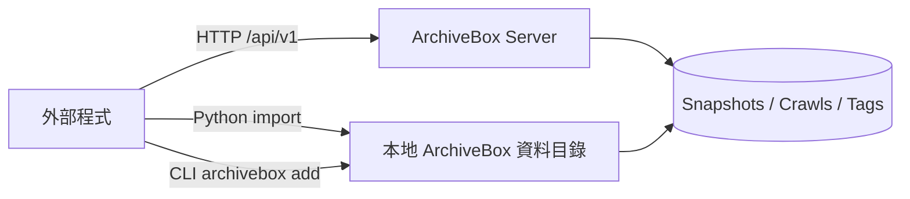

# ArchiveBox 是否支援 API 存取？

## 摘要

**支援。** ArchiveBox 提供三種可程式化存取途徑：

1. **REST API（HTTP）**：掛載於 `/api/v1/` 路徑之下，自 v0.8.0 起提供，具備互動式 Swagger 文件頁面、權杖（token）認證，且**支援寫入操作**（新增網址、建立 crawl、建立／修改／刪除 snapshot）[^auth][^v1api]。
2. **Python API（本地函式庫）**：在與 ArchiveBox 資料目錄同一台機器上，以 Python 匯入其模組直接操作，官方標示為 BETA[^readme]。
3. **CLI**：`archivebox add`、`archivebox update` 等命令列介面，並有對應的 REST 端點（`/api/v1/cli/*`）作為鏡像[^v1cli]。

最重要的限制：REST API 目前仍標示為 **`[v1 ALPHA]`**，官方明言「仍在早期開發階段，可能變動」；維護者在 issue 中亦稱其狀態為 **unstable**（不穩定）[^v1api][^issue496]。因此可正式用於整合，但必須預期介面可能破壞性變更。

---

## 一、專案背景

| 項目 | 內容 |
| --- | --- |
| 專案 | ArchiveBox（開源自架式網頁典藏工具） |
| 說明 | 接收 URL、瀏覽器歷史、書籤、Pocket、Pinboard 等來源，儲存 HTML、JS、PDF、媒體等[^ghapi] |
| 星數 | 29,088 stars（查詢當下）[^ghapi] |
| Fork 數 | 1,634[^ghapi] |
| 最新釋出 | v0.9.77（2026-10-27 發布）；文件站 `latest` 標示版本為 v0.9.78[^ghapi][^docs] |
| 授權與型態 | 自架（self-hosted）伺服器 + 命令列工具 |



---

## 二、REST API

### 2.1 基本資訊

| 項目 | 值 |
| --- | --- |
| 版本狀態 | `[v1 ALPHA]`（不穩定）[^v1api] |
| 首次提供 | v0.8.0[^auth] |
| 路徑前綴 | `/api/v1/`[^v1api] |
| 互動式文件 | `http://<主機>:<埠>/api/v1/docs`（django-ninja 產生的 Swagger UI）[^auth][^v1api] |
| 根路徑 | `/api/` 會重導向至 `/api/v1/docs`[^v1api] |
| 技術基礎 | Django Ninja（自動產生 OpenAPI 3.0 schema）[^v1api] |
| 認證要求 | 使用者必須為 **superuser**，否則回傳 403[^authsrc] |
| 權杖有效期 | 預設 120 天[^v1auth] |

官方說明：「REST API（自 v0.8.0 起提供）支援多種認證方式以方便使用。」[^auth]

### 2.2 端點總覽

以下端點整理自官方 `dev` 分支原始碼；不同版本可能略有差異（見第五節的來源批判）[^v1api][^v1core][^v1cli][^v1crawls][^v1auth]。

**認證 `/api/v1/auth/`**[^v1auth]

| 方法 | 路徑 | 說明 |
| --- | --- | --- |
| POST | `/auth/get_api_token` | 以帳號密碼換取 API 權杖 |
| POST | `/auth/check_api_token` | 驗證權杖是否有效且未過期 |
| POST | `/auth/browser_session` | 以管理員 API key 換取瀏覽器 session |

**核心模型 `/api/v1/core/`**[^v1core]

| 方法 | 路徑 | 說明 |
| --- | --- | --- |
| GET | `/core/snapshots` | 列出 snapshots（支援分頁與篩選） |
| POST | `/core/snapshots` | **建立** snapshot |
| GET | `/core/snapshot/{id}` | 取得單一 snapshot |
| PATCH | `/core/snapshot/{id}` | **更新** snapshot |
| DELETE | `/core/snapshot/{id}` | **刪除** snapshot |
| GET | `/core/archiveresults` | 列出 archive results |
| POST | `/core/archiveresults` | 建立／更新 archive result（含輸出檔案） |
| GET | `/core/tags` | 列出標籤 |
| POST | `/core/tags/create/` | **建立**標籤 |
| POST | `/core/tag/{id}/rename` | **重新命名**標籤 |
| POST | `/core/tags/add-to-snapshot/` | 為 snapshot 加上標籤 |
| GET | `/core/folders` | 列出資料夾 |
| POST | `/core/folders` | **建立**資料夾 |

**Crawl `/api/v1/crawls/`**[^v1crawls]

| 方法 | 路徑 | 說明 |
| --- | --- | --- |
| GET | `/crawls/crawls` | 列出所有 crawl |
| POST | `/crawls/crawls` | **建立 crawl（即批次加入網址）** |
| GET | `/crawls/crawl/{id}` | 取得單一 crawl |
| PATCH | `/crawls/crawl/{id}` | **更新**（例如 `action` 設為 pause／resume／cancel） |
| DELETE | `/crawls/crawl/{id}` | **刪除** crawl |
| GET | `/crawls/crawl/{id}/files/...` | 下載 crawl 產出檔案 |

**CLI 鏡像 `/api/v1/cli/`**[^v1cli]

| 方法 | 路徑 | 對應命令 |
| --- | --- | --- |
| POST | `/cli/add` | `archivebox add` |
| POST | `/cli/update` | `archivebox update` |
| POST | `/cli/schedule` | `archivebox schedule` |
| POST | `/cli/search` | `archivebox search` |
| POST | `/cli/remove` | `archivebox remove` |

其餘路由群組包含 `/machine/`（機器與相依套件）、`/personas/`（Persona 管理）、`/importers/`（匯入來源管理）[^v1api]。

### 2.3 認證方式

取得權杖有兩種方式[^auth]：

1. 於管理後台新增：`http://<主機>:<埠>/admin/api/apitoken/add/`
2. 呼叫端點：

```bash
curl -X 'POST' \
  'http://127.0.0.1:5797/api/v1/auth/get_api_token' \
  -H 'Content-Type: application/json' \
  -d '{"username": "YOURUSERNAMEHERE", "password": "YOURPASSWORDHERE"}'
```

取得權杖後，可採三種方式之一攜帶[^auth][^authsrc]：

| 方式 | 攜帶位置 | 範例 |
| --- | --- | --- |
| Bearer Token | `Authorization` 標頭 | `Authorization: Bearer <TOKEN>` |
| 自訂標頭 | `X-ArchiveBox-API-Key` 標頭 | `X-ArchiveBox-API-Key: <TOKEN>` |
| 查詢參數 | `api_key` 參數 | `?api_key=<TOKEN>` |

官方對第三種（查詢參數）明確警告：此即所謂的「Capability URLs」，任何持有該 URL 者皆可執行 API 操作，具重大安全風險，除非完全理解風險否則不建議使用[^auth]。

實例（列出 snapshots）[^auth]：

```bash
curl -X 'GET' \
  'http://127.0.0.1:5797/api/v1/core/snapshots?limit=10' \
  -H 'accept: application/json' \
  -H 'Authorization: Bearer YOURAPITOKENHERE'
```

`X-ArchiveBox-API-Key` 標頭的設計理由是：若 ArchiveBox 前方有反向代理（reverse proxy）會消費掉 `Authorization` 標頭，仍可改用此標頭認證[^auth]。

### 2.4 寫入操作

REST API **並非唯讀**，可完整執行新增網址等寫入動作。建立 crawl 的請求主體結構如下[^v1crawls]：

| 欄位 | 型別 | 必填 | 說明 |
| --- | --- | --- | --- |
| `urls` | `list[str]` | 是 | 至少一個有效 URL |
| `max_depth` | `int` | 否 | 0–4，預設 0 |
| `tags` | `list[str]` | 否 | 標籤清單 |
| `label` | `str` | 否 | 人類可讀標籤 |
| `notes` | `str` | 否 | 備註 |
| `config` | `dict` | 否 | 設定覆寫 |
| `folder_id` | `UUID` | 否 | 目標資料夾 |

```bash
curl -X POST "http://127.0.0.1:5797/api/v1/crawls/crawls" \
  -H "Authorization: Bearer YOURAPITOKENHERE" \
  -H "Content-Type: application/json" \
  -d '{"urls": ["https://example.com"], "max_depth": 1, "tags": ["news"]}'
```

或以 CLI 鏡像端點加入網址[^v1cli]：

```bash
curl -X POST "http://127.0.0.1:5797/api/v1/cli/add" \
  -H "X-ArchiveBox-API-Key: YOURAPITOKENHERE" \
  -H "Content-Type: application/json" \
  -d '{"urls": ["https://example.com"]}'
```

---

## 三、Python API（本地函式庫）

官方說明：「你可以從外部腳本或程式，把 ArchiveBox 當作 Python 函式庫來互動。此 API 是**本地** API，設計上與 ArchiveBox 收藏庫在同一台機器上使用。」[^usage]

```python
import os
from pathlib import Path

DATA_DIR = Path("~/archivebox/data").expanduser()
os.chdir(DATA_DIR)

# 必須先匯入並初始化 Django 以建立資料庫連線
from archivebox.config.django import setup_django
setup_django(check_db=True)

# 再匯入需要的 API
from archivebox.cli.archivebox_add import add

crawl, snapshots = add(urls=["https://example.com"], index_only=True)
print(crawl.id, list(snapshots.values_list("id", flat=True)))
```

要點與限制：

- 必須先呼叫 `setup_django()` 建立 DB 連線，且工作目錄需為 ArchiveBox 資料目錄[^usage]。
- 這是**本地** API，並非遠端介面；遠端存取請用 REST API[^usage]。
- 官方文件標示 Python API 為 **BETA**[^readme]。
- 另有 `archivebox shell` 可開啟已載入 Django 環境的互動式 REPL[^readme]。
- 完整自動產生參考文件位於 `https://docs.archivebox.io/dev/apidocs/index.html`[^usage]。

---

## 四、命令列介面（CLI）

CLI 是 ArchiveBox 最原始也最穩定的操作方式[^readme][^usage]：

```bash
archivebox add 'https://example.com'
archivebox add --depth=1 'https://example.com'
echo 'http://example.com' | archivebox add
```

Docker 環境下：

```bash
docker compose exec archivebox archivebox add 'https://example.com'
```

---

## 五、v0.8.0 之前的舊版「類 API」

在 v0.8.0 之前，ArchiveBox 並沒有正式、穩定的 REST API，只有 Web UI 本身使用的 Django 檢視（view），多未文件化且受 CSRF 保護。

維護者於 2020-10-02 表示[^issue496]：

> 「目前 API 的狀態，我會說是『不穩定』。」

同一則討論中，提問者描述其困境[^issue496]：

> 「我試著直接擷取瀏覽器按下『Add』時送出的請求，但看起來有 CSRF 保護，所以我沒辦法只複製一個 bearer token 就重發請求。」

維護者的建議與規劃[^issue496]：

> 「現階段只能逆向工程 UI，但我們計畫在未來版本把它穩定下來，並用 django-rest-framework 之類的工具拆出一個正式的 API，讓外部工具不必再把需求硬塞進 UI 用的請求裡。」

隔年（2021-01-23）針對瀏覽器擴充功能的 issue 中，維護者再次說明[^issue577]：

> 「現在確實有 `/add` 端點，但那是 UI 在用的，所以需要 CSRF token，對 API 式用法很麻煩。目前還沒有修這個的 ticket，等我把它穩定下來後會再回報。」

| 時間 | 事件 |
| --- | --- |
| 2020-10-01 | issue #496 開啟，提問 REST API 現況，並指出 `/add` 有 CSRF 保護[^issue496] |
| 2020-10-02 | 維護者稱狀態為 unstable，並規劃拆分正式 API[^issue496] |
| 2021-01-23 | 維護者確認 `/add` 為 UI 端點、需 CSRF token，不利 API 使用[^issue577] |
| 2024-04-26 | 維護者宣布新 REST API 已於 `dev` 分支的 v0.8.0-rc 提供（仍標示 unstable）[^issue496] |
| 2024-05-06 | issue #496 標記為 `status: done`，關聯 PR #1397（REST API）與 #1418（Webhooks）[^issue496] |

維護者宣布新 API 時的原話[^issue496]：

> 「各位，來看看 `dev` 上的新 REST API！非常感謝 @Brandl 提出 kickstart 這一切的第一個 PR！想試用的人請取得 v0.8.0-rc（unstable）或更新版本，執行 `archivebox server`，然後造訪 `http://127.0.0.1:8000/api`（`/api/v1/docs`）即可開始使用互動式 Swagger API 文件／測試頁。」

注意：官方文件稱 REST API「自 v0.8.0 起提供」[^auth]，而維護者當時的描述是 v0.8.0-rc，兩者一致（rc 為正式版前的候選版）。

---

## 六、來源批判與不確定性

- **權威性**：主要事實來自官方 GitHub 儲存庫、官方文件站（`docs.archivebox.io`）與原始碼，屬第一手來源，可信度高。星數與版本資訊來自 GitHub 官方 API[^ghapi]。
- **時效性**：多數端點清單來自 `dev` 分支原始碼，代表**尚未釋出**的 v0.9.x 開發線；而 v0.8.0 是最初提供 REST API 的版本[^auth][^v1api]。因此 `crawls/`、`folders/`、`importers/`、`personas/` 等路由在較舊版本中**可能不存在**。實際可用端點務必以自己伺服器上的 `/api/v1/docs` 為準。
- **穩定性風險**：官方在 API 首頁直接標註 `[v1 ALPHA]` 與「仍可能變動」警告[^v1api]，維護者在 issue #496 中亦自述狀態為 unstable[^issue496]。這是本主題最重要的風險訊號。
- **未完全驗證之處**：部分端點的單數／複數路徑（例如 `/core/snapshot/{id}` 對 `/core/snapshots/{id}`）在不同來源敘述略有出入；本報告採用官方原始碼敘述，但仍建議以實際 Swagger 文件為最終依據。
- **舊版狀況**：v0.8.0 之前並無正式 REST API，僅有 UI 使用的 `/add` 端點（受 CSRF 保護）[^issue496][^issue577]；正式 API 是 v0.8.0 才引入[^auth]。

---

## 七、結論

ArchiveBox **確實支援 API 存取**，且層次完整：

| 途徑 | 遠端可用 | 支援寫入 | 穩定性 |
| --- | --- | --- | --- |
| REST API `/api/v1/` | 是 | 是 | ALPHA／unstable[^v1api][^issue496] |
| Python API | 否（限同機） | 是 | BETA[^readme] |
| CLI | 否（限同機） | 是 | 最穩定[^readme] |

若目標是外部系統整合，REST API 是唯一選擇，需注意：先建立 superuser 帳號、產生權杖（預設 120 天過期）[^v1auth]、以 `/api/v1/docs` 確認實際端點，並將「API 可能變動」納入維護成本評估。

---

## 參考文獻

[^readme]: ArchiveBox. (2026). *ArchiveBox: Open source self-hosted web archiving* [Computer software]. GitHub. Retrieved 2026-11-24, from https://github.com/ArchiveBox/ArchiveBox

[^ghapi]: GitHub. (2026). *Repository: ArchiveBox/ArchiveBox* [Data file]. Retrieved 2026-11-24, from https://api.github.com/repos/ArchiveBox/ArchiveBox

[^docs]: ArchiveBox. (2026). *ArchiveBox Documentation* (latest). Retrieved 2026-11-24, from https://docs.archivebox.io/latest/

[^auth]: ArchiveBox. (2026). Setting up Authentication. In *ArchiveBox Documentation*. Retrieved 2026-11-24, from https://docs.archivebox.io/latest/Setting-up-Authentication.html

[^usage]: ArchiveBox. (2026). Usage. In *ArchiveBox Documentation*. Retrieved 2026-11-24, from https://docs.archivebox.io/latest/Usage.html

[^v1api]: ArchiveBox. (2026). archivebox.api.v1_api. In *ArchiveBox Python API Reference*. Retrieved 2026-11-24, from https://docs.archivebox.io/dev/apidocs/archivebox/archivebox.api.v1_api.html

[^v1core]: ArchiveBox. (2026). archivebox.api.v1_core. In *ArchiveBox Python API Reference*. Retrieved 2026-11-24, from https://docs.archivebox.io/dev/apidocs/archivebox/archivebox.api.v1_core.html

[^v1cli]: ArchiveBox. (2026). archivebox.api.v1_cli. In *ArchiveBox Python API Reference*. Retrieved 2026-11-24, from https://docs.archivebox.io/dev/apidocs/archivebox/archivebox.api.v1_cli.html

[^v1auth]: ArchiveBox. (2026). archivebox.api.v1_auth. In *ArchiveBox Python API Reference*. Retrieved 2026-11-24, from https://docs.archivebox.io/dev/apidocs/archivebox/archivebox.api.v1_auth.html

[^v1crawls]: ArchiveBox. (2026). archivebox.api.v1_crawls. In *ArchiveBox Python API Reference*. Retrieved 2026-11-24, from https://docs.archivebox.io/latest/apidocs/archivebox/archivebox.api.v1_crawls.html

[^authsrc]: ArchiveBox. (2026). archivebox/api/auth.py [Source code]. GitHub. Retrieved 2026-11-24, from https://github.com/ArchiveBox/ArchiveBox/blob/dev/archivebox/api/auth.py

[^issue496]: zblesk, & ArchiveBox. (2020). Question: what's the current status of the REST API? [Issue #496]. GitHub. Retrieved 2026-11-24, from https://github.com/ArchiveBox/ArchiveBox/issues/496

[^issue577]: ArchiveBox. (2021). Feature Request: Browser extension to submit either all history or certain URLs to a given ArchiveBox instance [Issue #577]. GitHub. Retrieved 2026-11-24, from https://github.com/ArchiveBox/ArchiveBox/issues/577

[^pr1397]: ArchiveBox. (2024). Add REST API [Pull request #1397]. GitHub. Retrieved 2026-11-24, from https://github.com/ArchiveBox/ArchiveBox/pull/1397
