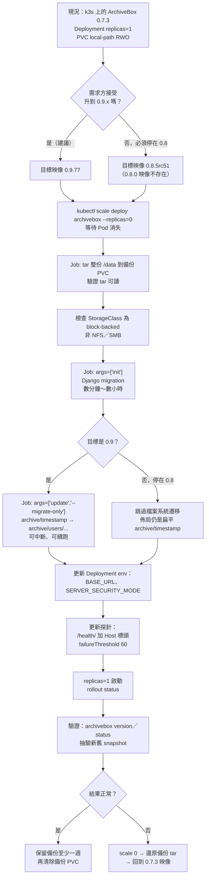

# 在 k3s 上把 ArchiveBox 從 0.7.3 升級到 0.8.0 的遷移指南

## 摘要

本報告回答一個具體的運維問題：**在 k3s（Kubernetes 輕量發行版）叢集上，以容器方式部署的 ArchiveBox 0.7.3，要如何遷移到 0.8.0？**

最重要的結論必須先講清楚：

1. **0.8.0 從來沒有正式發佈。** 整個 0.8.x 系列只有 pre-release（`-rc`）版本[^issue1526][^rel080rc]。因此 `archivebox/archivebox:0.8.0` 這個映像標籤不存在，在 Docker Hub 上查詢會直接得到 404[^dockerhub080]。Docker Hub 上最早的 0.8 標籤是 `0.8.2-rc`，最後一個是 `0.8.5rc51`（2024-10-24 推送）[^dockerhub08]。
2. **實務上有兩條路線**：
   - **路線 A（建議）**：跳過 0.8，直接升級到 0.9.x 穩定版。這是上游維護者明確設計的路徑，官方升級文件就是以 `>=0.9.0rc0` 為目標版本[^upgrading]。
   - **路線 B（僅在你被硬性要求停在 0.8）**：釘選到 `archivebox/archivebox:0.8.5rc51`。但這是 BETA 映像，且後續仍要再做一次 0.9 的檔案系統遷移。
3. **不論走哪條路線，k3s 上的動作順序都一樣**：`scale 0` → 整份 PVC 備份 → 用一次性 Job 掛同一個 PVC 跑 `archivebox init` →（0.9 才需要）`archivebox update --migrate-only` → 更新環境變數與探針 → 啟動 → 驗證。
4. 只有 `Recreate` 策略、單一副本、block-backed 儲存、`/dev/shm` 記憶體磁碟區這四件事做對，SQLite 才不會壞。

> ArchiveBox 專案本身是相當活躍的開源專案，GitHub 星數約 29,094、fork 約 1,634[^ghrepo]。這代表其 issue 與 release notes 是可查證的一手來源，但同時也代表版本之間變動幅度大，不能憑印象升級。

---

## 一、先釐清版本事實

### 1.1 為什麼沒有 0.8.0

ArchiveBox 維護者在 GitHub Issue #1526 中說明：

> 「整個 `v0.8.x` 系列仍只是 BETA（包含所有次要 semver／rc 版號升幅），我們仍以 `v0.9.0` 作為下一個穩定 `:latest` 版本為目標。」[^issue1526]

又在同一討論中提到，因為 0.8 alpha 的改動規模太大，乾脆跳號讓大家一看就知道是大版本[^issue1526]。

因此 0.8 系列的時間線是：

| 版本 | 類型 | 日期 | 備註 |
|---|---|---|---|
| `v0.7.3` | 穩定版 | 2024-12-15 | 僅 Docker 內依賴更新（Chrome v131、single-file v1.1.54、yt-dlp 2024.12.x），無 Python 程式碼變更[^rel073] |
| `v0.8.0-rc` | ALPHA pre-release | 2024-03-27 | 新 REST API（django-ninja）、Django 5.0、webhooks、rclone 遠端儲存、noVNC[^rel080rc] |
| `v0.8.2-rc` / `v0.8.3-rc` / `v0.8.4-rc` / `v0.8.5-rc` | pre-release | 2024-08 ~ 2024-10 | 資料模型欄位改名、REST API 認證改動、huey 任務系統、supervisord[^rel083rc][^rel085rc] |
| `v0.8.6rc1` | pre-release | 2024-10 | 修錯為主[^docs08] |
| `v0.7.4` | 穩定版 | 2026-05-18 | 0.7.x 線最後一版，同樣僅依賴更新[^rel074] |
| `v0.9.36` | 穩定版 | 2026-09-22 | 首個 0.9 穩定版，正式變更檔案系統佈局[^rel0936] |

注意 `v0.7.3` 發佈於 2024-12-15，而 `v0.8.0-rc` 是 2024-03-27，**0.8.0-rc 反而比 0.7.3 更早**。這是因為 0.7.x 被拉回來當作維護分支繼續出依賴更新，而 0.8 alpha 在另一條線上推進。這也解釋了為什麼「0.7.3 升 0.8.0」在語意上其實是「從維護分支跳到實驗分支」。

### 1.2 映像與套件可得性

| 目標 | Docker 映像存在？ | 說明 |
|---|---|---|
| `0.7.3` | 是（2024-12-15）[^dockerhub07] | 你目前用的 |
| `0.8.0` | **否** | Docker Hub 標籤 API 直接 404[^dockerhub080] |
| `0.8.5rc51` | 是（2024-10-24）[^dockerhub08] | 0.8 系列最後一個映像 |
| `0.9.77` | 是 | PyPI 上 `info.version` 為 `0.9.77`（2026-10-27 上傳）[^pypi] |

結論：**如果你真的要 0.8，就得釘 `0.8.5rc51`，不存在 `0.8.0` 映像。** 這一點必須先跟需求方對齊，否則整個遷移計畫會卡在「映像拉不到」。

---

## 二、破壞性變更盤點

因為你可能走 A 或 B 兩條路，這裡把兩段的破壞性變更分開列。

### 2.1 0.7.x → 0.8.x

| 項目 | 變更內容 | 對 k3s 部署的影響 |
|---|---|---|
| 資料模型欄位 | `.created` → `.created_at`、`.modified` → `.modified_at`、`.added` → `.bookmarked_at`、`.updated` → `.downloaded_at`[^rel083rc] | `archivebox init` 的 Django migration 會處理；但任何直接讀 `index.sqlite3` 的外部腳本會壞 |
| REST API 認證 | Cookie 不再能用於 API 認證，改為在 URL 附加 token[^rel083rc] | Ingress 若有 cookie-based 自動化會失效 |
| Web 伺服器 | 從 Django `runserver` 改為 `daphne` ASGI，並導入 `huey` 任務系統與 `supervisord`[^rel083rc][^rel084rc] | 容器內多程序，`terminationGracePeriodSeconds` 要留足 |
| Django | 5.0 → 5.1[^rel080rc][^docs08] | 映像內已處理，不需要宿主機動作 |
| noVNC 埠 | 從 6080 移到 8081[^rel085rc] | 若 Service/Ingress 有映射 6080，要一起改 |
| 安裝方式 | `apt` / `brew` 安裝被標為 deprecated，改推 `pip` + `archivebox install`[^rel085rc] | 容器部署不受影響 |
| 檔案系統佈局 | **0.8 階段尚未改變** | 這是 0.9 才發生的事 |

### 2.2 0.8.x → 0.9.x（若走路線 A，這段一定要看）

官方 v0.9.36 release notes 的 Upgrade Notes 明確列出：

> - **`data/archive/` 的 snapshot 目錄有全新佈局**，檔案會在首次存取時自動遷移：
>   `data/archive/{timestamp}` → `data/archive/users/{username}/snapshots/YYYYMMDD/example.com/{uuid}`[^rel0936]
> - **自訂設定應從 `docker-compose.yml` 的 `environment:` 移到 `data/ArchiveBox.conf`**，否則無法透過新的 Machine config 管理介面編輯[^rel0936]
> - **裸機安裝現在要求 Python >= 3.13+**[^rel0936]
> - **新的 DNS、SSL、HTTPS 供應需求**：為了隔離被封存的 JS，新增萬用字元子網域支援，需要設定 `BASE_URL` 與 `SERVER_SECURITY_MODE`[^rel0936]

同一份 notes 也說明這是 ArchiveBox 史上**第一次**改變 `data/` 的檔案系統佈局，原因是舊的扁平結構在單一目錄放上萬筆時效能崩壞，新結構 `user > recordtype > date > origin > uuid` 才可能擴展[^rel0936]。

另外 0.9 新增 PostgreSQL 支援（`DATABASE_ENGINE`）[^rel0936]。

---

## 三、k3s 遷移流程（逐步）

### 3.1 前置檢查

先確認你目前實際跑的東西：

```bash
kubectl -n archivebox get deploy,sts,pod,pvc,svc,ingress -o wide
kubectl -n archivebox describe pvc archivebox
kubectl -n archivebox exec deploy/archivebox -- archivebox version
```

**要確認的三件事**：

1. **StorageClass 是不是 block-backed**。官方明確要求：「SQLite 需要檔案系統鎖與 fsync 語意，不要把整個 `/data` 放在 NFS/SMB 的 PVC 上。」只有 `data/archive` 的快照檔可以放到遠端[^officialmanifest]。k3s 預設的 `local-path` 是節點本機磁碟，符合需求，但它只能 `ReadWriteOnce`，且會把 Pod 永久釘在該節點上[^k3sstorage]。
2. **策略必須是 `Recreate`，副本必須是 1**。官方 manifest 就寫 `replicas: 1` 加 `strategy: type: Recreate`，並註明「一個 server/orchestrator 擁有整個 collection；替換前要先停掉它」[^officialmanifest]。ArchiveBox 不支援水平擴展[^officialmanifest]。
3. **UID/GID**。映像 entrypoint 會用 collection 擁有者的數值 UID/GID，找不到就退回 **911**[^helmforge]。若 PVC 由 root 建立，entrypoint 會嘗試 `chown`；在 NFS 上這會失敗並造成 CrashLoopBackOff[^seckatie]。

### 3.2 步驟 1：停掉舊服務

```bash
kubectl -n archivebox scale deploy archivebox --replicas=0
kubectl -n archivebox wait --for=delete pod -l app=archivebox --timeout=180s
```

這一步不能省。SQLite 同時被兩個 writer 碰到就是資料損毀。

### 3.3 步驟 2：整份 PVC 備份

官方升級文件反覆強調：**資料庫單獨備份不夠，必須含 archive 檔案、設定、browser Personas**[^upgrading]。

```bash
kubectl -n archivebox apply -f - <<'EOF'
apiVersion: batch/v1
kind: Job
metadata:
  name: archivebox-backup
  namespace: archivebox
spec:
  backoffLimit: 0
  template:
    spec:
      restartPolicy: Never
      containers:
        - name: tar
          image: busybox:1.36
          command:
            - sh
            - -c
            - >-
              tar -czf /backup/archivebox-data-$(date +%s).tar.gz -C /data .
          volumeMounts:
            - name: data
              mountPath: /data
              readOnly: true
            - name: backup
              mountPath: /backup
      volumes:
        - name: data
          persistentVolumeClaim:
            claimName: archivebox
        - name: backup
          persistentVolumeClaim:
            claimName: archivebox-backup
EOF
```

把備份寫到另一個 PVC（或 hostPath）再 `kubectl cp` 出來。因為 `local-path` 是 RWO 且綁節點，備份 Job 會自動排到同一個節點，這點不用手動處理[^k3sstorage][^k8srwo]。

**備份後立刻驗證**：

```bash
kubectl -n archivebox exec job/archivebox-backup -- tar -tzf /backup/archivebox-data-*.tar.gz | head
```

### 3.4 步驟 3：用一次性 Job 跑 `archivebox init`

`archivebox init` 是冪等的，官方文件說「同一條命令同時用於初始化新 archive 與升級既有資料庫」，「可安全重複執行」[^upgrading]。底層是 Django migrations，官方稱之為「確定性、原子性、安全的升級」[^upgrading]。

```bash
kubectl -n archivebox apply -f - <<'EOF'
apiVersion: batch/v1
kind: Job
metadata:
  name: archivebox-init
  namespace: archivebox
spec:
  backoffLimit: 0
  template:
    spec:
      restartPolicy: Never
      containers:
        - name: init
          image: archivebox/archivebox:0.9.77
          args: ["init"]
          env:
            - name: BASE_URL
              value: "https://archive.example.com"
            - name: SERVER_SECURITY_MODE
              value: "safe-onedomain-nojsreplay"
          volumeMounts:
            - name: data
              mountPath: /data
            - name: shm
              mountPath: /dev/shm
      volumes:
        - name: data
          persistentVolumeClaim:
            claimName: archivebox
        - name: shm
          emptyDir:
            medium: Memory
            sizeLimit: 1Gi
EOF
kubectl -n archivebox logs -f job/archivebox-init
```

要點：

- **不要覆寫 `command`**，只給 `args: ["init"]`，讓映像的 entrypoint 負責降權與環境準備。社群早期範例（Issue #551）就是用 initContainer 加 `args: ['init']`[^issue551]。
- 只有在 NFS 這種 `chown` 會失敗的環境，才需要改成 `command: ["archivebox"]` 直接繞過 entrypoint，並自行設定 `securityContext.runAsUser/runAsGroup/fsGroup`[^seckatie]。
- 資料庫大的話這一步可能「數分鐘到數小時」[^rel0936]。

### 3.5 步驟 4（僅路線 A）：`archivebox update --migrate-only`

0.8.x 的升級文件**完全沒有**提到這個指令[^docs08upgrading]，它是 0.9 才有的檔案系統遷移工具。官方說明它會：

> 可能是重寫 metadata、遷移舊佈局、並在驗證遷移成功後移除過時的時間戳投影[^upgrading]。

而且它是**可中斷、可續跑**的：官方明說「檔案系統遷移是惰性的，可以隨時中斷／續跑」[^rel0936]。原始碼層面，它分兩階段：先「排空」舊的 `archive/<timestamp>` 目錄並建立對應 DB 記錄，再逐一處理 DB 中所有 snapshot 的待辦遷移[^apidocs]。

```bash
kubectl -n archivebox apply -f - <<'EOF'
apiVersion: batch/v1
kind: Job
metadata:
  name: archivebox-migrate
  namespace: archivebox
spec:
  backoffLimit: 0
  template:
    spec:
      restartPolicy: Never
      containers:
        - name: migrate
          image: archivebox/archivebox:0.9.77
          args: ["update", "--migrate-only"]
          env:
            - name: BASE_URL
              value: "https://archive.example.com"
          volumeMounts:
            - name: data
              mountPath: /data
      volumes:
        - name: data
          persistentVolumeClaim:
            claimName: archivebox
EOF
```

**若跳過這一步會怎樣？** 官方 v0.9.36 release notes 說得很清楚：遷移會「在首次存取時惰性發生，並可能拖慢 UI」[^rel0936]。所以跳過不會壞，但體驗會差，而且第一次點每一筆 snapshot 都會卡。

可用旗標（節錄）：`--migrate-only`、`--index-only`、`--rescan`、`--reverse`（預設由新到舊，`--reverse` 改成由舊到新）、`--limit`、`--batch-size`（預設 500）、`--resume`[^apidocs]。

> 實測建議：先 `--limit=50` 跑一輪，確認時間成本再全跑。因為 snapshot 從新到舊處理，`--reverse` 適合想先驗證最舊資料的情境。

### 3.6 步驟 5：更新 Deployment 的環境變數與探針

0.9 之後有兩個關鍵設定，兩者都**不能**用舊的 `ALLOWED_HOSTS` / `CSRF_TRUSTED_ORIGINS` 手動填法：

| 設定 | 作用 |
|---|---|
| `BASE_URL` | 對外正式 URL；用於樣板絕對連結、重導、以及子網域模式下推導 `admin.` / `web.` / `api.` / `snap-<id>.`[^configwiki] |
| `SERVER_SECURITY_MODE` | 伺服器整體安全姿態，決定封存內容怎麼被供應、admin/API 是否可達、UI 是否拆到不同 host[^configwiki] |

`SERVER_SECURITY_MODE` 的五個值[^configwiki]：

| 值 | 子網域 | JS replay | 控制面 | 適用 |
|---|---|---|---|---|
| `auto`（預設） | 只有 `*.localhost` 用子網域 | localhost 全 replay，其他 no-JS | 開啟 | 零設定預設值 |
| `safe-subdomains-fullreplay` | 全部拆開 | 開 | 僅 `admin.*` | **需要萬用字元 DNS + 憑證** |
| `safe-onedomain-nojsreplay` | 單一 host | 封存 HTML 不能跑 JS | 開啟 | 沒有萬用字元 DNS 時的最佳折衷 |
| `unsafe-onedomain-noadmin` | 單一 host | 全開 | **關閉**（`/admin`、`/api` 都 403） | 唯讀公開站 |
| `danger-onedomain-fullreplay` | 單一 host | 全開 | 開啟 | 只可在本機／信任網段 |

**k3s 上的實務選擇**：若你的 Ingress 只有單一 hostname，就用 `safe-onedomain-nojsreplay`；若要 `safe-subdomains-fullreplay`，Ingress 必須能路由 `admin.*`、`web.*`、`api.*`、`snap-*.*`，而且需要萬用字元憑證[^configwiki]。

還有一個很容易踩的坑：官方說明在單網域的 `auto` 模式下，讀取請求可以從任何合法 ingress hostname 進來，但 **POST/PUT/PATCH/DELETE 只接受 canonical `BASE_URL` 那個 host**[^configwiki]。若你的 Ingress 有多個別名 hostname，寫入操作會靜默失敗。

**從 0.7.3 上來有個好消息**：官方文件說 `archivebox init` 會保留完整舊設定，並把舊的 `ARCHIVE_BASE_URL`、`ADMIN_BASE_URL` 或 `LISTEN_HOST` 遷移成 `BASE_URL`；若這些都沒有，會用單一非預設的 `CSRF_TRUSTED_ORIGINS` / `ALLOWED_HOSTS` 作為回退[^configwiki]。所以舊環境變數不會直接變成孤兒。

探針要帶 `Host` 標頭。官方 manifest 的做法是：

```yaml
startupProbe:
  httpGet:
    path: /health/
    port: http
    httpHeaders:
      - name: Host
        value: admin.archivebox.localhost
  periodSeconds: 10
  timeoutSeconds: 5
  failureThreshold: 60
readinessProbe:
  httpGet:
    path: /health/
    port: http
    httpHeaders:
      - name: Host
        value: admin.archivebox.localhost
  periodSeconds: 10
  timeoutSeconds: 5
```

`failureThreshold: 60` 是有意義的：首次啟動要先跑完 migration，可能好幾分鐘[^officialmanifest]。

**完整 Deployment 骨架（0.9，k3s 適用）**：

```yaml
apiVersion: apps/v1
kind: Deployment
metadata:
  name: archivebox
  namespace: archivebox
spec:
  replicas: 1
  strategy:
    type: Recreate
  selector:
    matchLabels:
      app: archivebox
  template:
    metadata:
      labels:
        app: archivebox
    spec:
      terminationGracePeriodSeconds: 60
      containers:
        - name: archivebox
          image: archivebox/archivebox:0.9.77
          ports:
            - containerPort: 5797
              name: http
          env:
            - name: BASE_URL
              value: "https://archive.example.com"
            - name: SERVER_SECURITY_MODE
              value: "safe-onedomain-nojsreplay"
            - name: PUBLIC_ADD_VIEW
              value: "False"
          resources:
            requests:
              cpu: 250m
              memory: 1Gi
            limits:
              memory: 4Gi
          volumeMounts:
            - name: data
              mountPath: /data
            - name: shm
              mountPath: /dev/shm
      volumes:
        - name: data
          persistentVolumeClaim:
            claimName: archivebox
        - name: shm
          emptyDir:
            medium: Memory
            sizeLimit: 1Gi
```

`/dev/shm` 用記憶體 backed `emptyDir` 是必要的，Chromium headless 需要它；建議至少 2 GiB RAM[^officialmanifest]。0.9 官方也把最低建議拉到 `>= 2GB`[^rel0936]。

### 3.7 步驟 6：啟動與驗證

```bash
kubectl -n archivebox scale deploy archivebox --replicas=1
kubectl -n archivebox rollout status deploy/archivebox --timeout=15m
kubectl -n archivebox logs deploy/archivebox --tail=200
```

驗證清單：

```bash
# 版本是否正確
kubectl -n archivebox exec deploy/archivebox -- archivebox version

# 健康端點（要帶 Host）
kubectl -n archivebox port-forward svc/archivebox 5797:5797 &
curl -H 'Host: admin.archivebox.localhost' -sS http://127.0.0.1:5797/health/

# 資料完整性
kubectl -n archivebox exec deploy/archivebox -- archivebox status
```

`archivebox status` 是官方升級檢查清單的最後一步，用來確認升級成功並檢查孤立／損毀的 snapshot[^upgrading]。

再抽驗幾筆最舊與最新的 snapshot 能不能開，這比看 log 更有意義。

---

## 四、遷移流程圖



---

## 五、k3s 環境的專屬注意事項

### 5.1 `local-path` 的 RWO 語意

k3s 預設的 local-path provisioner 資料放在 `/var/lib/rancher/k3s/storage`（rootless 模式則在 `${HOME}/.rancher/k3s/storage`）[^k3sstorage]。它只支援 `ReadWriteOnce`，而且會「永久把 Pod 綁在擁有該 volume 的節點上」[^k3sstorage]。

Kubernetes 對 `ReadWriteOnce` 的定義是「volume 可被**單一節點**以讀寫掛載」，且「仍允許多個 Pod 存取同一個 volume，只要它們跑在同一個節點上」[^k8srwo]。

**對你的意義**：備份 Job、init Job、migrate Job 都會自動排到同一個節點（PV 有 node affinity），所以同時只能有一個 Pod 掛載。**每個步驟都要等下一個 Job 完成再跑下一個**，不能並行。若你想省事，把備份改寫到節點本機的 hostPath 或物件儲存，避免佔用同一個 RWO 名額。

若要多節點共用，local-path provisioner 只有在設定 `sharedFileSystemPath`（指向所有節點都掛載的共享檔案系統）時才支援 `ReadWriteMany`[^lpp]。但這與 SQLite 的需求衝突，不建議。

自訂儲存路徑可以用 `--default-local-storage-path` 或自訂 StorageClass 的 `nodePath` 參數[^k3sstorage]。

### 5.2 UID/GID 與 `lost+found`

- 映像 entrypoint 以 collection 擁有者的數值 UID/GID 執行，新 collection 回退到 **911**[^helmforge]。
- 在 ext4 block volume 上，`lost+found` 目錄曾讓 `archivebox init` 直接失敗，已在上游 commit `d9ef3d0` 修正[^issue551]。
- NFS 情境下 `usermod`/`groupmod`/`chown` 會出現 `Operation not permitted`，解法是繞過 entrypoint 並顯式設定 `securityContext.runAsUser/runAsGroup/fsGroup`，同時讓 NFS export 以 `anonuid`/`anongid` 對齊[^seckatie]。
- Pod Security `restricted` profile 預設**過不了**，因為容器需要 `CHOWN`、`DAC_OVERRIDE`、`FOWNER`、`SETUID`、`SETGID` 能力[^helmforge]。在 k3s 上若啟用 `restricted` PSA，要為 `archivebox` namespace 開例外或降級到 `baseline`。

### 5.3 排程不要用 CronJob 外掛

0.9 之後排程存在資料庫裡，由 `archivebox server` 內的 orchestrator 監看，**不需要**外部 cron、host crontab 或 sidecar[^apidocs]。官方 CLI：

```bash
archivebox schedule --every=daily --depth=1 https://example.com/feed.xml
archivebox schedule --every='0 */6 * * *' https://example.com
archivebox schedule --show
```

在 k3s 上就是 `kubectl exec` 進去設定一次，之後由 server 進程自己跑。如果你原本寫了 k8s CronJob 呼叫 `archivebox add`，升級後可以移除，否則會與內建 orchestrator 重複觸發。

### 5.4 Sonic 搜尋不需要 sidecar

現代映像把 Sonic 跑在主容器的 loopback 上，`SEARCH_BACKEND_ENGINE=sonic` 是預設值[^apidocs]。若你舊的 Deployment 有 `SEARCH_BACKEND_HOST_NAME=sonic` 這種指向 sidecar 的設定，升級時要移除。想換成無依賴方案可設 `SEARCH_BACKEND_ENGINE=sqlite`（FTS5）[^apidocs]。

重建索引用 `archivebox update --index-only`[^upgrading]。

### 5.5 不支援多副本

即使改用 PostgreSQL，ArchiveBox 也不支援水平擴展；每個 collection 只能有一個 server/orchestrator[^officialmanifest]。所以 `Recreate` 而非 `RollingUpdate` 是硬需求，不是最佳化。

### 5.6 設定要搬到 `ArchiveBox.conf`

0.9 的 release notes 明確要求把自訂設定從 Deployment 的 `env:` 移到 `data/ArchiveBox.conf`，否則新的 Machine config 管理介面無法編輯[^rel0936]。在 k8s 上的實務做法：把 `ArchiveBox.conf` 放進 ConfigMap，掛載成檔案；或接受「唯讀設定」並保留 env 注入。

---

## 六、回滾計畫

任何遷移都必須有回滾路徑，尤其 ArchiveBox 這種「資料庫 + 檔案佈局」同時變動的情況。

```bash
# 1. 停掉新版本
kubectl -n archivebox scale deploy archivebox --replicas=0

# 2. 用一次性 Pod 清空 /data 再解開備份
kubectl -n archivebox apply -f - <<'EOF'
apiVersion: batch/v1
kind: Job
metadata:
  name: archivebox-restore
  namespace: archivebox
spec:
  backoffLimit: 0
  template:
    spec:
      restartPolicy: Never
      containers:
        - name: restore
          image: busybox:1.36
          command:
            - sh
            - -c
            - rm -rf /data/* /data/.[!.]* ; tar -xzf /backup/archivebox-data-TIMESTAMP.tar.gz -C /data
          volumeMounts:
            - name: data
              mountPath: /data
            - name: backup
              mountPath: /backup
      volumes:
        - name: data
          persistentVolumeClaim:
            claimName: archivebox
        - name: backup
          persistentVolumeClaim:
            claimName: archivebox-backup
EOF

# 3. 把 image 改回 0.7.3 並啟動
kubectl -n archivebox set image deploy/archivebox archivebox=archivebox/archivebox:0.7.3
kubectl -n archivebox scale deploy archivebox --replicas=1
```

**關鍵前提**：一旦跑過 0.9 的 `update --migrate-only`，檔案已經搬成新佈局，**單靠回退映像無法還原**，必須連 tar 一起還原。這就是為什麼官方反覆強調「保留備份直到你確認最終設定沒問題」[^rel0936]。

若走的是路線 B（停在 0.8.5rc51），因為 0.8 沒有動檔案佈局，回滾只需換映像回來，風險低得多。這是路線 B 唯一的優勢。

---

## 七、決策建議

| 情境 | 建議 |
|---|---|
| 這是長期要維護的個人／團隊 archive | **走路線 A，直接到 0.9.77**。0.8 是 BETA，且之後還要再做一次檔案佈局遷移，痛一次比痛兩次好 |
| 有第三方工具直接讀 `index.sqlite3` 或呼叫舊 API | 先確認相容性；0.7→0.8 的欄位改名與 0.8→0.9 的 API 擴充都會影響 |
| 必須維持舊的 `archive/<timestamp>/` 佈局（例如外部同步腳本） | 只有在路線 B 才能維持，但這等於把自己鎖在 BETA |
| Ingress 只有單一 hostname、沒有萬用字元憑證 | 走 0.9 並用 `SERVER_SECURITY_MODE=safe-onedomain-nojsreplay` |
| 有萬用字元 DNS + 憑證 | 走 0.9 並用 `safe-subdomains-fullreplay`，安全性最好 |

---

## 八、來源批判與限制

**可信度評估**：

- **一手來源（高可信）**：GitHub Releases API（含 `prerelease` 旗標與發佈時間）、Docker Hub Tags API（可直接證明 `0.8.0` 標籤 404）、PyPI JSON API、官方文件站 `docs.archivebox.io`、官方 manifest 檔案。本報告的核心結論（0.8.0 不存在）完全建立在這些可機器驗證的 API 回應上。
- **二手來源（中可信，已交叉驗證）**：`helmforge.dev` 的 Helm chart 文件、`SecKatie` 的 NFS 指南、`sirMackk/archivebox-pi-helm`。這些為社群維護，細節可能與上游不同步，但與官方文件的說法一致（如 UID 911、`/dev/shm`、NFS 限制）。
- **低可信／需保留**：部分 release notes 的細節（例如 0.8.0-rc 究竟有沒有對應映像）在不同查詢路徑下曾出現不一致，最終以 Docker Hub API 的直接 404 為準。

**已知限制**：

1. 本報告**未實際執行**遷移，所有指令皆依官方文件與 manifest 推導，尚未在真實 k3s 叢集上驗證。`archivebox update --migrate-only` 的實際耗時高度依賴 snapshot 數量與儲存 IOPS，官方只給「數分鐘到數小時」這種範圍[^rel0936]。
2. `--migrate-only` 的旗標清單取自 API 參考文件的函式簽名[^apidocs]，不同 0.9 小版本可能增減，執行前應以 `archivebox update --help` 為準。
3. 0.9 系列仍在快速迭代（PyPI 最新為 `0.9.77`[^pypi]，GitHub 最後 push 為 2026-11-25[^ghrepo]），具體映像標籤與行為可能與本報告撰寫時（2026-11-24）有差異。
4. 未涵蓋 PostgreSQL 遷移的實作細節。官方僅說「支援 PostgreSQL，可請你的 agent 協助從 SQLite 遷移」[^rel0936]，沒有提供正式的遷移工具說明。
5. 若你的 0.7.3 部署有客製化的 `docker_entrypoint.sh` 覆寫或自建映像，上述步驟需要相應調整，本報告假定使用官方映像。

---

## 參考文獻

[^issue1526]: ArchiveBox. (2024). *About v0.8.x-rc pre-release versioning* (Issue #1526). GitHub. Retrieved 2026-11-24, from https://github.com/ArchiveBox/ArchiveBox/issues/1526

[^rel073]: ArchiveBox. (2024, December 15). *v0.7.3*. GitHub Releases. Retrieved 2026-11-24, from https://github.com/ArchiveBox/ArchiveBox/releases/tag/v0.7.3

[^rel074]: ArchiveBox. (2026, May 18). *v0.7.4*. GitHub Releases. Retrieved 2026-11-24, from https://github.com/ArchiveBox/ArchiveBox/releases/tag/v0.7.4

[^rel080rc]: ArchiveBox. (2024, March 27). *v0.8.0-rc*. GitHub Releases. Retrieved 2026-11-24, from https://github.com/ArchiveBox/ArchiveBox/releases/tag/v0.8.0-rc

[^rel083rc]: ArchiveBox. (2024). *v0.8.3-rc*. GitHub Releases. Retrieved 2026-11-24, from https://github.com/ArchiveBox/ArchiveBox/releases/tag/v0.8.3-rc

[^rel084rc]: ArchiveBox. (2024). *v0.8.4-rc*. GitHub Releases. Retrieved 2026-11-24, from https://github.com/ArchiveBox/ArchiveBox/releases/tag/v0.8.4-rc

[^rel085rc]: ArchiveBox. (2024). *v0.8.5-rc*. GitHub Releases. Retrieved 2026-11-24, from https://github.com/ArchiveBox/ArchiveBox/releases/tag/v0.8.5-rc

[^rel0936]: ArchiveBox. (2026, September 22). *v0.9.36*. GitHub Releases. Retrieved 2026-11-24, from https://github.com/ArchiveBox/ArchiveBox/releases/tag/v0.9.36

[^dockerhub080]: Docker, Inc. (n.d.). *archivebox/archivebox tag 0.8.0*. Docker Hub API. Retrieved 2026-11-24, from https://hub.docker.com/v2/repositories/archivebox/archivebox/tags/0.8.0

[^dockerhub08]: Docker, Inc. (n.d.). *archivebox/archivebox tags matching 0.8*. Docker Hub API. Retrieved 2026-11-24, from https://hub.docker.com/v2/repositories/archivebox/archivebox/tags?page_size=100&name=0.8&ordering=last_updated

[^dockerhub07]: Docker, Inc. (n.d.). *archivebox/archivebox tags matching 0.7*. Docker Hub API. Retrieved 2026-11-24, from https://hub.docker.com/v2/repositories/archivebox/archivebox/tags?page_size=100&name=0.7&ordering=last_updated

[^pypi]: Python Package Index. (2026, October 27). *archivebox 0.9.77*. PyPI. Retrieved 2026-11-24, from https://pypi.org/pypi/archivebox/json

[^upgrading]: ArchiveBox. (2026). Upgrading. In *ArchiveBox Documentation* (latest). Retrieved 2026-11-24, from https://docs.archivebox.io/latest/Upgrading.html

[^docs08]: ArchiveBox. (2024). *ArchiveBox Documentation* (v0.8.6rc1). Retrieved 2026-11-24, from https://docs.archivebox.io/v0.8.6rc1/

[^docs08upgrading]: ArchiveBox. (2024). Upgrading. In *ArchiveBox Documentation* (v0.8.6rc1). Retrieved 2026-11-24, from https://docs.archivebox.io/v0.8.6rc1/Upgrading.html

[^configwiki]: ArchiveBox. (2026). Configuration. In *ArchiveBox Wiki*. GitHub. Retrieved 2026-11-24, from https://github.com/ArchiveBox/ArchiveBox/wiki/Configuration

[^apidocs]: ArchiveBox. (2026). archivebox.cli.archivebox_update. In *ArchiveBox Python API Reference*. Retrieved 2026-11-24, from https://docs.archivebox.io/latest/apidocs/archivebox/archivebox.cli.archivebox_update.html

[^officialmanifest]: ArchiveBox. (2026). *docker-archivebox/archivebox.yml* [Kubernetes manifest]. GitHub. Retrieved 2026-11-24, from https://github.com/ArchiveBox/docker-archivebox/blob/main/archivebox.yml

[^issue551]: ArchiveBox. (2024). *Kubernetes deployment support* (Issue #551). GitHub. Retrieved 2026-11-24, from https://github.com/ArchiveBox/ArchiveBox/issues/551

[^ghrepo]: ArchiveBox. (2026). *ArchiveBox/ArchiveBox* [Repository metadata]. GitHub API. Retrieved 2026-11-24, from https://api.github.com/repos/ArchiveBox/ArchiveBox

[^helmforge]: HelmForge. (2026). *ArchiveBox Helm chart documentation*. Retrieved 2026-11-24, from https://helmforge.dev/docs/charts/archivebox/

[^seckatie]: SecKatie. (n.d.). *ArchiveBox Kubernetes NFS guide*. GitHub. Retrieved 2026-11-24, from https://github.com/SecKatie/infrastructure/blob/main/archivebox-k8s-nfs-guide.md

[^k3sstorage]: Rancher Labs. (n.d.). Storage. In *K3s Documentation*. Retrieved 2026-11-24, from https://docs.k3s.io/storage

[^k8srwo]: The Kubernetes Authors. (n.d.). Access Modes. In *Persistent Volumes*. Kubernetes Documentation. Retrieved 2026-11-24, from https://kubernetes.io/docs/concepts/storage/persistent-volumes/#access-modes

[^lpp]: Rancher Labs. (n.d.). *local-path-provisioner* [README]. GitHub. Retrieved 2026-11-24, from https://github.com/rancher/local-path-provisioner/blob/master/README.md