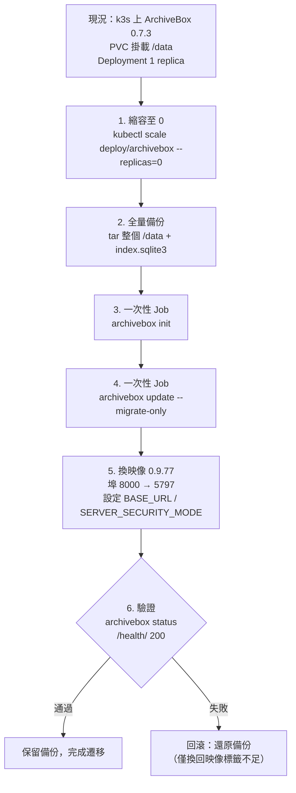
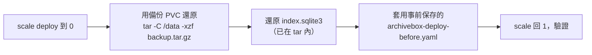

# 將 k3s 上的 ArchiveBox 從 0.7.3 升級到 0.9.0：版本事實、破壞性變更與遷移流程

## 摘要

本文說明如何把部署在 k3s（Kubernetes 輕量發行版）上的 ArchiveBox 自 0.7.3 升級到 0.9 系列。**最重要的前提是：截至 2026-11-24，ArchiveBox 並不存在名為 `0.9.0` 的穩定版本。** 專案在 `v0.8.x` 期間只有候選版本（`v0.8.0-rc` 至 `v0.8.6-rc`），之後直接跳到 `v0.9.31-rc`，第一個穩定版為 `v0.9.36`（2026-09-22 發布），其後為 `0.9.50`、`0.9.64`、`0.9.70`、`0.9.71`、`0.9.73`、`0.9.76`，目前最新穩定版為 `v0.9.77`（2026-10-27）[^rel][^tags][^hubtags]。因此「升級到 0.9.0」在實務上應理解為「升級到 0.9.x 穩定版」，建議直接採用 `0.9.77`（或待 `0.9.78` 正式發布後採用，原因見風險章節的 cgroup 記憶體檢查問題）[^i1966]。

升級的核心動作只有四個，且必須在**單一寫入者**的前提下、離線執行：

1. 停止舊服務（k3s 上把 Deployment 縮到 0 個 Pod）
2. **完整備份整個 `data/` 目錄**（資料庫、設定檔、封存檔案、browser Persona），只備份資料庫不夠[^rel36]
3. 以一次性 Job 執行 `archivebox init`（資料庫 migration）與 `archivebox update --migrate-only`（檔案系統版面遷移）
4. 換上新映像與新的埠號、`BASE_URL`、`SERVER_SECURITY_MODE` 後重啟



---

## 一、名詞與背景

### 1.1 ArchiveBox 是什麼

ArchiveBox 是自架的網頁封存工具，會把使用者提交的網址用 Wget、Chromium（截圖／PDF／SingleFile）、yt-dlp、git 等多種擷取器（0.9 起改稱 plugin／hook）存成離線可讀的檔案，並以 SQLite（`index.sqlite3`）作為索引資料庫[^repo]。截至目前 GitHub 上約 29,094 顆星、1,634 個 fork、授權為 MIT、主要語言為 Python，仍在活躍開發中[^repo]。

### 1.2 k3s 部署的既有形態（0.7.3）

0.7.3 的官方 compose 檔案顯示了當時的執行模型[^compose073]：

- 映像：`archivebox/archivebox:stable`（當時 `stable` 指向 0.7.x）
- 指令：`server --quick-init 0.0.0.0:8000`
- 埠：容器內 **8000**
- 掛載：`./data:/data`
- 環境變數範例：`ALLOWED_HOSTS=*`、`PUBLIC_INDEX`、`PUBLIC_SNAPSHOTS`、`PUBLIC_ADD_VIEW`、`ADMIN_USERNAME`／`ADMIN_PASSWORD`、`PUID`／`PGID`、`SEARCH_BACKEND_ENGINE`、`SEARCH_BACKEND_HOST_NAME`、`MEDIA_MAX_SIZE`、`TIMEOUT`、`CHECK_SSL_VALIDITY`、`SAVE_ARCHIVE_DOT_ORG`
- Sonic 全文搜尋服務是**獨立的選用容器**（`archivebox/sonic:latest`，埠 1491），以註解形式提供
- 沒有 healthcheck

0.7.3 映像的 `ENTRYPOINT` 為 `dumb-init -- /app/bin/docker_entrypoint.sh`，`CMD` 為 `archivebox server --quick-init 0.0.0.0:8000`；entrypoint 只負責 PUID/PGID 對應、目錄權限修補、QEMU 偵測、磁碟空間檢查，最後以 `gosu` 降權執行 CMD，本身**不會**呼叫 `archivebox init`，也不啟動 supervisord 或 Sonic[^dockerfile073]。在 k3s 上若把這段 compose 翻成 Deployment，典型長相就是「一個 Deployment + 一個 PVC + 一個 Service」，Sonic 若啟用則是第二個 Deployment（或乾脆沒開）。

### 1.3 k3s 的儲存前提

k3s 預設的 `local-path` provisioner 只支援 `ReadWriteOnce` 與 `ReadWriteOncePod` 兩種 access mode，不支援 `ReadWriteMany`；`NodePath` 型態的 volume 原生綁定節點[^lpp]。`ReadWriteOncePod` 的支援自 local-path-provisioner `v0.0.25` 起提供（對應 PR #331，2023-11 合併），而 k3s v1.29 之後已透過 PR #11657 內建 `v0.0.31` 以上版本，因此現行 k3s 叢集可用[^lpp]。這一點在後面「保證單一寫入者」時會用到。

---

## 二、版本事實釐清：沒有 0.9.0

| 標籤 | 類型 | 日期 | 備註 |
|---|---|---|---|
| `v0.7.3` / `v0.7.4` | 穩定版 | — | 0.7 系列最後的穩定分支 |
| `v0.8.0-rc` … `v0.8.6-rc` | **預發布** | 2024-03 起 | 從未轉為穩定版；對應 PR #1311 被關閉 |
| `v0.9.31-rc` | 預發布 | 2026-05-18 | 標記為 pre-release |
| **`v0.9.36`** | **穩定版** | **2026-09-22** | **第一個 0.9.x 穩定版**，官方稱 MAJOR RELEASE |
| `v0.9.50` | 穩定版 | 2026-09-23 | CLI 進度顯示、中斷修正 |
| `v0.9.64` / `v0.9.70` / `v0.9.71` | 穩定版 | 2026-09-26 ～ 09-28 | UI 精簡、效能與小螢幕修正 |
| `v0.9.73` | 穩定版 | 2026-10-06 | Google Docs／Drive／Dropbox 封存、行動版重播 |
| `v0.9.76` | 穩定版 | 2026-10-27 | 社群媒體匯入、Slack bot |
| **`v0.9.77`** | **穩定版（最新）** | **2026-10-27** | 「Reliable setup, extension updates, faster browsing」 |
| `0.9.78rc*` | 預發布 | 2026-11 起 | 尚未轉穩定 |

Docker Hub 上 `archivebox/archivebox` 的穩定標籤自 `0.9.36` 起才存在（`0.9.36`、`0.9.50`、`0.9.64`、`0.9.70`、`0.9.71`、`0.9.73`、`0.9.76`、`0.9.77`），皆為 `linux/amd64` 與 `linux/arm64` 多架構映像；`latest` 目前與 `0.9.77` 指向同一個 digest，而 `stable` 標籤已六個月未更新、仍指向 0.7.x 世代的舊映像，**不可再當作升級目標**[^hubtags][^rel]。

> 因此本文後續一律以 `archivebox/archivebox:0.9.77` 作為升級目標版本。

---

## 三、0.7.3 → 0.9 的破壞性變更

以下變更會直接影響 k3s manifest 的內容，必須逐項處理。

### 3.1 連接埠：8000 → 5797

0.7.3 的 `CMD` 與 compose 都寫死 8000[^compose073]；0.9 的 `BIND_ADDR` 預設值改為 `127.0.0.1:5797`，官方 compose 也只映射 `5797`[^cfg][^compose9]。0.9 官方文件已完全不提 8000，也就是說**舊埠號不再被視為相容介面**；若仍想用 8000 必須自己在啟動參數裡指定。實務上 k3s 的 Service `targetPort`、Ingress backend、以及所有既有書籤都會受影響，建議一次改到 5797。

### 3.2 啟動指令：`--quick-init` → `--init`

0.9 映像的 `Dockerfile` 結尾為[^dockerfile9]：

```dockerfile
ENTRYPOINT ["dumb-init", "--", "/app/bin/docker_entrypoint.sh"]
CMD ["archivebox", "server", "--init"]
```

`--quick-init` 已不在新指令列中，取而代之是 `--init`（可與 bind 位址併用，例如 `archivebox server --init 0.0.0.0:5797`）。entrypoint 的分派邏輯也改了：若第一個參數以 `/` 開頭或為 `bash`、`sh`、`echo`、`cat`、`whoami`、`archivebox`，就以 `bash -c` 直接執行；否則視為 `archivebox` 子命令並以 `setpriv` 降權後執行[^dockerfile9]。這代表舊的 `command: server --quick-init 0.0.0.0:8000` 寫法會直接失效，必須改成 `args: ["archivebox", "server", "--init", "0.0.0.0:5797"]`。

### 3.3 檔案系統版面：`archive/<timestamp>/` → `archive/users/<user>/snapshots/<date>/<domain>/<uuid>/`

這是升級中最不可逆的一步。0.9 版的新版面為[^rel36][^upg]：

```
data/
  index.sqlite3
  ArchiveBox.conf
  archive/
    155243135 -> users/admin/snapshots/20210406/example.com/<SNAPSHOT_UUID>/
    users/
      admin/
        snapshots/
          20210406/
            example.com/
              <SNAPSHOT_UUID>/
                index.jsonl          # 舊版是 index.json，新版改為 JSON Lines
                index.html
                wget/warc/           # 擷取輸出改為 plugin 命名空間子目錄
                ytdlp/media/
                git/
  sources/
```

- 快照改為**依使用者分層**（`users/<username>`），再依日期／網域分層，最後以 UUID 作為唯一目錄名
- 每快照中介資料由 `index.json` 改為 `index.jsonl`
- 擷取輸出改放進 plugin 命名空間子目錄（`wget/warc/`、`ytdlp/media/`、`git/` 等）
- 舊的 `archive/<timestamp>` 路徑會被建立成**符號連結**指向新位置；`archivebox update --migrate-only` 的內部函式 `drain_old_archive_dirs()` 會逐一處理舊目錄、觸發資料庫列的檔案系統遷移、確認 commit 後才移除舊路徑[^upg]

官方明講「0.9 會把 `data/` 底下部分檔案搬到新的檔案系統位置」，且這個遷移是**惰性（lazy）**的：不跑 `--migrate-only` 也會在第一次存取時才搬，但會讓 UI 變慢[^rel36]。

### 3.4 設定鍵的更名與移除

0.9 保留了大量向後相容別名，但有些鍵真的消失了，寫在 Deployment 的 `env:` 裡會靜默失效或造成錯誤行為。

| 0.7.x 設定鍵 | 0.9 狀態 | 對應處理 |
|---|---|---|
| `ALLOWED_HOSTS` | **移除**（不再是使用者可設定項） | 改由 `BASE_URL` + `SERVER_SECURITY_MODE` 自動推導 Django 的 `ALLOWED_HOSTS` 與 `CSRF_TRUSTED_ORIGINS`[^cfg] |
| `PUBLIC_SNAPSHOTS` | **移除** | 由 `PERMISSIONS`（`public`／`unlisted`／`private`）取代；舊布林值仍被粗略映射（`False` ⇒ `private`）[^cfg] |
| `SAVE_ARCHIVE_DOT_ORG` | 改名 | `ARCHIVEDOTORG_ENABLED`（0.9 官方 compose 使用此名）[^compose9] |
| `MEDIA_MAX_SIZE` | 改名，保留別名 | `YTDLP_MAX_SIZE`（別名 `MEDIA_MAX_SIZE` 仍可用）[^plugins] |
| `MEDIA_TIMEOUT` | 改名，保留別名 | `YTDLP_TIMEOUT`（別名 `MEDIA_TIMEOUT`，並回退到 `TIMEOUT`）[^plugins] |
| `SEARCH_BACKEND_HOST_NAME` | 改名，保留別名 | `SEARCH_BACKEND_SONIC_HOST_NAME`（別名 `SEARCH_BACKEND_HOST_NAME`、`SONIC_HOST`）[^plugins] |
| `SEARCH_BACKEND_PASSWORD` | 改名，保留別名 | `SEARCH_BACKEND_SONIC_PASSWORD`[^plugins] |
| `PUBLIC_INDEX` | 仍存在 | 語意改為「伺服器層級是否公開瀏覽」[^cfg] |
| `PUBLIC_ADD_VIEW` | 仍存在 | 是否允許匿名提交網址[^cfg] |
| `SEARCH_BACKEND_ENGINE` | 仍存在 | 可為 `sonic`（預設）／`ripgrep`／`sqlite`[^cfg] |
| `BIND_ADDR` | 仍存在 | 預設 `127.0.0.1:5797`[^cfg] |
| `ARCHIVE_BASE_URL` / `ADMIN_BASE_URL` / `LISTEN_HOST` | 舊鍵 | `archivebox init` 會把舊的 hostname 設定遷移成 `BASE_URL`[^cfg] |

另外 0.9 新增了兩個**幾乎必填**的設定[^cfg][^rel36]：

- `BASE_URL`：對外正式網址。留空時會在每次請求用 `Host` 標頭推導（並把 `localhost` 等改寫為 `archivebox.localhost`）；但若採用子網域模式，官方要求**必須明確設定**，否則重導向會錯。
- `SERVER_SECURITY_MODE`：預設 `auto`。可用值與語意如下：

| 值 | 主機配置 | 被封存頁面的 JS | 控制平面（admin/api/add） | 適用情境 |
|---|---|---|---|---|
| `auto`（預設） | `*.localhost` 走子網域，其餘單一主機 | localhost 完整重播，其餘不執行 JS | 啟用 | 零設定預設值 |
| `safe-subdomains-fullreplay` | admin/web/api/snap-* 分子網域 | 完整 JS 重播（與 admin 不同來源） | 僅 `admin.*` 啟用 | **具備泛用 DNS 與泛用憑證時的最佳選擇** |
| `safe-onedomain-nojsreplay` | 全部同一個主機 | 原始 HTML 不執行 JS | 啟用 | **拿不到泛用 DNS 時的建議值** |
| `unsafe-onedomain-noadmin` | 同一主機 | 完整 JS 重播 | 關閉（`/admin`、`/api` 等回 403） | 純唯讀公開站 |
| `danger-onedomain-fullreplay` | 同一主機 | 完整 JS 重播 | 啟用 | 僅限本機／受信網路，**不可對外** |

對 k3s 自架站而言，若沒有泛用 DNS（`*.archive.example.com`）與泛用 TLS 憑證，就選 `safe-onedomain-nojsreplay`；有的話選 `safe-subdomains-fullreplay` 以取得最高的重播保真度[^cfg]。

### 3.5 Sonic 搜尋：從獨立容器變成容器內託管

0.7.3 的 Sonic 是可選的**獨立容器**[^compose073]。0.9 的官方 compose 明確寫著「Sonic 或排程封存都**不需要獨立容器**，這些都是選用附加元件」，且 `SEARCH_BACKEND_ENGINE=sonic` 時「ArchiveBox 會自動啟動託管服務」[^compose9][^cfg]。因此在 k3s 上：

- 若原本有 `sonic` Deployment / Service，升級後應**移除**
- 若不想在容器內多跑一個 daemon，可改用 `SEARCH_BACKEND_ENGINE=sqlite`（使用 `index.sqlite3` 內的 FTS5 索引）或 `ripgrep`（純檔案系統 grep，不需 daemon，但在大集合上較慢）[^cfg]

### 3.6 執行身分與權限

0.9 的 entrypoint 行為[^dockerfile9]：

- 會掃描 `/data/ArchiveBox.conf`、`/data/index.sqlite3`、`/data/logs`、`/data/archive`、`/data`，找出**第一個非 root 的擁有者** UID/GID
- `PUID`／`PGID` 若明確設定則覆寫偵測值，且必須是數字；`PUID=0` 會被忽略（ArchiveBox 與 Chrome 不以 root 執行）
- 找不到擁有者時回退到 `911:911`
- 以 root 啟動時會用 `groupmod` / `usermod` 重新對應 `archivebox` 使用者，再以 `setpriv` 降權執行

實務結論：**k3s 的 `securityContext` 必須允許以 root 啟動**（`runAsUser: 0`，並保留 `CHOWN`、`DAC_OVERRIDE`、`FOWNER`、`SETUID`、`SETGID` 能力），由 entrypoint 自己降權。若強制 `runAsNonRoot`，會撞上歷史上已回報的 `failed switching to "archivebox": operation not permitted` 錯誤[^i633]。同時**不要設定 `fsGroup`**：既有集合的擁有者可能是舊部署留下的其他 UID，硬套 `fsGroup` 會把權限弄壞。

### 3.7 記憶體與 /dev/shm

0.9 建議至少 2 GB RAM；官方 compose 給 `shm_size: 1gb`（Chromium 需要較大的共享記憶體池）、`pids_limit: 2048`、`ulimits.nofile: 8192`[^rel36][^compose9]。在 Kubernetes 中 `shm_size` 要改以 `emptyDir: { medium: Memory, sizeLimit: 1Gi }` 掛到 `/dev/shm`；`pids_limit` 沒有對應的 Pod 欄位，只能依賴節點設定。

---

## 四、遷移策略的關鍵抉擇

### 4.1 單一寫入者是硬性前提

ArchiveBox 的資料目錄（尤其 `index.sqlite3`）不支援多寫入者同時操作。0.9 的 release notes 在相容性注意事項裡寫得很直白：「**針對某個 ArchiveBox 資料目錄，只應有一個 runner 在運作**」[^rn9]。官方 compose 也提供一個共享的 `tmp:/tmp/archivebox` 磁碟區，理由是「讓你的一次性 `docker compose run` 指令與主伺服器共用同一個 orchestrator，而不是互相搶誰是 leader」[^compose9]。

若違反此約束，症狀不是立即崩潰而是 `database is locked` 一類的鎖競爭錯誤：官方文件指出資料庫調校參數控制的是「鎖競爭行為，當多個 worker 同時存取資料庫時就會出問題——例如受 supervisor 管理的多個程序、平行的 `archivebox add`、**重啟時撞上進行中的寫入**，或**長時間執行的 web／admin 程序與 CLI 指令並存**」[^cfg]。0.9 內部確實有以 `fcntl.flock()` 實作的 per-crawl 生命週期鎖（`archivebox/crawls/locks.py`），能阻止「互相競爭的 runner」處理同一個集合，但這是**行程層級的補強，不是跨 Pod 的分散式鎖**[^locks]。

如果未來真的需要多寫入者，官方建議改用 PostgreSQL（`DATABASE_ENGINE=postgres`），適合「大型集合且有多個並行寫入者」的情況[^cfg]。但那已經是架構變更，不是升級的一部分。

在 k3s 上這意味著三件事：

1. `replicas` 必須是 **1**
2. 遷移 Job / initContainer **不能**與執行中的 Deployment 同時掛載同一個 PVC
3. `ReadWriteOnce` 只保證「同一節點」，**不保證「同一 Pod」**；同節點上的兩個 Pod 仍可同時讀寫同一個 volume[^pv]

### 4.2 `ReadWriteOnce` 會讓滾動更新死鎖

Deployment 預設 `RollingUpdate`，在 1 replica 時 `maxSurge` 向上取整為 1、`maxUnavailable` 向下取整為 0，因此控制器必須**先讓新 Pod 就緒**才允許終止舊 Pod。若新 Pod 被排到另一個節點，它需要 volume 從舊節點卸載，而舊 Pod 又要等新 Pod 就緒才被刪除——形成死鎖，新 Pod 永遠卡在 `ContainerCreating` 並報 `Multi-Attach error`[^deadlock][^k8s115997]。若排到同一節點則僥倖成功，因此症狀看起來「時好時壞」。

對 ArchiveBox 這種單寫入 SQLite 應用，正確解法是：

```yaml
spec:
  replicas: 1
  strategy:
    type: Recreate      # 先殺舊 Pod，再建新 Pod
```

或等價地保留 `RollingUpdate` 但設 `maxSurge: 0, maxUnavailable: 1`[^deadlock]。若叢集與 CSI/ provisioner 支援，更嚴謹的做法是把 PVC 改成 `ReadWriteOncePod`，它保證「整個叢集只有一個 Pod 能掛載」[^pv]；k3s 的 `local-path` 自 `v0.0.25` 起支援此模式（k3s v1.29+ 已內建）[^lpp]。但要注意 access mode 是 **immutable**，改它得刪除並重建 PVC（同時重新綁定到同一個 PV），對生產環境屬於額外風險，可視情況取捨。

### 4.3 用 Job 還是 initContainer 跑遷移

| 面向 | 一次性 Job | initContainer |
|---|---|---|
| 執行時機 | 手動、可控，只在升級時跑一次 | **每次 Pod 啟動都跑** |
| 對大型資料庫 | 適合（可能耗時數分鐘到數小時） | 每次重啟都要重新檢查，拖慢啟動 |
| 失敗可見度 | `kubectl logs job/...` 直接看，可重跑 | Pod 卡在 `Init:Error`，較難單獨重試 |
| 與 Deployment 併存 | 需先縮容至 0 | 天然序列化（同 Pod） |
| 適合場景 | **0.7 → 0.9 這種一次性大遷移** | 只做 `--init` 的冪等補強 |

建議：**用一次性 Job 跑 `archivebox init` 與 `archivebox update --migrate-only`**，Deployment 端只靠 `server --init` 做冪等的啟動檢查。0.9 的官方 compose 流程本質上就是「先 `run init`、再 `run update --migrate-only`、然後重啟」，與此對應[^rel36]。

### 4.4 是否需要先升到 0.8.x？

需要區分兩個來源的說法：

- **0.9.36 的 release notes** 有專門的「Upgrading from 0.7.x」章節，步驟直接從 0.7.x 跳到 0.9.x，完整變更比較連結也是 `v0.7.4...v0.9.36`，**沒有**要求中間先升 0.8.x[^rel36]
- **官方 Upgrading wiki** 則有一般性建議：「建議一次只升一個主要版本……直接跨多個主要版本在某些情況下可行，但為了最大資料安全並不建議」[^upg]

兩者並不矛盾：0.9.36 明確支援 0.7.x 直上，但 0.8.x 全系列從未穩定發布，實務上也沒有可靠的「中間站」可用。**結論：直接 0.7.3 → 0.9.77 是官方 release notes 認可的路徑，但必須先做完整備份並接受「檔案系統版面會被改寫」這個不可逆事實。**

---

## 五、k3s 遷移實作

以下假設：namespace `archivebox`、Deployment 名 `archivebox`、PVC 名 `archivebox-data`、對外網域 `archive.example.com`。所有 manifest 請依實際名稱調整。

### 步驟 0：盤點現況

```bash
kubectl -n archivebox get deploy,sts,svc,ingress,pvc
kubectl -n archivebox get deploy archivebox -o jsonpath='{.spec.template.spec.containers[*].image}{"\n"}'
kubectl -n archivebox get deploy archivebox -o yaml > archivebox-deploy-before.yaml
kubectl -n archivebox get pvc archivebox-data -o jsonpath='{.spec.accessModes}{"\n"}{.spec.volumeName}{"\n"}'
```

同時確認三件事：目前映像標籤是否為 `0.7.3`（或當時的 `stable`）、是否有獨立的 Sonic Deployment／Service、PVC 的 access mode 是 `ReadWriteOnce` 還是其他。

### 步驟 1：停止服務（單一寫入者）

```bash
kubectl -n archivebox scale deploy/archivebox --replicas=0
# 若有獨立 sonic
kubectl -n archivebox scale deploy/sonic --replicas=0 2>/dev/null || true
kubectl -n archivebox wait --for=delete pod -l app=archivebox --timeout=120s
```

**必須等到 Pod 真的消失**再繼續，否則 PVC 仍被掛載，後續 Job 會卡在 `Multi-Attach`。

### 步驟 2：全量備份

官方明確要求「備份整個集合：資料庫、設定、封存檔案、browser Persona，只備份資料庫不夠」[^rel36]。先準備一個備份用 PVC（或改用支援 `ReadWriteMany` 的物件儲存、NFS 等外部位置；重點是不要依賴同一個 PV）：

```yaml
apiVersion: batch/v1
kind: Job
metadata:
  name: archivebox-backup-073
  namespace: archivebox
spec:
  backoffLimit: 1
  ttlSecondsAfterFinished: 604800
  template:
    spec:
      restartPolicy: Never
      containers:
        - name: backup
          image: archivebox/archivebox:0.7.3
          command: ["/bin/bash", "-c"]
          args:
            - |
              set -euo pipefail
              ts=$(date -u +%Y%m%dT%H%M%SZ)
              mkdir -p /backup
              tar -C /data -czf "/backup/archivebox-data-${ts}.tar.gz" .
              sha256sum "/backup/archivebox-data-${ts}.tar.gz" > "/backup/archivebox-data-${ts}.sha256"
              ls -lh /backup
          volumeMounts:
            - name: data
              mountPath: /data
              readOnly: true
            - name: backup
              mountPath: /backup
      volumes:
        - name: data
          persistentVolumeClaim:
            claimName: archivebox-data
        - name: backup
          persistentVolumeClaim:
            claimName: archivebox-backup
```

備份完成後，**至少複製一份到叢集之外**（例如 `kubectl cp` 到工作站，或同步到遠端儲存）。理由：0.9 的 migration 會就地搬動與刪除舊目錄，`local-path` 的 PV 又被綁在單一節點上，節點故障時「備份與原始資料同生共死」等於沒有備份。

同時保留舊的 Deployment YAML（步驟 0 已存），回滾時要用。

### 步驟 3：資料庫 migration（`archivebox init`）

```yaml
apiVersion: batch/v1
kind: Job
metadata:
  name: archivebox-migrate-090
  namespace: archivebox
spec:
  backoffLimit: 0                 # 失敗就停，先看 log 再決定是否重跑
  activeDeadlineSeconds: 86400    # 大型集合可能耗時數小時
  template:
    spec:
      restartPolicy: Never
      containers:
        - name: migrate
          image: archivebox/archivebox:0.9.77
          command: ["/bin/bash", "-c"]
          args:
            - |
              set -euo pipefail
              archivebox version
              archivebox init
          env:
            - name: BASE_URL
              value: "https://archive.example.com"
            - name: PUID
              value: "1000"
            - name: PGID
              value: "1000"
          volumeMounts:
            - name: data
              mountPath: /data
      volumes:
        - name: data
          persistentVolumeClaim:
            claimName: archivebox-data
```

要點：

- `archivebox init` 是**冪等**的，可以重複執行；Django 的 migration 系統負責原子性地升級 schema[^upg]
- 官方說明 migration 可能「依資料庫大小耗時數分鐘到數小時」；0.8.x 時代的估計是「在較慢的 HDD 上約每 1000 個網址 1 分鐘」[^rel36]
- 監看：`kubectl -n archivebox logs -f job/archivebox-migrate-090`
- 若中斷，理論上可續跑（migration 設計為可中斷續傳），但官方建議讓它一次跑完[^upg]
- **不要**在這個節點設定 `ADMIN_PASSWORD` 環境變數以外的秘密到 manifest 明碼欄位；首次建立管理員建議改用 `Secret` 並在完成後移除

> 關於 `ADMIN_USERNAME` / `ADMIN_PASSWORD`：`archivebox init` 執行時若兩者同時存在，會建立超級使用者；使用者已存在後再改這些值沒有作用（要改用 `archivebox manage changepassword <user>` 或 admin UI）[^cfg]。官方也警告把密碼放在環境變數會留在 shell history、`docker inspect` 與 process list 中[^cfg]。

### 步驟 4：檔案系統版面遷移（`archivebox update --migrate-only`）

```yaml
apiVersion: batch/v1
kind: Job
metadata:
  name: archivebox-fsmigrate-090
  namespace: archivebox
spec:
  backoffLimit: 0
  activeDeadlineSeconds: 86400
  template:
    spec:
      restartPolicy: Never
      containers:
        - name: fsmigrate
          image: archivebox/archivebox:0.9.77
          command: ["/bin/bash", "-c"]
          args:
            - |
              set -euo pipefail
              archivebox update --migrate-only
              archivebox status
          env:
            - name: BASE_URL
              value: "https://archive.example.com"
            - name: PUID
              value: "1000"
            - name: PGID
              value: "1000"
          volumeMounts:
            - name: data
              mountPath: /data
      volumes:
        - name: data
          persistentVolumeClaim:
            claimName: archivebox-data
```

`--migrate-only` 的語意是「把已知資料列尚未完成的檔案系統遷移一次做完」，不排入正常的封存維護工作[^upg]。若跳過這步，遷移會在第一人存取時惰性發生，代價是 UI 變慢，且你會很難判斷「卡住」是遷移造成還是其他原因[^rel36]。跑完後 `archivebox status` 會印出集合統計，可用來對照升級前的快照數量。

### 步驟 5：更新 Deployment

```yaml
apiVersion: apps/v1
kind: Deployment
metadata:
  name: archivebox
  namespace: archivebox
spec:
  replicas: 1
  strategy:
    type: Recreate
  selector:
    matchLabels:
      app: archivebox
  template:
    metadata:
      labels:
        app: archivebox
    spec:
      securityContext:
        seccompProfile:
          type: RuntimeDefault
      containers:
        - name: archivebox
          image: archivebox/archivebox:0.9.77
          args: ["archivebox", "server", "--init", "0.0.0.0:5797"]
          ports:
            - name: http
              containerPort: 5797
          env:
            - name: BASE_URL
              value: "https://archive.example.com"
            - name: SERVER_SECURITY_MODE
              value: "safe-onedomain-nojsreplay"
            - name: PUBLIC_ADD_VIEW
              value: "False"
            - name: PUBLIC_INDEX
              value: "True"
            - name: ARCHIVEDOTORG_ENABLED
              value: "True"
            - name: PUID
              value: "1000"
            - name: PGID
              value: "1000"
          resources:
            requests:
              cpu: 500m
              memory: 2Gi
          volumeMounts:
            - name: data
              mountPath: /data
            - name: shm
              mountPath: /dev/shm
          startupProbe:
            httpGet:
              path: /health/
              port: http
            periodSeconds: 10
            failureThreshold: 180      # 最多等 30 分鐘，容忍首次啟動的惰性遷移
          readinessProbe:
            httpGet:
              path: /health/
              port: http
            periodSeconds: 10
            failureThreshold: 3
          livenessProbe:
            httpGet:
              path: /health/
              port: http
            periodSeconds: 30
            failureThreshold: 5
          securityContext:
            runAsUser: 0
            runAsNonRoot: false
            allowPrivilegeEscalation: false
            capabilities:
              drop: ["ALL"]
              add: ["CHOWN", "DAC_OVERRIDE", "FOWNER", "SETUID", "SETGID"]
      volumes:
        - name: data
          persistentVolumeClaim:
            claimName: archivebox-data
        - name: shm
          emptyDir:
            medium: Memory
            sizeLimit: 1Gi
```

逐項說明：

- **`strategy: Recreate`**：避免 4.2 節的 RWO 死鎖
- **`args` 而非 `command`**：沿用映像的 `ENTRYPOINT`（`dumb-init` + entrypoint 腳本），只覆寫 CMD 部分；若寫 `command:` 會連 entrypoint 一起覆蓋掉，導致 PUID／權限處理失效
- **`--init 0.0.0.0:5797`**：`--init` 讓伺服器啟動前做冪等的集合檢查與 migration，適合當作「Job 已跑過、這裡只補漏」的第二道防線
- **`securityContext.runAsUser: 0`**：entrypoint 需要 root 才能 `chown`／`usermod`／`setpriv`；它會自己降到偵測到的 UID
- **不要加 `fsGroup`**：會破壞既有資料的擁有者關係
- **`/dev/shm` 掛 1Gi 記憶體型 emptyDir**：對應 compose 的 `shm_size: 1gb`，Chromium 沒有這個會很容易 crash
- **`resources.limits` 刻意留空**：見下一節的 cgroup 記憶體檢查問題
- **probe 用 `/health/`**：`/health` 端點自 PR #873 起提供，正是為了 Kubernetes 的 readiness／liveness 探針[^pr873]

Service 與 Ingress 需同步改埠：

```yaml
apiVersion: v1
kind: Service
metadata:
  name: archivebox
  namespace: archivebox
spec:
  selector:
    app: archivebox
  ports:
    - name: http
      port: 5797
      targetPort: http
---
apiVersion: networking.k8s.io/v1
kind: Ingress
metadata:
  name: archivebox
  namespace: archivebox
spec:
  ingressClassName: traefik
  rules:
    - host: archive.example.com
      http:
        paths:
          - path: /
            pathType: Prefix
            backend:
              service:
                name: archivebox
                port:
                  number: 5797
  tls:
    - hosts:
        - archive.example.com
      secretName: archivebox-tls
```

若採用 `safe-subdomains-fullreplay`，Ingress 需要額外接 `*.archive.example.com`，且 TLS 憑證必須是泛用憑證，否則 `admin.` / `web.` / `api.` / `snap-<id>.` 子網域都會憑證錯誤[^cfg]。

### 步驟 6：驗證

```bash
kubectl -n archivebox rollout status deploy/archivebox --timeout=30m
kubectl -n archivebox exec deploy/archivebox -- archivebox version
kubectl -n archivebox exec deploy/archivebox -- archivebox status
kubectl -n archivebox logs deploy/archivebox --tail=200
kubectl -n archivebox port-forward svc/archivebox 5797:5797
# 另開終端
curl -sS -o /dev/null -w '%{http_code}\n' http://127.0.0.1:5797/health/
```

驗證清單：

1. `/health/` 回應 200
2. `archivebox version` 顯示 0.9.x 與各 plugin 版本
3. `archivebox status` 的快照數量與升級前一致（或至少沒有大批孤兒）
4. 舊目錄 `data/archive/<timestamp>` 已被符號連結或清空，實際資料落在 `data/archive/users/.../snapshots/...`
5. 隨機抽幾個快照在瀏覽器開啟，確認 `index.jsonl`、截圖、PDF、WARC 都在正確的 plugin 子目錄下
6. 管理介面（`http://admin.<base>/` 或單網域模式的 `/admin/`）可登入
7. 提交一個新網址，確認封存流程正常

### 回滾

**只把映像標籤改回 0.7.3 是行不通的。** 0.9 已經就地搬動並刪除了舊的 `archive/<timestamp>` 目錄，也升級了 `index.sqlite3` 的 schema。回滾必須：



還原需要一個能同時掛載「資料 PVC」與「備份 PVC」的一次性 Pod，先清空 `/data` 再解開 tar。這也是為什麼備份要放在**獨立於資料 PVC** 的位置。

---

## 六、風險、已知問題與注意事項

### 6.1 cgroup v2 記憶體檢查會讓 0.9.77 在設有記憶體上限的 Pod 中拒絕啟動

這是本次遷移**最容易被忽略**的地雷。0.9 在啟動與安裝前會檢查可用記憶體（門檻 256 MiB，建議 2 GB）。在 cgroup v2 環境（Docker `--memory`、Kubernetes、Incus／LXD）中，舊實作以 `memory.max - memory.current` 計算可用量，而 `memory.current` 包含了**可回收的 page cache**，導致明明有 2 GB 上限卻只報告 80 MiB 可用，於是 `archivebox install`／`archivebox server` 直接拒絕啟動，錯誤訊息形如[^i1966]：

```
[X] Not enough available memory to install ArchiveBox dependencies safely.
    Available RAM + swap: 80 MiB; at least 256 MiB must be free before this operation.
```

修正提交於 2026-11-19（commit `955b26a`，直接進 `dev` 分支），做法是讀 `memory.stat` 並扣掉 `active_file` + `inactive_file` 後再判斷[^i1966]。

**關鍵時間點**：`v0.9.77` 的 tag 早於此修正，**不含**修補；修正目前僅存在於 `0.9.78rc*` 候選版本，將隨 **0.9.78** 正式版釋出[^i1966]。

因此有兩種作法：

- 若必須現在升級：**不要給容器設 `resources.limits.memory`**（只設 requests），避免 `memory.current` 因 page cache 逼近上限
- 或等 `0.9.78` 穩定版釋出後直接採用

### 6.2 資料庫與備份大小

`local-path` PV 無法擴容（取決於底層 storage class），而遷移前的 tar 備份會佔用接近一份完整資料的空間。升級前務必確認目標 PV 與備份位置的可用容量，並確認 `/data` 所在節點磁碟至少有 1.5 倍集合大小的餘裕。

### 6.3 SQLite 不應放在網路檔案系統上

若為了「多 Pod 共享」而把 `/data` 換成 NFS／CIFS 的 `ReadWriteMany` 磁碟區，會遇到 SQLite 在網路檔案系統上的鎖定語意不可靠的問題。官方文件對此有明確警告：「**WAL 需要單一本機檔案系統與單一鎖定網域；跨網路檔案系統與 Docker 主機 bind mount 都不安全**」；它同時說明 0.9 在原生安裝時預設 `WAL`、在 Docker 中預設 `DELETE`，原因是「WAL 的共享記憶體鎖在 Docker bind mount 把同一個 live 資料庫暴露給主機端 SQLite 程序時並不安全」，並建議「改用 PostgreSQL 以獲得安全的跨執行環境併發」[^cfg]。官方 compose 對 `/data` 的註解也是「必須放在快速的本機 SSD」，只允許把體積大的 `/data/archive` 另外掛到較慢的 HDD 或遠端儲存[^compose9]。若真的要拆，`/data/index.sqlite3` 必須留在區塊儲存上。

### 6.4 設定遷移與舊變數的靜默失效

`ALLOWED_HOSTS` 與 `PUBLIC_SNAPSHOTS` 已移除，寫在 `env:` 裡不會報錯，只會被忽略。升級後若發現「所有請求 400 Bad Request」或「匿名使用者突然看不到任何快照」，優先檢查這兩項是否還留在 manifest 裡，並改為設定 `BASE_URL` 與 `PERMISSIONS`[^cfg]。

### 6.5 首次啟動的探針時間

若你跳過 `--migrate-only` 而讓遷移惰性發生，第一次有人開啟 UI 時會觸發大量檔案搬移，回應可能超過探針的 `timeoutSeconds`。這也是建議明確執行 `--migrate-only` 的原因之一，並請把 `startupProbe.failureThreshold` 放寬。

### 6.6 多 Pod 併發的一次性指令

若需要在服務執行中跑 `archivebox add` 之類的指令，官方 compose 用共享的 `/tmp/archivebox` 磁碟區讓多個容器共用同一個 orchestrator，避免「搶 leader」[^compose9]。在 k3s 上對應做法是 `kubectl exec deploy/archivebox -- archivebox add ...`（進入同一個 Pod），而**不要**另開一個掛同一 PVC 的 Pod。

---

## 七、替代方案：使用現成的 Helm Chart

若不想手工維護上述 manifest，目前有兩個針對 0.9.x 的 Helm chart：

| Chart | 版本 | appVersion | 來源 | 備註 |
|---|---|---|---|---|
| `helmforge/archivebox` | 2.0.0 | 0.9.77 | `oci://ghcr.io/helmforgedev/helm/archivebox` 或 `https://repo.helmforge.dev` | 最活躍，v2.0.0 明言「align chart with ArchiveBox 0.9.x」；`persistence.existingClaim` 可接上既有 PVC；含 `prepare-data-ownership` initContainer 與 `/health/` 探針[^helmforge] |
| `truecharts/archivebox` | 8.0.0 | 0.9.77 | `oci://oci.trueforge.org/truecharts/archivebox` | 基於 TrueCharts common library；若已在 TrueCharts 生態系可直接用[^truecharts] |
| `sirMackk/archivebox-pi-helm` | 1 | `sha-efebd8e` | GitHub（4 星） | 2022 年後未維護、僅針對 ARM 樹莓派，**勿用於 0.9.x**[^pihelm] |

採用 chart 的風險是它會接管 Deployment 的細節（例如 Helm 預設的 `RollingUpdate` 若未改成 `Recreate`，就會重現 4.2 節的死鎖）；匯入既有集合時務必把 `persistence.existingClaim` 指向現有 PVC，並確認 chart 沒有強制 `fsGroup` 或固定 `runAsUser: 911`——那會把既有資料的擁有者關係弄壞。

---

## 八、結論

把 k3s 上的 ArchiveBox 從 0.7.3 升到「0.9.0」的正確理解與做法是：

1. **沒有 0.9.0 這個穩定版本**，目標應設為 `0.9.77`（或等 `0.9.78` 修掉 cgroup 記憶體檢查）；`latest` 目前等於 `0.9.77`，`stable` 已過時不可用
2. 升級路徑是「**停機 → 全量備份 → `archivebox init` → `archivebox update --migrate-only` → 換映像與設定 → 驗證**」，與官方 release notes 的 0.7.x 章節一致，不需要中間的 0.8.x
3. k3s 的技術要點集中在四件事：**單一寫入者**（replicas=1、遷移用一次性 Job 且先縮容）、**`strategy: Recreate`**（避開 RWO 死鎖）、**權限模型**（root 啟動 + entrypoint 自行降權、不設 `fsGroup`）、**`/dev/shm` 給 1Gi**
4. 破壞性變更要逐項處理：**8000 → 5797**、`--quick-init` → `--init`、`archive/<timestamp>` → `archive/users/...`（不可逆）、`ALLOWED_HOSTS` 與 `PUBLIC_SNAPSHOTS` 被移除、Sonic 從獨立容器改為容器內託管
5. 回滾只能靠**備份還原**，改映像標籤無效

---

## 參考文獻

[^repo]: ArchiveBox. (n.d.). *ArchiveBox/ArchiveBox: Open source self-hosted web archive*. GitHub. Retrieved 2026-11-24, from https://github.com/ArchiveBox/ArchiveBox

[^rel]: ArchiveBox. (2026). *Releases · ArchiveBox/ArchiveBox*. GitHub. Retrieved 2026-11-24, from https://github.com/ArchiveBox/ArchiveBox/releases

[^rel36]: ArchiveBox. (2026-09-22). *Release v0.9.36*. GitHub. Retrieved 2026-11-24, from https://github.com/ArchiveBox/ArchiveBox/releases/tag/v0.9.36

[^tags]: ArchiveBox. (2026). *Tags · ArchiveBox/ArchiveBox*. GitHub. Retrieved 2026-11-24, from https://github.com/ArchiveBox/ArchiveBox/tags

[^hubtags]: Docker Hub. (2026). *archivebox/archivebox tags*. Retrieved 2026-11-24, from https://hub.docker.com/r/archivebox/archivebox/tags

[^upg]: ArchiveBox. (n.d.). *Upgrading · ArchiveBox/ArchiveBox Wiki*. GitHub. Retrieved 2026-11-24, from https://github.com/ArchiveBox/ArchiveBox/wiki/Upgrading

[^rn9]: ArchiveBox. (2026). *Release Notes v0.9*. ArchiveBox Documentation. Retrieved 2026-11-24, from https://docs.archivebox.io/latest/Release-Notes-v0.9.html

[^locks]: ArchiveBox. (2026). *archivebox.crawls.locks*. ArchiveBox API Reference. Retrieved 2026-11-24, from https://docs.archivebox.io/latest/apidocs/archivebox/archivebox.crawls.locks.html

[^cfg]: ArchiveBox. (2026). *Configuration*. ArchiveBox Documentation. Retrieved 2026-11-24, from https://docs.archivebox.io/latest/Configuration.html

[^plugins]: ArchiveBox. (2026). *Plugin configuration reference*. ArchiveBox Plugins Documentation. Retrieved 2026-11-24, from https://plugins.archivebox.io/

[^compose073]: ArchiveBox. (2021). *docker-compose.yml at v0.7.3*. GitHub. Retrieved 2026-11-24, from https://raw.githubusercontent.com/ArchiveBox/ArchiveBox/v0.7.3/docker-compose.yml

[^compose9]: ArchiveBox. (2026). *docker-compose.yml at v0.9.77*. GitHub. Retrieved 2026-11-24, from https://raw.githubusercontent.com/ArchiveBox/ArchiveBox/v0.9.77/docker-compose.yml

[^dockerfile073]: ArchiveBox. (2021). *Dockerfile and bin/docker_entrypoint.sh at v0.7.3*. GitHub. Retrieved 2026-11-24, from https://raw.githubusercontent.com/ArchiveBox/ArchiveBox/v0.7.3/Dockerfile

[^dockerfile9]: ArchiveBox. (2026). *Dockerfile and bin/docker_entrypoint.sh (dev branch)*. GitHub. Retrieved 2026-11-24, from https://raw.githubusercontent.com/ArchiveBox/ArchiveBox/dev/Dockerfile

[^i1966]: ArchiveBox. (2026-11-19). *bug: memory checks count page cache as used inside cgroup v2 containers (install/server refuse to start) (Issue #1966)*. GitHub. Retrieved 2026-11-24, from https://github.com/ArchiveBox/ArchiveBox/issues/1966

[^i633]: ArchiveBox. (2021-01-25). *Question: How to run ArchiveBox under Docker as non-root (Issue #633)*. GitHub. Retrieved 2026-11-24, from https://github.com/ArchiveBox/ArchiveBox/issues/633

[^pr873]: ArchiveBox. (2021-10-21). *healthcheck endpoint (Pull Request #873)*. GitHub. Retrieved 2026-11-24, from https://github.com/ArchiveBox/ArchiveBox/pull/873

[^pv]: Kubernetes Authors. (2026). *Persistent Volumes: Access Modes*. Kubernetes Documentation. Retrieved 2026-11-24, from https://kubernetes.io/docs/concepts/storage/persistent-volumes/#access-modes

[^deadlock]: Kubernetes Authors. (2026). *Deployments: Deployment strategies*. Kubernetes Documentation. Retrieved 2026-11-24, from https://kubernetes.io/docs/concepts/workloads/controllers/deployment/#strategy

[^k8s115997]: Kubernetes Authors. (2023). *Deployment rolling update fails with ReadWriteOnce volume (Issue #115997)*. GitHub. Retrieved 2026-11-24, from https://github.com/kubernetes/kubernetes/issues/115997

[^lpp]: Rancher. (2026). *local-path-provisioner: ReadWriteOncePod support and NodePath access modes*. GitHub. Retrieved 2026-11-24, from https://github.com/rancher/local-path-provisioner

[^helmforge]: HelmForge. (2026). *archivebox chart 2.0.0*. Artifact Hub. Retrieved 2026-11-24, from https://artifacthub.io/packages/helm/helmforge/archivebox

[^truecharts]: TrueCharts. (2026). *archivebox chart 8.0.0*. TrueCharts. Retrieved 2026-11-24, from https://tc.trueforge.org/charts/stable/archivebox/

[^pihelm]: sirMackk. (2022). *archivebox-pi-helm*. GitHub. Retrieved 2026-11-24, from https://github.com/sirMackk/archivebox-pi-helm