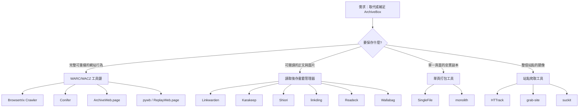

# ArchiveBox 的自由軟體替代方案調查

## 摘要

ArchiveBox 是一套自我託管（self-hosted）的網頁典藏應用，能將網址保存為標準 HTML、PNG 截圖、PDF、WARC、純文字、JSON 等多種格式，並提供命令列介面、網頁介面、REST API 與瀏覽器擴充功能；其授權為 MIT，GitHub 星數約 29.1k[^archivebox]。本報告整理可與之對照、替代或互補的自由暨開放原始碼軟體（FOSS, Free and Open Source Software），依「用途重疊程度」分成四類：可直接替代的完整快照書籤管理器、高保真 WARC 典藏工具鏈、單頁打包與站點鏡像命令列工具，以及僅部分重疊的相關工具。所有星數為 2026-11-24 自 GitHub／Codeberg 頁面讀取之數值，會隨時間變動。

## 一、被替代對象：ArchiveBox 的能力邊界

在挑選替代品前，需先確認 ArchiveBox 到底解決什麼問題，否則容易誤把「書籤管理器」當成替代品。ArchiveBox 的核心特徵有三[^archivebox]：

1. **多格式同時輸出**：同一網址可同時產生原始 HTML 與 SingleFile 單檔 HTML、截圖 PNG、PDF、WARC、可讀文字 TXT、metadata JSON，媒體內容（YouTube、SoundCloud）另存 MP3／MP4。
2. **多來源匯入與排程**：可從瀏覽器書籤、瀏覽歷史、Pocket、Pinboard、RSS、社群動態、網址清單、CLI 與 API 匯入，並依排程自動典藏。
3. **資料即檔案**：以普通檔案與 SQLite 索引儲存，不使用專有格式，理論上不需 ArchiveBox 本身也能讀取。

因此，「替代品」至少要能回答兩個問題：是否保存**完整快照**（而非只存網址與可讀正文）？是否採用**可長期存續的標準格式**（而非私有資料庫）？

## 二、分類架構

## 三、可直接替代：具備快照能力的書籤／讀取後保存工具

這一類與 ArchiveBox 的「使用情境」最接近，差別在於多數只保存「可讀內容 + 截圖 + PDF」，而非可完整重播的 WARC。

### 3.1 Linkwarden

自我託管的協作式書籤管理器，主打「收集、閱讀、註解並完整保存」網頁內容。儲存時會自動擷取截圖、PDF 與單檔 HTML，並可選擇送往 Wayback Machine 建立快照；授權 AGPL-3.0，GitHub 星數約 20.5k，主要語言為 TypeScript[^linkwarden]。在「快照格式數量」上略遜 ArchiveBox，但在多人協作與註解體驗上更完整。

### 3.2 Karakeep（原 Hoarder）

可自行託管的「什麼都能存」書籤應用，支援連結、筆記與圖片，具備 AI 自動標籤與全文搜尋。為對抗連結失效（link rot），它使用 monolith 將整頁封存為單檔 HTML，並以 yt-dlp 自動封存影片；授權 AGPL-3.0，GitHub 星數約 30.8k，主要語言為 TypeScript[^karakeep]。若需求偏向「個人知識庫 + 快照」而非「可重播的典藏」，它是星數最高的選項。

### 3.3 Shiori

以 Go 撰寫的簡單書籤管理器，定位為 Pocket 的開源複製品。預設會解析可讀內容並建立**離線檔案**，而不只是儲存連結；授權 MIT，GitHub 星數約 11.9k[^shiori]。優點是單一靜態執行檔、部署成本極低。

### 3.4 linkding

極簡、快速的自我託管書籤管理器，以 Docker 一鍵部署為設計目標。可自動將網站封存為**本機 HTML 檔**或送往 Internet Archive；授權 MIT，GitHub 星數約 11.5k，主要語言為 Python（Django）[^linkding]。適合「已經有閱讀流程、只想要最低摩擦保存」的使用者。

### 3.5 Readeck

Go 撰寫的讀取後保存應用，儲存時抓取完整可讀內容與圖片，並打包為**單一不可變 ZIP** 存放於伺服器；閱讀時瀏覽器不發出任何外部請求。支援匯出 EPUB、OPDS 目錄與全文搜尋；授權 AGPL-3.0，Codeberg 星數約 1.2k[^readeck]。影片只存字幕與文字稿，不存影片檔。它亦被 awesome-selfhosted 的「典藏與數位保存」分類收錄[^awesome]。

### 3.6 Wallabag

老牌的自我託管「稍後閱讀」應用（前身 Poche），會擷取文章正文並去除導覽列與廣告，可離線閱讀與匯出 EPUB；授權 MIT，GitHub 星數約 13.1k，主要語言為 PHP（Symfony）[^wallabag]。歷史最久、生態最完整（行動 App、電子書閱讀器整合），但**不保存頁面外觀**，只保留文字內容。

### 3.7 LinkAce

以 Laravel 撰寫的書籤管理與分享平台，會自動把儲存的網址送往 Internet Archive 建立快照，並具備失效連結監控、標籤與清單、REST API；授權 GPL-3.0，GitHub 星數約 3.4k[^linkace]。快照依賴外部服務，離線可用性取決於 Internet Archive。

### 3.8 Archivy

定位為「可自我託管的知識庫」，把書籤的網頁內容存到本機以確保永久存取，並以雙向連結的個人 wiki 形式組織；授權 MIT，GitHub 星數約 3.3k，主要語言為 Python[^archivy]。**維護已停滯**，不建議用於新部署。

### 3.9 Omnivore

開源的稍後閱讀服務，支援文章、電子報與 PDF，可自行託管；授權 AGPL-3.0，GitHub 星數約 16.4k。惟其**官方雲端服務已於 2024 年 11 月終止**，專案轉為純自行託管模式[^omnivore]。選擇前應確認社群維護熱度。

## 四、高保真典藏工具鏈：WARC／WACZ 路線

若目標是「十年後仍能重播當時的網頁行為」（含 JavaScript、互動元素），WARC 系列工具是 ArchiveBox 之外最正統的選擇，但通常需要自行組合擷取與重播兩端。

### 4.1 Browsertrix Crawler

以 Puppeteer 驅動 Brave／Chromium 的瀏覽器型爬蟲，透過 Chrome DevTools Protocol 擷取所有網路流量，輸出 WARC／WACZ；以單一 Docker 容器執行；授權 AGPL-3.0，GitHub 星數約 1.2k[^browsertrix-crawler]。是 Webrecorder 生態的事實標準擷取引擎。

### 4.2 Browsertrix（雲端服務版）

Webrecorder 的雲端原生、高保真瀏覽器爬取服務，可調度多個爬取任務並產出 WARC／WACZ；授權 AGPL-3.0，GitHub 星數約 503，維護活躍[^browsertrix]。適合團隊規模的典藏工作流。

### 4.3 Conifer（原 Webrecorder）

以遠端控制的 Chrome／Firefox 容器擷取網頁，保存為 ISO 標準 WARC，並以 pywb 重播；授權 Apache-2.0，GitHub 星數約 1.5k，主要語言為 Python 加 React 前端[^conifer]。Apache-2.0 授權在商業整合上比 AGPL 寬鬆，是此類工具中少見的選擇。

### 4.4 ArchiveWeb.page

Chrome／Chromium 擴充功能與獨立 Electron 桌面應用，直接在瀏覽器內擷取、儲存（IndexedDB）與重播網頁，輸出 WARC／WACZ；授權 AGPL-3.0，GitHub 星數約 1.6k[^archivewebpage]。對非技術使用者最友善的「邊逛邊存」方案。

### 4.5 pywb

核心的 Python 網頁典藏工具包，同時提供 WARC 重播（即 Wayback Machine 功能）與錄製（可從線上網站或其他典藏錄製），支援 HTTP/S 代理模式與 Memento API；授權 GPL-3.0，GitHub 星數約 1.7k[^pywb]。通常作為 Browsertrix／Conifer 的重播後端。

### 4.6 ReplayWeb.page

純前端、無伺服器的 WARC／WACZ 重播器，直接在瀏覽器中播放既有典藏；授權 AGPL-3.0，GitHub 星數約 1.0k，維護活躍[^replayweb]。它**不以擷取為目的**，屬配套工具。

### 4.7 ipwb（InterPlanetary Wayback）

將 WARC 內容拆解後散布到 IPFS，建立 CDXJ 索引，並提供基於 Service Worker 的重播介面；授權 MIT，GitHub 星數約 659，最近一次發佈為 2024-10-24[^ipwb]。適合需要去中心化、點對點保存的場景。

### 4.8 wayback（wabarc/wayback）

以 Go 撰寫、具備即時通訊介面的隱私取向外掛，可同時把網址送往 Internet Archive、archive.today、Ghostarchive、IPFS（含 Pinata 釘選）、Telegraph 與本機檔案系統；授權 GPL-3.0，GitHub 星數約 2.3k[^wabarc]。它不自行建立完整離線副本，而是「多方備援」策略，適合當作 ArchiveBox 的補充。

### 4.9 Archive Now（archivenow）

命令列工具與函式庫，可把網址推送至 Internet Archive、archive.today／archive.is、Perma.cc、Megalodon.jp，也能產生本機 WARC；授權 MIT，GitHub 星數約 435，最後提交為 2024-01[^archivenow]。功能單純但適合腳本化。

## 五、單頁打包與站點鏡像：命令列工具

這一類不提供書籤管理介面，但輸出格式（單檔 HTML、WARC、離線目錄）正是 ArchiveBox 內部實際使用的引擎，適合自行組裝替代方案。

### 5.1 SingleFile

瀏覽器擴充功能，把整頁（HTML、CSS、圖片、字型）打包成**單一自包含 HTML 檔**，可離線開啟；授權 AGPL-3.0，GitHub 星數約 23.0k[^singlefile]。ArchiveBox、Linkwarden、Obsidian、Zotero 等皆可整合。

### 5.2 single-file-cli

SingleFile 的命令列版本，支援 `--dump-content`、嵌入截圖、嵌入 PDF、依 CSS 選擇器只存局部、自訂檔名模板，以及遞迴爬取連結並打包成自解壓 ZIP；授權 AGPL-3.0，GitHub 星數約 1.7k，發佈極為頻繁（2026-11 仍有多次版本）[^singlefilecli]。是自建典藏管線時最實用的積木。

### 5.3 monolith

Rust 撰寫的 CLI／函式庫，把網頁連同 CSS、圖片、JavaScript 全部以 data URL 內嵌為單一 HTML，另可輸出 MHTML、WARC、WARCGZ；授權 0BSD（幾近公眾領域），GitHub 星數約 15.6k[^monolith]。授權最寬鬆、輸出格式最齊全的單頁工具，Karakeep 即以它作為封存引擎。

### 5.4 HTTrack

老牌的離線瀏覽器工具，遞迴下載整個網站（HTML、圖片、目錄結構），保留相對連結以形成可離線瀏覽的鏡像，支援續傳與增量更新；授權 GPL-3.0，GitHub 星數約 4.9k[^httrack]。適合「整個站點」而非「單一頁面」的保存。

### 5.5 grab-site

ArchiveTeam 的「檔案管理者爬蟲」，遞迴爬取網站並輸出 WARC，具備儀表板、重複頁面偵測、動態忽略規則與 WARC 大小上限；授權 MIT，GitHub 星數約 1.6k[^grabsite]。ArchiveBot 的底層即為此工具。

### 5.6 suckit

Rust 撰寫的遞迴站點下載器，支援多執行緒、延遲與中斷續傳，輸出可直接離線瀏覽；授權 MIT 與 Apache-2.0 雙授權，GitHub 星數約 812，維護活躍[^suckit]。

### 5.7 wpull

Wget 相容的下載器與爬蟲，支援 WARC 輸出、遞迴深度控制、sitemap、PhantomJS 整合；授權 GPL-3.0，GitHub 星數約 613，但**最後一次發佈為 2018-10-10**，且存在 Python 3.7+ 相容性問題未解[^wpull]。不建議新專案採用。

### 5.8 WAIL（Web Archiving Integration Layer）

以 Heritrix 3.7.0 擷取、OpenWayback 2.4.0 重播的桌面 GUI，主打「一鍵保存」；授權 MIT，GitHub 星數約 403[^wail]。專案已由 WAIL-Electron 取代，原版屬維護末期。

### 5.9 Sosse

以 Selenium 驅動 Firefox／Chromium 的搜尋引擎與爬蟲，支援網頁典藏（HTML 內容、連結改寫、資源下載、動態內容），資料存於 PostgreSQL；授權 AGPL-3.0，GitHub 星數約 412，維護活躍[^sosse]。適合需要「爬取 + 全文檢索」一體化的情境。

## 六、部分重疊的相關工具

- **Zotero**：研究引用管理軟體，但在啟用「從網頁建立項目時自動建立快照」後，會把網頁存成離線 HTML 副本；授權 AGPL-3.0，GitHub 星數約 16.0k[^zotero]。若典藏目的是學術引用，它比 ArchiveBox 更貼合流程。
- **Memex（WorldBrain）**：瀏覽器擴充功能，可對所有造訪過的網頁與 PDF 做全文搜尋與註解；授權 MIT，GitHub 星數約 4.7k。惟「網站封存 + 離線檢視」仍列為待社群貢獻的未來功能，**目前不具備完整快照能力**[^memex]。

## 七、綜合比較

| 專案 | 授權 | 星數 | 主要語言 | 快照能力 | 維護狀態 |
| --- | --- | --- | --- | --- | --- |
| ArchiveBox（基準） | MIT | 29.1k | Python | HTML／PNG／PDF／WARC／TXT／JSON | 活躍 |
| Karakeep | AGPL-3.0 | 30.8k | TypeScript | 單檔 HTML（monolith）、影片 | 活躍 |
| SingleFile | AGPL-3.0 | 23.0k | JavaScript | 單檔自包含 HTML | 活躍 |
| Linkwarden | AGPL-3.0 | 20.5k | TypeScript | 截圖／PDF／單檔 HTML | 活躍 |
| Zotero | AGPL-3.0 | 16.0k | JavaScript | 離線 HTML 快照 | 活躍 |
| monolith | 0BSD | 15.6k | Rust | HTML／MHTML／WARC | 活躍 |
| Wallabag | MIT | 13.1k | PHP | 可讀正文（無頁面外觀） | 活躍 |
| Shiori | MIT | 11.9k | Go | 可讀內容離線檔 | 活躍 |
| linkding | MIT | 11.5k | Python | 本機 HTML 或 Internet Archive | 活躍 |
| HTTrack | GPL-3.0 | 4.9k | C | 全站鏡像 | 活躍 |
| Memex | MIT | 4.7k | TypeScript | 無（規劃中） | 活躍 |
| LinkAce | GPL-3.0 | 3.4k | PHP | Internet Archive 快照 | 活躍 |
| Archivy | MIT | 3.3k | Python | 本機網頁內容 | 停滯 |
| wabarc/wayback | GPL-3.0 | 2.3k | Go | 轉送多個外部典藏服務 | 活躍 |
| pywb | GPL-3.0 | 1.7k | Python | WARC 錄製與重播 | 活躍 |
| single-file-cli | AGPL-3.0 | 1.7k | JavaScript | 單檔 HTML、ZIP 站點包 | 極活躍 |
| grab-site | MIT | 1.6k | Python | WARC | 活躍 |
| ArchiveWeb.page | AGPL-3.0 | 1.6k | JavaScript | WARC／WACZ | 活躍 |
| Conifer | Apache-2.0 | 1.5k | Python | WARC + pywb 重播 | 活躍 |
| Browsertrix Crawler | AGPL-3.0 | 1.2k | TypeScript | WARC／WACZ | 活躍 |
| Readeck | AGPL-3.0 | 1.2k（Codeberg） | Go | 可讀內容 ZIP、EPUB | 活躍 |
| ReplayWeb.page | AGPL-3.0 | 1.0k | TypeScript | 僅重播 | 活躍 |
| suckit | MIT／Apache-2.0 | 812 | Rust | 全站離線鏡像 | 活躍 |
| ipwb | MIT | 659 | Python | WARC 上 IPFS、重播 | 活躍 |
| wpull | GPL-3.0 | 613 | Python | WARC | 2018 後停更 |
| Browsertrix（服務版） | AGPL-3.0 | 503 | Python／TypeScript | WARC／WACZ 雲端調度 | 活躍 |
| Archive Now | MIT | 435 | Python | 推送外部典藏、本機 WARC | 低度 |
| Sosse | AGPL-3.0 | 412 | Python | 網頁典藏 + 全文檢索 | 活躍 |
| WAIL | MIT | 403 | Python | WARC（Heritrix） | 末期内 |

## 八、選型建議

| 你的情境 | 建議起點 | 理由 |
| --- | --- | --- |
| 想要 ArchiveBox 的即插即用替代，且需要多使用者協作 | Linkwarden | 截圖／PDF／單檔 HTML 三格式，AGPL 授權，社群規模大[^linkwarden] |
| 想要「稍後閱讀 + 自動封存」，且偏好 AI 標籤 | Karakeep | 以 monolith 封存整頁，星數最高，支援影片[^karakeep] |
| 想要極輕量、單一執行檔 | Shiori 或 linkding | Go／Django 皆易部署，Shiori 預設建立離線檔[^shiori][^linkding] |
| 想要最高還原度，能接受自組管線 | Browsertrix Crawler + pywb（或 ReplayWeb.page） | 產出 WARC／WACZ，可重播 JavaScript 行為[^browsertrix-crawler][^pywb] |
| 需要寬鬆授權以便商業整合 | monolith（0BSD）或 Conifer（Apache-2.0） | 非 copyleft，易嵌入產品[^monolith][^conifer] |
| 只想在瀏覽器裡邊逛邊存 | ArchiveWeb.page | 擴充功能直接擷取與重播[^archivewebpage] |
| 目標是整個網站而非單頁 | HTTrack 或 grab-site | 前者做鏡像，後者產 WARC[^httrack][^grabsite] |
| 需要去中心化保存 | ipwb + IPFS | WARC 內容散布至 P2P 網路[^ipwb] |

## 九、判讀注意事項

1. **星數不等於適用性**：SingleFile 與 monolith 星數高，但定位是「引擎」而非「典藏系統」，仍需自行加上排程、索引與介面，才能達到 ArchiveBox 的完整度。
2. **授權差異影響整合**：AGPL-3.0（Linkwarden、Karakeep、Readeck、Browsertrix 系列、SingleFile）在提供網路服務時需釋出原始碼；MIT／0BSD／Apache-2.0 則適合嵌入商業產品。取用前應由法務確認。
3. **「保存正文」與「保存外觀」是兩件事**：Wallabag、Readeck、Shiori 只保留可讀內容，若原始頁面排版、動態元素或廣告版位本身即為典藏標的，必須改用 WARC 或單檔 HTML 路線。
4. **外部依賴風險**：LinkAce、linkding（Internet Archive 模式）、wabarc/wayback、Archive Now 都把內容交給第三方服務，服務終止即失去備份，建議同時保留本機副本。
5. **維護狀態**：Archivy、wpull、WAIL 已停滯或進入末期，除非有既有部署，否則不建議新專案採用[^archivy][^wpull][^wail]。
6. **資料可遷移性**：ArchiveBox 的主要優勢之一是「資料即一般檔案」。替代方案中，Readeck（不可變 ZIP + EPUB 匯出）、monolith／SingleFile（單檔 HTML）、WARC 系列（ISO 標準）在長期可讀性上最接近此原則；反之依賴私有資料庫 schema 的工具，需評估其匯出格式是否足夠完整。

## 參考文獻

[^archivebox]: ArchiveBox. (n.d.). *ArchiveBox is a powerful, self-hosted internet archiving solution*. GitHub. Retrieved 2026-11-24, from https://github.com/ArchiveBox/ArchiveBox

[^linkwarden]: Linkwarden. (n.d.). *Linkwarden: Self-hosted collaborative bookmark manager*. GitHub. Retrieved 2026-11-24, from https://github.com/linkwarden/linkwarden

[^karakeep]: Karakeep. (n.d.). *Karakeep: A self-hostable bookmark-everything app*. GitHub. Retrieved 2026-11-24, from https://github.com/karakeep-app/karakeep

[^shiori]: Shiori. (n.d.). *Shiori: A simple bookmark manager written in Go*. GitHub. Retrieved 2026-11-24, from https://github.com/go-shiori/shiori

[^linkding]: linkding. (n.d.). *linkding: Self-hosted bookmark manager*. GitHub. Retrieved 2026-11-24, from https://github.com/sissbruecker/linkding

[^readeck]: Readeck. (n.d.). *Readeck: Save the precious readable content of web pages you like and want to keep forever*. Retrieved 2026-11-24, from https://readeck.org/en/

[^wallabag]: wallabag. (n.d.). *wallabag: a self hostable application for saving web pages*. GitHub. Retrieved 2026-11-24, from https://github.com/wallabag/wallabag

[^linkace]: LinkAce. (n.d.). *LinkAce: A self-hosted archive to collect links of your favorite websites*. GitHub. Retrieved 2026-11-24, from https://github.com/Kovah/LinkAce

[^archivy]: Archivy. (n.d.). *Archivy: A self-hostable knowledge repository*. GitHub. Retrieved 2026-11-24, from https://github.com/archivy/archivy

[^omnivore]: Omnivore. (n.d.). *Omnivore: Open source read-it-later solution*. GitHub. Retrieved 2026-11-24, from https://github.com/omnivore-app/omnivore

[^browsertrix-crawler]: Webrecorder. (n.d.). *Browsertrix Crawler: A high-fidelity browser-based web archiving crawler*. GitHub. Retrieved 2026-11-24, from https://github.com/webrecorder/browsertrix-crawler

[^browsertrix]: Webrecorder. (n.d.). *Browsertrix: Cloud-native high-fidelity browser-based crawling service*. GitHub. Retrieved 2026-11-24, from https://github.com/webrecorder/browsertrix

[^conifer]: Rhizome. (n.d.). *Conifer: Collect and revisit web pages*. GitHub. Retrieved 2026-11-24, from https://github.com/webrecorder/conifer

[^archivewebpage]: Webrecorder. (n.d.). *ArchiveWeb.page: High-fidelity web archiving in the browser*. GitHub. Retrieved 2026-11-24, from https://github.com/webrecorder/archiveweb.page

[^pywb]: Webrecorder. (n.d.). *pywb: Core Python Web Archiving Toolkit for replay and recording*. GitHub. Retrieved 2026-11-24, from https://github.com/webrecorder/pywb

[^replayweb]: Webrecorder. (n.d.). *ReplayWeb.page: Serverless replay of web archives in the browser*. GitHub. Retrieved 2026-11-24, from https://github.com/webrecorder/replayweb.page

[^ipwb]: ODU Web Science and Digital Libraries Research Group. (n.d.). *ipwb: InterPlanetary Wayback*. GitHub. Retrieved 2026-11-24, from https://github.com/oduwsdl/ipwb

[^wabarc]: wabarc. (n.d.). *wayback: A toolkit for archiving webpages to the Internet Archive, archive.today, IPFS, and local file systems*. GitHub. Retrieved 2026-11-24, from https://github.com/wabarc/wayback

[^archivenow]: ODU Web Science and Digital Libraries Research Group. (n.d.). *Archive Now: Push web resources into public web archives*. GitHub. Retrieved 2026-11-24, from https://github.com/oduwsdl/archivenow

[^singlefile]: Lormeau, G. (n.d.). *SingleFile: Web Extension for saving a faithful copy of a complete web page in a single HTML file*. GitHub. Retrieved 2026-11-24, from https://github.com/gildas-lormeau/SingleFile

[^singlefilecli]: Lormeau, G. (n.d.). *single-file-cli: SingleFile command-line interface*. GitHub. Retrieved 2026-11-24, from https://github.com/gildas-lormeau/single-file-cli

[^monolith]: Y2Z. (n.d.). *monolith: Save complete web pages as a single HTML file*. GitHub. Retrieved 2026-11-24, from https://github.com/Y2Z/monolith

[^httrack]: Roche, X. (n.d.). *HTTrack: Website copier*. GitHub. Retrieved 2026-11-24, from https://github.com/xroche/httrack

[^grabsite]: ArchiveTeam. (n.d.). *grab-site: The archivist's web crawler*. GitHub. Retrieved 2026-11-24, from https://github.com/ArchiveTeam/grab-site

[^suckit]: skallwar. (n.d.). *suckit: Recursively fetch websites for offline viewing*. GitHub. Retrieved 2026-11-24, from https://github.com/skallwar/suckit

[^wpull]: ArchiveTeam. (n.d.). *wpull: Wget-compatible web downloader and crawler*. GitHub. Retrieved 2026-11-24, from https://github.com/ArchiveTeam/wpull

[^wail]: Macháček, M. (n.d.). *WAIL: Web Archiving Integration Layer*. GitHub. Retrieved 2026-11-24, from https://github.com/machawk1/wail

[^sosse]: Biolds. (n.d.). *Sosse: Selenium based search engine and crawler with offline archiving*. GitLab. Retrieved 2026-11-24, from https://gitlab.com/biolds1/sosse

[^zotero]: Corporation for Digital Scholarship. (n.d.). *Zotero: Your personal research assistant*. GitHub. Retrieved 2026-11-24, from https://github.com/zotero/zotero

[^memex]: WorldBrain. (n.d.). *Memex: Browser extension to curate, annotate, and discuss web content*. GitHub. Retrieved 2026-11-24, from https://github.com/WorldBrain/Memex

[^awesome]: Awesome Selfhosted. (n.d.). *Archiving and Digital Preservation (DP)*. Retrieved 2026-11-24, from https://awesome-selfhosted.net/tags/archiving-and-digital-preservation-dp.html