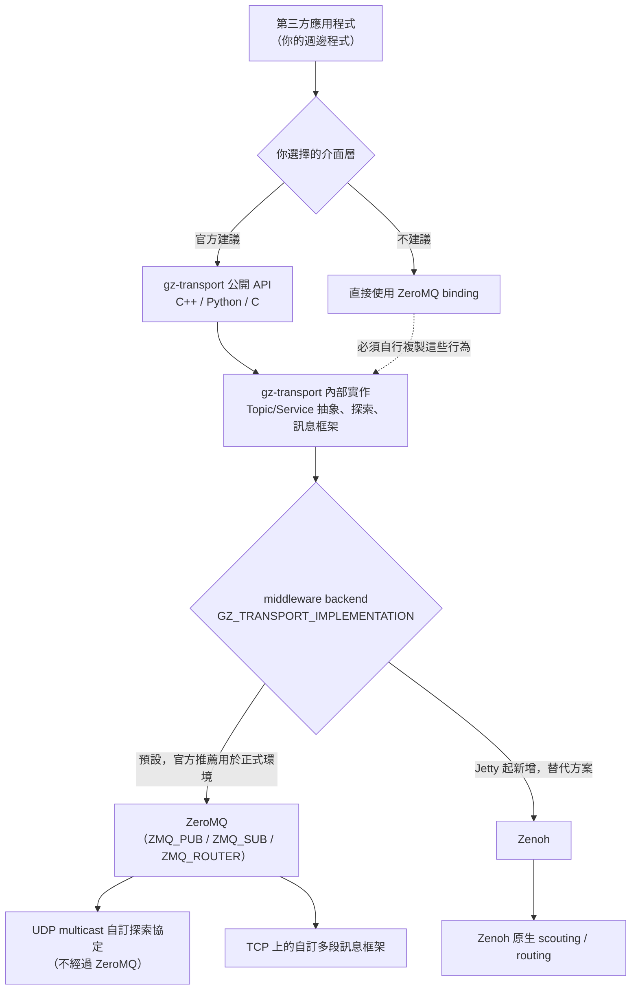
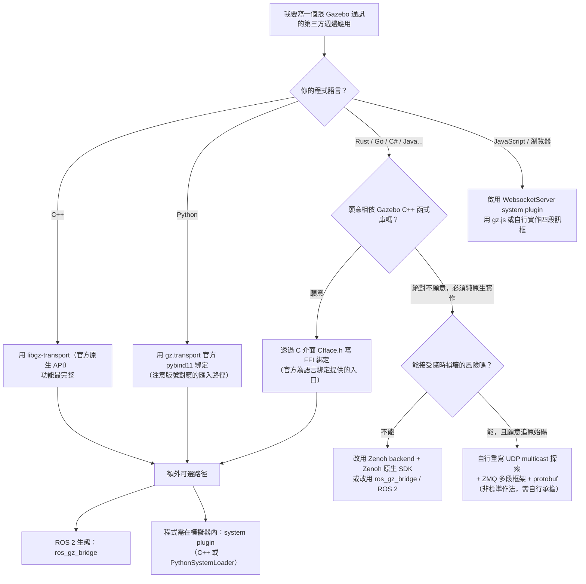

# 開發第三方 Gazebo（gz-sim）週邊應用：該直接用 ZeroMQ，還是用官方 SDK？

## 摘要

**結論先講：應該用 Gazebo 官方的 `gz-transport` 函式庫，不要直接呼叫 ZeroMQ binding。**

理由有三個層次：

1. Gazebo 確實有「SDK」，只是它不叫 SDK，而叫 **`gz-transport`**（加上訊息定義函式庫 `gz-msgs`）。官方把它當成对外公開的 API，提供 C++ 原生介面、Python（pybind11）綁定、以及 `extern "C"` 的 C 介面，另有命令列工具與 WebSocket 伺服器外掛[^intro][^lib][^ciface]。
2. ZeroMQ 在 gz-transport 裡**只是可替換的底層 middleware backend 之一**，而且從 Gazebo Jetty（gz-transport 15）起已經有 Zenoh 這個替代 backend。ZeroMQ 之上還疊了一層 Gazebo 自己寫的 **UDP multicast 自訂探索協定（discovery）** 與**自訂多段訊息框架（multi-part frame）**，這些都不在 ZeroMQ 的規格裡[^dev][^zenohcfg]。
3. 這個 wire protocol **沒有正式規格文件、沒有穩定性保證**，Gazebo 專案自己在 issue 裡承認「自訂探索協定讓我們很難支援 C++ 以外的語言，而且我們得自己維護它」[^issue559]。官方 issue #287「為移植到其他語言而描述 line protocol」從 2022 年開至今仍未完成[^issue287]。

換句話說：直接接 ZeroMQ 等於**逆向工程一個隨時可能變動的私有協定**；用 `gz-transport` 則是使用專案承諾維護的公開介面。

---

## 一、先釐清架構：ZeroMQ 在 Gazebo 裡到底站在哪一層

Gazebo Transport 的官方描述是「以 Google Protocol Buffers 做資料序列化，並以自訂程式碼加上 middleware（ZeroMQ 或 Zenoh）來完成探索、序列化與遞送」[^lib]。所以整條堆疊長這樣：



關鍵是圖中那條虛線：**直接接 ZeroMQ 並不能讓你「少一層」，反而讓你「多一層」**——你得自己重寫 gz-transport 已經做好的東西。

### 1.1 探索（discovery）完全不經過 ZeroMQ

Gazebo Transport 的節點探索用的是**自己實作的 UDP multicast 協定**，`Discovery` 類別直接管理 raw UDP socket，不經過 ZeroMQ[^dev]：

- 每個行程有兩個 `Discovery` 物件，分別負責 topic 與 service，各自使用不同 UDP port（topic 探索預設 `10317`，可用 `GZ_DISCOVERY_MSG_PORT` 覆寫）[^envvars]。
- 訊息型別包含 `ADVERTISE`、`UNADVERTISE`、`SUBSCRIBE`、`HEARTBEAT`、`BYE`，二進位格式為 `Header`（Version、Process UUID 長度、Process UUID、Message Type、Flags）加上各自的 payload[^dev]。
- 探索會列舉本機所有網路介面，對每個本機 IP 建立一個發送 socket，向所有子網段 flood 探索訊息；接收時則對每個介面 join multicast group 後共用一個 socket[^dev]。
- 每個遠端節點有活動時間戳，超過 silence interval 沒更新就使其条目失效；正常結束時送 `BYE` 一次作廢該行程所有條目[^dev]。

**這是第一個致命點**：如果你只用 ZeroMQ binding，你連「有哪些 topic 存在、對應的 endpoint 在哪」都不知道。`ZMQ_PUB`/`ZMQ_SUB` 本身沒有任何探索能力，你必須自己實作整套 UDP multicast 協定才能加入網路。

### 1.2 資料傳輸用 ZeroMQ，但框架是自訂的

探索完成後，真正的資料才走 ZeroMQ over TCP。原始碼 `NodeSharedPrivate.hh` 中宣告了五個 socket[^src]：

| 成員變數 | ZeroMQ socket 型別 | 用途 |
|---|---|---|
| `publisher` | `ZMQ_PUB` | 發送 topic 更新 |
| `subscriber` | `ZMQ_SUB` | 接收 topic 更新 |
| `requester` | `ZMQ_ROUTER` | 發送 service 請求 |
| `responseReceiver` | `ZMQ_ROUTER` | 接收 service 回應 |
| `replier` | `ZMQ_ROUTER` | 接收 service 請求 |

注意 service 用的是 **ROUTER/ROUTER**，不是標準的 REQ/REP，因為要支援非同步、多客戶端並行請求。topic 的資料則是多段（multi-part）ZMQ 訊息：`[topic | sender_address | protobuf_data | msg_type]`；service 請求是 `[dst_id | topic | sender | node_uuid | req_uuid | req_data | req_type | rep_type]`[^dev]。

**這是第二個致命點**：即使你成功連上 `ZMQ_SUB`，你收到的也不是「乾淨的 protobuf」，而是需要依序拆解的多段框架，並且要正確處理 identity frame、UUID、型別字串。這些格式沒有任何對外規格文件，只有一份「寫給貢獻者看」的開發者教學，而且該教學開頭就聲明：

> 「本節描述 Gazebo Transport 的部分高階概念，但實作細節僅適用於 zeromq middleware backend。」
> 「你不需要讀這一節，如果你只是想在自己的程式碼裡使用這個函式庫。這一節是為了幫你理解原始碼，如果你有興趣貢獻程式碼。」[^dev]

Gazebo 官方文件把這段定位為**內部實作說明**，而非對外承諾的協定規格。

---

## 二、Gazebo 官方到底提供了什麼「SDK」

Gazebo 官網與文件從來不用「SDK」這個詞，但實質上提供了四個層次的對外介面，全部以 `gz-transport` 為核心。

### 2.1 C++：原生且功能最完整

官方說法：「C++ 是原生實作，也是唯一具備所有函式庫功能的語言。」[^intro]

用法就是 link `gz-transport`，建立 `gz::transport::Node`，呼叫 `Advertise` / `Subscribe` / `Request`。Gazebo 建立者 Nate Koenig 在社群論壇被問到「如何寫一個不依賴 ROS 的獨立程式跟 Gazebo topic 通訊」時，直接指向 gz-transport 的 C++ 範例目錄[^forum]。

安裝（Ubuntu）：

```bash
sudo apt install libgz-transport<版號>-dev
```

macOS 可用 Homebrew `brew install gz-transport<版號>`，Windows 可用 conda-forge 的 `libgz-transport<版號>`；也可從原始碼建置，相依套件包含 protobuf、ZeroMQ、Zenoh 與 pybind11[^install]。

### 2.2 Python：官方 pybind11 綁定

Python 綁定是「以 pybind11 包裝 C++ 方法」，「不支援 C++ 的全部功能，但包含發佈、訂閱、service 請求等主要功能」[^intro]。

最新（gz-transport 15 / Jetty）的寫法是[^py15]：

```python
from gz.msgs.stringmsg_pb2 import StringMsg
from gz.transport import Node

node = Node()
pub = node.advertise("/example_stringmsg_topic", StringMsg)
pub.publish(StringMsg(data="Hello"))
```

```python
from gz.msgs.stringmsg_pb2 import StringMsg
from gz.transport import Node

def cb(msg: StringMsg):
    print(msg.data)

node = Node()
node.subscribe(StringMsg, "/example_stringmsg_topic", cb)
```

安裝：`sudo apt install python3-gz-transport15`[^py15]。

**重要版本差異**（容易踩雷）：

| Gazebo 版本 | Python 匯入路徑 | 訊息模組 |
|---|---|---|
| Harmonic（gz-transport 13） | `from gz.transport13 import Node` | `gz.msgs10.*` |
| Ionic（gz-transport 14） | `from gz.transport14 import Node` | `gz.msgs11.*` |
| Jetty（gz-transport 15） | `from gz.transport import Node` | `gz.msgs.*` |

Jetty 把套件名稱裡的版號拿掉了：「在套件名稱裡放主版號，原本是為了讓兩個 Gazebo 版本可以並存安裝。雖然對部分使用者有幫助，但這個做法讓開發者頭痛，因為他們得經常更新這些版號。我們終止了這個做法，讓 Gazebo 更好維護、對套件開發者更易用。」[^jetty]

Python 綁定的已知限制：**service responser（服務提供端）不支援**，官方建議「用 C++ 建立 service responser，再從 Python 發請求」[^py15]。另外綁定內部仍會開 C++ 執行緒，GIL 不保護共享變數，需自行用 `threading.Lock`[^py15]。

### 2.3 C 介面：給「其他語言」用的 FFI 入口

`include/gz/transport/CIface.h` 提供一整組 `extern "C"` 函式，這是官方提供給非 C++ 語言（Rust、Go、C#、Java via JNI 等）寫 binding 的正規入口[^ciface]：

```c
typedef struct GzTransportNode GzTransportNode;

typedef struct SubscribeOpts
{
    unsigned int msgsPerSec;
} SubscribeOpts;

GzTransportNode *gzTransportNodeCreate(const char *_partition);
void gzTransportNodeDestroy(GzTransportNode **_node);

int gzTransportAdvertise(GzTransportNode *_node,
                         const char *_topic,
                         const char *_msgType);

int gzTransportPublishRaw(GzTransportNode *_node,
                          const char *_topic,
                          const void *_data,
                          size_t _size,
                          const char *_msgType);

int gzTransportSubscribe(
    GzTransportNode *_node,
    const char *_topic,
    void (*_callback)(const char *, size_t, const char *, void *),
    void *_userData);

int gzTransportUnsubscribe(GzTransportNode *_node, const char *_topic);
void gzTransportWaitForShutdown();
```

這組介面自 **gz-transport 7.0.0（2019 年 4 月）** 引入，changelog 寫的是「新增 C 介面的開端，目前僅支援 pub/sub」，後續版本陸續補上訂閱、發佈選項等[^ciface]。設計上明確是為了 FFI：不透明指標型別、`extern "C"` 連結、`void* userData` 的 C 風格 callback。

需要留意的是 C 介面曾有一個**二進位安全（binary-safe）的 bug**：`gzTransportPublish` 把 `void*` 當成以 null 結尾的字串處理，導致 protobuf 訊息在遇到 `\0` 位元組時被截斷。這個 bug 直接影響「用 C 介面寫語言綁定的開發者（Python/ctypes、Rust、Go）」，已於 2026 年 3 月由 PR #823 修復，並新增帶 `size` 參數的 `gzTransportPublishRaw` 取代舊函式[^issue773]。這也側面說明：**用 C 介面是官方認可、且維護者會主動關注的用法**（維護者 azeey 在該 issue 中主動詢問回報者「你是在做語言綁定嗎？我一直很有興趣知道大家怎麼用 Gazebo 函式庫」）[^issue773]。

### 2.4 命令列工具與外掛：另兩條「不寫程式」的路

- **CLI**：`gz topic -l` / `-e` / `-i`、`gz service -l` / `-s` / `-i`，可直接列舉、echo、呼叫。適合除錯與 shell script 自動化。
- **WebSocket 伺服器**：Gazebo 提供 `gz::sim::systems::WebsocketServer`（Jetty 起從已棄用的 `gz-launch` 遷移到 gz-sim system plugin），用 libwebsockets 開一個 port，把 Gazebo topic/service 暴露給瀏覽器。訊框格式是逗號分隔的四段：`operation,topic_name,message_type,payload`（payload 為原始二進位 protobuf），並附帶 `gz.js` 客戶端函式庫[^ws]。這是**瀏覽器／JavaScript 應用的標準作法**。
- **ROS 2 橋接**：`ros_gz_bridge` 做 Gazebo Transport 與 ROS 2 的雙向轉換[^rosgz]。如果你的週邊程式本來就是 ROS 2 節點，這是最省事的正規路徑。
- **System plugin**：若程式需要「在模擬器內部」直接存取 ECS 狀態（而非透過網路），標準作法是在 SDF 裡掛 system plugin（C++ 或經 `PythonSystemLoader` 載入的 Python 模組），實作 `ISystemConfigure` / `ISystemPreUpdate` / `ISystemPostUpdate` 等介面[^simplugin][^simpython]。

---

## 三、為什麼「直接接 ZeroMQ」不是標準作法

### 3.1 專案自己承認這是問題

gz-transport issue #559（2024 年 11 月開，2025 年 8 月完成關閉）動機寫得很直白[^issue559]：

> 「gz-transport 有自己的一套探索與訊息傳輸實作，建構在 zeromq 之上。這長年來對 Gazebo 服務得很好，但它有幾個缺點：
> - **擁有自己的自訂探索協定，意味著很難支援 C++ 以外的語言**
> - 我們得維護它
> - gz-transport 用 UDP multicast 做探索，在某些平台上因為防火牆設定而無法直接運作
> - gz-transport 只有一個執行緒服務訊息，可能成為效能瓶頸
>
> 採用 Zenoh 可以解決其中部分或全部問題。」

### 3.2 wire protocol 文件化的請求，四年來仍未完成

issue #287「Line protocol description for porting to other languages」（2022 年 1 月開，標籤 `documentation` / `enhancement` / `help wanted`，**至今仍 open、無指派對象**）由社群提出，理由與本文問題完全一致[^issue287]：

> 「我對用 C++ 以外的語言寫程式控制 Gazebo 模擬有興趣……看起來沒有固定的 line protocol 可以『只要用 protobuf 和 0mq』就能通訊。似乎沒有清楚區分『這是你可以用任何程式語言接上的 line protocol』與『這是能講這個 line protocol 的 C++ SDK』。」
>
> 「ZeroMQ 與 Protocol Buffers 在非常多語言裡都有良好支援，所以第三方**只要能描述這個協定**，就完全可能寫出整合進這個生態系的程式碼。」

Gazebo PMC 成員 caguero 的回覆是[^issue287]：

> 「我覺得這是個好主意！……我唯一能想到的注意事項是，不同語言的實作可能因為語言固有差異而有略微不同的行為，這與在現行實作之上建立 wrapper 不同。」
>
> 「我目前大概沒時間直接做這件事，但如果有人願意投入，我可以幫忙。」

換句話說：**官方明確表達「寧可大家用 wrapper，而不是各自重寫協定」**，而且四年過去仍沒有人把 line protocol 補齊。

### 3.3 官方回應「如何寫獨立應用」時的建議

Gazebo 社群論壇上最貼近本文問題的討論串是「How can I communicate to Gazebo Sim topics via a standalone application (no ROS)?」，發問者問的正是「Regular zmq? or anything custom?」[^forum]。回覆者的建議全部指向 gz-transport 本身，而非裸 ZeroMQ：

- Gazebo 建立者 Nate Koenig：指向 gz-transport 的 C++ 範例[^forum]。
- Gazebo PMC 成員 Carlos Agüero 給出完整架構說明：探索是「一個非常簡單的、跑在 UDP multicast 上的自訂協定」；pub/sub 是「用 ZMQ over TCP，搭配自訂協定」；req/res 同理；並主動表示「願意幫忙指出該看哪些程式碼」給想自己實作協定的人[^forum]。
- 另一位 Open Robotics 成員 Mabel Zhang 補充 WebSocket server plugin 這條路[^forum]。

值得注意的是 Agüero 的措辭：「**願意幫忙指出該看哪些程式碼**」——這是社群善意，不是官方支援承諾。

### 3.4 協定穩定性：沒有任何保證，而且 backend 正在被替換

- gz-transport 15 的 introduction 頁面明確寫：「`zeromq` 是預設的 middleware backend，也是正式環境（production code）的推薦選項」，同時列出 Zenoh 為第二個 backend[^intro]。這代表 ZeroMQ 之上的那層抽象是**專案認定的穩定介面**，而 ZeroMQ 本身是**可替換的實作細節**。
- Jetty release notes：「直到 Ionic 為止，Gazebo 都以 ZeroMQ（0MQ）作為主要訊息傳輸協定。Gazebo 現在支援 Zenoh 作為**替代**的傳輸實作。」[^jetty]
- 官方 Zenoh 設定教學甚至提到 ROI 上的相容性承諾是針對 Zenoh：「Zenoh 的 wire protocol 在 1.x 系列內向後相容，所以 router 不需要與 Gazebo Transport 編譯時所用的 Zenoh 函式庫版本完全一致。」[^zenohcfg] —— 這種「wire protocol 相容性承諾」的語言，在 ZeroMQ backend 的文件裡完全找不到。

**如果你把產品綁在 Gazebo 的 ZeroMQ 私有框架上，未來 Gazebo 把預設 backend 換成 Zenoh（專案已明確在朝這個方向走），你的程式會直接失效，而且沒有遷移路徑。**

---

## 四、標準作法決策樹



### 4.1 各語言實務建議

| 語言 | 建議作法 | 說明 |
|---|---|---|
| **C++** | `libgz-transport-dev`，直接用 `gz::transport::Node` | 官方原生、功能最完整[^intro] |
| **Python** | `python3-gz-transport<版號>`，`from gz.transport import Node` | 官方綁定；service responser 不支援[^py15] |
| **Rust** | 優先用 `eduidl/gz-rs`（FFI 包裝，⭐ 18）[^gzrs]；若必須零 C++ 相依，才考慮 `Bedrock-Dynamics/gz-transport-rs`（純 Rust 重寫，⭐ 0，pre-alpha）[^gzrs2] | 前者成熟、支援 Fortress 到 Jetty；後者極新 |
| **Go / C# / Java** | 用 C 介面 `CIface.h` 自行寫 cgo / P-Invoke / JNI 綁定 | 目前無現成函式庫[^thirdparty] |
| **JavaScript（瀏覽器）** | `gz::sim::systems::WebsocketServer` + `gz.js` | 官方 websocket 路徑，payload 為二進位 protobuf[^ws] |
| **JavaScript（Node.js 後端）** | 同上，或經 C 介面寫原生 addon | 無現成 npm 套件[^thirdparty] |
| **ROS 2** | `ros_gz_bridge` | 官方橋接，雙向轉換[^rosgz] |

### 4.2 若真的要用「純 ZeroMQ + 純 protobuf」從零實作

唯一有公開參考價值的素材是：

1. `gz-transport` 的 `tutorials/22_development.md`（探索協定的二進位格式圖、訊息型別、介面列舉行為）[^dev]
2. `src/NodeSharedPrivate.hh`（socket 型別）[^src]
3. `gz-msgs` 的 `.proto` 檔（安裝後位於 `/usr/share/gz/gz-msgs<版號>/protos/`，可用 `protoc` 自行產生任何語言的訊息類別）[^msgs]

`.proto` 這部分是**唯一真正穩定、可安心依賴的介面**：`gz-msgs` 的 CMake 明確把 `proto/gz` 目錄下所有 `*.proto` 安裝到 `share/gz/gz-msgs<版號>/protos/`，因此第三方語言可以自行 `protoc --python_out` / `--rust_out` 產生訊息類別[^msgs]。但**訊息定義穩定，不代表傳輸協定穩定**。

現存的純重寫案例：`Bedrock-Dynamics/gz-transport-rs`「純 Rust 實作的 Gazebo Transport 協定，不需要 Gazebo C++ 堆疊，只相依 libzmq」，實作了 UDP multicast 探索、ZMQ PUB/SUB topics、ZMQ DEALER/ROUTER services。但該專案 0 star、4 個 commit、單一 0.1.0 版本，屬 pre-alpha[^gzrs2]。這正好說明純重寫路線的現實成本與社群接受度。

---

## 五、版本對照與套件名稱（避免踩雷）

Gazebo 的版號命名在 Ionic → Jetty 之間發生重大變化：**Jetty 起把主版號從套件名稱移除**[^jetty]。

| Gazebo 版本 | 發布 | LTS | gz-sim | gz-transport | gz-msgs | Python 匯入 |
|---|---|---|---|---|---|---|
| Fortress | 2021-09 | 是（至 2027-05） | 6 | 11 | 8 | 無官方綁定 |
| Garden | 2022-09 | 否（EOL 2024-11） | 7 | 12 | 9 | 無官方綁定 |
| Harmonic | 2023-09 | 是（至 2029-05） | 8 | 13 | 10 | `gz.transport13` |
| Ionic | 2024-09 | 否（至 2026-12） | 9 | 14 | 11 | `gz.transport14` |
| Jetty | 2025-09 | 是（至 2031-05） | 10 | 15 | 12 | `gz.transport` |

上表的版本對應來自 Gazebo 官方 release 頁面與版本對照表[^versions]，Python 匯入路徑差異來自各版 Python 教學[^py15][^py13]。

套件安裝（以 Jetty 為例）[^install][^py15]：

```bash
# C++
sudo apt install libgz-transport-dev

# Python
sudo apt install python3-gz-transport

# 想列舉系統上所有可用的 gz Python 綁定
apt-cache search 'python3-gz|python3-sdformat'
```

最後一行指令是 Open Robotics 的 Jose Luis Rivero 在論壇上給的建議，用來確認實際安裝環境裡有哪些綁定可用[^forum]。

---

## 六、實務注意事項

### 6.1 `GZ_PARTITION` 必須一致

Gazebo Transport 用 partition 隔離 topic 群組。預設 partition 是 `<hostname>:<username>`，可用 `GZ_PARTITION` 覆寫；程式內也可透過 `NodeOptions` 指定，且程式內設定優先於環境變數[^envvars][^nodestopics]。

**這是第三方應用最常見的「明明有發但收不到」原因**：你的程式與 Gazebo 若不在同一個 partition，彼此的 topic 完全看不到對方。官方文件特別提醒「所有終端機必須設定相同的 `GZ_PARTITION`」，且值不要含空格[^py15]。

### 6.2 Topic 名稱與 scope

Topic 名稱只能含英數字與 `/`；`@`、`:=`、`~` 與空白皆禁止。Publisher 可指定 scope：`Process`（僅同行程可見）、`Host`（僅同機可見）、`All`（全網路可見）；scope 為 `Process` 的 topic 不會透過 multicast 廣播出去[^nodestopics][^dev]。

### 6.3 型別字串必須完全一致

`gzTransportAdvertise` / `gzTransportPublishRaw` 都要傳 `_msgType` 字串（例如 `gz.msgs.Twist`），訂閱端也必須用同一個型別字串。這是執行期字串比對，不是編譯期檢查，打錯只會靜默收不到訊息。

### 6.4 UDP multicast 的環境陷阱

- Docker 容器與 host 之間常常因為 bridge 不轉發 multicast 而互相看不到。官方解法是 `GZ_RELAY=<對端 IP>` 直接以 unicast 送探索訊息，搭配 `GZ_IP` 綁定特定介面[^relay]。
- 但 relay 只解決**探索階段**。官方警告：「所有節點的 endpoint 必須雙向可達。relay 功能會克服 UDP multicast 的限制，但請記住探索階段之後，節點會用另一組 endpoint 直接交換資料。這些 endpoint 必須能從任何節點抵達，否則通訊不會成功。」[^relay] 若 publisher 在 NAT 之後，官方建議用 VPN。
- 某些平台因防火牆設定，multicast 探索「無法直接運作」——這正是 issue #559 想解決的問題之一[^issue559]。

### 6.5 Zenoh backend 的現況

啟用方式：`export GZ_TRANSPORT_IMPLEMENTATION=zenoh`，預設值為 `zeromq`[^envvars]。

Zenoh 模式下預設是 **peer-to-peer multicast scouting**，不需要 router；若要用 router 做集中式探索，設 `ZENOH_CONFIG` 指向 JSON5 設定檔，指定 `connect.endpoints` 並關閉 multicast scouting[^zenohcfg]。

需要特別澄清：官方 Zenoh 教學**只示範 Gazebo 節點彼此透過 router 通訊，並沒有示範「用原生 Zenoh 客戶端（Rust/Python/C）直接訂閱 Gazebo topic」**。理論上這條路可行（Zenoh 提供 Rust、C、C++、Python、Kotlin、REST 等官方 API[^zenohapi]），但 Gazebo 如何把 topic 名映射到 Zenoh key expression、型別資訊放在哪裡，官方文件沒有交代。若要評估這條路，必須先讀原始碼驗證。

---

## 七、風險比較表

| 面向 | 用 gz-transport 官方 API | 直接接 ZeroMQ |
|---|---|---|
| 探索（discovery） | 內建 | **必須自己實作整套 UDP multicast 協定** |
| 訊息框架 | 內建 | **必須自己實作多段框架、identity frame、UUID** |
| 型別檢查 | API 層帶型別字串與 protobuf 類別 | 全部自行處理 |
| Service 支援 | 內建（ROUTER/ROUTER） | 必須自己處理非同步請求/回應 |
| 文件完整度 | 官方教學、API doc、範例 | **僅有一份「給貢獻者看」的內部說明，且明確標示非對外規格** |
| 穩定性承諾 | C++ API 隨版本演進 | **無任何 wire protocol 相容性承諾** |
| backend 變動風險 | 抽象層隔離，backend 可替換 | **直接綁死在 ZeroMQ，Zenoh 成為替代後即失效** |
| 官方態度 | 明確推薦 | issue #287 請求文件化，四年未完成 |
| 語言生態 | C++ / Python / C 介面 / WebSocket | 需自行造輪子，現存案例多為 pre-alpha |

---

## 八、結論

1. **Gazebo 有 SDK，叫做 `gz-transport`（加 `gz-msgs`）**。它不是選配，而是官方唯一承諾維護的對外訊息介面。
2. **ZeroMQ 只是 backend**，不是 API。gz-transport 在它之上還疊了自訂的 UDP multicast 探索與多段訊息框架；官方文件把這些歸類為「內部實作細節」，並明說使用者不需要讀。
3. **標準作法是依語言選介面**：C++ 用原生 `gz-transport`；Python 用官方 pybind11 綁定；其他語言用 `CIface.h` 的 C 介面寫 FFI；瀏覽器用 WebSocket server plugin；ROS 2 用 `ros_gz_bridge`。
4. **只有在「無法安裝 Gazebo C++ 函式庫」且「能承受協定隨時變動」時**，才考慮用原生 ZeroMQ binding 自行重寫協定。這條路目前社群只有一個 0 star 的 pre-alpha 專案在走，且已有多個跡象顯示 Gazebo 專案本身正把重心移向 Zenoh。
5. 若真的走純重寫路線，**唯一可以安心依賴的是 `gz-msgs` 的 `.proto` 檔**（安裝於 `/usr/share/gz/gz-msgs<版號>/protos/`）；探索與框架部分每次升級 Gazebo 都需要重新驗證。

---

## 參考文獻

[^lib]: Gazebo. (n.d.). *Gazebo Transport*. Retrieved 2026-11-25, from https://gazebosim.org/libs/transport/

[^intro]: Gazebo. (n.d.). *Introduction — Gazebo Transport 15 documentation*. Retrieved 2026-11-25, from https://gazebosim.org/api/transport/15/introduction.html

[^py15]: Gazebo. (n.d.). *Python support — Gazebo Transport 15 documentation*. Retrieved 2026-11-25, from https://gazebosim.org/api/transport/15/python.html

[^py13]: Gazebo. (n.d.). *Python support — Gazebo Transport 13 documentation*. Retrieved 2026-11-25, from https://gazebosim.org/api/transport/13/python.html

[^install]: Gazebo. (n.d.). *Installation — Gazebo Transport 15 documentation*. Retrieved 2026-11-25, from https://gazebosim.org/api/transport/15/installation.html

[^envvars]: Gazebo. (n.d.). *Environment variables — Gazebo Transport 15 documentation*. Retrieved 2026-11-25, from https://gazebosim.org/api/transport/15/envvars.html

[^nodestopics]: Gazebo. (n.d.). *Nodes and topics — Gazebo Transport 15 documentation*. Retrieved 2026-11-25, from https://gazebosim.org/api/transport/15/nodestopics.html

[^relay]: Gazebo. (n.d.). *Relay — Gazebo Transport 15 documentation*. Retrieved 2026-11-25, from https://gazebosim.org/api/transport/15/relay.html

[^zenohcfg]: Gazebo. (n.d.). *Zenoh configuration — Gazebo Transport 15 documentation*. Retrieved 2026-11-25, from https://gazebosim.org/api/transport/15/zenohconfig.html

[^dev]: GazeboSim. (n.d.). *22_development.md — gz-transport tutorials*. GitHub. Retrieved 2026-11-25, from https://github.com/gazebosim/gz-transport/blob/main/tutorials/22_development.md

[^src]: GazeboSim. (n.d.). *src/NodeSharedPrivate.hh — gz-transport*. GitHub. Retrieved 2026-11-25, from https://github.com/gazebosim/gz-transport/blob/main/src/NodeSharedPrivate.hh

[^ciface]: GazeboSim. (n.d.). *include/gz/transport/CIface.h — gz-transport*. GitHub. Retrieved 2026-11-25, from https://github.com/gazebosim/gz-transport/blob/main/include/gz/transport/CIface.h

[^msgs]: GazeboSim. (n.d.). *gz-msgs proto directory*. GitHub. Retrieved 2026-11-25, from https://github.com/gazebosim/gz-msgs/tree/main/proto

[^issue559]: GazeboSim. (2024, November 26). *Use Zenoh in gz-transport (Issue #559)*. GitHub. Retrieved 2026-11-25, from https://github.com/gazebosim/gz-transport/issues/559

[^issue287]: GazeboSim. (2022, January 23). *Line protocol description for porting to other languages (Issue #287)*. GitHub. Retrieved 2026-11-25, from https://github.com/gazebosim/gz-transport/issues/287

[^issue773]: GazeboSim. (2026, March 11). *gzTransportPublish (C API) is not binary-safe; truncates data at \0 (Issue #773)*. GitHub. Retrieved 2026-11-25, from https://github.com/gazebosim/gz-transport/issues/773

[^jetty]: Gazebo. (2025, September). *Jetty release notes*. Retrieved 2026-11-25, from https://gazebosim.org/docs/jetty/release_notes/

[^versions]: Gazebo. (n.d.). *Releases*. Retrieved 2026-11-25, from https://gazebosim.org/docs/latest/releases

[^forum]: Gazebo Community. (2022, November–December). *How can I communicate to Gazebo Sim topics via a standalone application (no ROS)?* Retrieved 2026-11-25, from https://community.gazebosim.org/t/how-can-i-communicate-to-gazebo-sim-topics-via-a-standalone-application-no-ros/48364

[^ws]: Gazebo. (n.d.). *Websocket server — Gazebo Sim 10 documentation*. Retrieved 2026-11-25, from https://gazebosim.org/api/sim/10/websocket_server.html

[^rosgz]: Gazebo. (n.d.). *ROS 2 integration*. Retrieved 2026-11-25, from https://gazebosim.org/docs/latest/ros2_integration/

[^simplugin]: Gazebo. (n.d.). *Creating system plugins — Gazebo Sim 9 documentation*. Retrieved 2026-11-25, from https://gazebosim.org/api/sim/9/createsystemplugins.html

[^simpython]: Gazebo. (n.d.). *Python interfaces — Gazebo Sim 9 documentation*. Retrieved 2026-11-25, from https://gazebosim.org/api/sim/9/python_interfaces.html

[^zenohapi]: Eclipse Zenoh. (n.d.). *Zenoh documentation — APIs*. Retrieved 2026-11-25, from https://zenoh.io/docs/

[^gzrs]: eduidl. (n.d.). *gz-rs — Rust bindings for Gazebo libraries*. GitHub. Retrieved 2026-11-25, from https://github.com/eduidl/gz-rs

[^gzrs2]: Bedrock-Dynamics. (2026). *gz-transport-rs — Pure Rust implementation of the Gazebo Transport protocol*. GitHub. Retrieved 2026-11-25, from https://github.com/Bedrock-Dynamics/gz-transport-rs

[^thirdparty]: 綜合 GitHub、crates.io、pkg.go.dev、NuGet 與 npm 搜尋結果（2026-11-25 查詢）。Go、JavaScript/TypeScript、C#/.NET 目前均無可用的 gz-transport 客戶端函式庫；Python 有第三方的 `srmainwaring/gz-python`（⭐ 18，最後提交 2024-04），但官方綁定已足夠使用。檢索來源：https://github.com/srmainwaring/gz-python