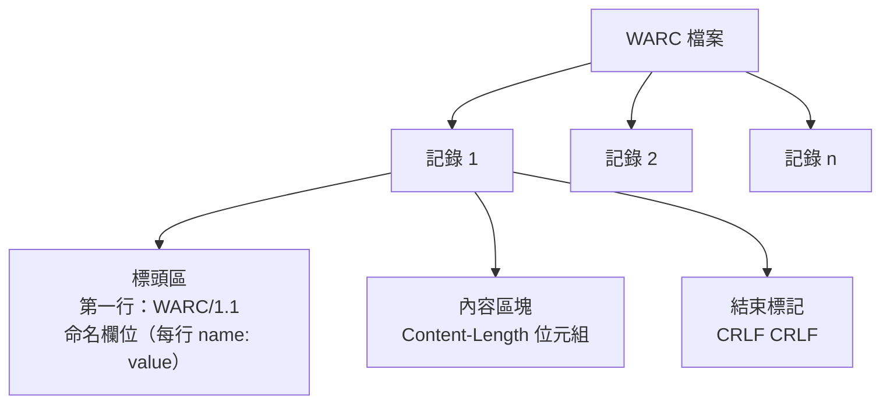
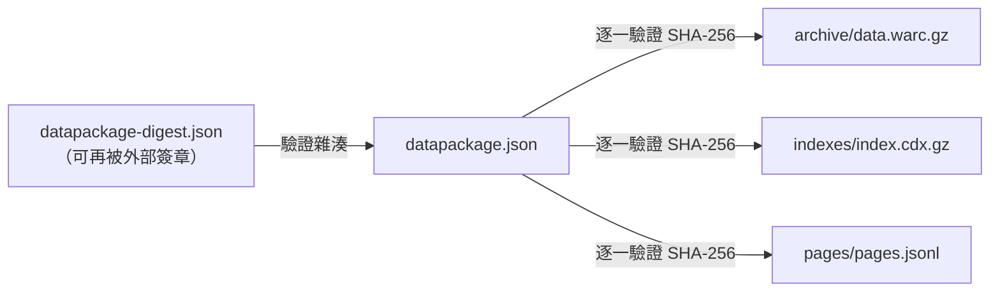
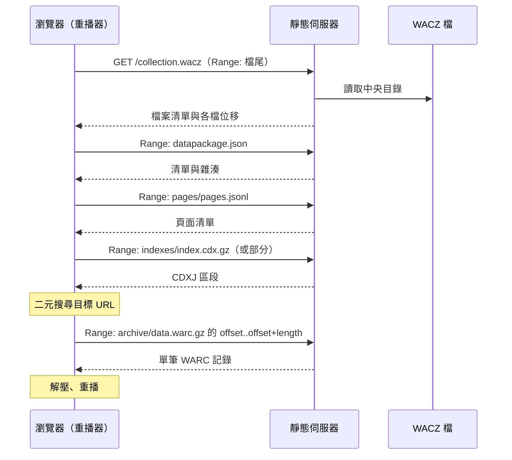
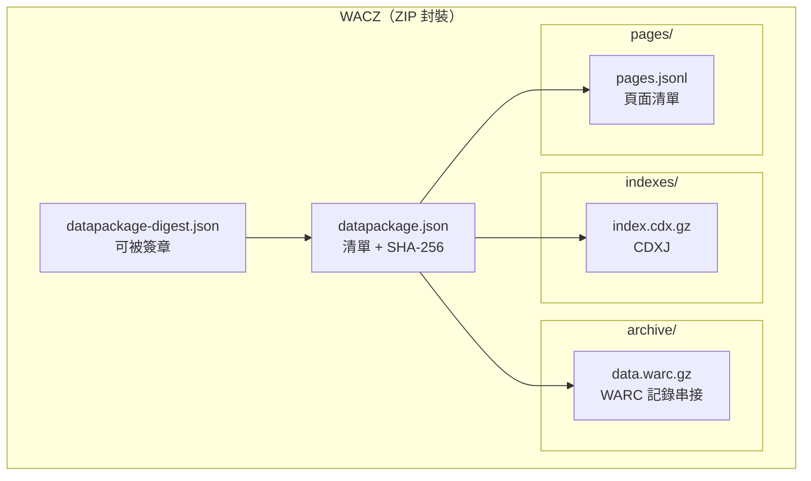

# WARC 與 WACZ：網頁典藏的檔案格式

## 摘要

**WARC**（Web ARChive）是一種以「串接多筆記錄」為核心設計的網頁典藏檔案格式，2017 年成為國際標準 ISO 28500:2017，是數位典藏機構存放網頁爬取成果的事實標準[^warc-iso]。**WACZ**（Web Archive Collection Zipped）則不是取代 WARC 的新格式，而是由 Webrecorder 專案於 2021 年提出的**封裝慣例**：把一份或多份 WARC、CDXJ 索引、頁面清單與 JSON 清單檔打包成單一 ZIP，使瀏覽器能透過 HTTP Range 請求「只抓需要的那幾段位元組」即可重播典藏內容[^wacz-spec][^wacz-1-0]。

一句話區分：**WARC 是內容容器，WACZ 是傳遞與重播用的封裝**。前者解決「如何忠實且長期地保存抓取下來的位元組與協定資訊」，後者解決「如何把這些位元組變成一個可下載、可驗證、可在瀏覽器裡隨機存取的單一檔案」。

---

## 一、WARC 是什麼

### 1.1 定義與核心設計

WARC 規範對自身的定義是：

> 「WARC（Web ARChive）檔案格式提供一種慣例，用於將多筆資源記錄（資料物件）串接在一起，每筆記錄由一組簡單的文字標頭與一個任意資料區塊組成，全部併入一個長檔案。」[^warc-spec]

也就是說，一個 WARC 檔不是壓縮檔、不是資料庫，而是**純粹的位元組串接**：記錄一筆接一筆寫在同一條位元流裡，中間沒有任何檔案層級的索引。規範中的語法形式為[^warc-spec]：

```
warc-file    = 1*warc-record
warc-record  = header CRLF block CRLF CRLF
header       = version warc-fields
version      = "WARC/1.1" CRLF
warc-fields  = *named-field CRLF
block        = *OCTET
```

這種「無索引、可追加」的設計有三個直接後果：寫入時的容錯性高（單筆記錄損壞不會破壞整檔結構）、可以邊爬邊寫、也天然適合大量平行寫入後再合併。但代價是**隨機查詢需要外部索引**，這正是後續 CDX／CDXJ 與 WACZ 存在的理由。

### 1.2 歷史與標準化

WARC 並非憑空出現，而是 Internet Archive（IA）自 1996 年起使用的 **ARC** 格式的延伸。規範原文寫道：「WARC 格式是 ARC 檔案格式的擴充，ARC 傳統上用於以內容區塊序列的形式儲存『網頁爬取』成果。」[^warc-spec]

推動擴充的動力來自 **IIPC**（International Internet Preservation Consortium，國際網際網路保存聯盟），其創始成員包括澳洲、加拿大、丹麥、芬蘭、法國、冰島、義大利、挪威、瑞典的國家圖書館，以及大英圖書館、美國國會圖書館與 Internet Archive；加州數位圖書館與洛斯阿拉莫斯國家實驗室亦提供意見[^warc-spec][^warc-wiki]。

標準化時程如下[^warc-iso][^warc-iso-2009][^warc-ietf]：

| 階段 | 時間 | 內容 |
|---|---|---|
| 新工作項目通過（ISO TC 46/SC 4） | 2006-12-08 | 標準化工作正式立案 |
| 委員會草案（CD）註冊 | 2007-06-16 | — |
| 國際標準草案（DIS）註冊 | 2008-04-21 | — |
| IETF 草案 `draft-kunze-warc-00` | 2008-07-05 | 於 IETF 公開的早期草案 |
| 最終草案（FDIS）註冊 | 2008-12-11 | — |
| 第一版國際標準 | 2009-05-13 | ISO 28500:2009（WARC 1.0，第 1 版） |
| 第二版國際標準 | 2017-08-14 | ISO 28500:2017（WARC 1.1，第 2 版），同日第 1 版撤銷 |
| 定期審查確認 | 2023 | 審查階段 90.93，確認標準仍然有效 |

### 1.3 兩個版本：1.0 與 1.1

WARC 1.0（ISO 28500:2009）與 WARC 1.1（ISO 28500:2017）的差異主要不是功能，而是**語法細節的相容性調整**。最顯著的一項是 URI 的書寫方式。規範的注解版說明：

> 「在 WARC 1.0 中，`uri` 在語法裡定義為 `"<" <'URI' per RFC 3986> "">"`，但標準中的範例只在記錄 ID 欄位使用這些字元，`WARC-Target-URI` 與 `WARC-Profile` 則否。在 WARC 1.1 中，這些字元從 `uri` 的定義移到了個別的記錄 ID 欄位，以使語法與範例一致，並符合多數實作在實務上的做法。」[^warc-annotated]

換言之，1.1 並非「新增功能」，而是**讓規格文字追上實作現實**。語法本身也把版本寫死為 `version = "WARC/1.1" CRLF`；規範並未要求讀取器接受其他版本字串，但要求「WARC 處理軟體應忽略無法辨識名稱的欄位」，且「應跳過未知類型的記錄」，這是向前相容的主要機制[^warc-annotated]。

這也造就閱讀老 WARC 檔時常見的相容性陷阱：`WARC-Target-URI: <http://example.org/>` 與 `WARC-Target-URI: http://example.org/` 分屬不同版本的慣例。

### 1.4 記錄結構

每一筆 WARC 記錄由三部分構成[^warc-spec]：



標頭格式大致遵循 HTTP/1.1（RFC 2616）與 RFC 5322 的一般規則，但有一項重要例外：**允許 UTF-8 字元**（RFC 3629）[^warc-spec]。

**四個必填欄位**（每筆記錄都必須具備）[^warc-spec]：

| 欄位 | 意義 |
|---|---|
| `WARC-Record-ID` | 全域唯一的 URI 識別碼 |
| `Content-Length` | 內容區塊的位元組數 |
| `WARC-Date` | UTC 時間戳，採 ISO 8601 的 W3C 剖析（`YYYY-MM-DDThh:mm:ssZ`） |
| `WARC-Type` | 記錄類型 |

**常見的選填欄位**包括 `Content-Type`、`WARC-Target-URI`、`WARC-IP-Address`、`WARC-Block-Digest`、`WARC-Payload-Digest`、`WARC-Concurrent-To`、`WARC-Refers-To`、`WARC-Profile`、`WARC-Truncated`、`WARC-Segment-Number` 等[^warc-spec]。其中 digest 欄位是「內容完整性可被獨立驗證」的關鍵，也是後來 WACZ 簽章機制得以成立的基礎。

### 1.5 八種記錄類型

規範第 6 章定義八種 `WARC-Type`[^warc-spec]：

| 類型 | 用途 |
|---|---|
| `warcinfo` | 描述後續記錄的脈絡資訊，通常置於檔案開頭 |
| `response` | 完整的協定回應，含協定層資訊（例如完整 HTTP 回應標頭） |
| `resource` | 不含協定回應資訊的資源（例如直接取得的檔案） |
| `request` | 完整的協定請求，含協定層資訊 |
| `metadata` | 關於某資源的補充描述性或說明性資料 |
| `revisit` | 對已典藏內容的「再訪」，用於去重（有「相同 payload digest」與「伺服器未修改」兩種 profile） |
| `conversion` | 另一筆記錄內容的替代版本，由典藏流程產生（例如格式遷移） |
| `continuation` | 分段記錄的續段，用於重組超長記錄 |

這八種類型揭示了 WARC 的一個關鍵價值主張：它保存的不只是「網頁長什麼樣」，還包括**「當時是怎麼取得的」**（`request` 記錄、`WARC-IP-Address`、digest）。對於需要論證來源與完整性的檔案館、法院與新聞查核機構而言，這層脈絡與內容同等重要。

### 1.6 為何記憶機構採用

規範本身對用途的說明相當直接：

> 「WARC 格式提供一種標準方式，用來結構化、管理與儲存從網頁及其他來源蒐集的數十億計資源。它被用於建構採集、管理、存取、探勘與交換內容的應用程式。雖然它是網頁典藏的唯一標準格式，也已被網頁典藏社群之外的領域採用，用來儲存原生數位或數位化的素材。」[^warc-spec]

具體能力包括[^warc-spec]：

- 儲存 HTTP、DNS、FTP 等主流協定的 payload 內容與控制資訊
- 儲存與其他資料連結的任意中介資料
- 支援資料壓縮，同時維持記錄完整性
- 儲存採集過程的**所有**控制資訊（例如請求標頭），而非只有回應
- 儲存資料轉換的結果
- 儲存重複偵測事件（以降低儲存成本）
- 可在不破壞相容性的前提下擴充
- 透過截斷（truncation）或分段（segmentation）處理過長的記錄

美國國會圖書館在其《Recommended Formats Statement》中將 WARC 列為網頁典藏的**偏好格式**[^loc-warc]。這類「格式建議清單」在數位保存領域具有實質影響力，因為它直接影響政府與機構採購、交付規格。

### 1.7 治理與維護

WARC 的維護是「正式標準」與「社群實務」的雙軌結構[^warc-spec][^warc-iso]：

- **ISO/TC 46/SC 4**（資訊與文獻技術委員會下的「技術互通性」分委會）負責標準本體，目前版本為 ISO 28500:2017，分委會祕書處由韓國 KATS 擔任[^iso-sc4]
- **IIPC**（國際網際網路保存聯盟）負責討論格式演進。規範原文寫道：「新增的命名欄位與記錄類型可在核心格式的擴充中定義。然而強烈建議在新增前先討論，以確認不會與既有的欄位或類型衝突。討論應主要在 IIPC 內進行。」並指向 `http://bibnum.bnf.fr/WARC/` 取得更多資訊
- 規格文件本身以 GitHub 倉庫形式公開維護，修訂意見以 issue 形式提出

關於治理結構有一處值得一提的落差：坊間常提到 WARC 由「ISO/TC 46/SC 4/WG 12」維護，但 **ISO 官方委員會頁面目前的結構清單並未列出 WG 12**，僅有 WG 2、WG 14、兩個 AHG 與 EPUB 聯合工作組；ISO 28500 的標準頁面也只標示「負責委員會為 ISO/TC 46/SC 4」，未指明工作小組[^iso-sc4][^warc-iso]。這可能意味該工作小組已整併、休止，或維護改以其他形式進行，本文無法確認其實際現況，因此不對現行召集單位或聯絡窗口作斷言。

這種「正式標準在 ISO、實務演進在社群」的雙軌治理，是數位保存領域常見的模式，優點是穩定與彈性並存，缺點則是實作相容性必須靠社群自律。

---

## 二、WACZ 是什麼

### 2.1 定義與定位

WACZ（Web Archive Collection Zipped）規格對自身定位有明確界定：

> 「WACZ 並非設計來取代其他網頁典藏格式。它建立的是**檔案封裝慣例**，把瀏覽器有效率地呈現一份網頁典藏集合及其脈絡化所需的全部資料包在一起。」[^wacz-spec]

換句話說，WACZ 的創新點不在資料格式，而在**打包方式**。它把下列四件事同時解決：

1. **單檔傳遞**：整個典藏集合就是一個 `.wacz` 檔，可直接以電子郵件、隨身碟或靜態網站託管傳播
2. **隨機存取**：ZIP 格式自帶中央目錄，配合 Range 請求，客戶端不必下載整個檔案就能取出任一筆記錄
3. **可驗證性**：`datapackage.json` 內含每個檔案的 SHA-256 雜湊
4. **可脈絡化**：`pages/pages.jsonl` 提供「頁面 ↔ 時間戳 ↔ URL」的清單，讓重播器知道首頁與瀏覽順序

### 2.2 版本演進

WACZ 由 Webrecorder 專案開發與維護，規格公開於 `specs.webrecorder.net`，原始碼在 GitHub 的 `webrecorder/specs` 倉庫[^wacz-spec][^wacz-repo]。

| 版本 | 時間 | 狀態 | 內容重點 |
|---|---|---|---|
| 1.0.0 | 2021-01-18 發布 | 已由 1.1.1 接續 | 初版：把「原始 WARC + CDX（或壓縮 CDX）索引 + 全文索引 + 入口頁面清單 + 使用者可編輯的中介資料」打包成 ZIP，並遵循 Frictionless Data Package，清單中對每個檔案加上 SHA-256 或 MD5 的完整性檢查[^wacz-1-0] |
| 1.1.1 | 2021-06-03（國會圖書館記載為「Webrecorder Recommendation 03 June 2021」）[^loc-wacz-fdd] | **現行穩定版**，規格自述「為 WACZ 標準的穩定版本，且正由 Webrecorder 專案積極使用中」 | 目前規格倉庫中最早被保留的版本化文件；明確要求 CDXJ 索引、頁面清單必備，並以 MUST／SHOULD 分級規定 `Content-Length`、Range 請求、CORS 與 `application/wacz` 媒體類型 |
| 1.2.0 | 頁面未標示日期 | **草案**，規格自述「本文件為潛在規格的草案，不具任何官方地位，亦不代表任何標準組織的支持或共識」 | 有明確的變更清單：`profile` 改為 `wacz`、移除 `wacz_version`、移除 `mainPageUrl`／`mainPageDate`、新增 `home` 物件、新增專門的 CDXJ 章節 |

版本比較需要一個方法論上的提醒：**1.1.1 規格本身沒有變更紀錄章節**，而現行規格倉庫的 `wacz/` 目錄只保留 `1.1.1` 與 `1.2.0` 兩個版本，`1.0.0` 與 `1.1.0` 的規格文件已不在此倉庫中[^wacz-repo]。因此「1.0.0 到 1.1.1 之間究竟改了什麼」並無公開的權威變更清單，只能由 2021-01-18 的發布公告與 1.1.1 規格內容交叉比對推測。唯一有官方變更清單的版本轉換是 1.1.1 → 1.2.0[^wacz-1-2]。

需要注意的是，1.1.1 與 1.2.0 並存：前者是實際被工具鏈廣泛支援的穩定版，後者仍是草案。實務上若遇到 `profile` 欄位值，可用來判斷檔案是依哪一版產生[^wacz-1-2]。

### 2.3 目錄結構

WACZ 的規範佈局如下[^wacz-spec]：

```
├── archive/
│   └── data.warc.gz          # 必要：一份或多份 WARC / WARC.GZ
├── indexes/
│   └── index.cdx.gz          # 必要：CDXJ 索引，可為 gzip
├── pages/
│   └── pages.jsonl           # 必要：JSON-Lines 頁面清單
├── datapackage.json          # 必要：Frictionless Data Package 清單
└── datapackage-digest.json   # 建議：datapackage.json 的雜湊
```

規則細節[^wacz-spec]：

- 「其他檔案與目錄可以存在於 WACZ 中，只要不干擾規範指定的檔案與目錄」；但「自訂的檔案與目錄**不得**加入既有的 WACZ 目錄，即 `archive`、`indexes` 與 `pages`」
- 額外檔案必須列在 `datapackage.json` 的 `resources` 中，以維持與 Frictionless Data Package 的一致性
- `pages/` 目錄可加入其他 JSON-Lines 檔，例如 `extraPages.jsonl`，用於放置爬蟲自動發現的次要頁面

這裡有一個規格自身的矛盾值得指出：「自訂檔案不得加入 `pages/`」與「其他 JSONL 檔可加入 `pages/`」在字面上相互衝突。合理的解讀是：與 `pages.jsonl` 相同格式的補充頁面清單屬「規範內的延伸」，而非「自訂檔案」，但規格並未明文劃清界線，實作者需自行判斷[^wacz-spec]。

### 2.4 清單檔與完整性鏈

`datapackage.json` 遵循 **Frictionless Data Package** 規範，必要屬性為[^wacz-spec]：

| 屬性 | 內容 |
|---|---|
| `profile` | 必須為 `"data-package"`（1.1.1 版） |
| `resources` | WACZ 內所有檔案的「檔名、路徑、大小與 fixity（完整性資訊）」 |
| `wacz_version` | 使用的 WACZ 規格版本，例如 `1.1.1`（1.2.0 草案已移除） |

建議的中介資料屬性包括 `title`、`description`（Markdown 格式）、`created`、`modified`（RFC 3339）、`software`、`mainPageUrl`、`mainPageDate`，以及 Frictionless 的 `licenses`、`organization`、`contributors` 等[^wacz-spec]。

`pages/pages.jsonl` 同樣是必要檔案，每行是一個 JSON 物件，**至少**須包含兩個屬性[^wacz-spec]：

| 屬性 | 內容 |
|---|---|
| `url` | 該頁面的 URL |
| `ts` | RFC 3339 格式的日期時間字串 |

`datapackage-digest.json` 則是**建議但非必要**的根目錄檔案。規格原文：「`datapackage-digest.json` 檔**應**（SHOULD）置於 WACZ 的根目錄，用以透過雜湊驗證 `datapackage.json` 清單，從而驗證整個 WACZ 的內容。」其內容為 `datapackage.json` 的雜湊[^wacz-spec]：

```json
{
  "path": "datapackage.json",
  "hash": "sha256:ec1f44ab13e2c94b0ddf66e9673d585ba4a77e6f8c9cc30d8665da434557e885"
}
```

這形成一條可逐層驗證的信任鏈：



只要最外層的 digest 被信任（例如被 X.509 簽章、被時間戳服務錨定），整包內容就無法被悄悄替換。這正是 WACZ 被用於法律與新聞查核場景的技術基礎[^wacz-blog][^starling]。

### 2.5 索引：CDXJ

`indexes/` 目錄必須包含至少一份索引。規格原文：「`indexes` 目錄**必須**包含一份或多份索引，供 `archive` 中儲存的 WARC 資料使用。這些索引檔讓客戶端能有效率地查詢某個 URL 是否存在於 WACZ 中。索引檔**必須**包含 CDXJ 資料，且**可**為 gzip 壓縮。」[^wacz-spec]

CDXJ 的每一行由三個以單一空白分隔的部分組成[^cdxj-spec]：

```
<可搜尋 URL（SURT）> <整數時間戳> <JSON 區塊>
```

1. **可搜尋 URL（SURT）**：把 URL 轉為可排序、可用二元搜尋掃描的正規化形式。步驟為：轉小寫 → 移除協定（HTTP／HTTPS）→ 把主機名改為反轉並以逗號分隔的等價形式（`www.example.org` → `org,example,www`）→ 加上 `)` 分隔符 → 接上其餘的路徑與查詢字串。例如 `https://www.example.org/index.html` → `org,example,www)/index.html`
2. **整數時間戳**：典藏快照建立時間（UTC）的整數表示，由四位年份、兩位月、兩位日、兩位時（24 小時制）、兩位分、兩位秒組成，**可**再包含三位毫秒。例如 `20220205231359032`
3. **JSON 區塊**：**必須**包含 `url`、`digest`、`mime`、`filename`、`offset`、`length`、`status` 七個屬性

範例[^cdxj-spec]：

```
org,example)/index.html 20220106150849300 {"url":"https://example.org/index.html","digest":"sha-256:a8c5ac6f...","mime":"image/png","offset":283,"length":2269,"status":200,"filename":"data.warc.gz"}
```

CDXJ 檔案**必須**以位元組值排序（等同 `LC_ALL=C sort`），才能用二元搜尋定位[^cdxj-spec]。相較於 Internet Archive 早期以空白分隔、欄位位置固定的 CDX 格式，CDXJ 把欄位放進自描述的 JSON，新增欄位不會破壞既有工具，這是它成為 pywb、Webrecorder、Common Crawl 與 WACZ 預設索引格式的主因[^cdx-2015]。

**關鍵三欄位**是 `filename` + `offset` + `length`：有了這三者，就能從 WARC 檔案的任意位置讀出單筆記錄，而不必解析整個檔案。WARC 本身沒有索引，索引的責任完全外掛在 CDXJ 上。

### 2.6 壓縮規則與隨機存取

WACZ 對 ZIP 內的壓縮方式有明確規定[^wacz-spec]：

| 內容 | ZIP 壓縮模式 | 理由 |
|---|---|---|
| `archive/` 下的檔案 | **STORE**（不再壓縮） | 本身已壓縮，且必須允許依位移隨機讀取 |
| `indexes/*.cdx.gz` | **STORE** | 同上 |
| 其他 JSON、JSON-Lines、索引檔 | DEFLATE 或 STORE 皆可 | 彈性 |

規格原文使用「should」，即 SHOULD 等級：「所有 `archive/` 下的檔案應以 ZIP 的『STORE』模式儲存」、「所有 `index/*.cdx.gz` 檔案應以 ZIP 的『STORE』模式儲存」。

核心邏輯：**已壓縮的檔案不得再次壓縮**，否則解壓一個位元組區段就必須解壓整條串流，隨機存取便失效。

完整的讀取流程如下[^wacz-spec]：



這解釋了為何 WACZ 規範對伺服器行為有明確要求。規格中的強制層級區分得很細[^wacz-spec]：

| 要求 | 規範用語 | 理由（規格原文要點） |
|---|---|---|
| `Content-Length` | **MUST** | 客戶端需要在渲染前知道整個檔案大小，或進行動態讀取 |
| 支援 HTTP range 請求（RFC 7233） | **MUST** | 客戶端需依 CDXJ 索引中的位移即時取出 WARC 的一部分 |
| `Accept-Ranges` 標頭 | **SHOULD** | 明示伺服器支援部分請求 |
| `access-control-allow-origin`（CORS） | **SHOULD** | 允許 WACZ 與檢視端位於不同網域（例如放在物件儲存、於另一網域檢視） |
| `application/wacz` 媒體類型 | **SHOULD** | 讓客戶端正確辨識檔案類型 |

若託管於不支援 Range 請求的空間，WACZ 就退化成一個必須整包下載的壓縮檔，其設計優勢大部分消失。

### 2.7 簽章與驗證

WACZ 規格本身只處理「封裝與雜湊」，**密碼學簽章**則交由另一份規格處理。規格原文指向獨立的 WACZ Signing and Verification 文件：「關於在 `datapackage-digest.json` 中記錄密碼學簽章，以主張並證明 WACZ 作者身分的方法，請參見 WACZ Signing and Verification。」[^wacz-spec][^wacz-auth]

該規格目前為 **0.1.0 工作草案**，自述是「一份建立已簽章 WACZ 封裝、使封裝作者能被密碼學證明的提案工作草案」。它定義兩種簽章方式[^wacz-auth]：

1. **匿名簽章**：使用內嵌於封裝中的 ECDSA 公鑰，金鑰需以頻外方式管理
2. **網域所有權身分 + 已簽章時間戳**：使用 TLS 網域憑證（X.509）簽章，並搭配 RFC 3161 時間戳伺服器；`authsign` 函式庫與 `py-wacz` 命令列工具實作的是這一種

其實務意義在於**證據能力**。史丹佛 Starling Lab 與美聯社在「Tracked」調查報導系列中合作，於 2022-12-20 刊出的〈Police seize on COVID-19 tech to expand global surveillance〉一文中，約三分之二處內嵌了一段典藏推文；該典藏以 ReplayWeb.page 呈現，讀者可下載原始 WACZ 自行驗證。案例研究明確記載「這些網站被爬取，產生的網頁典藏以 Starling 的簽章憑證簽署，以確保這項『觀測』可歸屬於執行爬取的 Starling」，並且「Starling 並非代表美聯社簽章，而是代表自己簽章；美聯社僅刊載一份由 Starling 證實的典藏」[^starling]。

該系列另有 9 份檔案分別透過 Numbers Protocol 註冊於 Avalanche 區塊鏈、以及以 ISCN 標準註冊於 LikeCoin 區塊鏈，形成「誰在何時典藏了什麼」的公開紀錄[^starling]。這類應用把網頁典藏從「圖書館保存」推進到「事實查核與法律證據」的領域。

一個已知限制是：WACZ Auth 規格目前只支援**一個**內嵌簽章，因此需要多來源時間證明的場景，實務上會額外附掛 OpenTimestamps、RFC 3161 時間戳或 QTSA 等旁檔（sidecar）[^pagecrawl]。

---

## 三、WARC 與 WACZ 的關係



層級關係可以用三個問題釐清：

| 問題 | 由誰回答 |
|---|---|
| 抓下來的位元組與脈絡要怎麼**長期保存**？ | WARC |
| 要怎麼**快速找到**某個 URL 的某一筆記錄？ | CDXJ 索引 |
| 要怎麼把上述東西**打包成一個可傳遞、可驗證、可隨機讀取的檔案**？ | WACZ |

因此，「WARC 還是 WACZ」是個偽命題，實務上幾乎總是**兩者並用**：先用爬蟲產生 WARC，再以 `py-wacz` 之類的工具加上索引與清單，封裝成 WACZ 交付或上線[^pywacz]。

### 3.1 比較表

| 面向 | WARC | WACZ |
|---|---|---|
| 本質 | 記錄串接的位元流格式 | ZIP 封裝慣例 |
| 標準地位 | ISO 28500:2017 國際標準 | 社群規格（Webrecorder），非 ISO |
| 治理 | ISO/TC 46/SC 4 + IIPC 社群 | Webrecorder 專案（GitHub） |
| 索引 | 無（需外部 CDX/CDXJ） | 內含 CDXJ |
| 隨機存取 | 需外部索引與 Range 請求自行組合 | 內建設計目標 |
| 完整性驗證 | 逐記錄 digest 欄位 | 全檔 SHA-256 清單 + 可選簽章 |
| 中介資料 | WARC 欄位 + `metadata` 記錄 | `datapackage.json` + `pages.jsonl` |
| 典型使用者 | 檔案館、國家圖書館、研究機構 | 瀏覽器重播、新聞查核、教學、小型機構 |
| 媒體類型 | 無註冊專用型別（多為 `application/warc`） | `application/wacz`（規格建議）；PRONOM 登錄為 `application/x-wacz` |

---

## 四、生態系與採用情況

### 4.1 工具鏈

WACZ 的採用高度依賴 Webrecorder 生態系，但也已外溢到其他機構[^wacz-blog][^loc-wacz-fdd]。下表列出各工具的定位與 GitHub 星數（星數為 2026-11-24 查詢值，僅供參考其社群規模）[^gh-stars]：

| 工具 | 角色 | 說明 | GitHub 星數 |
|---|---|---|---|
| **Browsertrix Crawler** | 爬蟲 | 「在單一 Docker 容器中執行高保真、瀏覽器驅動的網頁典藏爬蟲」，輸出可為 WARC 或 WACZ | 約 1.2k |
| **ArchiveWeb.page** | 瀏覽器擴充功能 | 「為 Chrome 與 Chromium 系瀏覽器提供的高保真網頁典藏擴充功能」，錄製後匯出 WACZ | 約 1.6k |
| **ReplayWeb.page** | 重播器 | 純前端檢視器，可載入本機檔案、URL 或雲端硬碟；亦提供桌面版 | — |
| **py-wacz** | 命令列／函式庫 | 「用於處理網頁典藏資料的 Python 模組與命令列工具」，可「將任何 WARC 檔轉換為 WACZ」，並可選擇產生全文檢索索引、簽章與驗證 | 約 64 |
| **wabac.js** | JavaScript 函式庫 | 「Web Archive Browsing Augmentation Client」，以 Service Worker 為基礎的網頁典藏重播系統，提供 WACZ 讀取能力，是 ReplayWeb.page 的核心 | 約 130 |

星數的分布本身反映了一個結構性事實：**WACZ 的終端使用者工具（擴充功能、爬蟲）人氣遠高於封裝工具與底層函式庫**。這與 WARC／WACZ 的分工相符：多數使用者在意的是「錄下來、看得見」，而非封裝規格的細節。

### 4.2 機構採用

| 機構 | 具體作為 |
|---|---|
| **美國國會圖書館（LOC）** | 於《Recommended Formats Statement》列為網頁典藏的**可接受格式**，並維護格式描述 FDD000586；該頁引用 Kirsta Stapelfeldt 的論述，指 WACZ「提供額外工具以擴充網頁典藏與其他網頁紀錄資料配置的豐富度與功能」，並「讓網頁典藏集合能隨使用者在瀏覽器中重播而逐步載入，實質改善終端使用者體驗」[^loc-wacz-fdd] |
| **Internet Archive** | 在 Save Page Now 服務中提供 WACZ 下載，使用 `py-wacz` 封裝[^summers] |
| **英國國家檔案館** | 於 PRONOM 註冊 WACZ，PUID 為 `fmt/1840`（2023-03-14 以 V110 納入，提交者為 NARA 與耶穌基督後期聖徒教會）[^pronom] |
| **美國國家檔案與紀錄管理局（NARA）** | 與耶穌基督後期聖徒教會共同提交 WACZ 至 PRONOM[^pronom] |
| **史丹佛 Starling Lab** | 在「Authenticated Web Archives」流程中使用簽章 WACZ，並應用於美聯社調查報導[^starling-wacz] |

值得注意的是，WACZ 已被納入**國家級格式登錄系統**（PRONOM、LOC FDD），這在實務上比規格本身的成熟度更能說明其被機構接受的程度，因為登錄意味著它已被納入保存政策的評估範圍。

---

## 五、限制與批評

批判性地檢視來源後，可整理出以下幾類問題。

### 5.1 格式本身的限制

1. **單檔大小上限的實務壓力**：規格允許 ZIP64，但 Webrecorder 自身承認「單一 WACZ 檔再大也有限（儘管我們去年已用此格式超過 1TB）」，並因此發展 Multi-WACZ 規格來組合多個檔案[^wacz-blog]。歷史上有具體案例：ArchiveWeb.page 早期使用不支援 ZIP64 的 jszip，輸出上限約 4GB，2022 年改用 `client-zip` 後才解決[^awp-issue]。
2. **壓縮效率被犧牲**：為換取隨機存取，已壓縮的 WARC 必須以 STORE 模式存放，不能對整包做更好的壓縮[^wacz-spec]。
3. **託管環境依賴**：需要 Range 請求、`Content-Length` 與 CORS，並非所有靜態託管服務都完整支援[^wacz-spec]。
4. **簽章能力有限**：內嵌簽章僅支援一個，多來源時間證明需外掛旁檔[^pagecrawl]。

### 5.2 採用層面的批評

Ed Summers 對 Internet Archive 的 Save Page Now 所產出 WACZ 做過細部檢查，提出三點批評[^summers]：

- **缺少 `request` 記錄**：他檢查的檔案有 676 筆 `response` 記錄，卻沒有任何 `request` 記錄，因而失去「內容是如何被典藏的」這層脈絡（例如 User-Agent）
- **缺少來源標示**：初期檔案的中介資料未標明來自 Internet Archive；後來在 `datapackage.json` 補上 `title` 與 `description`，但 IA 仍未對其 WACZ 簽章
- **保真度落差**：與 ArchiveWeb.page 的擷取相比，SPN 產生的 WACZ 有圖片缺失（例如《紐約時報》照片未能顯示）

這些批評指向一個更根本的議題：**格式保證的是結構，不是品質**。一個結構完全合規的 WACZ，仍可能因為爬蟲設定、中介資料缺漏或資源載入策略而成為劣質典藏。格式標準化無法取代典藏政策與品質檢核。

### 5.3 對「為何需要 WACZ」的質疑

社群中亦有「直接散佈 WARC 不就好了」的質疑聲音。在 Hacker News 的一串討論中，使用者 infogulch 問道：「WACZ 的意義是什麼？它看起來只是把若干 WARC 檔包進一個 ZIP，讓 Range 請求能指定到個別 WARC，以便由被動的檔案伺服器提供服務。但為何需要這樣？」他進一步質疑：「它內部仍以 WARC 作為典藏格式。當原始格式仍然存在時，把它稱為替代品似乎很奇怪。」[^hn]

反方的回應（使用者 nikisweeting）則聚焦於實務可行性：「這對於在瀏覽器中重播大型 WARC 檔而不必下載整個檔案，意義重大。（例如試著從 IPFS 載入一個 700MB 的 WARC 只為了看其中一頁，以現狀而言太慢了。）」[^hn]

這場爭論的實質結論接近「兩者解決不同問題」，而非「誰取代誰」：WARC 負責保存，WACZ 負責讓保存成果在瀏覽器場景中可用。

---

## 六、結論

WARC 與 WACZ 的關係，可以用數位保存領域一個常見的模式來理解：**保存格式與傳遞格式分離**。

- **WARC（ISO 28500:2017）** 是保存層的答案。它以極簡的「標頭 + 位元組區塊」串接結構，換取長期可讀性、寫入容錯與完整的協定脈絡；代價是查詢能力必須外掛。它由 ISO 與 IIPC 雙軌治理，被美國國會圖書館列為偏好格式。
- **WACZ（1.1.1 穩定、1.2.0 草案）** 是傳遞與重播層的答案。它不改變資料格式，只定義「怎麼打包」：WARC + CDXJ + 頁面清單 + SHA-256 清單，裝進一個支援隨機存取的 ZIP，再選擇性加上密碼學簽章。它由 Webrecorder 維護，已被 LOC、PRONOM 與 Internet Archive 納入實務。

對實作者而言，決策點通常不是「選哪一個」，而是三個接續的問題：**用什麼爬蟲產生 WARC、用什麼工具加上索引與清單封裝成 WACZ、用什麼重播器與驗證流程交付給讀者**。格式只是這條鏈條的中段，前後兩端的爬取品質與驗證政策，往往才是典藏成敗的關鍵。

---

## 參考文獻

[^warc-iso]: International Organization for Standardization. (2017). *Information and documentation — WARC file format* (ISO Standard No. 28500:2017). Retrieved 2026-11-24, from https://www.iso.org/standard/68004.html

[^warc-iso-2009]: International Organization for Standardization. (2009). *Information and documentation — WARC file format* (ISO Standard No. 28500:2009). Retrieved 2026-11-24, from https://www.iso.org/standard/44717.html

[^iso-sc4]: International Organization for Standardization. (n.d.). *ISO/TC 46/SC 4: Technical interoperability*. Retrieved 2026-11-24, from https://www.iso.org/committee/48798.html

[^warc-ietf]: Kunze, J. (2008, July 5). *WARC file format* (Internet-Draft draft-kunze-warc-00). Internet Engineering Task Force. Retrieved 2026-11-24, from https://datatracker.ietf.org/doc/draft-kunze-warc/

[^warc-spec]: International Internet Preservation Consortium. (n.d.). *WARC format 1.1*. Retrieved 2026-11-24, from https://iipc.github.io/warc-specifications/specifications/warc-format/warc-1.1/

[^warc-annotated]: International Internet Preservation Consortium. (n.d.). *WARC format 1.1 (annotated)*. Retrieved 2026-11-24, from https://iipc.github.io/warc-specifications/specifications/warc-format/warc-1.1-annotated/

[^warc-wiki]: Wikipedia. (n.d.). WARC (file format). Retrieved 2026-11-24, from https://en.wikipedia.org/wiki/WARC_(file_format)

[^loc-warc]: Library of Congress. (n.d.). *WARC file format* (Sustainability of Digital Formats, FDD000236). Retrieved 2026-11-24, from https://www.loc.gov/preservation/digital/formats/fdd/fdd000236.shtml

[^wacz-spec]: Webrecorder. (n.d.). *WACZ 1.1.1 specification*. Retrieved 2026-11-24, from https://specs.webrecorder.net/wacz/1.1.1/

[^wacz-1-2]: Webrecorder. (n.d.). *WACZ 1.2.0 specification (draft)*. Retrieved 2026-11-24, from https://specs.webrecorder.net/wacz/1.2.0/

[^wacz-1-0]: Webrecorder. (2021, January 18). *Announcing WACZ format 1.0*. Retrieved 2026-11-24, from https://webrecorder.net/blog/2021-01-18-wacz-format-1-0/

[^wacz-repo]: Webrecorder. (n.d.). *Specifications repository*. GitHub. Retrieved 2026-11-24, from https://github.com/webrecorder/specs

[^wacz-blog]: Kreymer, I. (2023, May 3). *An update on the WACZ format*. Webrecorder. Retrieved 2026-11-24, from https://webrecorder.net/blog/2023-05-03-an-update-on-wacz/

[^wacz-auth]: Webrecorder. (n.d.). *WACZ signing and verification*. Retrieved 2026-11-24, from https://specs.webrecorder.net/wacz-auth/latest/

[^cdxj-spec]: Webrecorder. (n.d.). *CDXJ index format specification 0.1.0*. Retrieved 2026-11-24, from https://specs.webrecorder.net/cdxj/0.1.0/

[^cdx-2015]: International Internet Preservation Consortium. (2015). *CDX format specification*. Retrieved 2026-11-24, from https://iipc.github.io/warc-specifications/specifications/cdx-format/cdx-2015/

[^pywacz]: Webrecorder. (n.d.). *py-wacz* [Computer software]. GitHub. Retrieved 2026-11-24, from https://github.com/webrecorder/py-wacz

[^gh-stars]: Webrecorder. (n.d.). *Browsertrix Crawler*, *ArchiveWeb.page*, *wabac.js* [Computer software]. GitHub. Retrieved 2026-11-24, from https://github.com/webrecorder/browsertrix-crawler, https://github.com/webrecorder/archiveweb.page, https://github.com/webrecorder/wabac.js

[^loc-wacz-fdd]: Library of Congress. (n.d.). *WACZ (Web Archive Collection Zipped) format description* (Sustainability of Digital Formats, FDD000586). Retrieved 2026-11-24, from https://www.loc.gov/preservation/digital/formats/fdd/fdd000586.shtml

[^summers]: Summers, E. (2023, April 3). *WACZ, Save Page Now and the Internet Archive*. Inkdroid. Retrieved 2026-11-24, from https://inkdroid.org/2023/04/03/spn-wacz/

[^pronom]: The National Archives. (2023, March 14). *PRONOM entry fmt/1840: WACZ* (updated 2024, April 30). Retrieved 2026-11-24, from https://www.nationalarchives.gov.uk/PRONOM/fmt/1840

[^starling]: The Stanford Starling Lab. (2022). *When a screenshot isn't enough* (case study). Retrieved 2026-11-24, from https://starling.stanford.edu/case-studies/when-a-screenshot-isnt-enough/

[^starling-wacz]: The Stanford Starling Lab. (2023, November 13). *Authenticated web archives with WACZ files*. Retrieved 2026-11-24, from https://dispatch.starlinglab.org/p/authenticated-web-archives-wacz-files

[^pagecrawl]: PageCrawl. (n.d.). *WACZ format explained*. Retrieved 2026-11-24, from https://pagecrawl.io/help/web-archives/article/wacz-format-explained

[^awp-issue]: Webrecorder. (n.d.). *ZIP64 support in ArchiveWeb.page* (Issue #36). GitHub. Retrieved 2026-11-24, from https://github.com/webrecorder/archiveweb.page/issues/36

[^hn]: Hacker News. (n.d.). *Discussion on WACZ and web archive formats*. Retrieved 2026-11-24, from https://news.ycombinator.com/item?id=39187540