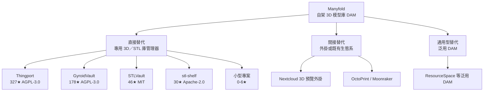
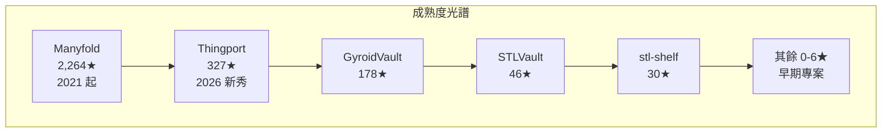

# Manyfold 的自由開源替代方案調查

## 摘要

Manyfold（前身為 VanDAM）是一套自架（self-hosted）的 3D 列印檔案數位資產管理系統（Digital Asset Manager, DAM），採 Ruby on Rails 撰寫、以 AGPL-3.0 授權釋出[^manyfold-repo]。本報告針對「尋找 Manyfold 的自由開源（Free and Open Source Software, FOSS）替代品」進行調查，將替代方案區分為三類：

1. **直接替代**：同樣以「自架 3D 模型／STL 檔案庫管理器」為核心定位的專案。
2. **間接替代**：可透過外掛或既有生態系達成部分功能者（如 Nextcloud 預覽外掛、列印機管理軟體）。
3. **通用型替代**：泛用數位資產管理系統，經調整後可擺放 3D 檔案，但缺乏 3D 專屬功能。

調查結果顯示：截至 2026-11-25，除 Manyfold 本身外，**最接近的直接替代方案為 Thingport（327 顆星）與 GyroidVault（178 顆星）**；其餘直接替代專案的星數多落在 0 至 46 顆之間，屬於早期或小眾專案。值得注意的是，這個領域在 2025 至 2026 年間出現多家新興專案，但多數仍在早期開發階段，成熟度與社群規模皆不及 Manyfold。

## Manyfold 專案背景（比較基準）

在討論替代方案前，必須先界定「被替代的對象」究竟提供什麼功能，否則「替代」二字將無從衡量。Manyfold 的核心能力如下[^manyfold-repo][^manyfold-site]：

| 項目 | 內容 |
| --- | --- |
| 定位 | 自架 3D 列印檔案數位資產管理系統 |
| 授權 | AGPL-3.0 |
| 主要語言 | Ruby |
| GitHub 星數 | 2,264 |
| 分支（fork）數 | 152 |
| 未結議題數 | 532 |
| 建立日期 | 2021-02-05 |
| 最近推送 | 2026-11-25 |

其功能涵蓋：互動式 3D 瀏覽（客戶端以 THREE.js 渲染）、依標籤／創作者／集合分類、公開或私有分享、ActivityPub 聯邦宇宙（Fediverse）整合、依中繼資料自動重整磁碟上的檔案結構、重複檔案與低效率格式偵測、多使用者模式與 OpenID Connect 單一登入、外掛系統等[^manyfold-site]。

換言之，一個「真正的替代品」至少要能滿足：**自架部署、多格式 3D 檔案收納、可搜尋的分類與中繼資料、以及瀏覽器內的 3D 預覽**。以下評估即以此為判準。

## 替代方案全景

## 直接替代方案

### Thingport

Thingport 是目前除 Manyfold 外聲量最高的直接替代方案[^thingport-api][^thingport-repo]。

| 項目 | 內容 |
| --- | --- |
| 說明 | 自架 3D 列印模型庫，可匯入、整理、設計並保存模型 |
| 授權 | AGPL-3.0 |
| 主要語言 | TypeScript |
| GitHub 星數 | 327 |
| 分支數 | 29 |
| 未結議題數 | 36 |
| 建立日期 | 2026-09-06 |
| 最近推送 | 2026-11-24 |

其差異化特色在於「匯入」能力：可從 23 個模型網站（包含 MakerWorld、Printables、Thingiverse、MyMiniFactory 等）匯入並同步收藏，並能將模型轉為適配使用者切片軟體的 3MF 格式[^thingport-repo]。此外還內建 AI 分類整理、內建 CAD 工作室、列印品質檢查，以及可將檔案送往 OctoPrint、Klipper、PrusaLink 等列印機的功能[^thingport-repo]。相較於 Manyfold 偏重「已有檔案的整理與聯邦分享」，Thingport 更偏向「從外部平台抓取並整合列印工作流」。

**注意**：Thingport 建立於 2026-09-06，至調查日僅約兩個半月，星數雖高但歷史極短，長期維護能力尚待觀察。

### GyroidVault

GyroidVault 是一套「自架 3D 模型庫與列印管理平台」[^gyroidvault-api][^gyroidvault-repo]。

| 項目 | 內容 |
| --- | --- |
| 說明 | 自架 3D 模型庫與列印管理平台 |
| 授權 | AGPL-3.0（依官方 LICENSE 檔與 README 宣告） |
| 主要語言 | JavaScript |
| GitHub 星數 | 178 |
| 分支數 | 14 |
| 未結議題數 | 2 |
| 建立日期 | 2026-05-11 |
| 最近推送 | 2026-11-15 |

其功能包含：STL 與 3MF 的 WebGL 互動瀏覽（等角視圖、線框、X 光檢測、一鍵產生縮圖）、逐層 G-code 預覽（顯示層數、Z 高度、噴嘴與熱床溫度）、針對 2TB 以上大型庫最佳化的 SQLite 索引、Moonraker／Klipper 整合、批次編輯、資料夾監看、SHA-256 重複檔案比對、角色權限控管（RBAC）、限時分享連結、自訂中繼資料欄位，以及原生 MCP（Model Context Protocol）伺服器供 AI 助理整合[^gyroidvault-repo]。

需特別說明的一點：**GitHub API 對此專案的授權欄位回傳 `NOASSERTION`**，亦即 GitHub 無法自動辨識其授權檔[^gyroidvault-api]。然而其 README 與 LICENSE 檔明確宣告為 AGPL-3.0[^gyroidvault-repo]。此種不一致通常源自授權檔格式非標準，實務上應以專案自身的 LICENSE 檔為準，但這類落差本身即是採用前應留意的訊號。

### STLVault（moddroid94）

STLVault 定位為「容器化的 3D 模型庫管理器與整理工具，聚焦 3D 列印」[^stlvault-api][^stlvault-repo]。

| 項目 | 內容 |
| --- | --- |
| 授權 | MIT |
| 主要語言 | TypeScript（前端 React）+ Python（後端 FastAPI） |
| GitHub 星數 | 46 |
| 分支數 | 12 |
| 未結議題數 | 2 |
| 建立日期 | 2025-11-22 |
| 最近推送 | 2026-11-17 |

功能包括：每個模型可附 Markdown 說明手冊、可嵌套的階層式資料夾、列印分組、一鍵以慣用切片軟體開啟、從 Printables 或 MakerWorld 依 URL 匯入、拖放匯入、批次操作、STL／3MF／STEP／STP 的內建 3D 預覽、自訂縮圖、模型版本修訂、標籤與中繼資料、全域搜尋[^stlvault-repo]。其 MIT 授權對商業整合較友善，是與 Manyfold（AGPL-3.0）在授權策略上的關鍵差異。

### stl-shelf（CQ-Fabrication）

| 項目 | 內容 |
| --- | --- |
| 說明 | 為 3D 可列印模型打造的個人庫管理，追蹤版本、於瀏覽器預覽 |
| 授權 | Apache-2.0 |
| 主要語言 | TypeScript |
| GitHub 星數 | 30 |
| 分支數 | 5 |
| 未結議題數 | 2 |
| 建立日期 | 2025-08-26 |
| 最近推送 | 2026-08-07 |

採用 TanStack Start（React 19 伺服器端渲染）、Bun 執行環境、PostgreSQL 搭配 Drizzle ORM、相容 S3 的物件儲存（Cloudflare R2、MinIO、AWS S3）、Better Auth 認證，以及 Three.js + React Three Fiber 的 3D 渲染[^stlshelf-api][^stlshelf-repo]。功能含模型版本歷史、組織與角色權限、標籤、批次下載（含 ZIP）[^stlshelf-repo]。其最近推送為 2026-08-07，距今已逾三個月，活躍度低於前述專案。

### 自架模型分享站替代（Thingiverse／Printables 類型）

Manyfold 有一項特殊能力是其他專案少見的：透過 ActivityPub 將自己的實例接入聯邦宇宙，與其他實例互相追蹤分享[^manyfold-site]。這使其兼具「模型庫管理器」與「自架模型分享站」兩種身分。因此若要尋找這一面向的替代品，須轉向「可自架的模型分享網站」類專案：

| 專案 | 說明 | 授權 | 語言 | 星數 | 建立 | 最近推送 |
| --- | --- | --- | --- | --- | --- | --- |
| my-printables（liyu1981） | Printables.com 的自架複製品，作為 NAS 上的 3D 模型管理器 | MIT | Go | 14 | 2026-10-28 | 2026-11-02 |
| polybucket | 可自架的 3D 模型儲存庫 | 未辨識 | C# | 3 | 2024-07-29 | 2026-11-25 |
| meowdels（auroradevllc） | 自架模型儲存庫，用以存放 3D 模型 | ISC | PHP | 2 | 2026-05-11 | 2026-05-15 |
| plastic-machine（toddpress） | 自我定位為「有野心的 Thingiverse 替代品」 | 無 | Svelte | 0 | 2023-06-05 | 2023-06-20 |

[^myprintables-api][^polybucket-api][^meowdels-api][^plasticmachine-api]

此類專案的規模明顯更小。my-printables 成立於 2026-10-28，至調查日僅約四週；plastic-machine 則自 2023-06 起便無推送，實質上已停止開發[^plasticmachine-api]。若使用者真正需要的是「與他人分享與被分享」，這些專案目前皆難與 Manyfold 的聯邦能力相比。

### 早期／小眾專案

以下專案星數低於 10，多處於早期階段，列出僅供完整參考，採用前須自行評估維護風險：

| 專案 | 說明 | 授權 | 語言 | 星數 | 建立 | 最近推送 |
| --- | --- | --- | --- | --- | --- | --- |
| STL_MANAGER（Yoalgrin） | 管理跨多硬碟大型 STL 收藏的輕量 Windows 應用（非網頁自架） | 無 | Python | 6 | 2026-09-19 | 2026-10-07 |
| model-hub（aon082910） | 為 Unraid 打造的自架 3D 列印檔案庫管理器，含 AI 標記與列印估算 | MIT | Python | 5 | 未取得 | 2026-11-16 |
| trinetra（nahushrk） | 自架 3D 模型管理器與整理工具 | MIT | G-code | 5 | 2024-10-06 | 2026-03-16 |
| stl_archive（arslanfth） | 自由開源 STL 歸檔管理器，可選 Google Drive 同步 | MIT | PHP | 4 | 2026-07-02 | 2026-07-17 |
| printbench | 自架 3D 列印庫管理器，支援 STL/3MF/OBJ/PLY，可追蹤列印與線材 | MIT | TypeScript | 2 | 2026-08-23 | 2026-11-25 |
| 3d-model-manager（nickm324） | 自架 3D 模型與 OpenSCAD 庫的整理、預覽、編輯工具 | MIT | JavaScript | 1 | 未取得 | 2026-11-22 |
| ModelVault（R3nierjvr） | 自架 3D 列印嗜好中心：模型庫、塗料、線材、樹脂與工具 | 未辨識 | JavaScript | 1 | 2026-11-14 | 2026-11-14 |
| MeshDepot（MrDark7199） | 自架 3D 列印庫管理器 | AGPL-3.0 | Go | 1 | 未取得 | 2026-10-26 |
| PrintVault（Phikzel2） | 自架 3D 列印檔案庫 | 無 | TypeScript | 1 | 未取得 | 2026-06-22 |
| stl-library（codeStev） | 輕量自架 3D 列印庫管理器（STL/Lychee/Chitubox），支援 ELEGOO SDCP 列印機 | MIT | Go | 0 | 未取得 | 2026-10-01 |

[^stlmanager-api][^modelhub-api][^trinetra-api][^stlarchive-api][^printbench-api][^3dmgr-api][^modelvault-api][^meshdepot-api][^printvault-api][^stllibrary-api]

須嚴正提醒：**星數為 0 至 10 的專案在此領域大量存在，且多數壽命未知**。Yoalgrin/STL_MANAGER 與 Phikzel2/PrintVault 甚至未附授權檔，嚴格而言不符合 FOSS 定義（無授權即「保留所有權利」，並非自由軟體），僅因其實際原始碼公開而列入觀察。此外，部分專案的「主要語言」欄位可能失真：例如 trinetra 的語言被標記為「G-code」，這顯然是 GitHub 以檔案行數統計造成的誤判，而非該專案以 G-code 撰寫[^trinetra-api]。

## 間接替代方案

### Nextcloud 3D 預覽外掛

Nextcloud 生態系中並**不存在**專門管理 3D 列印檔案的應用，但存在純預覽用的外掛[^nextcloud-search]：

- **3D Model Viewer（`files_3dmodelviewer`）**：支援 STL（ASCII 與二進位）、OBJ、3MF、GLB、STEP、IFC、FreeCAD、Collada、FBX、PLY 等 20 餘種格式，提供環繞、平移、縮放等基本操作[^nc-3dviewer]。
- **Universal File Viewer（`fileviewer`）**：通用預覽器，支援 200 餘種格式，其中含 stl、obj、glb、gltf、ply、fbx、dae、3ds、3mf、amf、step、stp、iges、igs、ifc、3dm 等 3D 格式[^nc-fileviewer]。

兩者皆為**檢視器**。若使用者已在 Nextcloud 上存放檔案，加裝此類外掛即可獲得「看得見 3D」的能力，但**分類中繼資料、切片整合、列印機派送、線材追蹤、列印歷程等功能一概沒有**。因此 Nextcloud 只能算是「部分功能替代」，無法取代 Manyfold 的管理職能。

### 列印機管理軟體

OctoPrint、Moonraker 等軟體本身以列印機控制為主，附帶部分 STL 檔案瀏覽能力，同樣不具備作為模型庫管理系統所需的資產管理功能，僅能與前述專案搭配使用（例如 Thingport 與 GyroidVault 皆可將檔案送往這些系統）。

## 通用型數位資產管理系統（泛用 DAM）

另一條思路是採用泛用 DAM，再以自訂中繼資料欄位收納 3D 檔案。此路線的優點是成熟度高、社群穩定；缺點是**缺乏 3D 專屬能力**：沒有模型檔案解析、沒有互動式 3D 預覽、沒有重複網格偵測、更沒有切片或列印機整合。對純粹「想在瀏覽器裡看到 3D」的需求或許足夠，但對 3D 列印工作流則明顯不足。

| 專案 | 說明 | 授權 | 語言 | 星數 | 最近推送 |
| --- | --- | --- | --- | --- | --- |
| Pimcore | 開放核心（open core）的資料與體驗管理平台，含 PIM、MDM、DAM、CMS 與數位商務 | 混合（非標準，部分元件需付費授權） | PHP | 3,891 | 2026-11-25 |
| Damselfly | 伺服器端相片管理應用，鎖定超大規模影像集的索引與檢索，支援物件／人臉偵測 | GPL-3.0 | C# | 1,799 | 2026-09-29 |
| ResourceSpace | 組織用的開源數位資產管理軟體（相片、影片、插畫、音訊） | 非標準（NOASSERTION） | PHP | 95 | 2026-11-24 |

[^pimcore-api][^damselfly-api][^resourcespace-api]

此處須特別警惕**「開源」標籤的稀釋**。Pimcore 自稱「Open Core」，意即核心開放但部分功能置於付費授權之下，並非完整的自由軟體[^pimcore-api]；ResourceSpace 的 GitHub 授權欄位無法自動辨識（`NOASSERTION`），其實際採用的是附帶限制的授權模式[^resourcespace-api]。若使用者的需求嚴格限定於「自由開源」，這兩個專案都不宜在未細讀授權條款前直接採納。相對地，Damselfly 為標準 GPL-3.0，但其設計目標是相片而非 3D 模型，對 3D 檔案僅能當作一般檔案存放與分類[^damselfly-api]。

## 綜合比較

下表以 Manyfold 為基準，彙整主要直接替代方案：

| 專案 | 星數 | 授權 | 語言 | 建立 | 最近推送 | 相對定位 |
| --- | --- | --- | --- | --- | --- | --- |
| Manyfold（基準） | 2,264 | AGPL-3.0 | Ruby | 2021-02 | 2026-11-25 | 成熟、聯邦分享、外掛系統 |
| Thingport | 327 | AGPL-3.0 | TypeScript | 2026-09 | 2026-11-24 | 外部平台匯入與列印工作流整合 |
| GyroidVault | 178 | AGPL-3.0 | JavaScript | 2026-05 | 2026-11-15 | G-code 預覽、列印機整合、MCP |
| STLVault | 46 | MIT | TypeScript/Python | 2025-11 | 2026-11-17 | 授權寬鬆、切片開啟、版本修訂 |
| stl-shelf | 30 | Apache-2.0 | TypeScript | 2025-08 | 2026-08-07 | 團隊協作、S3 儲存 |
| 其餘小型專案 | 0-6 | 多為 MIT，部分無授權 | 多樣 | - | - | 早期實驗性 |

## 選擇建議

依不同需求，建議如下：

- **追求成熟度與聯邦分享**：維持 Manyfold。其 4 年多的開發歷史、2,264 顆星與活躍的推送紀錄，短期內無同規模對手。
- **想從 MakerWorld／Printables 等平台自動抓取並同步收藏**：Thingport 是最貼近的選擇，但其成立僅約兩個半月，須承擔早期專案的風險。
- **需要 G-code 逐層預覽與列印機／AI 助理整合**：GyroidVault 提供 Manyfold 所沒有的 G-code 預覽與 MCP 伺服器。
- **需要寬鬆授權以便商業整合或閉源修改**：選 MIT 的 STLVault 或 Apache-2.0 的 stl-shelf，而非 AGPL-3.0 的 Manyfold／Thingport／GyroidVault。
- **只是想在現有 Nextcloud 裡看到 3D 縮圖**：加裝 `files_3dmodelviewer` 即可，無須另建服務。
- **將「自架並與他人分享模型」視為核心需求**：這是 Manyfold 最難被取代之處。市面上最接近的是 my-printables（14 顆星），但其成立僅約四週；其餘如 polybucket、meowdels 規模更小，plastic-machine 則已停止開發。此情境下建議維持 Manyfold。

## 對來源的批判性反思

本報告的資料以 GitHub 官方 API 為主要事實來源，理由如下：專案網頁的星數可能因快取而與即時值略有落差（例如某次網頁擷取顯示 Manyfold 為 2,300 顆星，而 API 回傳 2,264 顆[^manyfold-repo][^manyfold-api]），API 的欄位較適合機械化查證。然而仍須留意數項限制：

1. **星數不等於品質**。Thingport 以約兩個半月累積 327 顆星，可能反映行銷或話題性，而非程式碼穩定性；反之 STLVault 的 46 顆星可能只是曝光不足。
2. **授權欄位可能失真**。GyroidVault 的 API 授權欄位為 `NOASSERTION`，但專案自稱 AGPL-3.0，顯示自動辨識並非萬無一失；採用前務必直接閱讀 LICENSE 檔。
3. **「無授權」即「非 FOSS」**。部分專案（如 Yoalgrin/STL_MANAGER、Phikzel2/PrintVault）未附授權檔，即便原始碼公開，在法律上仍非自由軟體，不應計入嚴格的 FOSS 替代方案。
4. **本領域變動極快**。多數專案成立不到一年，尚未脫離早期開發期。任何採用決策都應在數週後重新檢視其活躍度，而非僅憑一次調查定案。
5. **無法完全排除遺漏**。GitHub 主題頁面曾因流量限制（HTTP 429）擷取失敗[^topic-429]，因此可能存在未納入本報告的專案；本報告已盡力以多組關鍵字與 API 查詢交叉比對，但清單不宜視為窮盡。

## 結論

Manyfold 在其利基市場（自架 3D 列印資產管理）目前仍是最成熟、社群規模最大的自由開源方案，**並不存在功能對等、成熟度相當的直接替代品**。真正可考慮的替代者為 Thingport 與 GyroidVault，兩者皆為 2026 年出現的新秀，在「外部平台匯入」與「G-code／列印機整合」等特定面向提供 Manyfold 所缺的價值，但開發歷史與穩定性遠不及 Manyfold。若需求僅止於瀏覽器內預覽，Nextcloud 外掛是最輕量的間接方案；若重視授權寬鬆度，則應在 STLVault（MIT）與 stl-shelf（Apache-2.0）之間取捨。選擇時應以自身最關鍵的需求（成熟度？匯入能力？授權條款？列印機整合？）作為主要判準，而非單純比較星數。

## 參考文獻

[^manyfold-repo]: Manyfold3d. (n.d.). *manyfold: A self-hosted digital asset manager for 3d print files* [Source code]. GitHub. Retrieved 2026-11-25, from https://github.com/manyfold3d/manyfold

[^manyfold-site]: Manyfold. (n.d.). *Manyfold: Self-hosted 3D model library*. Retrieved 2026-11-25, from https://manyfold.app/

[^manyfold-api]: GitHub. (2026). *Repository metadata for manyfold3d/manyfold* [Data file]. Retrieved 2026-11-25, from https://api.github.com/repos/manyfold3d/manyfold

[^thingport-repo]: TautvydasDerzinskas. (n.d.). *Thingport: A self-hosted library that imports, organises, designs, and never loses your favourites 3d print models* [Source code]. GitHub. Retrieved 2026-11-25, from https://github.com/TautvydasDerzinskas/Thingport

[^thingport-api]: GitHub. (2026). *Repository metadata for TautvydasDerzinskas/Thingport* [Data file]. Retrieved 2026-11-25, from https://api.github.com/repos/TautvydasDerzinskas/Thingport

[^gyroidvault-repo]: TeeCodeDev. (n.d.). *GyroidVault: Self-hosted 3D model library and print management platform* [Source code]. GitHub. Retrieved 2026-11-25, from https://github.com/TeeCodeDev/GyroidVault

[^gyroidvault-api]: GitHub. (2026). *Repository metadata for TeeCodeDev/GyroidVault* [Data file]. Retrieved 2026-11-25, from https://api.github.com/repos/TeeCodeDev/GyroidVault

[^stlvault-repo]: moddroid94. (n.d.). *STL Vault: A containerized 3D Model library manager and organizer, focused on 3D printing* [Source code]. GitHub. Retrieved 2026-11-25, from https://github.com/moddroid94/STLVault

[^stlvault-api]: GitHub. (2026). *Repository metadata for moddroid94/STLVault* [Data file]. Retrieved 2026-11-25, from https://api.github.com/repos/moddroid94/STLVault

[^stlshelf-repo]: CQ-Fabrication. (n.d.). *stl-shelf: Personal library management for 3D printable models* [Source code]. GitHub. Retrieved 2026-11-25, from https://github.com/CQ-Fabrication/stl-shelf

[^stlshelf-api]: GitHub. (2026). *Repository metadata for CQ-Fabrication/stl-shelf* [Data file]. Retrieved 2026-11-25, from https://api.github.com/repos/CQ-Fabrication/stl-shelf

[^stlmanager-api]: GitHub. (2026). *Repository metadata for Yoalgrin/STL_MANAGER* [Data file]. Retrieved 2026-11-25, from https://api.github.com/repos/Yoalgrin/STL_MANAGER

[^trinetra-api]: GitHub. (2026). *Repository metadata for nahushrk/trinetra* [Data file]. Retrieved 2026-11-25, from https://api.github.com/repos/nahushrk/trinetra

[^modelvault-api]: GitHub. (2026). *Repository metadata for R3nierjvr/ModelVault* [Data file]. Retrieved 2026-11-25, from https://api.github.com/repos/R3nierjvr/ModelVault

[^myprintables-api]: GitHub. (2026). *Repository metadata for liyu1981/my-printables* [Data file]. Retrieved 2026-11-25, from https://api.github.com/repos/liyu1981/my-printables

[^polybucket-api]: GitHub. (2026). *Repository metadata for poly-bucket/polybucket* [Data file]. Retrieved 2026-11-25, from https://api.github.com/repos/poly-bucket/polybucket

[^meowdels-api]: GitHub. (2026). *Repository metadata for auroradevllc/meowdels* [Data file]. Retrieved 2026-11-25, from https://api.github.com/repos/auroradevllc/meowdels

[^plasticmachine-api]: GitHub. (2026). *Repository metadata for toddpress/plastic-machine* [Data file]. Retrieved 2026-11-25, from https://api.github.com/repos/toddpress/plastic-machine

[^modelhub-api]: GitHub. (2026). *Repository metadata for aon082910/model-hub* [Data file]. Retrieved 2026-11-25, from https://api.github.com/repos/aon082910/model-hub

[^stlarchive-api]: GitHub. (2026). *Repository metadata for arslanfth/stl_archive* [Data file]. Retrieved 2026-11-25, from https://api.github.com/repos/arslanfth/stl_archive

[^printbench-api]: GitHub. (2026). *Repository metadata for PrintBench/printbench* [Data file]. Retrieved 2026-11-25, from https://api.github.com/repos/PrintBench/printbench

[^3dmgr-api]: GitHub. (2026). *Repository metadata for nickm324/3d-model-manager* [Data file]. Retrieved 2026-11-25, from https://api.github.com/repos/nickm324/3d-model-manager

[^meshdepot-api]: GitHub. (2026). *Repository metadata for MrDark7199/MeshDepot* [Data file]. Retrieved 2026-11-25, from https://api.github.com/repos/MrDark7199/MeshDepot

[^printvault-api]: GitHub. (2026). *Repository metadata for Phikzel2/PrintVault* [Data file]. Retrieved 2026-11-25, from https://api.github.com/repos/Phikzel2/PrintVault

[^stllibrary-api]: GitHub. (2026). *Repository metadata for codeStev/stl-library* [Data file]. Retrieved 2026-11-25, from https://api.github.com/repos/codeStev/stl-library

[^nc-3dviewer]: WARP-LAB. (n.d.). *3D Model Viewer* [Nextcloud app]. Nextcloud App Store. Retrieved 2026-11-25, from https://apps.nextcloud.com/apps/files_3dmodelviewer

[^nc-fileviewer]: devnoname120. (n.d.). *Universal File Viewer* [Nextcloud app]. Nextcloud App Store. Retrieved 2026-11-25, from https://apps.nextcloud.com/apps/fileviewer

[^nextcloud-search]: Nextcloud. (n.d.). *Files apps* [App category listing]. Nextcloud App Store. Retrieved 2026-11-25, from https://apps.nextcloud.com/categories/files

[^topic-429]: GitHub. (2026). *3d-model-manager topic page* [Web page]. Retrieved 2026-11-25, from https://github.com/topics/3d-model-manager

[^pimcore-api]: GitHub. (2026). *Repository metadata for pimcore/pimcore* [Data file]. Retrieved 2026-11-25, from https://api.github.com/repos/pimcore/pimcore

[^damselfly-api]: GitHub. (2026). *Repository metadata for Webreaper/Damselfly* [Data file]. Retrieved 2026-11-25, from https://api.github.com/repos/Webreaper/Damselfly

[^resourcespace-api]: GitHub. (2026). *Repository metadata for resourcespace/resourcespace* [Data file]. Retrieved 2026-11-25, from https://api.github.com/repos/resourcespace/resourcespace
