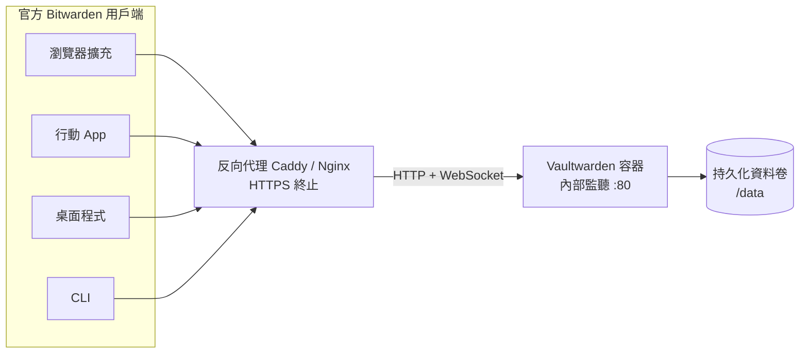
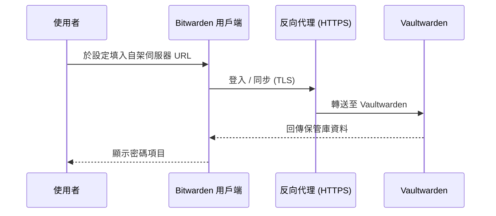

# Vaultwarden 的安裝與使用指南

## 摘要

Vaultwarden 是一套以 Rust 撰寫、非官方的 Bitwarden 相容伺服器實作，前身為 bitwarden_rs。它實作了 Bitwarden 用戶端 API 的絕大部分功能，讓官方的 Bitwarden 瀏覽器擴充、行動 App、桌面程式與命令列工具都能連線使用，特別適合資源有限的個人或小型自架環境[^repo]。本報告說明其原理、安裝方式（以 Docker 為主）、組態設定、HTTPS 與反向代理、用戶端連線、備份與安全強化等實務面向。

## 1. Vaultwarden 是什麼

Vaultwarden 是 Bitwarden 用戶端 API 的替代伺服器實作，以 Rust 撰寫，官方描述為「Unofficial Bitwarden compatible server written in Rust, formerly known as bitwarden_rs」[^repo]。專案的目標是提供一套輕量、可在低資源環境運作的自架伺服器，以取代官方 Bitwarden 伺服器較為耗費資源的部署方式[^repo]。

需要特別注意的是，Vaultwarden **與 Bitwarden, Inc. 沒有關聯**。專案明確聲明與官方無關，且其錯誤回報與功能請求應送至 Vaultwarden 專案本身，而非官方 Bitwarden 的支援管道[^repo]。專案採用 AGPL-3.0 授權[^repo]。

### 1.1 專案概況

| 項目 | 內容 |
| --- | --- |
| 官方描述 | 以 Rust 撰寫、非官方的 Bitwarden 相容伺服器，前身為 bitwarden_rs[^repo] |
| 授權 | AGPL-3.0[^repo] |
| 主要語言 | Rust（核心伺服器邏輯）、Handlebars（樣板）、TypeScript、Shell 等[^repo] |
| 目前穩定版 | 1.37.5（2026-11-01 發布），內含 Web Vault v2026.10.1[^release] |
| 熱門程度 | GitHub 上約 71.3k 顆星、約 3.5k 次 fork[^repo] |

### 1.2 支援的功能

Vaultwarden 自稱是 Bitwarden Client API 的「近乎完整」實作，針對個人、家庭與小型組織的自架需求而設計[^repo]。主要支援的功能包括[^repo]：

- **個人保管庫**：項目、資料夾、記事、身分、信用卡等。
- **Send**：安全的文字或檔案分享。
- **附件（Attachments）**：保管庫項目的檔案附件。
- **網站圖示（Website icons）**：抓取並快取 favicon。
- **個人 API 金鑰（Personal API Key）**。
- **組織（Organizations）**：集合（Collections）、密碼共享、成員角色、群組、事件記錄、管理員密碼重設、目錄連接器（Directory Connector / LDAP、AD 同步）與政策（Policies）。
- **多因素與雙因素驗證**：Authenticator（TOTP）、Email 2FA、FIDO2 WebAuthn、YubiKey、Duo。
- **緊急存取（Emergency Access）**。
- **Vaultwarden 管理後台**（Web 管理頁面）。
- **內附修改過的 Web Vault 用戶端**[^repo]。

### 1.3 與官方 Bitwarden 的差異

以下為自架情境下需留意的差異與限制：

1. **雲端服務**：Vaultwarden 僅供自架，沒有官方的雲端（SaaS）版本[^repo]。
2. **部分進階功能**：雖然 Vaultwarden 免費提供許多在官方屬於付費的功能（如 TOTP、Send、緊急存取），但部分較新的企業級功能可能落後或尚未實作[^repo]。
3. **API 相容性持續追趕**：Vaultwarden 需不斷跟上 Bitwarden 最新的 API 變更與 Web Vault 版本，版本說明中可見持續為新版 Web Vault 進行相容性修補[^release]。
4. **不提供行動／桌面 App**：Vaultwarden 僅是伺服器端，須完全依賴官方的 Bitwarden 用戶端連線[^repo]。
5. **規模定位**：使用 SQLite（或 MySQL、PostgreSQL），設計上針對個人、家庭與小型組織，並非為企業級大規模部署而設計[^repo]。

> 提醒：Vaultwarden 的最新版不一定能與最新版 Web Vault 向前相容，升級前建議留意版本說明[^gettingstarted]。

## 2. 系統架構

Vaultwarden 以單一服務的形式運行，資料持久化於掛載的資料目錄中。使用時通常在其前方放置一個反向代理伺服器負責 TLS（HTTPS）終止，再由多種官方 Bitwarden 用戶端連線。



## 3. 安裝方式

Vaultwarden 提供多種安裝途徑，官方 wiki 記載主要分為六類[^gettingstarted]：

1. **Docker（直接 `docker run`）**：主要且建議的方式。
2. **Docker Compose**：適合多容器（例如搭配反向代理）的部署。
3. **Podman**：無守護程序的 Docker 替代方案，支援 Quadlet（Podman 4.4 以上）。
4. **預先建置的二進位檔**：由官方 Alpine 基礎映像中取出（Vaultwarden 不另外提供獨立下載的二進位檔）。
5. **Arch Linux 官方套件庫**：`extra` 中提供 `vaultwarden` 與 `vaultwarden-web`。
6. **第三方套件**：Debian、Fedora、Gentoo、NixOS、FreeBSD、Void Linux、Snap、RHEL/CentOS 等，皆為社群維護，可能落後於官方版本。

### 3.1 前置準備

無論採用哪種方式，首要工作是建立一個持久化資料目錄，並將其掛載至容器內的 `/data`[^gettingstarted]。

```bash
mkdir /vw-data
```

若系統為 RHEL/Fedora 等啟用 SELinux 的環境，需先設定檔案的安全脈絡，否則容器無法寫入該目錄[^gettingstarted]：

```bash
semanage fcontext -a -t svirt_sandbox_file_t '/vw-data(/.*)?'
restorecon -Rv /vw-data
```

### 3.2 使用 Docker

最基本的啟動指令如下[^gettingstarted]：

```bash
docker run -d --name vaultwarden -v /vw-data/:/data/ -p 80:80 vaultwarden/server:latest
```

也可以綁定特定 IP[^gettingstarted]：

```bash
docker run -d --name vaultwarden -v /vw-data/:/data/ -p 192.168.0.2:80:80 vaultwarden/server:latest
```

`-v /vw-data/:/data/` 將宿主機目錄掛載為容器的資料目錄，所有持久資料（如 db.sqlite3、設定檔、RSA 金鑰、附件、Send 與圖示快取）都存放於此[^gettingstarted][^config]。

### 3.3 使用 Docker Compose

不使用反向代理時，最小化的 Compose 檔如下[^compose]：

```yaml
# compose.yml
services:
  vaultwarden:
    image: vaultwarden/server:latest
    container_name: vaultwarden
    restart: always
    environment:
      # DOMAIN: "https://vaultwarden.example.com"  # 使用反向代理時必填
      SIGNUPS_ALLOWED: "true"
    volumes:
      - ./vw-data:/data
    ports:
      - 11001:80
```

啟動與更新[^compose]：

```bash
docker compose up -d && docker compose logs -f
```

```bash
docker compose pull && docker compose up -d && docker compose logs -f
```

wiki 亦提供搭配 **Caddy**（含 HTTP challenge 與 DNS challenge 兩種設定）的完整 Compose 範例[^compose]。

### 3.4 使用 Podman

Podman 提供非 root 與 root 兩種範例。非 root 因無法綁定 1024 以下的特權埠，需更改 `ROCKET_PORT` 並對應較高的埠[^gettingstarted][^podman]：

```bash
# 非 root
podman run -d --name vaultwarden -v /vw-data/:/data/:Z -e ROCKET_PORT=8080 -p 8080:8080 vaultwarden/server:latest
```

```bash
# root
sudo podman run -d --name vaultwarden -v vw-data:/data/:Z -p 80:80 vaultwarden/server:latest
```

`/data/:Z` 中的 `:Z` 用於 SELinux 重新標記[^gettingstarted][^podman]。

### 3.5 預先建置二進位檔與發行版套件

Vaultwarden 不提供獨立的二進位檔下載，官方的預先建置二進位檔是由 Alpine 基礎映像中取出[^binaries]。Arch Linux 使用者可直接透過官方套件庫安裝 `vaultwarden` 與 `vaultwarden-web`[^gettingstarted]。其他發行版的套件多由社群維護，可能落後於最新版本，官方建議使用者留意新版本發布並在落後時聯絡維護者[^gettingstarted]。

## 4. 組態設定

### 4.1 設定來源與優先順序

Vaultwarden 的組態有三種來源，優先順序由高至低為[^config]：

1. **`config.json`**（透過 `/admin` 管理頁面產生與編輯）——**覆蓋所有其他來源**。
2. **環境變數**（建議使用）。
3. **`.env` 檔**（`ENV_FILE`，預設讀取工作目錄下的 `.env`）。

另有一項機制：在任一組態選項後加上 `_FILE` 可從檔案讀取值，例如 `SMTP_PASSWORD_FILE=/run/secrets/smtp_password`，適合搭配 Docker secrets 使用[^config]。

> 建議：以環境變數或 `.env` 管理組態。若曾透過管理頁面儲存 `config.json`，之後再以環境變數修改同一選項將無效，需刪除或更名 `config.json` 並重啟[^config]。

### 4.2 常用環境變數

| 變數 | 預設值 | 說明 |
| --- | --- | --- |
| `DOMAIN` | （未設定） | 執行個體的基底 URL，例如 `https://bitwarden.example.com`。未設定會導致附件下載、信件連結、U2F/WebAuthn 等功能異常[^config][^envtemplate] |
| `DATA_FOLDER` | `data` | 主資料目錄，存放 `db.sqlite3`、`config.json`、`rsa_key`、圖示快取、附件、Send 等[^config] |
| `DATABASE_URL` | `sqlite://data/db.sqlite3` | 資料庫連線字串，支援 SQLite、MySQL、PostgreSQL[^config][^envtemplate] |
| `SIGNUPS_ALLOWED` | `true` | 是否允許新使用者註冊[^config] |
| `INVITATIONS_ALLOWED` | `true` | 是否允許組織管理員邀請使用者，即使已關閉註冊[^config] |
| `SIGNUPS_DOMAINS_WHITELIST` | （未設定） | 以逗號分隔的網域清單，這些網域的信箱即使 `SIGNUPS_ALLOWED=false` 仍可註冊[^config] |
| `ADMIN_TOKEN` | （未設定，管理頁面停用） | 存取 `/admin` 管理頁面的密碼，建議使用 `vaultwarden hash` 產生的 Argon2 PHC 字串[^config][^envtemplate] |
| `ROCKET_PORT` | `8000`（容器內為 `80`） | HTTP 伺服器監聽埠，屬於 Rocket 框架設定，無法透過 `config.json` 設定[^config] |
| `ENABLE_WEBSOCKET` | `true` | 啟用 WebSocket 即時通知，讓用戶端之間即時同步[^config] |
| `SHOW_PASSWORD_HINT` | `false` | 未設定 SMTP 時是否在網頁上顯示密碼提示，不建議在公開執行個體開啟[^config] |

### 4.3 SMTP（電子郵件）

SMTP 用於寄送邀請、驗證與密碼提示等信件，相關變數如下[^config][^envtemplate]：

| 變數 | 預設值 | 說明 |
| --- | --- | --- |
| `SMTP_HOST` | （未設定） | SMTP 伺服器主機名稱，例如 `smtp.gmail.com` |
| `SMTP_FROM` | （未設定） | 寄件者位址 |
| `SMTP_FROM_NAME` | `Vaultwarden` | 寄件者顯示名稱 |
| `SMTP_PORT` | `587`（starttls）、`465`（force_tls）、`25`（off） | SMTP 埠號 |
| `SMTP_SECURITY` | `starttls` | 加密模式：`starttls`、`force_tls`、`off` |
| `SMTP_USERNAME` | （未設定） | 認證帳號（若伺服器不需登入可留空） |
| `SMTP_PASSWORD` | （未設定） | 認證密碼（設定 `SMTP_USERNAME` 時必填） |
| `SMTP_TIMEOUT` | `15` | 逾時秒數 |

另有 `SMTP_AUTH_MECHANISM`、`SMTP_EMBED_IMAGES`、`SMTP_DEBUG`、`SMTP_ACCEPT_INVALID_CERTS`、`SMTP_ACCEPT_INVALID_HOSTNAMES` 等進階選項[^envtemplate]。

### 4.4 管理後台（`/admin`）

管理後台提供圖形化的組態編輯、使用者管理與診斷功能。使用步驟[^adminpage][^config]：

1. 設定 `ADMIN_TOKEN`，建議以內建的 `vaultwarden hash` 指令產生 Argon2 PHC 字串，而非使用明碼。
2. 瀏覽至 `https://你的網域/admin`（或 `http://localhost:8000/admin`）。
3. 以 `ADMIN_TOKEN` 的值作為密碼登入。
4. 管理員工作階段以 JWT 認證，預設有效期為 **20 分鐘**（可由 `ADMIN_SESSION_LIFETIME` 調整）。
5. 若要讓所有管理員工作階段失效，刪除 `DATA_FOLDER` 中的 `rsa_key.pem` 並重啟。
6. 若要完全停用管理頁面，確保 `ADMIN_TOKEN` 與 `DISABLE_ADMIN_TOKEN` 皆未設定，且 `config.json` 中沒有 `admin_token` 鍵[^adminpage]。

`/admin/diagnostics` 頁面則提供三項用途：蒐集基本資訊以定位組態錯誤、檢查是否有新版本可更新，以及產生「Support String」（自動彙整最重要的系統與組態資訊，方便貼到議題追蹤或支援論壇）[^config]。

## 5. HTTPS 與反向代理

### 5.1 為何必須使用 HTTPS

Vaultwarden 實際上**要求**使用 HTTPS，因為 Bitwarden Web Vault 依賴瀏覽器的 Web Crypto API（`SubtleCrypto`），而多數瀏覽器僅在安全脈絡（HTTPS）下提供這些 API[^https]。官方警告：**請勿在未使用 HTTPS 的情況下將 Vaultwarden 暴露於網際網路**，否則行動 App 與瀏覽器用戶端將無法正常運作[^https]。行動 App 亦可能在 OCSP stapling 設定不當時出現 `Chain validation failed` 錯誤[^https]。

### 5.2 兩種啟用方式

1. **（建議）反向代理**：於代理層終止 TLS，Vaultwarden 內部以純 HTTP 監聽。官方建議：若不熟悉反向代理且沒有偏好，可優先考慮 **Caddy**[^https]。
2. **（不建議）Rocket 內建 HTTPS**：以 `ROCKET_TLS` 環境變數啟用。官方指出此方式「相對不成熟且受限」，僅支援 RSA 憑證（不支援 ECC/ECDSA），且憑證檔必須包含完整鏈（需使用 `fullchain.pem` 而非 `cert.pem`）[^https]。安全強化指南亦建議不要在生产環境使用內建的 Rocket TLS（缺乏嚴格 SNI）[^hardening]。

### 5.3 支援的反向代理

官方 wiki 提供多種反向代理的範例組態[^https]：

| 反向代理 | 是否提供範例 | 備註 |
| --- | --- | --- |
| Caddy 2.x | 是 | 對新手首選，內建 ACME/Let's Encrypt 自動 HTTPS[^https] |
| Nginx | 是 | 含 upstream keepalive、WebSocket map、HTTP→HTTPS 轉址[^https] |
| Apache | 是 | 以 `ProxyPass` 搭配 `upgrade=websocket`[^https] |
| Traefik v2 | 是 | 以 Docker Compose labels 設定轉址與 TLS[^https] |
| HAproxy | 是 | frontend/backend 組態[^https] |
| lighttpd | 是 | 含子路徑範例[^https] |
| Pound | 是 | 有列出[^https] |
| Cloudflare Tunnel（cloudflared） | 是 | 含 Compose 與 config.yml 範例[^https] |
| Istio（k8s） | 是 | 含 Gateway 與 VirtualService 範例[^https] |

### 5.4 Caddy 範例

Caddy 會自動處理 HTTPS 與憑證，`reverse_proxy` 亦會自動處理 WebSocket 升級，無需額外設定[^https]：

```caddy
{$DOMAIN} {
    log {
        level INFO
        output file {$LOG_FILE} {
            roll_size 10MB
            roll_keep 10
        }
    }

    encode zstd gzip

    reverse_proxy 127.0.0.1:8000 {
        header_up X-Real-IP {remote_host}
    }
}
```

`header_up X-Real-IP` 用於傳遞真實用戶端 IP，讓 Vaultwarden 記錄正確來源（例如供 fail2ban 使用）[^https]。

### 5.5 Nginx 範例

Nginx 需以 `map` 指令明確定義 WebSocket 升級所需的標頭[^https]：

```nginx
upstream vaultwarden-default {
    zone vaultwarden-default 64k;
    server 127.0.0.1:8000;
    keepalive 2;
}

map $http_upgrade $connection_upgrade {
    default upgrade;
    ''      "";
}

server {
    listen 80;
    listen [::]:80;
    server_name vaultwarden.example.tld;
    return 301 https://$host$request_uri;
}

server {
    listen 443 ssl;
    listen [::]:443 ssl;
    http2 on;
    server_name vaultwarden.example.tld;

    # ssl_certificate     /path/to/fullchain.pem;
    # ssl_certificate_key /path/to/privkey.pem;

    client_max_body_size 525M;

    proxy_http_version 1.1;
    proxy_set_header Upgrade $http_upgrade;
    proxy_set_header Connection $connection_upgrade;

    proxy_set_header Host $host;
    proxy_set_header X-Real-IP $remote_addr;
    proxy_set_header X-Forwarded-For $proxy_add_x_forwarded_for;
    proxy_set_header X-Forwarded-Proto $scheme;

    location / {
        proxy_pass http://vaultwarden-default;
    }
}
```

若缺少 WebSocket 標頭設定，Vaultwarden 的即時通知（`/notifications/hub`）將無法透過 Nginx 運作[^https]。

## 6. 用戶端連線與使用

Vaultwarden 本身不提供用戶端，須使用官方的 Bitwarden 用戶端（瀏覽器擴充、行動 App、桌面程式、CLI）連線[^repo]。由於它實作了 Bitwarden Client API，官方用戶端可與之相容[^repo]。連線時需將用戶端的伺服器網址改為自架的執行個體位址（在用戶端的設定中選擇自架/self-hosted 環境並填入 `DOMAIN` 對應的 URL）。整個連線流程可簡示如下：



> 注意：本節所述「在用戶端中更改伺服器 URL」為官方 Bitwarden 用戶端的既有功能；關於各用戶端確切的設定項目名稱與步驟，建議以官方客戶端與 Vaultwarden 官方 wiki 的最新說明為準。

## 7. 備份

備份是自架密碼管理服務最關鍵的維運工作。需要備份的項目與建議如下[^backup]：

| 項目 | 必要性 | 說明 |
| --- | --- | --- |
| `data/db.sqlite3` | 必要 | 主資料庫，存放保管庫內容與使用者／組織中介資料[^backup] |
| `data/db.sqlite3-wal` | 視情況 | 僅在直接複製檔案時需要，需與 db 檔成對；使用 `.backup`／`VACUUM INTO` 時不需[^backup] |
| `data/db.sqlite3-shm` | 不需要 | 無須備份或還原[^backup] |
| `data/attachments/` | 必要 | 檔案附件，以個別檔案儲存[^backup] |
| `data/sends/` | 選用 | Send 附件，本質上具時效性[^backup] |
| `data/config.json` | 建議 | 管理頁面組態（內含明碼的管理員權杖、SMTP 認證，建議加密）[^backup] |
| `data/rsa_key.*` | 建議 | JWT 簽章金鑰，遺失將導致所有使用者需重新登入[^backup] |
| `data/icon_cache/` | 選用 | 網站圖示快取，價值不高[^backup] |

### 7.1 執行中或停止後備份

- 使用 SQLite 的 `.backup` 或 `VACUUM INTO` 時，Vaultwarden **可保持運行**，因為 `.backup` 採用 SQLite 的線上備份 API[^backup]。
- 若以檔案層級複製，則應**先停止**服務以確保一致性[^backup]。
- **還原時必須停止** Vaultwarden[^backup]。

### 7.2 建議的備份方法

1. **`sqlite3 .backup`（SQLite 建議做法）**：可在服務運行時安全執行[^backup]。

   ```bash
   sqlite3 data/db.sqlite3 ".backup '/path/to/backups/db-$(date '+%Y%m%d-%H%M').sqlite3'"
   ```

2. **`VACUUM INTO`**：可壓縮空白空間，但耗費較多處理時間[^backup]。

   ```bash
   sqlite3 data/db.sqlite3 "VACUUM INTO '/path/to/backups/db-$(date '+%Y%m%d-%H%M').sqlite3'"
   ```

3. **內建備份指令（v1.32.1 起）**[^backup]：

   ```bash
   docker exec -it vaultwarden /vaultwarden backup
   ```

4. **檔案系統快照／restic／rustic**：適合較大的附件，restic 與 rustic 可避免重複複製未變動的附件資料[^backup]。
5. **Docker stop → zip → scp → restart**：簡單但較原始的做法[^backup]。
6. **雲端儲存**：建議以 rclone 將備份複製到雲端[^backup]。

### 7.3 注意事項

- 官方警告**不建議以檔案系統／VM 快照作為主要備份方式**，因為操作較複雜、出錯機率高，且一般使用者難以在必要時還原[^backup]。
- 還原 `.backup` 或 `VACUUM INTO` 快照時，務必**先刪除既有的 `db.sqlite3-wal`**，否則殘留的 WAL 檔可能在 SQLite 復原時造成資料庫損毀[^backup]。
- 若直接複製 `db.sqlite3`，需連同對應的 `db.sqlite3-wal` 成對還原（`db.sqlite3-shm` 可忽略）[^backup]。
- `config.json`（管理員權杖、SMTP 認證）與 `rsa_key.pem`（JWT 私鑰）皆以明碼儲存，上傳雲端前應加密備份[^backup]。
- 應定期測試還原流程，並保留原始資料副本以免備份無效[^backup]。
- 使用 MySQL/PostgreSQL 者需另行 dump 資料庫，此為 SQLite 導向的 wiki 頁面範疇之外[^backup]。
- 建議以 cron 自動化，至少每日一次；Docker 映像預設不含 `sqlite3` 或 `cron`，需在宿主機執行或於容器啟動時安裝[^backup]。

## 8. 安全強化

Vaultwarden 官方提供強化指南，以下是主要建議[^hardening]：

1. **關閉註冊與邀請**：建立第一個帳號後即關閉公開註冊（`SIGNUPS_ALLOWED=false`），並視情況關閉使用者互邀（`INVITATIONS_ALLOWED=false`）[^hardening]。
2. **關閉密碼提示**：設定 `SHOW_PASSWORD_HINT=false`，避免登入頁顯示提示而助長暴力破解或猜測[^hardening]。
3. **使用 Argon2 管理員權杖**：以 `vaultwarden hash` 產生 Argon2 雜湊作為 `ADMIN_TOKEN`，而非明碼[^hardening]。
4. **以反向代理提供 HTTPS**：不要使用內建的 Rocket TLS，改用 Nginx、Caddy、Traefik 等進行 TLS 終止，並確保嚴格 SNI，使執行個體僅能透過你的網域存取（而非 IP），避免被 Shodan 等掃描發現[^hardening]。
5. **保護 `/admin` 管理頁面**：維持強固的 `ADMIN_TOKEN`，並可在反向代理層額外限制 `/admin`（例如 IP 白名單或 HTTP Basic 認證）[^hardening]。
6. **限制組織建立（`ORG_CREATION_USERS`）**：限制哪些使用者可建立組織（或設定為無人可建立）[^hardening]。
7. **啟用雙因素驗證**：為使用者啟用 U2F/FIDO2 WebAuthn 或 YubiKey OTP，即使主密碼遭破解仍可防止帳號被盜[^hardening]。
8. **以 fail2ban 減緩暴力破解**：在多次登入失敗後封鎖來源 IP，尤其在未使用 2FA 時更為重要[^hardening]。
9. **Docker 以非 root 使用者執行**：預設容器以 root 執行，可以 `docker run -u 1000:1000` 或 Compose 的 `user: 1000:1000` 改為非 root；Podman 使用 `--userns keep-id`。僅掛載必要資料，切勿掛載 `/var/run/docker.sock` 或整個家目錄，憑證等可唯讀掛載（`:ro`）[^hardening]。
10. **日誌遮蔽敏感資訊**：存取日誌可能包含 WebSocket 通知 URL 中的 `access_token`（JWT），若日誌外送（如 Prometheus/Promtail），應在反向代理層遮蔽 `access_token` 的值[^hardening]。
11. **縱深防禦**：可將 Vaultwarden 架於不顯眼的子路徑（例如 `example.com/bitwarden/<secret>`），作為額外的一層遮蔽（但不可視為主要防護）[^hardening]。

## 9. 更新流程

Docker 部署的更新方式為拉取新映像並重建容器[^compose]：

```bash
docker compose pull && docker compose up -d && docker compose logs -f
```

更新前建議先備份（見第 7 節），並留意 Vaultwarden 與 Web Vault 版本的相容性，因為最新版 Vaultwarden 不一定與最新版 Web Vault 向前相容[^gettingstarted]。

## 10. 結論

Vaultwarden 以 Rust 撰寫、輕量且相容於官方 Bitwarden 用戶端，是個人、家庭與小型組織自架密碼管理服務的實用選擇。典型部署為：以 Docker 掛載持久化資料目錄運行 Vaultwarden，前方加上 Caddy 或 Nginx 等反向代理提供 HTTPS 與 WebSocket，並以官方 Bitwarden 用戶端連線使用。導入後的首要任務是關閉公開註冊、設定 Argon2 管理員權杖、啟用雙因素驗證與 fail2ban，並建立可靠且經測試的備份流程[^hardening][^backup]。

值得注意的是，Vaultwarden 與官方 Bitwarden 無關聯，部分較新的企業級功能可能尚未支援，且其 API 相容性需持續追趕官方變更[^repo][^release]。在採用前應評估此一維護特性是否符合自身需求。

## 參考資料

[^repo]: Vaultwarden. (n.d.). *Unofficial Bitwarden compatible server written in Rust, formerly known as bitwarden_rs*. GitHub. Retrieved 2026-11-24, from https://github.com/dani-garcia/vaultwarden

[^release]: Vaultwarden. (2026-11-01). *Release 1.37.5*. GitHub. Retrieved 2026-11-24, from https://github.com/dani-garcia/vaultwarden/releases/tag/1.37.5

[^gettingstarted]: Vaultwarden. (n.d.). *Getting started / Starting a container*. GitHub Wiki. Retrieved 2026-11-24, from https://github.com/dani-garcia/vaultwarden/wiki/Starting-a-Container

[^compose]: Vaultwarden. (n.d.). *Using Docker Compose*. GitHub Wiki. Retrieved 2026-11-24, from https://github.com/dani-garcia/vaultwarden/wiki/Using-Docker-Compose

[^podman]: Vaultwarden. (n.d.). *Using Podman*. GitHub Wiki. Retrieved 2026-11-24, from https://github.com/dani-garcia/vaultwarden/wiki/Using-Podman

[^binaries]: Vaultwarden. (n.d.). *Pre-built binaries*. GitHub Wiki. Retrieved 2026-11-24, from https://github.com/dani-garcia/vaultwarden/wiki/Pre-built-binaries

[^config]: Vaultwarden. (n.d.). *Configuration overview*. GitHub Wiki. Retrieved 2026-11-24, from https://github.com/dani-garcia/vaultwarden/wiki/Configuration-overview

[^envtemplate]: Vaultwarden. (n.d.). *.env.template*. GitHub. Retrieved 2026-11-24, from https://raw.githubusercontent.com/dani-garcia/vaultwarden/main/.env.template

[^adminpage]: Vaultwarden. (n.d.). *Enabling the admin page*. GitHub Wiki. Retrieved 2026-11-24, from https://github.com/dani-garcia/vaultwarden/wiki/Enabling-admin-page

[^https]: Vaultwarden. (n.d.). *Enabling HTTPS*. GitHub Wiki. Retrieved 2026-11-24, from https://github.com/dani-garcia/vaultwarden/wiki/Enabling-HTTPS

[^backup]: Vaultwarden. (n.d.). *Backing up your vault*. GitHub Wiki. Retrieved 2026-11-24, from https://github.com/dani-garcia/vaultwarden/wiki/Backing-up-your-vault

[^hardening]: Vaultwarden. (n.d.). *Hardening Guide*. GitHub Wiki. Retrieved 2026-11-24, from https://github.com/dani-garcia/vaultwarden/wiki/Hardening-Guide

## 來源評估與批判性反思

- **來源權威性**：本報告主要依據 Vaultwarden 官方 GitHub 儲存庫、官方 wiki 與其 `.env.template`，屬於一手來源，權威性高[^repo][^config][^envtemplate]。這些文件由專案維護者撰寫與更新。
- **時效性**：專案更新頻繁，最新穩定版為 2026-11-01 發布的 1.37.5，且釋出後仍有後續提交[^release]。使用者應以官方最新文件為準，本報告的版本資訊可能隨時間變動。
- **利益與偏見**：官方 wiki 以推廣與教學該專案為目的，對於自身限制（例如與官方 Bitwarden 的功能落差、內建 TLS 不成熟）雖有提及，但不會強調競品（官方 Bitwarden 伺服器）的優勢[^repo][^https]。讀者若在兩者之間抉擇，宜另尋中立比較來源。
- **佐證與一致性**：安裝方式、組態變數與備份建議同時在 repo、wiki 與 `.env.template` 中互相呼應，一致性良好[^config][^envtemplate][^gettingstarted]。
- **已知限制**：第三方發行版套件由社群維護、可能落後於官方發布，官方已明確提醒[^gettingstarted]。本報告未逐一驗證各第三方套件的狀態。
- **未能取得之來源**：`https://vaultwarden.community/` 於撰寫時無法透過 DNS 解析而未能取得內容，故本報告未引用該站資訊。
