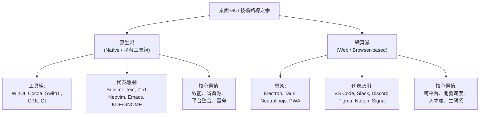
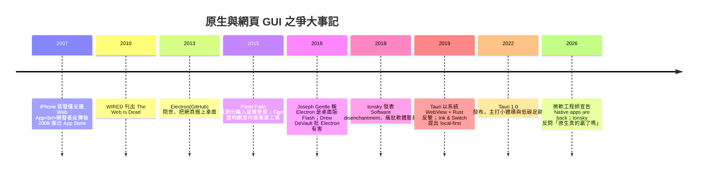

# 桌面 GUI 應該 Native 還是 Web/Browser-based？開源與軟體工程圈的「大作戰」

## 摘要

在開源圈與軟體工程圈中，確實存在一場關於「桌面圖形介面（GUI）應該用平台原生工具組，還是用瀏覽器／網頁技術」的長期論戰。這場爭論至少延續了二十年，每隔數年就會因為新技術（Electron、WebAssembly、PWA、Tauri、React Native）而重新點燃一次[^timeline]。

兩派的核心分歧可濃縮為一句話：**「成本要轉嫁給使用者，還是轉嫁給開發者？」**[^tension]

- **原生派（native）**主張最佳化「使用者的體驗」：啟動快、記憶體省、能與作業系統深度整合、尊重電池、軟體壽命長。代價由開發者承擔（多份程式碼、較慢的迭代、較小的人才庫）。
- **網頁派（web / browser-based）**主張最佳化「開發者的速度與觸及範圍」：一次開發、跨平台發布、即時迭代、可從最大的人才庫招聘、享受最豐富的生態系。代價由使用者承擔（啟動較慢、記憶體較多、與平台整合較差）。

## 一、為什麼會有這場爭論？

桌面應用程式的 GUI 有兩條技術路線：

1. **原生工具組**：直接呼叫作業系統提供的繪圖與元件 API，例如 Windows 的 Win32/WinUI、macOS 的 Cocoa/AppKit/SwiftUI、Linux 的 GTK 或 Qt。程式通常編譯為原生機器碼，畫面由系統或工具組直接繪製。
2. **網頁／瀏覽器技術**：以 HTML／CSS／JavaScript 描述介面，交由一個瀏覽器引擎（Chromium、WebKit、Gecko）繪製。封裝成桌面應用的常見形式是 Electron（內嵌整套 Chromium）、Tauri（改用系統內建 WebView）、或 Neutralinojs 等[^electron][^tauri]。

爭論之所以激烈，是因為兩種路線在「效能、資源、整合度、開發成本、生態系」等多個維度上互有勝負，而且這些維度的權重取決於產品性質（一個聊天軟體 vs 一個影片剪輯器），因此很難有放諸四海皆準的答案。

## 二、原生派的論點

### 1. 記憶體與磁碟膨脹

網頁派應用最大的原罪是「每個應用都綁進一整套瀏覽器引擎」。Joseph Gentle 在 2016 年的名文〈Electron is flash for the desktop〉中指出，下載 Slack 等同於「下載一整套 Google Chrome」，而 Chrome 當時約有 1,500 萬行非註解程式碼，其中「99% 的程式碼都藏在水面下」[^josephg]。

具體數字相當驚人。Gentle 實測 Slack 閒置時佔用「300 MB 到 1 GB 的記憶體」，一個純文字聊天程式不該如此；磁碟上則是 160 MB，「大約是 70 份未壓縮《魔戒》的大小」[^josephg]。微軟工程師 David Fowler 於 2026 年公開表示「原生應用回來了」，並援引實測：WhatsApp 在 8 GB 記憶體的機器上「什麼都不做就佔用 600 MB」，而 Electron 製的 Discord「可佔用高達 4 GB 記憶體」[^winlatest]。

### 2. CPU 空轉與電池續航

Gentle 指出，閒置的 Electron 應用仍持續喚醒 CPU：「電源管理最怕的就是那些持續用掉幾個百分點 CPU 的程式。它們讓 CPU 不斷醒來、睡去、又醒來，這是燒掉寶貴電池續航最完美的方式。」[^josephg]

### 3. 效能、啟動時間與輸入延遲

原生派最有力的實證來自 Pavel Fatin 於 2015 年以自製工具 Typometer 對各家文字編輯器做的延遲量測。在 Windows、空白文字檔的理想條件下，平均輸入延遲為[^fatin]：

| 編輯器 | 架構 | 平均延遲 (ms) | 最大延遲 (ms) |
|---|---|---|---|
| GVim | 原生 (C) | 0.9 | 1.2 |
| Emacs | 原生 (C) | 5.3 | 19.2 |
| Sublime Text | 原生 (C++) | 8.2 | 35.2 |
| Atom | Electron / 網頁 | 49.4 | 85.5 |

Atom（Electron 製）是最慢的，平均約 50 ms，最大達 85 ms；GVim 最快，低於 1 ms。Fatin 的結論是：「編輯器並非生而平等（至少從延遲的角度來看）。」執行於虛擬機上的編輯器（Atom 跑在 Chrome runtime、IntelliJ IDEA 跑在 JVM）普遍較慢且抖動（jitter）更大[^fatin]。

在 IDE／編輯器領域，LogRocket 於 2026 年的一篇分析指出 VS Code 的效能問題「並非實作不良或缺少最佳化，而是來自根本的架構選擇」：它以 Electron 綁進 Chromium 與 Node.js，聲稱平均專案下佔用約 600 MB RAM、約 500 MB 磁碟，而 Rust 原生的 Zed 約 90 MB RAM（約為 VS Code 的六分之一），並透過 GPUI 框架直接使用 Vulkan／Metal／DirectX 做硬體加速繪製[^logrocket]。該文甚至下結論：「VS Code 這種混合式架構長期而言無法存續，因為它過度且不道德地消耗資源。」[^logrocket]

### 4. 外觀、手感與作業系統整合

Drew DeVault（Sway、wlroots、SourceHut 作者）在 2016 年的〈Electron considered harmful〉中條列選擇 Electron 的代價：「你會得到：一整套跟著你出貨的 Chromium；一個看起來、感覺起來都跟使用者作業系統其他部分格格不入的介面；以及市面上最慢、最沒效率、最不優雅的 GUI 應用平台之一。」[^devault]

由於網頁應用自繪所有元件，而非使用平台原生工具組，常見抱怨包括：字型、間距與度量不對；鍵盤導覽模式不同；無法整合原生無障礙樹；缺少平台特有行為（如 Exposé、視窗管理手勢）[^devault]。

### 5. 開發者的怠惰與工藝

DeVault 的批評措辭最為嚴厲：「人們選擇 Electron，是因為他們**太懶**，不願學習正確的工具。這是開發者最糟糕的特質。老天，你是個工程師！他媽的表現得像一個！」[^devault] 這句話成為原生派最常被引用的戰吼之一。

### 6. 壽命與可攜性

tonsky 在〈Software disenchantment〉中提出結構性論點：「一個 DOS 程式幾乎可以在自 1980 年代以來製造的任何電腦上原封不動地執行。一個 JavaScript 應用可能因為明天的 Chrome 更新就壞掉。」[^tonsky2018]

### 7. 環境成本

Tauri 團隊在 1.0 版發布文（2022）中以表格量化應用大小與碳排放的關係：採用其方法論（傳輸 1 GB 資訊 = 0.1 kWh = 0.06 kg CO₂），一個 600 MB 的應用若被下載 1,000 萬次，將產生約 360,000 kg CO₂，約需 2,160 棵樹一年才能吸收；相較之下 3 MB 的應用只需 1,800 kg CO₂ 與 12 棵樹[^tauri1]。原文寫道：「你做的應用精簡且高效，能減少電力、儲存空間與自然資源的消耗。省下的每一個位元，都是一片能繼續生長的葉子。」[^tauri1]

## 三、網頁派的論點

### 1. 單一程式碼庫、跨平台發布

這是最實際、最難反駁的一點。VS Code、Slack、Discord、Figma、Notion、Signal、WhatsApp Desktop 全都以**同一份程式碼**發布到 Windows、macOS 與 Linux，不需要為每個平台各養一組 SwiftUI、WinUI、GTK 團隊[^winlatest][^slack]。Drew DeVault 的批評者也會指出：若沒有 Electron，這批應用「根本不會存在」——在 Electron 出現前，願意投入跨平台原生桌面開發的團隊寥寥無幾。

### 2. 與網頁版共用程式碼

若產品本來就有網頁版（多數 SaaS 都是），桌面版可直接重用大部分前端程式碼，使功能在網頁與桌面同時上線、行為一致。Slack 工程團隊的〈When a rewrite isn't〉即說明他們如何在 Electron 內以 React + Redux 重建桌面客戶端：原本「登入多個工作區時，每個工作區其實是在各自的 Electron 行程中跑一份獨立的網頁客戶端，導致記憶體用量超乎使用者預期」，他們改為單一行程搭配多個 Redux store，因而大幅降低記憶體[^slack]。

### 3. 開發者生產力與人才庫

網頁技術（HTML／CSS／JavaScript／React）的開發者數量遠多於 Qt、Cocoa、SwiftUI、WPF 專家。對新創與沒有平台專才的公司而言，用網頁技術開發桌面應用能以現有人才快速出貨。這是「開發者經濟學」的核心論點[^logrocket]。

### 4. 快速迭代與部署

網頁技術支援熱重載、即時預覽與完整的網頁開發工具鏈。Slack 的整個策略就是「漸進式發布」：隨著程式碼現代化，功能一完成就立刻釋出給使用者，而不必等待一次高風險的大改版[^slack]。

### 5. CSS 佈局與生態系

CSS 的 Flexbox 與 Grid 被視為當今最成熟的宣告式佈局系統之一，在響應式排版、對齊、動畫等方面不遜於原生工具組；而 npm 是世界上最大的套件註冊庫，任何圖表、UI 元件、狀態管理方案都唾手可得，原生生態系（NuGet、CocoaPods 等）相對小得多[^logrocket]。

### 6. 免於平台廠商的控制

從更廣的「網路 vs 原生平台」視角，網頁派主張瀏覽器是唯一真正開放的發布管道：沒有公司能封鎖你的應用、抽成 30%、或規定你只能用哪些技術。這條脈絡可追溯到 2010 年 WIRED 的〈The Web Is Dead. Long Live the Internet〉所描述的「圍牆花園」焦慮[^wired]。

### 7. 效能可以被工程追平

Figma 是網頁派最強的反例。Evan Wallace 在 2015 年的〈Building a professional design tool on the web〉中坦言，要在瀏覽器上做到專業級效能「真的很難；我們基本上是在瀏覽器裡又造了一個瀏覽器」，但結果證明可行[^figma]。Figma 的關鍵在於用 WebAssembly（由 C++ 編譯）承擔運算密集的渲染工作，同時保留網頁「免安裝、即時更新」的散布優勢。

## 四、量化比較一覽

| 維度 | 網頁派（Electron / VS Code） | 原生派（Sublime / Zed / Neovim / Qt） |
|---|---|---|
| 記憶體 | 約 600 MB（平均專案）[^logrocket] | 約 20–90 MB[^logrocket] |
| 啟動時間 | 約 1–3 秒 | 約 100–300 ms |
| 輸入延遲 | Atom 約 50 ms[^fatin] | GVim 約 0.9 ms、Emacs 約 5.3 ms[^fatin] |
| 磁碟 | 約 150–500 MB／應用 | 約 1–60 MB／應用 |
| 無障礙 | 需經 ARIA／HTML 中介層，易有缺漏 | 直接使用系統無障礙 API |
| 跨平台 | 一份程式碼通吃 | 需各平台分別開發 |
| 迭代速度 | 極快（熱重載、即時更新） | 需編譯，較慢 |
| 人才庫 | 極大（網頁開發者） | 較小（Qt／原生專才） |

（表中啟動時間與磁碟數字為社群常見估計，未逐一取得同級實測來源，僅供量級參考。）

## 五、歷史脈絡

## 六、近期的擺盪：鐘擺盪回原生？

近幾年出現明顯的「反網頁、回原生」訊號：

- **Tauri**（2019 起，GitHub 約 11.3 萬星）以系統內建 WebView 取代綁入 Chromium，改用 Rust 後端，二進位檔從 Electron 的約 150 MB 縮到約 600 KB 等級，並主打安全性與環境永續[^tauri][^tauri1]。
- **Flutter**（約 18.1 萬星）、**Compose Multiplatform**（約 1.95 萬星）等跨平台方案選擇「自繪像素」（Skia／Impeller）而非使用 WebView，某種程度上是對「原生渲染」的投票[^stars]。
- **Rust 原生 GUI 生態**興起：egui（約 3.24 萬星）、iced（約 3.21 萬星）、Slint（約 2.47 萬星）等[^stars]。
- **微軟**於 2026 年公開轉向：工程師 David Fowler 宣告「Native apps are back」，並計畫讓 Windows 11 應用「100% 原生」，把開始功能表從 React 改回 WinUI[^winlatest]。
- **Ink & Switch** 的〈Local-first software〉宣言（2019）從資料主權角度支持「回到本地」：主張快、多裝置、可離線、可協作、長壽、隱私、使用者掌控等七項理想，並催生了 CRDT 函式庫與 local-first 社群[^localfirst]。

但同時，網頁派並未退場，Electron 仍有約 12.4 萬星、被大量旗艦應用採用[^stars]，而 tonsky 在 2026 年的〈Claude is an Electron App because we've lost native〉中甚至反過來嘲諷原生派：「就 API 而言，原生應用早就輸給網頁應用了。原生 API 難用得要命，而作業系統廠商無所不用其極地讓你不想去為他們的平台開發原生應用。」他認為如今「原生跟網頁一樣糟，甚至更糟」，一致性的慣例已經瓦解[^tonsky2026]。他甚至指出效能問題的根因不是網頁技術本身：「沒有技術上的理由讓 Slack 為了顯示十個頻道名稱和三則訊息就得載入 80 MiB。問題不在網頁！這是選擇做爛。」

## 七、批判性反思

在閱讀各方文獻時，需注意以下偏向與時效性問題：

1. **情緒化與人身攻擊**：DeVault 的「太懶」與 Gentle 的「Just Say NO」語氣強烈，動機論述（開發者怠惰）難以證偽，讀者應把注意力放在可驗證的技術數據上。
2. **量測的條件依賴性**：輸入延遲、記憶體等數字高度依賴硬體、專案規模與量測方法。Fatin 的數據來自 2015 年，當時的 Chromium 效能與今日已有落差；引用時應標明年代[^fatin]。
3. **利益與立場**：Tauri 的文章在推廣自家產品，自然強調體積與碳排優勢；LogRocket 的文章主題即為「原生替代方案」，對 VS Code 較嚴苛。反之 Electron 官方與 Slack 的文章則從自身產品出發。各方皆有立場，需交叉比對。
4. **「原生 vs 網頁」不是二元對立**：中間存在大量混合路線，如 Tauri（系統 WebView）、React Native（JS 橋接到原生元件）、Flutter（自繪引擎）、WebAssembly（C++ 編譯進瀏覽器）。真正的光譜是「渲染由誰負責、程式碼共用多少」。
5. **2026 年的資料特別多**：多篇關鍵文章（微軟宣告原生回歸、tonsky 的反思）集中於 2026 年，時效新穎但尚未經長期驗證，屬「進行中的事件」，宜視為趨勢訊號而非定論。

## 八、結論

是的，開源與軟體工程圈確實存在一場 GUI「native vs web」之爭，且至今未歇。原生派以**效能、資源、平台整合、軟體壽命、環境成本**為主要論據，網頁派以**跨平台、開發速度、人才庫、生態系、快速迭代**為主要論據。雙方的根本張力在於「把成本轉嫁給使用者還是開發者」。

近年的鐘擺明顯向原生一方傾斜（Tauri、Flutter、Rust GUI、微軟轉向），但網頁派以 Figma、VS Code、WebAssembly 與大量旗艦應用證明其價值仍在。多數務實的結論傾向：**取決於產品性質**，聊天、文書、開發工具等 CRUD／內容型應用適合網頁技術；對延遲、資源、系統整合極度敏感的應用（影像、音訊、系統工具、遊戲）則更適合原生。

## 參考文獻

[^timeline]: 此時間軸綜合自本報告各來源，事件年份見各對應註腳。
[^tension]: 「成本轉嫁」框架為本報告對各方論點的綜合歸納，非單一來源原文。
[^josephg]: Gentle, J. (2016, October 29). *Electron is flash for the desktop*. Retrieved 2026-11-25, from https://josephg.com/blog/electron-is-flash-for-the-desktop/
[^devault]: DeVault, D. (2016, November 24). *Electron considered harmful*. Retrieved 2026-11-25, from https://drewdevault.com/blog/Electron-considered-harmful/
[^tonsky2018]: Prokopov, N. (2018, September 17). *Software disenchantment*. Retrieved 2026-11-25, from https://tonsky.me/blog/disenchantment/
[^tonsky2026]: Prokopov, N. (2026, March 3). *Claude is an Electron App because we've lost native*. Retrieved 2026-11-25, from https://tonsky.me/blog/fall-of-native/
[^fatin]: Fatin, P. (2015, December 20). *Typing with pleasure*. Retrieved 2026-11-25, from https://pavelfatin.com/typing-with-pleasure/
[^logrocket]: Suranga, S. (2026, January 9). *6 fast (native) alternatives for VSCode*. LogRocket Blog. Retrieved 2026-11-25, from https://blog.logrocket.com/native-alternatives-vscode/
[^winlatest]: Naskar, R. (2026, April 29). *Microsoft engineer says native apps are back, and it could finally revive Windows 11's fight against web apps*. Windows Latest. Retrieved 2026-11-25, from https://www.windowslatest.com/2026/04/29/microsoft-engineer-says-native-apps-are-back-and-it-could-finally-revive-windows-11s-fight-against-web-apps/
[^slack]: Christian, M., & Rodgers, J. (2019, July 22; updated 2020, June 23). *When a rewrite isn't: rebuilding Slack on the desktop*. Slack Engineering. Retrieved 2026-11-25, from https://slack.engineering/rebuilding-slack-on-the-desktop/
[^tauri]: Tauri Contributors. (n.d.). *Tauri*. Retrieved 2026-11-25, from https://tauri.app/
[^tauri1]: Thompson-Yvetot, D. (2022, June 19). *Tauri 1.0 Release*. Tauri. Retrieved 2026-11-25, from https://tauri.app/blog/tauri-1-0/
[^figma]: Wallace, E. (2015, December 7). *Building a professional design tool on the web*. Figma. Retrieved 2026-11-25, from https://www.figma.com/blog/building-a-professional-design-tool-on-the-web/
[^localfirst]: Kleppmann, M., Wiggins, A., van Hardenberg, P., & McGranaghan, M. (2019, October). *Local-first software: You own your data, in spite of the cloud*. Ink & Switch. Retrieved 2026-11-25, from https://www.inkandswitch.com/local-first/
[^wired]: Anderson, C., & Wolff, M. (2010, August). *The Web is dead. Long live the Internet*. WIRED. Retrieved 2026-11-25, from https://www.wired.com/2010/08/ff_webrip/
[^electron]: Electron Contributors. (n.d.). *Electron*. Retrieved 2026-11-25, from https://www.electronjs.org/
[^stars]: Star History. (2026, November 25). Star counts for electron/electron (~124k), tauri-apps/tauri (~113k), flutter/flutter (~181.3k), JetBrains/compose-multiplatform (~19.5k), emilk/egui (~32.4k), iced-rs/iced (~32.1k), slint-ui/slint (~24.7k). Retrieved 2026-11-25, from https://www.star-history.com/
