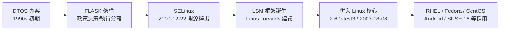
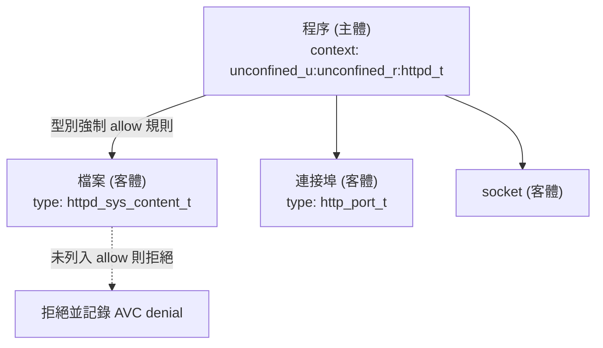
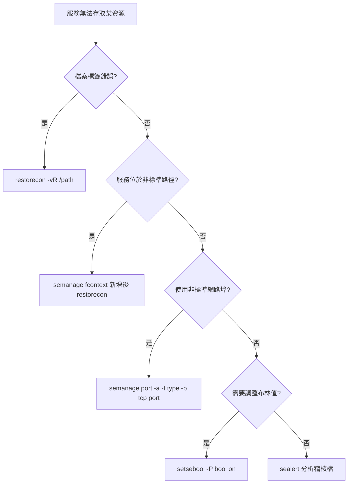
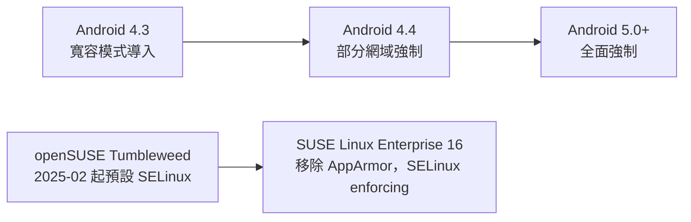

# SELinux 是什麼？

## 摘要

SELinux（Security-Enhanced Linux，安全強化版 Linux）是一套內建於 Linux 核心的**強制存取控制**（Mandatory Access Control，MAC）安全架構。它在傳統 Linux 的**任意存取控制**（Discretionary Access Control，DAC）之上，額外加入一層由中央政策（policy）驅動的存取檢查：任何未被政策明確允許的行為都會被拒絕，而且連 `root` 也無法豁免[^rh-what][^man7]。

本報告說明 SELinux 的定義、歷史起源、核心架構（LSM、安全脈絡、型別強制）、運作模式、常用指令，以及它與 AppArmor 等其他 MAC 系統的差異，並在最後對資料來源做批判性反思。本報告為獨立文件，閱讀時不需任何背景知識。

---

## 一、定義：什麼是強制存取控制（MAC）

SELinux 是美國國家安全局（NSA）主導開發、並以開源方式釋出的 Linux 核心安全模組。根據 NSA 的說法，它是一組針對 Linux 核心與工具的修補，用來在核心的主要子系統中提供「強大、彈性的強制存取控制架構」[^wiki]。

其運作核心原則是**預設拒絕**（default-deny）：未經政策明示允許的操作一律禁止。此一隔離機制獨立於傳統的 Linux 檔案權限之外，並且**沒有「root 超級使用者」的概念**——即使是 root 權限的程序，同樣受到 SELinux 政策約束[^rh-what]。

### DAC 與 MAC 的差異

傳統 Linux 權限屬於 DAC：檔案的擁有者可以自行決定誰能存取。這帶來兩個問題：權限設定錯誤（例如 `chmod 777`）會讓檔案對所有人開放；而 root 可以繞過所有限制。SELinux 的 MAC 模型則由管理者集中定義政策，且**同時需要 DAC 與 MAC 兩層都允許**才能通過，因此 SELinux 扮演「安全網」的角色[^rh-what][^man7]。

| 面向 | 任意存取控制（DAC） | 強制存取控制（MAC） |
|---|---|---|
| 權限決定者 | 檔案擁有者自行決定 | 管理者集中定義的政策 |
| root 的地位 | 幾乎不受限制 | 同樣受政策約束 |
| 設定錯誤的後果 | `chmod 777` 即對外全開 | 政策仍可阻擋未授權存取 |
| SELinux 的對應 | 傳統 `rwx` 權限 | 以型別（type）為基礎的政策 |

---

## 二、歷史與起源

### 從 DTOS / FLASK 到 SELinux

SELinux 的技術根源可追溯到 1990 年代初期 NSA 與 Secure Computing Corporation 合作的 **DTOS**（Distributed Trusted Operating System）專案，其後演進為 **FLASK**（Flux Advanced Security Kernel）架構，並於猶他大學的 Fluke 作業系統上建立雛型。FLASK 的核心設計原則是將**政策決策**（policy decision）與**政策執行**（policy enforcement）分離，這正是 SELinux 所沿用的架構[^usenix-flask][^wiki]。

### 開源釋出與進入 Linux 核心

NSA 的 Security-Enhanced Linux 團隊於 **2000 年 12 月 22 日**以 GNU GPL 授權首次向開源社群釋出 SELinux[^wiki]。

SELinux 進入 Linux 核心主線的關鍵，是 **Linux Security Modules（LSM）**框架的誕生。當時 Linus Torvalds 建議不要在核心各處散落 SELinux 專屬的掛鉤，而應改採模組化設計，於是催生了 LSM；SELinux 隨後成為 LSM 的第一個使用者。SELinux 於 Linux 核心 **2.6.0-test3**（2003 年 8 月 8 日）併入主線[^wiki][^rh-deploy]。

主要貢獻者包括 NSA（原始開發者）、Red Hat（主要貢獻與採用者）、Network Associates、Secure Computing Corporation、Tresys Technology 等[^rh-deploy]。



---

## 三、核心架構

### 1. Linux Security Modules（LSM）

LSM 是 Linux 核心中允許各種安全模組掛入核心操作的框架。核心官方文件中明確指出：「LSM 介面的主要使用者是提供完整安全政策的強制存取控制（MAC）擴充，例如 SELinux、Smack、Tomoyo 與 AppArmor」[^kernel-lsm]。

重點特性：

- 在編譯期透過 `CONFIG_LSM` 設定，也可在開機時以核心參數 `lsm=...` 覆寫[^kernel-lsm]。
- 同一時間僅能有一個「主要」（major）MAC 模組（如 SELinux）生效，但可搭配多個「次要」（minor）模組[^kernel-lsm]。
- 可透過 `/sys/kernel/security/lsm` 檢視目前啟用的模組[^kernel-lsm]。

### 2. 安全脈絡（Security Context，又稱安全性標籤）

在 SELinux 中，每一個**主體**（subject，即程序）與**客體**（object，如檔案、目錄、socket、連接埠）都帶有一個**安全脈絡**，格式為四個以冒號分隔的欄位[^ctx]：

```
user:role:type[:level]
```

| 欄位 | 意義 | 範例 |
|---|---|---|
| **user** | SELinux 使用者身分（並非 Linux 的 UID，而是兩者對應後的 SELinux 帳號） | `unconfined_u`、`system_u`、`user_u` |
| **role** | SELinux 角色，決定該使用者可進入哪些型別 | `unconfined_r`、`object_r`、`system_r` |
| **type** | 最關鍵的欄位；用於幾乎所有存取決策。主體（程序）的型別又稱**網域**（domain） | `httpd_t`、`unconfined_t`、`bin_t` |
| **level** | 選用的 MLS/MCS 敏感度範圍 | `s0`、`s0-s0:c0.c1023` |

SELinux Project 官方筆記本將安全脈絡定義為「定義 SELinux 使用者、角色、型別識別碼，以及選用的 MCS/MLS 安全範圍或等級的可變長度字串」[^ctx]。

實例[^ctx]：

- 程序：`unconfined_u:unconfined_r:unconfined_t`（一個不受限制的 bash 程序）
- 檔案：`system_u:object_r:in_queue_t`（一個訊息佇列目錄）

型別慣例上以 `_t` 結尾。

### 3. 型別強制（Type Enforcement，TE）

**型別強制**是 SELinux 用來落實 MAC 的核心機制：所有主體與客體都帶有型別識別碼，政策則以 **allow 規則**描述「哪種型別的主體，能對哪種型別的客體，執行哪些操作」[^te]。

SELinux Project 說明：「SELinux 採用特定風格的型別強制（TE）來落實強制存取控制……所有主體與客體都帶有型別識別碼，可據以執行政策所訂定的規則」[^te]。

範例規則[^te]：

```
allow unconfined_t ext_gateway_t : process transition;
```

意思是：執行於 `unconfined_t` 網域的程序，被允許將程序轉換（transition）至 `ext_gateway_t` 網域。

### 4. 網域（Domain）與型別（Type）

SELinux 術語中：

- **網域（domain）**＝與**程序**（主體）相關聯的型別。
- **型別（type）**＝與**客體**（檔案、socket 等）相關聯的型別。

當程序在某個網域中執行，即稱其「為型別 X_t」。政策即精確規定哪些網域能對哪些型別做什麼操作[^te]。



---

## 四、實際運作方式

### 目標式政策（Targeted Policy，預設）

多數發行版（RHEL、Fedora、CentOS）預設採用**目標式政策**。在此政策下：

- 大多數**使用者程序**執行於**不受限制網域**（`unconfined_t`），不受 SELinux 限制。
- **特定服務**（daemon）被放入**受限制網域**，例如 Apache（`httpd_t`）、DNS（`named_t`）、SSH（`sshd_t`）等，只能存取其所需資源。

man page 描述：「目標式政策被設計成一種政策，其中大多數使用者程序不受限制地運作，只有特定服務被放入受政策限制的獨立安全網域中」[^man7]。

另有 **MLS（Multi-Level Security）政策**，粒度更細、實作 Bell-LaPadula 模型，主要用於政府與高安全需求環境[^man7]。

### 三種運作模式

SELinux 有三種模式，由 `/etc/selinux/config` 中的 `SELINUX=` 變數設定[^man7]：

| 模式 | 行為 |
|---|---|
| **Enforcing（強制）** | SELinux 完全生效，違反政策者被阻擋並寫入稽核記錄。**預設且建議的模式。** |
| **Permissive（寬容）** | SELinux 仍運作並記錄，但**不阻擋**；用於除錯與政策開發。 |
| **Disabled（停用）** | 完全關閉 SELinux。**強烈不建議**：檔案不會被標記，日後重新啟用會很困難。 |

man page 描述寬容模式：「寬容選項會啟用 SELinux 程式碼，但使其運作於一種政策原本會拒絕的存取仍被允許、只是會被稽核的模式」[^man7]。

> 註：將 `SELINUX=disabled` 寫入設定檔屬過時做法；建議以核心開機參數 `selinux=0` 完全停用[^man7]。

### 布林值（Booleans）

**布林值**是執行期的政策開關，讓管理者在不重新編譯或重新載入整份政策的情況下，調整政策的特定部分。系統預先定義了數百個布林值[^rh-using]。

常見範例[^rh-using]：

| 布林值 | 用途 |
|---|---|
| `httpd_can_network_connect` | 允許 Apache 建立網路連線 |
| `httpd_enable_home_dirs` | 允許 Apache 讀取使用者家目錄 |
| `ftp_home_dir` | 允許 FTP 讀寫家目錄 |
| `samba_enable_home_dirs` | 允許 Samba 共享家目錄 |

---

## 五、常用指令

### 檢視狀態與模式[^man7][^rh-using]

| 指令 | 用途 |
|---|---|
| `getenforce` | 顯示目前模式：`Enforcing`、`Permissive` 或 `Disabled` |
| `setenforce 0` / `setenforce 1` | 切換為寬容 / 強制模式（重開機前有效） |
| `sestatus` | 顯示完整狀態（模式、政策名稱等） |
| `selinuxenabled` | SELinux 啟用時回傳 0（供腳本判斷） |

### 檢視安全脈絡[^ctx]

| 指令 | 用途 |
|---|---|
| `ls -Z` | 顯示檔案與目錄的安全脈絡 |
| `ps -Z` | 顯示執行中程序的安全脈絡 |
| `id -Z` | 顯示目前使用者的安全脈絡 |

### 管理標籤[^rh-using]

| 指令 | 用途 |
|---|---|
| `chcon -t httpd_sys_content_t /path` | 暫時變更檔案型別 |
| `restorecon -vR /path` | 依政策還原檔案/目錄的預設脈絡 |
| `semanage fcontext -a -t httpd_sys_content_t "/custom/path(/.*)?"` | 將自訂路徑對應新增至政策（永久） |
| `semanage port -a -t http_port_t -p tcp 8080` | 為非標準連接埠註冊 SELinux 連接埠型別 |

### 布林值與政策查詢[^rh-using]

| 指令 | 用途 |
|---|---|
| `getsebool -a` | 列出所有布林值與目前狀態 |
| `setsebool -P httpd_can_network_connect on` | 設定布林值（`-P` 使設定在重開機後仍保留） |
| `semanage boolean -l` | 列出所有布林值與說明 |
| `semanage login -l`、`semanage user -l` | 顯示 Linux 使用者與 SELinux 使用者的對應 |

### 疑難排解[^rh-using]

| 指令 | 用途 |
|---|---|
| `audit2allow -w -a` | 讀取稽核記錄，以人類可讀方式解釋被拒絕的操作 |
| `audit2allow -a -M mymodule` | 依稽核記錄產生自訂政策模組 |
| `sealert -a /var/log/audit/audit.log` | 分析稽核記錄並提供建議（屬 `setroubleshoot`） |
| `grep "avc: denied" /var/log/audit/audit.log` | 直接搜尋 SELinux 拒絕訊息 |

### 常見問題與對策[^rh-using]



---

## 六、與 AppArmor 及其他 MAC 系統的關係

Linux 上常見的 MAC 實作包括 SELinux、AppArmor、Smack、Tomoyo 等：LSM 框架的設計正是為了同時支援這些不同實作[^kernel-lsm]。

### SELinux 與 AppArmor 的關鍵差異

| 面向 | SELinux | AppArmor |
|---|---|---|
| 檔案識別方式 | 以 **inode**（擴充屬性）標記，重新命名或建立硬連結仍維持標籤 | 以**路徑名稱**識別，硬連結可能繞過限制 |
| 政策粒度 | 細緻，具多種客體類別與權限 | 較簡單，主要為讀、寫、附加、執行等操作 |
| 型別強制 | 有，檔案具明確型別 | 無，以路徑而非型別描述 |
| MLS 支援 | 支援多層安全（Bell-LaPadula 等） | 不支援 |
| 政策語言 | 較複雜，由 `.te`/`.fc`/`.if` 等檔案編譯而成 | 簡潔的平面式 profile |
| 管理方式 | 可支援遠端政策伺服器 | 多為逐台手動部署 |

維基百科的比較指出：「SELinux 重新發明了某些概念，以提供更具表達力的政策選擇；AppArmor 則以簡潔為設計目標，將用於 DAC 的管理語義延伸到強制存取控制層級」[^wiki]。

### 其他相關系統[^kernel-lsm][^wiki]

- **Smack**：簡化版 MAC，較 SELinux 單純，用於部分嵌入式系統。
- **Tomoyo Linux**：由 NTT 開發的路徑式 MAC，強調易用性。
- **RSBAC**：規則集式存取控制框架。
- **Landlock**：較新的非特權 LSM，用於沙箱化（Linux 5.13 起）。

### 採用情況

SELinux 是 RHEL、Fedora、CentOS 等發行版的預設 MAC 機制[^wiki]。

**Android**：自 **Android 4.3（Jelly Bean）**起，Android 便以 SELinux 進一步界定應用程式沙箱的邊界，對所有程序落實強制存取控制。其導入是漸進的：4.3 版先以**寬容模式**導入（僅記錄不阻擋）、4.4 版對部分網域局部強制、5.0 版起對全部網域全面強制[^android]。

**SUSE 生態系**：openSUSE Tumbleweed 自 **2025 年 2 月**的 snapshot 20250211 起，於新安裝中改用 SELinux 作為預設 LSM，並以強制模式啟用，取代原本的 AppArmor[^tw]。openSUSE Leap 16（2025-10-01 釋出）亦以 SELinux 作為 LSM[^leap]。SUSE Linux Enterprise 16 更明確移除 AppArmor，改以 SELinux 為預設並設為強制模式，政策涵蓋超過 400 個模組，幾乎限制整個系統；官方文件說明 SLES 16.1 的預設模式即為 `enforcing`[^sle-compare][^sle-selinux]。



---

## 七、批判性反思（資料來源評估）

本報告在撰寫時對來源做了以下評估：

1. **官方與第一手文件優先**：架構與指令部分主要引用 Linux 核心官方文件、man page、SELinux Project 官方筆記本與 Red Hat 官方文件，這些來源由維護者或發行商直接撰寫，權威性最高[^kernel-lsm][^kernel-selinux][^man7][^ctx][^te][^rh-using]。

2. **歷史細節的來源層級較弱**：SELinux 首次開源釋出日期（2000-12-22）與併入核心版本（2.6.0-test3）主要來自維基百科[^wiki]，屬二手彙整來源。學術原始論文可佐證設計動機與架構[^usenix-flask][^usenix-integ]，但未逐一佐證精確日期，因此這些日期應視為待進一步以 NSA 或核心 Git 紀錄交叉驗證的項目。

3. **廠商文件的立場**：Red Hat 文件同時具備權威性與推廣性，對 SELinux 的優點描述可能偏正面；本報告在呈現時盡量附上 man page 與核心文件等中立來源作為對照[^rh-what][^man7]。

4. **時效性**：Linux 核心與發行版文件持續更新，本報告存取日期為 2026-11-24，具體版本號與預設政策可能隨發行版演進而變動，讀者應以最新官方文件為準。

5. **未取得佐證的陳述**：本報告未對所有二手來源中的每一項細節（例如各貢獻組織的實際投入範圍）進行獨立查證，此類內容僅作背景參考。

---

## 參考文獻

[^rh-what]: Red Hat. (n.d.). *What is SELinux?* Retrieved 2026-11-24, from https://www.redhat.com/en/topics/linux/what-is-selinux

[^rh-using]: Red Hat. (n.d.). *Using SELinux*. Retrieved 2026-11-24, from https://docs.redhat.com/en/documentation/red_hat_enterprise_linux/9/html/using_selinux/index

[^rh-deploy]: Red Hat. (n.d.). *Brief background and history of SELinux*. Retrieved 2026-11-24, from https://docs.redhat.com/en/documentation/red_hat_enterprise_linux/5/html/deployment_guide/rhlcommon-appendix-0005

[^man7]: SELinux(8) — Linux manual page. (n.d.). Retrieved 2026-11-24, from https://www.man7.org/linux/man-pages/man8/SELinux.8.html

[^kernel-lsm]: The Linux Kernel documentation. (n.d.). *Linux Security Module (LSM)*. Retrieved 2026-11-24, from https://www.kernel.org/doc/html/latest/admin-guide/LSM/index.html

[^kernel-selinux]: The Linux Kernel documentation. (n.d.). *SELinux*. Retrieved 2026-11-24, from https://www.kernel.org/doc/html/latest/admin-guide/LSM/SELinux.html

[^ctx]: SELinux Project. (n.d.). *Security context*. Retrieved 2026-11-24, from https://github.com/SELinuxProject/selinux-notebook/blob/main/src/security_context.md

[^te]: SELinux Project. (n.d.). *Type enforcement*. Retrieved 2026-11-24, from https://github.com/SELinuxProject/selinux-notebook/blob/main/src/type_enforcement.md

[^usenix-flask]: Spencer, R., Smalley, S., Loscocco, P., Hibler, M., Andersen, D., & Lepreau, J. (1999). *The Flask security architecture: System support for diverse security policies*. In Proceedings of the 8th USENIX Security Symposium. Retrieved 2026-11-24, from https://www.usenix.org/conference/8th-usenix-security-symposium/flask-security-architecture-system-support-diverse-security

[^usenix-integ]: Loscocco, P., & Smalley, S. (2001). *Integrating flexible support for security policies into the Linux operating system*. In Proceedings of the 2001 USENIX Annual Technical Conference. Retrieved 2026-11-24, from https://www.usenix.org/conference/2001-usenix-annual-technical-conference/integrating-Flexible-Support-security-policies

[^nsa]: National Security Agency. (n.d.). *SELinux*. Retrieved 2026-11-24, from https://www.nsa.gov/What-We-Do/Research/SELinux/

[^wiki]: Wikipedia. (n.d.). *SELinux*. Retrieved 2026-11-24, from https://en.wikipedia.org/wiki/SELinux
