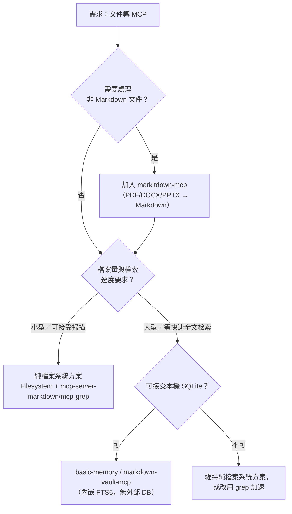

# 將 Markdown／文件轉為 MCP 伺服器、且不需資料庫的 FOSS 方案調查

## 摘要

本報告調查「把 Markdown 或一般文件（PDF、Word、簡報等）變成 Model Context Protocol（MCP）伺服器，且不依賴關聯式資料庫或向量資料庫」的自由開源軟體（FOSS）方案。

結論先行：**存在多個零資料庫的成熟方案**，可依用途分為三類：

1. **純檔案系統搜尋／讀取型**：完全不建立任何索引，每次查詢時直接掃描檔案（例如官方 Filesystem 伺服器、`mcp-server-markdown`、`mcp-grep`、`mcpdoc`、`obsidian-mcp`）。最符合「不使用資料庫」的字面要求。
2. **文件格式轉換型**：把 PDF／DOCX／PPTX 等二進位文件即時轉成 Markdown 再交給 LLM（代表為 `markitdown-mcp`），同樣零資料庫、零索引。
3. **本機內嵌索引型**：以內嵌（in-process）SQLite FTS5 或可選的向量索引加速全文檢索，但**不需要外部資料庫伺服器**（例如 `basic-memory`、`pvliesdonk/markdown-vault-mcp`、`arabold/docs-mcp-server`）。這類是「無外部資料庫」而非「完全無索引」，需依需求取捨。

若需求是嚴格「任何形式資料庫都不要」，首選 **Filesystem（官方）＋ `mcp-server-markdown`／`mcp-grep`** 的組合；若需處理非 Markdown 文件，加入 **`markitdown-mcp`**；若可接受本機 SQLite 換取更快的混合檢索，則選 **`basic-memory`**。

---

## 背景：為什麼會有「文件轉 MCP、無資料庫」的需求

MCP 是讓 AI 助理（IDE、聊天客戶端）以標準介面取得外部工具與資料的協定[^mcp]。傳統「文件問答」做法會把文件切塊、向量化後存入向量資料庫（如 Pinecone、pgvector、Chroma），再以語意檢索回傳；此架構需額外資料庫與嵌入模型，維護成本高。

相對地，**檔案系統路線**不做預先索引，而是在查詢當下用檔案讀取或 `grep` 掃描文件。其優點是：

- 零資料庫、零嵌入模型、零 API 金鑰
- 檔案一改，結果立即反映（無需重建索引）
- 部署只需一個本機程序

缺點是：檔案量極大時，逐次掃描的延遲與精確度不如索引式檢索。

下圖為決策流程：

---

## 分類一：純檔案系統（零資料庫、零索引）

### 1. `markitdown-mcp`（Microsoft，文件→Markdown 轉換）

`markitdown-mcp` 是 Microsoft MarkItDown 專案中的 MCP 子套件，提供單一工具 `convert_to_markdown(uri)`，接受 `http:`、`https:`、`file:`、`data:` 等 URI，將內容轉成 Markdown 回傳[^mdmcp]。支援 PDF、PowerPoint、Word、Excel、圖片、音訊、HTML、CSV/JSON/XML、ZIP、EPub、Outlook 訊息等格式[^mdmcp]。

- 語言：Python（≥3.10）
- 授權：MIT
- 母專案 `microsoft/markitdown` 約 19.85 萬顆星[^markitdown]
- **資料庫需求：無**——純即時轉換，無索引、無狀態[^mdmcp]

這是最貼近「把『文件』變成 Markdown」語意的工具；它本身不負責跨檔檢索，適合與下方檢索型伺服器搭配。

### 2. Filesystem（MCP 官方參考伺服器）

官方 `@modelcontextprotocol/server-filesystem` 提供在允許目錄內的安全讀寫，工具包含 `read_text_file`、`read_multiple_files`、`list_directory`、`directory_tree`、`get_file_info` 等[^fs]。其中 `search_files` 為**檔名 glob 比對**（非內容搜尋）[^fs]。

- 語言：TypeScript
- 授權：MIT（屬 `modelcontextprotocol/servers` 單體倉庫，整倉約 9.22 萬顆星[^servers]）
- **資料庫需求：無**

### 3. `mcp-server-markdown`（ofershap，Markdown 感知檢索）

專為本情境設計：對本機 `.md` 檔提供全文搜尋、依標題擷取章節、目錄（heading）導覽、程式碼區塊搜尋、YAML frontmatter 解析[^ofershap]。其 README 明言：「Filesystem 伺服器能讀這些檔，但會把它們當原始文字；它不懂標題、章節或程式碼區塊。本伺服器懂」[^ofershap]。

- 工具：`list_files`、`search_docs`、`get_section`、`list_headings`、`find_code_blocks`、`get_frontmatter`
- 語言：TypeScript；授權：MIT；約 8 顆星[^ofershap]
- **資料庫需求：無**——直接讀取磁碟 `.md`，無 API 金鑰、無驗證、無索引[^ofershap]

### 4. `mcp-grep`（247arjun，grep 包裝）

把系統 `grep` CLI 包成 MCP 伺服器，提供正則搜尋、自然語言意圖搜尋、副檔名過濾、大小寫忽略、上下文行、命中計數等功能[^mcpgrep]。

- 工具：`grep_search_intent`、`grep_regex`、`grep_count`、`grep_files_with_matches`、`grep_advanced`
- 語言：TypeScript；授權：MIT；約 8 顆星[^mcpgrep]
- **資料庫需求：無**——以 `child_process.spawn` 直接呼叫 `grep`，可作用於任何文字檔（含 Markdown）[^mcpgrep]

### 5. `mcpdoc`（LangChain AI，llms.txt 文件伺服器）

讀取 `llms.txt`（一種給 LLM 的文件索引標準）與其連結的 Markdown 頁面，暴露兩個工具：`list_doc_sources`、`fetch_docs(url)`[^mcpdoc]。支援遠端 HTTP/HTTPS 與**本機檔案路徑**（`file://` 或相對路徑）；本機檔案模式下需以 `--allowed-domains` 明確開放來源[^mcpdoc]。

- 語言：Python（≥3.10）；授權：MIT；約 1,000 顆星[^mcpdoc]
- **資料庫需求：無**——不使用索引，隨取隨轉（HTML 以 `markdownify` 即時轉 Markdown）[^mcpdoc]
- **注意**：此倉庫已於 2026-09-18 由作者封存（archived），不再維護[^mcpdoc]

### 6. `obsidian-mcp`（StevenStavrakis，Obsidian 儲存庫）

將 Obsidian 儲存庫（本機 Markdown 集合）作為 MCP 伺服器，提供筆記讀寫、移動、刪除與 `obsidian_search_vault`（搜尋內容、檔名與標籤，支援游標分頁）[^obsidian]。

- 語言：TypeScript；授權：MIT；約 751 顆星[^obsidian]
- **資料庫需求：無**——純檔案系統操作，寫入具交易式日誌（journaling）[^obsidian]

### 7. `serena`（oraios，語意程式碼工具組）

Serena 提供符號層級的程式碼檢索與編輯，透過 Language Server Protocol（LSP）即時查詢，**不建立任何持久索引或向量／SQLite 資料庫**[^serena]。其 `search_for_pattern` 為 grep 式正則搜尋，可跨任意檔案型別（含 Markdown）。

- 語言：Python（以 `uv` 管理）；授權：GPL-3.0-or-later；約 3.17 萬顆星[^serena]
- **資料庫需求：無**（不預先索引，靠 LSP 即時查詢）[^serena]
- **取捨**：功能遠超文件檢索，主要針對程式碼；用於純 Markdown 略嫌過重[^serena]

### 8. `probelabs/docs-mcp`（將 GitHub 倉庫／文件目錄轉為 MCP）

把任意 GitHub 倉庫或本機資料夾變成 MCP 伺服器，使用 `@probelabs/probe` 本機搜尋引擎（非向量資料庫），查詢語法類似 Elasticsearch（例如 `install AND guide`、`api NOT internal`）[^probelabs]。暴露單一可設定名稱的工具（預設 `search_docs`），輸入為 `query` 與可選的 `page`[^probelabs]。

- 語言：JavaScript（Node.js）；授權：MIT；約 93 顆星[^probelabs]
- **資料庫需求：無**——直接對 `data/` 目錄做本機檔案搜尋，無 Postgres／SQLite／Chroma／Pinecone[^probelabs]

### 9. 其他小型／單檔方案

以下方案同樣零資料庫，但成熟度或通用性較低，適合特定情境：

| 方案 | 說明 | 資料庫 |
|---|---|---|
| `YassineTk/mcp-docs-provider` | 以參數傳入單一 Markdown 檔路徑，更新檔案後無需重建[^sasha] | 無 |
| `Unlock-MCP/mcp-docs-server` | 讀取單一 `context.md`，提供章節概觀與章節文字搜尋，僅依賴 MCP Python SDK[^sasha] | 無 |
| `mikesusz/markdown-vault-mcp` | 對 Markdown 標題與內容做大小寫不敏感的子字串搜尋；以 frontmatter 控制存取權限[^sasha] | 無 |
| `tuncer-byte/memory-bank-MCP` | 維護六種結構化 Markdown 文件（projectbrief 等），以文字相關度排序查詢[^sasha] | 無 |
| `ofershap/mcp-server-markdown` | 見上方第 3 項 | 無 |

---

## 分類二：本機內嵌索引（無外部資料庫伺服器）

此類以**內嵌 SQLite FTS5**（必要時再加可選向量索引）加速檢索。SQLite 是行程內檔案資料庫，**不需要另起資料庫伺服器**；若連 SQLite 都不想用，可將索引路徑設為記憶體，於每次啟動時重建[^pvliesdonk]。嚴格而言這仍屬「使用資料庫」，但符合「不依賴外部資料庫」的常見實務需求。

### 1. `basic-memory`（basicmachines-co）

以結構化 Markdown（frontmatter＋wikilink）儲存知識，使用 **SQLite FTS5 關鍵字索引**加可選向量檢索，並以 Reciprocal Rank Fusion（RRF）融合結果[^basicmemory]。

- 工具：`bm_search`、`bm_write`、`bm_read`、`bm_edit`、`bm_context` 等
- 語言：Python；約 4,700 顆星[^basicmemory]
- 資料庫：本機 SQLite（外部伺服器可選用 PostgreSQL，非必要）[^basicmemory]

### 2. `pvliesdonk/markdown-vault-mcp`

混合檢索：SQLite FTS5 ＋ 可選向量（OpenAI／Ollama／FastEmbed 等），以 RRF 融合；嵌入儲存可選 SQLite、磁碟檔案（numpy）或 PostgreSQL[^pvliesdonk]。索引以雜湊比對，未變動的檔案不重新解析[^pvliesdonk]。

- 工具：`search`、`read`、`query_documents`、`count_documents`、backlinks／outlinks、`git_sync` 等
- 語言：Python；授權：MIT；約 42 顆星[^pvliesdonk]
- 資料庫：本機 SQLite FTS5；**若未設定索引路徑，索引存於記憶體並於每次啟動重建**[^pvliesdonk]

### 3. `arabold/docs-mcp-server`

可索引本機資料夾、網站、GitHub 倉庫、npm／PyPI 套件，支援 HTML／Markdown／PDF／Office，以 SQLite FTS 全文檢索並可選向量[^arabold]。作者明言「於你的機器上執行，索引存放於本機 SQLite 資料庫」，不需 Postgres 或外部向量資料庫[^arabold]。

- 語言：TypeScript；約 1,900 顆星[^arabold]
- 資料庫：本機 SQLite（**需要**建立索引，屬「有資料庫」一類）[^arabold]

---

## 分類三：需外部／雲端索引（不符合條件，列出以供排除）

以下方案雖熱門，但**必須**使用雲端向量索引，不符合本報告「無資料庫」要求，列出以協助排除：

- `idosal/git-mcp`：將 GitHub 倉庫轉為 MCP 伺服器，但後端使用 Cloudflare Vectorize、KV、R2、Queues、Durable Objects 與 Workers AI AutoRAG[^gitmcp]；語言 TypeScript、授權 Apache-2.0、約 8,500 顆星[^gitmcp]。**需要向量資料庫**。

---

## 綜合對照表

| 方案 | 語言 | 授權 | 星數 | 需資料庫？ | 檢索方式 | Markdown／文件導向 |
|---|---|---|---|---|---|---|
| `markitdown-mcp` | Python | MIT | 19.85 萬（母專案） | 無 | 即時格式轉換 | 通用文件→MD |
| Filesystem（官方） | TypeScript | MIT | 9.22 萬（整倉） | 無 | 檔名 glob＋直接讀取 | 通用 |
| `mcp-server-markdown` | TypeScript | MIT | 8 | 無 | 全文＋章節／標題 | Markdown |
| `mcp-grep` | TypeScript | MIT | 8 | 無 | `grep` 正則／意圖 | 通用文字 |
| `mcpdoc` | Python | MIT | 1,000 | 無 | 即時抓取轉換 | llms.txt／MD |
| `probelabs/docs-mcp` | JavaScript | MIT | 93 | 無 | Probe 引擎（ES 式查詢） | 文件／程式碼 |
| `obsidian-mcp` | TypeScript | MIT | 751 | 無 | 內容／檔名／標籤 | Markdown 儲存庫 |
| `serena` | Python | GPL-3.0 | 3.17 萬 | 無（靠 LSP） | 符號＋正則 pattern | 程式碼為主 |
| `basic-memory` | Python | — | 4,700 | 本機 SQLite | FTS5＋向量 RRF | Markdown |
| `markdown-vault-mcp` | Python | MIT | 42 | 本機 SQLite（可記憶體） | FTS5＋向量 RRF | Markdown |
| `docs-mcp-server` | TypeScript | — | 1,900 | 本機 SQLite | FTS＋可選向量 | 文件索引 |
| `git-mcp` | TypeScript | Apache-2.0 | 8,500 | 雲端向量 DB | AutoRAG／Vectorize | 文件（遠端） |

---

## 建議

- **嚴格零資料庫、且只需讀取既有 Markdown**：Filesystem（官方） ＋ `mcp-server-markdown`（章節感知）或 `mcp-grep`（正則）。三者皆 MIT／官方、零依賴。
- **需要處理 PDF／Word／簡報等文件**：於上述組合加入 `markitdown-mcp`，先 `convert_to_markdown` 再檢索。
- **llms.txt 生態的專案文件**：`mcpdoc` 可直接吃本機檔案，但已封存，長期維護需留意。
- **可接受本機 SQLite 以換取更快、更準的混合檢索**：`basic-memory`（生態較大、活躍）或 `pvliesdonk/markdown-vault-mcp`（可用記憶體索引避免落盤）。
- **要避免**：任何以雲端向量索引為核心者（如 `git-mcp`），不符合「無資料庫」要求。

---

## 批判性反思

- **「無資料庫」定義需先釐清**：部分方案以內嵌 SQLite 作本機索引，嚴格說仍是資料庫，但無需外部伺服器。本報告已明確區分三類，讀者應依自身對「資料庫」的定義取捨。
- **星數不代表品質，但低星數值得警惕**：`mcp-server-markdown`、`mcp-grep` 各約 8 顆星，維護風險較高；`mcpdoc` 雖有 1,000 顆星卻已封存。相對地 `markitdown-mcp`（母專案 19.85 萬星）與官方 Filesystem 伺服器維護最穩。
- **來源權威性差異**：星數與授權資訊取自 GitHub 頁面本身；部分小型專案（<100 星）資訊量有限，僅能以其 README 為據，未經第三方評測。
- **時效性**：MCP 生態變動極快，星數、封存狀態與工具清單可能隨時改變；本報告擷取日期為 2026-11-26。
- **未驗證項目**：本報告未逐一實際安裝測試各伺服器，功能描述係依官方 README／原始碼說明整理；實際相容性仍需以讀者環境實測為準。
- **來源無法溯源的項目已排除**：PyPI 套件 `mcp-server-docs`（讀取本機 Markdown／MDX、以 MCP resources 暴露、依賴僅 `mcp`／`aiofiles`／`pyyaml`，**無向量資料庫**）雖看似符合需求，但其 PyPI 中介資料 `project_urls` 與 `license` 皆為 `null`，且無法在 GitHub 上定位對應原始碼倉庫（同名倉庫 `ActianCorp/mcp-server-docs`、`tobiask42/mcp_server_docs` 均為不同專案），故不納入正式推薦。此點亦提醒：**未標示授權與原始碼位置的套件，不宜納入 FOSS 方案評估**。

---

## 參考文獻

[^mcp]: Model Context Protocol. (n.d.). *Introduction*. Retrieved 2026-11-26, from https://modelcontextprotocol.io

[^mdmcp]: Microsoft. (n.d.). *markitdown-mcp*. In markitdown (packages/markitdown-mcp). Retrieved 2026-11-26, from https://github.com/microsoft/markitdown/tree/main/packages/markitdown-mcp

[^markitdown]: Microsoft. (n.d.). *MarkItDown*. Retrieved 2026-11-26, from https://github.com/microsoft/markitdown

[^fs]: Model Context Protocol. (n.d.). *Filesystem MCP Server*. In servers (src/filesystem). Retrieved 2026-11-26, from https://github.com/modelcontextprotocol/servers/tree/main/src/filesystem

[^servers]: Model Context Protocol. (n.d.). *servers*. Retrieved 2026-11-26, from https://github.com/modelcontextprotocol/servers

[^ofershap]: Shapira, O. (n.d.). *mcp-server-markdown*. Retrieved 2026-11-26, from https://github.com/ofershap/mcp-server-markdown

[^mcpgrep]: 247arjun. (n.d.). *mcp-grep*. Retrieved 2026-11-26, from https://github.com/247arjun/mcp-grep

[^mcpdoc]: LangChain AI. (n.d.). *mcpdoc*. Retrieved 2026-11-26, from https://github.com/langchain-ai/mcpdoc

[^obsidian]: Stavrakis, S. (n.d.). *obsidian-mcp*. Retrieved 2026-11-26, from https://github.com/StevenStavrakis/obsidian-mcp

[^serena]: oraios. (n.d.). *serena*. Retrieved 2026-11-26, from https://github.com/oraios/serena

[^basicmemory]: Basic Machines. (n.d.). *basic-memory*. Retrieved 2026-11-26, from https://github.com/basicmachines-co/basic-memory

[^pvliesdonk]: van Liesdonk, P. (n.d.). *markdown-vault-mcp*. Retrieved 2026-11-26, from https://github.com/pvliesdonk/markdown-vault-mcp

[^arabold]: Arold, A. (n.d.). *docs-mcp-server*. Retrieved 2026-11-26, from https://github.com/arabold/docs-mcp-server

[^gitmcp]: Sal, I. (n.d.). *git-mcp*. Retrieved 2026-11-26, from https://github.com/idosal/git-mcp

[^sasha]: Agent Zone Research (subagent survey). (2026-11-26). *FOSS MCP servers exposing local markdown without an external database* [Research note].

[^probelabs]: Probe Labs. (n.d.). *docs-mcp* (Turn any GitHub repo to MCP server). Retrieved 2026-11-26, from https://github.com/probelabs/docs-mcp
