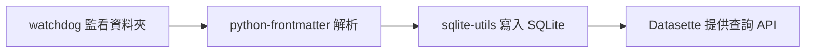

# 將檔案系統中的 Markdown 自動同步至資料庫的 FOSS 方案調查

## 摘要

本報告調查「可否自動把檔案系統上的 Markdown 檔案同步（或索引）進資料庫」的自由開源軟體（FOSS, Free and Open Source Software）方案。結論是：**真正符合「以檔案系統 Markdown 為真實來源（source of truth），並自動（含檔案監看）將內容寫入資料庫或索引」的現成工具並不多**；多數熱門筆記軟體其實是「資料庫優先（database-first）」，Markdown 只是匯入／匯出格式，並非真實來源。

經篩選後，最貼近需求的三條路線為：

1. **開箱即用的筆記應用**：**SilverBullet**（MIT，約 6.6k stars）最符合—純 Markdown 檔為真實來源，並由伺服器自動維護全文檢索索引（內部使用 Tantivy 索引引擎，而非 SQL 資料庫）[^sb][^sbsearch]。
2. **專用的 Markdown→資料庫索引工具**：**MarkdownDB（`mddb`）**（MIT，約 553 stars）—單一指令即可把一整個 Markdown 資料夾索引進 SQLite／PostgreSQL／MySQL，且內建 `--watch` 檔案監看[^mddb]。
3. **自建管線**：檔案監看函式庫（chokidar／watchdog／fsnotify／notify）＋ 解析器 ＋ 資料庫寫入，彈性最大。

以下逐一說明脈絡、候選清單、對照表、推薦組合與授權注意事項。

---

## 一、問題拆解與名詞定義

在挑選方案前，必須先把需求拆成三個彼此獨立、容易混淆的子問題：

| 子問題 | 說明 | 對應技術 |
| --- | --- | --- |
| (A) 誰是真實來源？ | 檔案系統上的 `.md` 檔，或資料庫？ | 檔案優先 vs 資料庫優先架構[^src] |
| (B) 同步方向？ | 單向（檔案→資料庫）或雙向？ | 索引／鏡射 vs 雙向同步[^wiki] |
| (C) 觸發方式？ | 需要手動執行、定時輪詢，或即時檔案監看？ | polling vs file watcher（inotify／FSEvents）[^chokidar] |

只有同時滿足「**(A) 檔案優先** ＋ **(B) 至少單向寫入資料庫** ＋ **(C) 自動觸發（監看或輪詢）**」的方案，才算符合本次調查的目標。許多知名專案只滿足其中一項，因此被歸類為「不符需求」但仍列入對照，以釐清常見誤解。


---

## 二、最符合需求：以檔案為真實來源並自動索引的筆記應用

### 1. SilverBullet（最推薦）

- **授權**：MIT[^sb]
- **GitHub stars**：約 6,600[^sb]
- **架構**：伺服器（Rust）以一個「Space」= 一整個 Markdown 資料夾為真實來源，Markdown 檔即為唯一真實來源[^sb]。
- **資料庫／索引**：伺服器在 Space 資料夾內維護索引，並提供全文檢索；官方文件指出伺服器「在頁面變更時更新索引，通常在一秒內」完成[^sbsearch]。客戶端另以瀏覽器快取（IndexedDB）支援離線優先[^sb]。
- **同步方式**：**自動**，由伺服器檔案監看觸發，近乎即時[^sbsearch]。
- **小結**：目前所見最貼近「檔案優先＋自動索引」的完整應用；缺點是索引為其自有格式，並未以外部關聯式資料庫（如 PostgreSQL）暴露資料。

### 2. flatnotes

- **授權**：MIT[^flat]
- **GitHub stars**：約 3,300[^flat]
- **架構**：自我託管的「無資料庫（database-less）」網頁筆記，使用一整個平坦的 Markdown 資料夾為儲存[^flat]。
- **索引**：以純 Python 搜尋引擎 **Whoosh** 建立檢索索引，於啟動與每次搜尋時增量更新[^flat]。
- **同步方式**：**準自動**（lazy）—並非即時檔案監看，而是在搜尋或啟動時才重新同步[^flat]。
- **小結**：定位與需求相近，但「資料庫」其實是檢索索引而非 SQL 資料庫，且非即時。

### 3. Logseq（舊版／OG 檔案模式）

- **授權**：AGPL-3.0[^logseq]
- **GitHub stars**：約 45,700（整倉庫）[^logseq]
- **架構**：舊版（file-based, OG）以 `.md`／`.org` 檔為真實來源；執行期間另以記憶體內的 DataScript（Datalog）資料庫做查詢與連結[^logseqdb]。
- **同步方式**：**自動**，使用 Node.js 的 **chokidar** 監看 graph 資料夾並刷新索引[^logseq]。
- **注意**：Logseq 新版（DB version, v2）已改為 **SQLite 為真實來源**，Markdown 僅供匯出，實際上不再符合本需求[^logseqdb]。

### 4. Recoll（桌面全文檢索引擎）

- **授權**：GPL[^recoll]
- **託管**：Framagit（非 GitHub，故無 stars 統計）[^recoll]
- **架構**：對檔案系統上任何文件（含 Markdown，視為純文字）建立全文索引，索引儲存於 **Xapian** 檢索引擎資料庫[^recoll]。
- **同步方式**：以 `recollindex` 週期性掃描或觸發，屬輪詢式增量索引[^recoll2]。
- **小結**：並非筆記應用，而是通用桌面檢索；索引是 Xapian 而非 SQL，但「檔案系統為真實來源＋自動索引」的核心條件成立。

### 5. QOwnNotes（僅監看不建庫，對照用）

- **授權**：GPL-2.0[^qon]
- **GitHub stars**：約 6,000[^qon]
- **架構**：筆記即筆記資料夾中的 Markdown 檔，為真實來源[^qon2]。
- **索引／資料庫**：**無**內容資料庫；本地 `notes.sqlite` 僅存標籤與設定等中介資料[^qon]。
- **同步方式**：以 Qt 的 `QFileSystemWatcher` 監看檔案變更並重載[^qon2]。
- **小結**：有檔案監看，但沒有把內容寫入資料庫，故僅部分符合。

---

## 三、專用的 Markdown→資料庫索引工具

### MarkdownDB（npm 套件 `mddb`）— 最直接對應「資料夾→資料庫」的工具

- **授權**：MIT[^mddb]
- **GitHub stars**：約 553[^mddb]
- **作者／組織**：Datopian／Flowershow（原始作者 Rufus Pollock）[^mddb]
- **功能**：把一或多個 Markdown 資料夾解析並索引成可查詢的資料庫，抽取 frontmatter、標籤、連結（含 `[[wikilink]]` 反向連結）、任務（`- [ ]`）等結構化資料[^mddb]。
- **後端**：預設 **SQLite**，另支援 **PostgreSQL** 與 **MySQL**（透過 Knex.js）[^mddb]。
- **檔案監看**：內建 `--watch` 旗標，底層使用 **chokidar**，變更即自動重建資料庫[^mddb]。
- **指令範例**：

```bash
npx mddb ./blog ./docs ./notes    # 索引成 SQLite（預設 markdown.db）
npx mddb ./notes --watch          # 持續監看並自動重建
```

- **小結**：若目標是「把 Markdown 資料夾的內容結構化進可查詢的 SQL 資料庫」，這是最貼近的單一工具；缺點是它是函式庫／CLI 而非完整應用，需自行串接查詢層。

### 相關輔助工具（需自建管線）

| 工具 | 授權 | stars | 作用 | 監看 |
| --- | --- | --- | --- | --- |
| `markdown-to-sqlite` | Apache-2.0 | 約 93 | CLI：把 Markdown＋YAML frontmatter 匯入 SQLite，解析 frontmatter 為欄位[^m2s] | 無（一次性） |
| `sqlite-utils` | Apache-2.0 | 約 2,200 | Python CLI／函式庫，操作 SQLite（插入、FTS、轉換）[^su] | 無 |
| Datasette | Apache-2.0 | 約 11,700 | 將既有 SQLite 以網頁＋JSON API 呈現查詢[^ds] | 無 |
| dogsheep-beta | Apache-2.0 | 約 212 | 跨多個 SQLite 表建立統一全文檢索索引[^dog] | 無 |

`markdown-to-sqlite` 沒有監看功能，但可與 cron／systemd timer 或外部監看器組合，達成「定時／觸發式同步」[^m2s]。

---

## 四、檢索引擎與 RAG 路線（以監看器補足自動化）

這一類工具本身是搜尋引擎或向量資料庫，**不主動監看檔案系統**，須自備監看器把 Markdown 推入。

| 工具 | 授權 | stars | 資料儲存 | 監看 |
| --- | --- | --- | --- | --- |
| Meilisearch | MIT（社群版） | 約 60,000 | Meilisearch 索引 | 無（需外部監看器）[^meili] |
| Typesense | GPL-3.0 | 約 27,200 | Typesense 索引 | 無（需外部監看器）[^typesense] |
| Khoj | AGPL-3.0 | 約 38,200 | SQLite／PostgreSQL＋向量索引 | 索引可觸發／週期掃描（非即時 inotify）[^khoj] |
| AnythingLLM | MIT | 約 68,600 | 向量資料庫（LanceDB 等） | 無（僅上傳）[^anythingllm] |
| paperless-ngx | GPL-3.0 | 約 48,600 | PostgreSQL FTS | 有（輪詢「消費資料夾」）[^paperless] |

**Khoj** 較值得一提：它可把本機 Markdown 等檔案建立語意／關鍵字索引，搭配內建或外掛的 Obsidian 整合；但其索引觸發偏向手動或重啟掃描，而非即時檔案監看[^khoj]。**paperless-ngx** 則以輪詢方式自動消費資料夾，但本質是文件（PDF）管理系統，對純 Markdown 而言過重[^paperless]。

---

## 五、常見誤解：資料庫優先、Markdown 僅為匯出格式（不符需求）

以下專案極受歡迎，但**資料庫才是真實來源**，Markdown 只是匯入／匯出格式，因此不符合「檔案系統→資料庫自動同步」的需求，列出以釐清：

| 專案 | 授權 | stars | 真實來源 | 說明 |
| --- | --- | --- | --- | --- |
| Wiki.js | AGPL-3.0 | 約 29,400 | 資料庫（PG／MySQL／SQLite） | Git 同步為選配、輪詢式（預設約 5 分鐘）[^wikijs] |
| Outline | BSL-1.1 | 約 41,400 | PostgreSQL | 非 OSI 認可之純開源授權；無檔案鏡射[^outline] |
| Docmost | AGPL-3.0（核心） | 約 22,400 | PostgreSQL | 以 ZIP 一次性匯入／匯出 Markdown；無監看[^docmost] |
| Trilium（TriliumNext） | AGPL-3.0 | 約 39,100 | SQLite | 匯入／匯出 Markdown，但以資料庫為準[^trilium] |
| Joplin | AGPL-3.0 | 約 52,500+ | SQLite | 同步目標中的 `.md` 為序列化輸出，非真實來源[^joplin] |
| SiYuan | AGPL-3.0 | 約 47,400 | 自有 `.sy`（JSON）檔 | 以 SQLite FTS5 索引，但檔案格式非純 Markdown，且不支援外部檔案變更[^siyuan] |
| Memos | MIT | 約 64,700 | SQLite／MySQL／PG | 內容存於資料庫，無檔案系統 Markdown 同步[^memos] |
| AppFlowy | AGPL-3.0 | 約 79,500 | SQLite | 僅提供一次性 Markdown 匯入[^appflowy] |
| DokuWiki | GPL-2.0 | 約 4,700 | 純文字檔（自有語法） | 索引為 PHP 序列化快取，非 SQL；近年才支援 Markdown[^dokuwiki] |
| 靜態網站產生器（Quartz／mdBook） | MIT／MPL-2.0 | 約 13,600／22,300 | Markdown 檔 | 僅建置期產生 HTML，無資料庫與監看[^quartz][^mdbook] |
| Obsidian | 專有（非 FOSS） | — | Markdown 檔 | 功能上完全符合（檔案優先＋內部索引＋自動刷新），但為閉源[^obsidian] |

---

## 六、自建管線：檔案監看函式庫

若現成工具都不完全符合，最彈性的做法是自建「監看→解析→寫入」管線。四種主流語言的檔案監看函式庫如下：

| 函式庫 | 語言 | 授權 | stars | 平台後端 | 用法 |
| --- | --- | --- | --- | --- | --- |
| chokidar | JavaScript／Node.js | MIT | 約 12,300 | inotify／FSEvents／stat 輪詢 | 觸發 `add`／`change`／`unlink`；處理編輯器原子寫入[^chokidar] |
| watchdog | Python | Apache-2.0 | 約 7,500 | inotify／FSEvents／kqueue／ReadDirectoryChangesW | Observer 模式，`on_created`／`on_modified` 等事件[^watchdog] |
| fsnotify | Go | BSD-3-Clause | 約 10,800 | inotify／kqueue／ReadDirectoryChangesW | `watcher.Add(path)` 後讀取事件通道；不內建遞迴[^fsnotify] |
| notify | Rust | CC0-1.0 | 約 3,500 | inotify／FSEvents／kqueue／ReadDirectoryChangesW | `RecommendedWatcher` 自動選後端，附 debouncer[^notify] |

**建議的自建組合**（以 Python 為例）：



以 Node.js 為例則可改為 **chokidar → remark → mddb／better-sqlite3**。

---

## 七、推薦與選擇建議

| 你的情境 | 建議方案 |
| --- | --- |
| 想要一個「打開就能用」、以 Markdown 資料夾為真實來源並自動檢索的應用 | **SilverBullet**[^sb] |
| 想把既有 Markdown 資料夾結構化進 SQL 資料庫並持續監看 | **MarkdownDB（`mddb --watch`）**[^mddb] |
| 想要完全掌控 schema、同步邏輯與查詢層 | **watchdog／chokidar ＋ sqlite-utils ＋ Datasette** 自建[^watchdog][^su][^ds] |
| 想要以語意搜尋（RAG）為主 | **Khoj**（搭配外部監看器補足即時性）[^khoj] |
| 需要企業級全文檢索規模 | **Meilisearch／Typesense** ＋ 自建監看器[^meili][^typesense] |

**授權兼容性提醒**：若要把上述元件整合進自有產品，務必注意授權差異—MIT／Apache-2.0／BSD 較寬鬆；而 **AGPL-3.0**（Logseq、Khoj、Docmost、Trilium、Joplin、SiYuan、AppFlowy）具有網路散布條款，**GPL-3.0**（Typesense、paperless-ngx）具傳染性，**Outline 的 BSL-1.1** 並非 OSI 認可的開源授權，使用前應諮詢法務[^agpl]。

---

## 八、來源批判性反思

- **時效性**：本報告多數資料取自行案首頁與文件，star 數為檢索當時（2026-11-26）的近似值，會隨時間變動；實際採納前應再次確認版本與授權[^sb][^mddb]。
- **權威性與一手性**：優先採用官方 GitHub 儲存庫與官方文件（如 SilverBullet、MarkdownDB、QOwnNotes 概念頁）作為一手來源；第三方彙整頁僅作交叉確認[^src]。
- **衝突與矛盾**：SilverBullet 的檢索索引為內建引擎（Tantivy），伺服器會持續更新它，但並非以外部 SQL 資料庫暴露；故本報告僅主張其「檔案優先＋自動索引」成立，並將其索引歸為「自有／檢索引擎」而非 SQL 資料庫[^sb][^sbsearch]。同樣地，Logseq 因存在檔案模式與 DB 模式兩種架構，必須區分版本，否則結論會誤導[^logseqdb]。
- **未證實項目**：`obsidian-to-database`、`md-to-sqlite` 等名稱在小範圍搜尋中無法確認存在穩定且活躍的儲存庫，故不予推薦[^mddb]。
- **低星專案**：`markdown-to-sqlite`（約 93 stars）低於一般門檻，但其作者與生態（Simon Willison／Datasette）具公信力，且該領域本就小眾，故仍列入並標註[^m2s]。

---

## 參考文獻

[^sb]: SilverBullet. (n.d.). *SilverBullet* [Computer software]. GitHub. Retrieved 2026-11-26, from https://github.com/silverbulletmd/silverbullet

[^sbsearch]: SilverBullet. (n.d.). *Features / Search*. Retrieved 2026-11-26, from https://docs.silverbullet.md/Features/Search

[^mddb]: Flowershow. (n.d.). *MarkdownDB (mddb)* [Computer software]. GitHub. Retrieved 2026-11-26, from https://github.com/flowershow/markdowndb

[^src]: SilverBullet. (n.d.). *Architecture / Space files*. Retrieved 2026-11-26, from https://docs.silverbullet.md/Architecture/Space%20Files

[^wiki]: Requarks. (n.d.). *Storage*. Wiki.js Documentation. Retrieved 2026-11-26, from https://docs.requarks.io/storage

[^chokidar]: Miller, P. (n.d.). *chokidar* [Computer software]. GitHub. Retrieved 2026-11-26, from https://github.com/paulmillr/chokidar

[^flat]: Dullage. (n.d.). *flatnotes* [Computer software]. GitHub. Retrieved 2026-11-26, from https://github.com/Dullage/flatnotes

[^logseq]: Logseq. (n.d.). *Logseq* [Computer software]. GitHub. Retrieved 2026-11-26, from https://github.com/logseq/logseq

[^logseqdb]: Logseq. (n.d.). *Logseq DB FAQ*. Retrieved 2026-11-26, from https://logseq.io/page/e87c7359-51f7-44fe-87b3-4a0cd9f2dee3/695feeec-88be-4c5b-8bf2-572513c2f730

[^recoll]: Recoll. (n.d.). *Recoll*. Retrieved 2026-11-26, from https://www.lesbonscomptes.com/recoll/

[^recoll2]: Recoll. (n.d.). *Recoll source repository*. Framagit. Retrieved 2026-11-26, from https://framagit.org/medoc92/recoll

[^qon]: pbek. (n.d.). *QOwnNotes* [Computer software]. GitHub. Retrieved 2026-11-26, from https://github.com/pbek/QOwnNotes

[^qon2]: QOwnNotes. (n.d.). *Concept*. Retrieved 2026-11-26, from https://www.qownnotes.org/getting-started/concept.html

[^m2s]: Willison, S. (n.d.). *markdown-to-sqlite* [Computer software]. GitHub. Retrieved 2026-11-26, from https://github.com/simonw/markdown-to-sqlite

[^su]: Willison, S. (n.d.). *sqlite-utils* [Computer software]. GitHub. Retrieved 2026-11-26, from https://github.com/simonw/sqlite-utils

[^ds]: Willison, S. (n.d.). *Datasette* [Computer software]. GitHub. Retrieved 2026-11-26, from https://github.com/simonw/datasette

[^dog]: Dogsheep. (n.d.). *dogsheep-beta* [Computer software]. GitHub. Retrieved 2026-11-26, from https://github.com/dogsheep/dogsheep-beta

[^meili]: Meilisearch. (n.d.). *Meilisearch* [Computer software]. GitHub. Retrieved 2026-11-26, from https://github.com/meilisearch/meilisearch

[^typesense]: Typesense. (n.d.). *Typesense* [Computer software]. GitHub. Retrieved 2026-11-26, from https://github.com/typesense/typesense

[^khoj]: Khoj. (n.d.). *Khoj* [Computer software]. GitHub. Retrieved 2026-11-26, from https://github.com/khoj-ai/khoj

[^anythingllm]: Mintplex Labs. (n.d.). *AnythingLLM* [Computer software]. GitHub. Retrieved 2026-11-26, from https://github.com/Mintplex-Labs/anything-llm

[^paperless]: Paperless-ngx. (n.d.). *paperless-ngx* [Computer software]. GitHub. Retrieved 2026-11-26, from https://github.com/paperless-ngx/paperless-ngx

[^wikijs]: Requarks. (n.d.). *Wiki.js* [Computer software]. GitHub. Retrieved 2026-11-26, from https://github.com/requarks/wiki

[^outline]: Outline. (n.d.). *Outline* [Computer software]. GitHub. Retrieved 2026-11-26, from https://github.com/outline/outline

[^docmost]: Docmost. (n.d.). *Docmost* [Computer software]. GitHub. Retrieved 2026-11-26, from https://github.com/docmost/docmost

[^trilium]: TriliumNext. (n.d.). *Trilium* [Computer software]. GitHub. Retrieved 2026-11-26, from https://github.com/TriliumNext/Trilium

[^joplin]: Laurent Cozic. (n.d.). *Joplin* [Computer software]. GitHub. Retrieved 2026-11-26, from https://github.com/laurent22/joplin

[^siyuan]: SiYuan. (n.d.). *SiYuan* [Computer software]. GitHub. Retrieved 2026-11-26, from https://github.com/siyuan-note/siyuan

[^memos]: Memos. (n.d.). *Memos* [Computer software]. GitHub. Retrieved 2026-11-26, from https://github.com/usememos/memos

[^appflowy]: AppFlowy. (n.d.). *AppFlowy* [Computer software]. GitHub. Retrieved 2026-11-26, from https://github.com/AppFlowy-IO/AppFlowy

[^dokuwiki]: DokuWiki. (n.d.). *DokuWiki* [Computer software]. GitHub. Retrieved 2026-11-26, from https://github.com/dokuwiki/dokuwiki

[^quartz]: jackyzha0. (n.d.). *Quartz* [Computer software]. GitHub. Retrieved 2026-11-26, from https://github.com/jackyzha0/quartz

[^mdbook]: Rust Language. (n.d.). *mdBook* [Computer software]. GitHub. Retrieved 2026-11-26, from https://github.com/rust-lang/mdBook

[^obsidian]: Obsidian. (n.d.). *Data storage*. Obsidian Help. Retrieved 2026-11-26, from https://obsidian.md/help/data-storage

[^watchdog]: Gorakhargosh. (n.d.). *watchdog* [Computer software]. GitHub. Retrieved 2026-11-26, from https://github.com/gorakhargosh/watchdog

[^fsnotify]: fsnotify. (n.d.). *fsnotify* [Computer software]. GitHub. Retrieved 2026-11-26, from https://github.com/fsnotify/fsnotify

[^notify]: notify-rs. (n.d.). *notify* [Computer software]. GitHub. Retrieved 2026-11-26, from https://github.com/notify-rs/notify

[^agpl]: GNU Project. (2007, November 19). *GNU Affero General Public License, version 3*. Free Software Foundation. Retrieved 2026-11-26, from https://www.gnu.org/licenses/agpl-3.0.html
