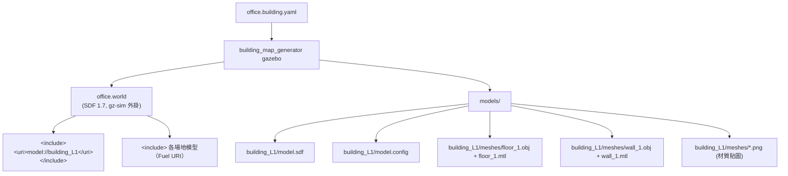
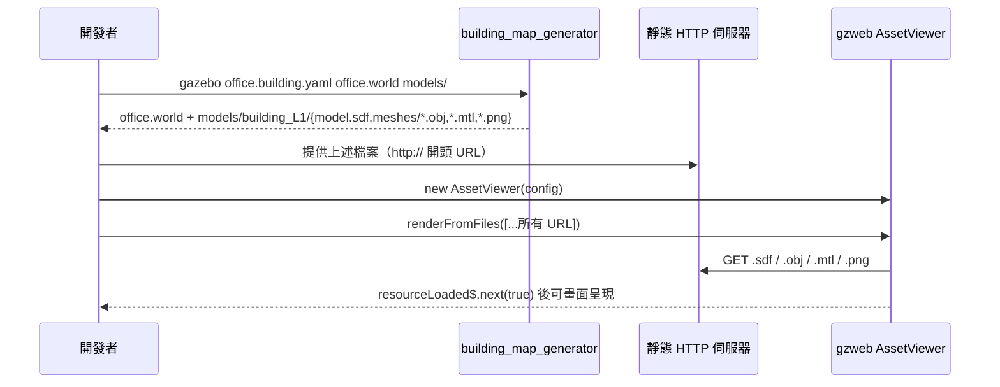
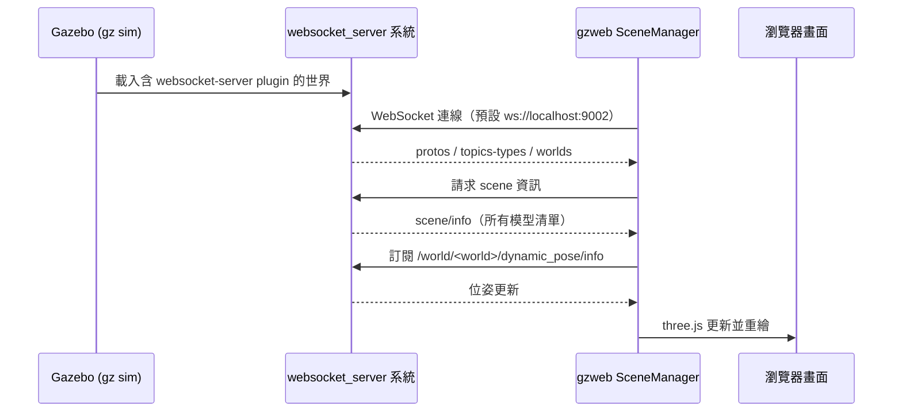

# 以 gzweb 渲染 rmf_demos 的 `.building.yaml`：可行性、轉換管線與實作路線

## 摘要

本文回答一個具體的工程問題：**如何使用 `gazebo-web/gzweb` 這個網頁渲染函式庫，在瀏覽器中呈現 `open-rmf/rmf_demos` 專案裡的 `.building.yaml` 建築圖**。

核心結論如下：

1. **gzweb 無法直接讀取 `.building.yaml`。** gzweb 是 Gazebo 的網頁前端，它只懂 SDF（`.sdf` / `.world`）與其引用的網格檔（mesh）[^gzweb-readme]。`.building.yaml` 是 `rmf_traffic_editor` 的專案格式，屬於 2D 平面圖加註記資料[^book]。因此**必須先經過一次格式轉換**。
2. **轉換工具是 `rmf_building_map_tools` 的 `building_map_generator`**，子命令 `gazebo` 可以把 `.building.yaml` 生成一份 Gazebo 世界檔（`.world`）與一個模型目錄（`models/`，內含 `.sdf`、`.obj`、`.mtl`、`.png`）[^rmf-maps-cmake]。轉換後的產物才是 gzweb 能吃的東西。
3. **轉換後有兩條渲染路線**：
   - **路線 A（離線 / 靜態）**：用 gzweb 的 `AssetViewer`，透過純 HTTP 取得檔案 URL 清單直接渲染，**不需要啟動 Gazebo 伺服器**（AssetViewer「沒有任何 websocket 連線」[^gzweb-assetviewer]）。
   - **路線 B（即時模擬）**：啟動內建 `websocket_server` 系統的 Gazebo，用 gzweb 的 `SceneManager` 連上 `ws://localhost:9002`，即時看到模擬狀態[^gzsim-readme][^gzweb-scenemanager]。
4. **關鍵限制**：gzweb 支援 `.obj`、`.dae`、`.stl`、`.glb`、`.gltf`，但**明確不支援 `.urdf`**[^gzweb-scene]；`AssetViewer.renderFromFiles()` 只會自動辨識檔名結尾為 `.sdf` 的檔案[^gzweb-assetviewer]；被 `<include>` 的模型會透過 Fuel 伺服器的 REST API 抓檔案清單[^gzweb-sdfparser][^gzweb-fuel]。
5. **若目標只是「在網頁看到 RMF 建築圖」，其實有更直接的路**：`open-rmf/rmf-web` 的儀表板已經用 three.js（`@react-three/fiber`）從 `building.yaml` 的圖資即時生成 3D 幾何，完全不需要 Gazebo，也不需要 gzweb[^rmf-web]。

---

## 1. 背景：兩個專案的定位

### 1.1 gzweb

`gazebo-web/gzweb` 是一個 npm 套件，定位為「讓網頁客戶端能渲染模型與世界，並且能與執行中的 Gazebo 模擬溝通（透過 Websocket launcher plugin）」[^gzweb-readme]。目前版本為 `3.0.1`，`type: module`，要求 Node 24 / npm 11，核心依賴為 `three@^0.141.0`、`fast-xml-parser`、`protobufjs`、`rxjs`、`jszip`、`three-nebula`[^gzweb-pkg]。GitHub 星數約 50[^stars-gzweb]。

套件對外匯出的兩個主要類別，正好對應前面提的兩條路線[^gzweb-exports]：

- `AssetViewer`：用於「渲染靜態模型或世界」，只需要資源的 URL，沒有 websocket 連線[^gzweb-readme][^gzweb-assetviewer]。
- `SceneManager`：用於「渲染執行中的 Gazebo 模擬」，需要連上一台 Gazebo 的 websocket 伺服器[^gzweb-readme][^gzweb-scenemanager]。

要注意的是，`gazebosim/gzweb`（較舊、星數較高的另一個同名倉庫）與 `gazebo-web/gzweb` 並非同一個程式碼庫；本文所述的 API 全部依據 `gazebo-web/gzweb` 的原始碼[^gzweb-assetviewer][^gzweb-scenemanager][^gzweb-transport]。

### 1.2 rmf_demos

`open-rmf/rmf_demos` 是 Open-RMF 的示範集合，星數約 633[^stars-demos]。其中與本文最相關的兩個子套件是：

- `rmf_demos_maps`：提供各示範場地的地圖，`.building.yaml` 置於 `maps/<map_name>/<map_name>.building.yaml`（例如 `maps/office/office.building.yaml`）[^rmf-maps-office][^rmf-maps-cmake]。
- `rmf_demos_gz`：提供使用 Gazebo 模擬器的頂層 launch 檔，負責把地圖載入並啟動 Gazebo[^rmf-demos-gz-readme]。

依 `rmf_demos` 官方說明，此系列示範在 Ubuntu 24.04 LTS、ROS 2 Kilted、Gazebo Ionic 上建置與測試[^rmf-demos-readme]。

---

## 2. `.building.yaml` 是什麼

`.building.yaml` 是 `traffic_editor` GUI 的專案檔，可以想成「2D 樓層平面圖 + 機器人動線註記 + 3D 世界生成的必要資訊」的組合[^book]。以 `rmf_demos` 的 `office.building.yaml` 為例，頂層結構如下[^rmf-maps-office]：

```yaml
coordinate_system: reference_image
crowd_sim: { ... }
graphs: {}
levels:
  L1:
    drawing: { filename: office.png }
    elevation: 0
    vertices: [...]
    walls: [...]
    floors: [...]
    doors: [...]
    lanes: [...]
    models: [...]
    measurements: [...]
    layers: { ... }
    constraints: [...]
    features: [...]
lifts: {}
name: building
```

各欄位的語意（依官方使用手冊）[^book]：

| 欄位 | 內容 |
|---|---|
| `drawing.filename` | 作為底圖的 2D 平面圖 PNG |
| `elevation` | 該樓層高度（公尺），多樓層對齊用 |
| `vertices` | 頂點清單，格式為 `[x, y, z, name, {參數}]`，是所有標註的基本單元 |
| `walls` | 牆段，格式 `[起點索引, 終點索引, {texture_name, texture_height, ...}]` |
| `floors` | 地板多邊形，`{parameters: {...}, vertices: [...]}` |
| `doors` | 門，格式含 `type`（hinged / double_hinged / sliding / double_sliding）、`motion_degrees` 等 |
| `lanes` | 交通車道，含 `bidirectional`、`graph_idx`、`orientation` |
| `models` | 場地擺設模型（桌椅、櫃子等），以 `model_name` 指向模型資產 |
| `measurements` | 比例尺參考線，用來換算像素與實際公尺 |
| `lifts` | 電梯定義（本範例為空） |
| `layers` | 疊圖（例如雷射掃描圖） |

換句話說，`.building.yaml` **不含**任何 3D 網格；3D 幾何是在後續生成階段才被「算出來」的[^book]。

---

## 3. 關鍵一步：用 `building_map_generator` 轉出 Gazebo 世界

### 3.1 轉換指令

`rmf_building_map_tools` 套件（版本 1.16.0）提供 `building_map_generator` 這個 console script[^rmf-setup]。其 `gazebo` 子命令的用法為：

```bash
ros2 run rmf_building_map_tools building_map_generator gazebo \
  <輸入 building.yaml> \
  <輸出 .world 檔路徑> \
  <輸出模型目錄> \
  [--TEMPLATE_WORLD_FILE <樣板>] [--SKIP_CAMERA_POSE]
```

`rmf_demos_maps/CMakeLists.txt` 就是這樣呼叫的[^rmf-maps-cmake]：

```cmake
set(output_dir ${CMAKE_CURRENT_BINARY_DIR}/maps/${output_world_name})
set(output_world_path ${output_dir}/${output_world_name}.world)
set(output_model_dir ${output_dir}/models)

message("BUILDING WORLDFILE WITH COMMAND: ros2 run rmf_building_map_tools building_map_generator gazebo ${map_path} ${output_world_path} ${output_model_dir}")
```

### 3.2 產物長相

生成的結果是一份「世界檔 + 每層一包模型」的目錄結構：



- **地板**由 `floor.py` 以 Shapely 對多邊形做三角化後，手動輸出成 OBJ（每個頂點寫兩次，z=0 與 z=-厚度），並附 MTL 指向貼圖[^subfloor]。
- **牆面**由 `wall.py` 依 `wall_thickness`（預設 0.1 m）與 `wall_height`（預設 2.5 m）建立 4 角柱體，每段牆 8 個面，輸出 OBJ 並以 `<pose>` 偏移原點；牆的高度與厚度定義在原始碼常數中[^subwall][^book]。
- **世界檔**以 `<include><uri>model://<building>_<level></uri></include>` 方式引用各層模型；若模型名稱含 `/`（例如 `OpenRobotics/OfficeChairBlack`），則可能被改寫為 Fuel 的 HTTPS URI，例如 `https://fuel.gazebosim.org/1.0/<author>/models/<model>`[^submodel]。
- 世界檔使用的樣板是 SDF version 1.7，內含 `gz-sim-physics-system` 等外掛，屬於**Gazebo（前稱 Ignition）而非 Gazebo Classic**[^subtemplate]。

### 3.3 依賴

`building_map_generator` 的 Python 依賴為 `shapely` 與 `pyyaml`；ROS 端的 exec 依賴包含 `gz_fuel_tools_vendor`、`python3-shapely`、`python3-pyproj`、`python3-fiona`、`python3-rtree`、`python3-requests`、`rclpy`、`rmf_building_map_msgs` 等[^rmf-setup][^rmf-packagexml]。

---

## 4. gzweb 的渲染 API 與其邊界

### 4.1 `AssetViewer`（無 Gazebo 伺服器）

建構子接受一份設定物件[^gzweb-assetviewer]：

```ts
interface AssetViewerConfig {
  elementId?: string;        // 渲染容器 id，預設 "gz-scene"
  addModelLighting?: boolean; // 是否加光
  scaleModel?: boolean;      // 是否自動縮放以入鏡
  enablePBR?: boolean;       // 是否使用 PBR 材質
  token?: string;            // Fuel 私有資源的 Bearer token
}

const viewer = new AssetViewer({ elementId: "gz-scene", addModelLighting: true });
viewer.renderFromFiles(files); // files: string[] 全部是 URL
```

`renderFromFiles(files)` 的行為（原始碼直引重點）[^gzweb-assetviewer]：

- `this.sdfParser.usingFilesUrls = true;`，之後資源只從傳入的 URL 陣列找。
- 找出**結尾為 `.sdf`** 的那一個檔案當作入口：`const sdfFile = files.find((file) => file.endsWith(".sdf"));`
- 把每個 URL 交給 `sdfParser.addUrl()`，再 `loadSDF(sdfFile, cb)`。

`addUrl()` 只接受以 `"http"` 開頭的 URL，否則只會印警告後忽略[^gzweb-sdfparser]。這是實作時最容易踩的坑之一：**資源必須透過 HTTP(S) 提供，不能是 `model://` 或相對路徑**。

### 4.2 `SceneManager`（連 Gazebo websocket）

建構子設定與連線 API[^gzweb-scenemanager]：

```ts
interface SceneManagerConfig {
  elementId?: string;
  websocketUrl?: string;   // 指向 Gazebo 伺服器，例如 ws://localhost:9002
  websocketKey?: string;   // 選用授權金鑰
  audioTopic?: string;
  topicName?: string; msgType?: string; msgData?: any; // 發佈自訂 topic
  enableLights?: boolean;
}

const mgr = new SceneManager({ elementId: "gz-scene", websocketUrl: "ws://localhost:9002" });
```

`connect()` 之後的連線狀態機為 `disconnected → connected → ready`；只有在 `ready` 時才會拿到 world 名稱與 `scene/info`，並訂閱 `/world/<world>/dynamic_pose/info` 來更新模型位姿[^gzweb-transport][^gzweb-scenemanager]。`play()` / `pause()` 是對 `/world/<world>/control` 發出 `ignition.msgs.WorldControl` 服務請求[^gzweb-scenemanager]。

### 4.3 支援的網格格式

`Scene` 的 `loadMeshFromUri` 依副檔名分派載入器[^gzweb-scene]：

| 副檔名 | 載入器 | 是否支援 |
|---|---|---|
| `.dae` | ColladaLoader | 是 |
| `.obj` | OBJLoader + MTLLoader（`GzObjLoader`） | 是 |
| `.stl` | STLLoader | 是 |
| `.glb` / `.gltf` | GLTFLoader | 是 |
| `.urdf` | 無 | **否**（原始碼會輸出 "Attempting to load URDF file, but it's not supported."） |

`loadMeshFromString` 則僅支援 `.dae` 與 `.obj`（後者需要同時提供 OBJ 字串與 MTL 字串）[^gzweb-scene]。OBJ 的 MTL 與其貼圖是透過 HTTP 抓取：`GzObjLoader` 會以 OBJ 檔所在目錄作為 `mtlLoader` 的 base path，MTL 內的 `map_Kd` 等貼圖參考再經 `TextureLoader` 以 HTTP 載入[^subscene]。

### 4.4 SDF 解析與 Fuel 依賴

`SDFParser` 會處理 SDF 的 `<include>`：對每個被 include 的模型，呼叫 `fuelServer.getFiles(model.uri, cb)`，向 `<uri>/tip/files` 抓檔案樹，從中找出 `model.sdf` 作為該模型入口，其餘檔案加入 URL 陣列[^gzweb-sdfparser][^gzweb-fuel]。`createFuelUri()` 會把本機路徑形式的 Fuel 快取路徑轉成合法 Fuel HTTPS URL[^gzweb-fuel]。

這代表：**如果 `.world` 內含 `<include>`（例如 office 場地的椅子、桌子），靜態渲染時這些模型必須能透過 Fuel 或你自己的 HTTP 伺服器取得**，否則那部分會載入失敗。

---

## 5. 兩條實作路線

### 5.1 路線 A：純靜態渲染（AssetViewer）

適用情境：只想「看到建築的 3D 外觀」，不需要機器人動態、不需要 Gazebo。



實作要點與陷阱：

1. **入口檔必須以 `.sdf` 結尾。** `renderFromFiles` 只認 `.sdf`，所以請把生成的 `models/building_L1/model.sdf` 當入口，而不是 `.world`[^gzweb-assetviewer]。若你希望渲染整個世界（含所有樓層與場地模型），需要自行把 world 內容整理成一份 `.sdf`，並把所有 include 目標也放進同一份 URL 清單。
2. **所有 URL 必須 `http` 開頭**[^gzweb-sdfparser]。本機開發時可用 `python -m http.server` 之類的靜態伺服器。
3. **OBJ 與 MTL 必須成對且同目錄**，否則會出現 "Missing MTL file" 並中止該網格載入[^gzweb-scene]。
4. **`model://` 不會被解析成檔案路徑。** `createFuelUri()` 只把含 `fuel.gazebosim.org` / `fuel.ignitionrobotics.org` 的路徑轉為 URL，其餘 `model://...` 會原樣回傳，無法透過 XHR 取得[^gzweb-fuel][^gzweb-sdfparser]。
5. **被 include 的模型需要 Fuel 可達**，或你需要自行改寫 SDF 使 `<uri>` 成為自己的 HTTP URL[^gzweb-fuel]。

### 5.2 路線 B：即時模擬（SceneManager + websocket_server）

適用情境：想要看到 RMF 模擬中機器人移動、門開關、電梯狀態等即時畫面。



Gazebo 端需要一個含 `gz-sim-websocket-server-system` 的世界檔。`gz-sim` 官方範例的 README 直接說明這就是「給 gzweb 用的網頁視覺化」示範，指令為[^gzsim-readme]：

```bash
gz sim -v 4 -s websocket_server.sdf
```

其世界檔除了 websocket 外掛，還必須包含下列外掛才算完整[^gzsim-sdf]：

```xml
<plugin filename="gz-sim-physics-system" name="gz::sim::systems::Physics"/>
<plugin filename="gz-sim-user-commands-system" name="gz::sim::systems::UserCommands"/>
<plugin filename="gz-sim-scene-broadcaster-system" name="gz::sim::systems::SceneBroadcaster"/>
<plugin filename="gz-sim-websocket-server-system" name="gz::sim::systems::WebsocketServer">
  <publication_hz>30</publication_hz>
  <port>9002</port>
  <max_connections>-1</max_connections>
</plugin>
```

預設埠為 **9002**；`websocket_server` 外掛原本位於 `gz-launch`，後來被移植為 `gz-sim` 的 system（`gz-launch` 版本已標示為 deprecated）[^gzsim-readme]。

把這條路線接到 RMF 的具體作法：

1. 依第 3 節生成 `office.world` 與 `models/`。
2. **在這個 world 檔內加入** `gz-sim-websocket-server-system`（以及 physics / user-commands / scene-broadcaster）外掛。
3. 讓 Gazebo 能找到模型：`rmf_demos_gz` 的 `simulation.launch.xml` 是用 `GZ_SIM_RESOURCE_PATH` 把 `maps/<map_name>/models` 加進搜尋路徑[^rmf-sim-launch]：

   ```xml
   <set_env name="GZ_SIM_RESOURCE_PATH" value="$(env GZ_SIM_RESOURCE_PATH):$(var model_path)"/>
   ```
4. 啟動 Gazebo 後，網頁端用 `new SceneManager({ websocketUrl: "ws://localhost:9002" })` 連線[^gzweb-scenemanager]。
5. 官方也提供一個現成的視覺化前端 `https://app.gazebosim.org/visualization`，可直接連 `ws://localhost:9002`；若不想自己寫前端，這是最快的驗證方式[^gzsim-readme]。

---

## 6. 限制、障礙與決策表

| 項目 | 事實 | 來源 |
|---|---|---|
| gzweb 是否直接讀 `.building.yaml` | 否，只讀 SDF 與網格 | [^gzweb-readme] |
| 轉換工具 | `building_map_generator gazebo` | [^rmf-maps-cmake] |
| 生成的地板/牆面格式 | `.obj` + `.mtl` + `.png` | [^subfloor][^subwall] |
| gzweb 是否支援 `.urdf` | 否 | [^gzweb-scene] |
| `AssetViewer` 入口檔辨識 | 只認副檔名 `.sdf` | [^gzweb-assetviewer] |
| URL 是否必須 `http` 開頭 | 是 | [^gzweb-sdfparser] |
| `<include>` 模型如何取得 | 經 Fuel REST API (`<uri>/tip/files`) | [^gzweb-sdfparser][^gzweb-fuel] |
| websocket 預設埠 | 9002 | [^gzsim-sdf] |
| Gazebo 版本取向 | 需 SDF 1.7+、`gz-sim-*` 外掛（Gazebo 非 Classic） | [^subtemplate][^gzsim-sdf] |
| rmf_demos 官方測試環境 | Ubuntu 24.04 / ROS 2 Kilted / Gazebo Ionic | [^rmf-demos-readme] |

**幾個實務上會直接卡住的點：**

- **`model://` 的死路**：生成的 world 用 `model://` 引用各層模型[^submodel]，而 gzweb 的靜態路徑無法解析 `model://`[^gzweb-fuel]。路線 A 一定要先做 URL 改寫或自建對照清單。
- **Fuel 私有/連線問題**：場地模型若走 Fuel URI，需要網路可達（私有資源還要 token）[^gzweb-fuel][^gzweb-assetviewer]。
- **`renderFromFiles` 不吃 `.world`**：想一次渲染整個世界，必須自行整理檔案清單與入口 SDF[^gzweb-assetviewer]。
- **版本耦合**：gzweb 的服務請求使用 `ignition.msgs.*` 名稱[^gzweb-scenemanager]，而 rmf_demos 目前指向 Gazebo Ionic[^rmf-demos-readme]，兩者在訊息命名空間與外掛體系上高度相關，但實際相容性仍需以你安裝的 Gazebo 版本實測。

---

## 7. 替代方案：rmf-web

如果需求是「在瀏覽器中顯示 RMF 建築圖並疊上機器人狀態」，最直接、也最少工程量的方案其實是 `open-rmf/rmf-web`（約 141 星）[^rmf-web]：它不需要 Gazebo，也不需要 gzweb，而是由 `api-server` 把 `building.yaml` 當成 JSON 提供，前端 `rmf-dashboard-framework` 用 three.js（`three`、`@react-three/fiber`、`@react-three/drei`）**程序化生成 3D 幾何**——包含以 2D 平面圖貼圖作為地板、把牆段轉成有高度的 3D 方塊、門與電梯的 3D 表示、以及機器人即時位置[^rmf-web]。

| 方案 | 輸入 | 需要 Gazebo？ | 需要 gzweb？ | 呈現 |
|---|---|---|---|---|
| rmf-web dashboard | `.building.yaml`（經 API） | 否 | 否 | 2D 底圖 + 程序化 3D 牆/門/電梯 + 即時狀態 |
| gzweb AssetViewer | 生成的 `.sdf` + mesh | 否 | 是 | 靜態 3D 世界外觀 |
| gzweb SceneManager | 執行中的 Gazebo + websocket | 是 | 是 | 即時 3D 模擬畫面 |

**選型建議**：

- 只是想「看到 RMF 建築的 3D 樣貌」→ 用 rmf-web 或 gzweb 路線 A。
- 想要「即時看 RMF 模擬、機器人在建築中移動」→ 用 gzweb 路線 B（需自行在 world 加 websocket 外掛），或直接用 rmf-web 搭配 Gazebo 模擬。
- 需要「與 Gazebo 完整同步的渲染管線」→ gzweb 路線 B。

---

## 8. 端到端最小可行步驟（路線 B）

1. 取得地圖：`rmf_demos_maps/maps/office/office.building.yaml`[^rmf-maps-office]。
2. 生成世界與模型：

   ```bash
   ros2 run rmf_building_map_tools building_map_generator gazebo \
     office.building.yaml office.world models
   ```

3. 在 `office.world` 內加入 `gz-sim-websocket-server-system` 與其必要外掛，並設定 `<port>9002</port>`[^gzsim-sdf]。
4. 將 `models/` 加入 `GZ_SIM_RESOURCE_PATH`[^rmf-sim-launch]。
5. 啟動 Gazebo：`gz sim -v 4 office.world`[^gzsim-readme]。
6. 網頁端：

   ```ts
   import { SceneManager } from "gzweb";
   const mgr = new SceneManager({ elementId: "gz-scene", websocketUrl: "ws://localhost:9002" });
   ```

   或直接開啟 `https://app.gazebosim.org/visualization` 並連 `ws://localhost:9002`[^gzsim-readme]。

---

## 參考文獻

[^gzweb-readme]: gazebo-web. (n.d.). *Gzweb* [Computer software]. GitHub. Retrieved 2026-11-21, from https://github.com/gazebo-web/gzweb

[^gzweb-pkg]: gazebo-web. (n.d.). *gzweb package.json* [Source code]. GitHub. Retrieved 2026-11-21, from https://raw.githubusercontent.com/gazebo-web/gzweb/master/package.json

[^gzweb-exports]: gazebo-web. (n.d.). *gzweb.js* [Source code]. GitHub. Retrieved 2026-11-21, from https://raw.githubusercontent.com/gazebo-web/gzweb/master/src/gzweb.js

[^gzweb-assetviewer]: gazebo-web. (n.d.). *AssetViewer.ts* [Source code]. GitHub. Retrieved 2026-11-21, from https://raw.githubusercontent.com/gazebo-web/gzweb/master/src/AssetViewer.ts

[^gzweb-scenemanager]: gazebo-web. (n.d.). *SceneManager.ts* [Source code]. GitHub. Retrieved 2026-11-21, from https://raw.githubusercontent.com/gazebo-web/gzweb/master/src/SceneManager.ts

[^gzweb-transport]: gazebo-web. (n.d.). *Transport.ts* [Source code]. GitHub. Retrieved 2026-11-21, from https://raw.githubusercontent.com/gazebo-web/gzweb/master/src/Transport.ts

[^gzweb-sdfparser]: gazebo-web. (n.d.). *SDFParser.ts* [Source code]. GitHub. Retrieved 2026-11-21, from https://raw.githubusercontent.com/gazebo-web/gzweb/master/src/SDFParser.ts

[^gzweb-fuel]: gazebo-web. (n.d.). *FuelServer.ts* [Source code]. GitHub. Retrieved 2026-11-21, from https://raw.githubusercontent.com/gazebo-web/gzweb/master/src/FuelServer.ts

[^gzweb-scene]: gazebo-web. (n.d.). *Scene.ts* [Source code]. GitHub. Retrieved 2026-11-21, from https://raw.githubusercontent.com/gazebo-web/gzweb/master/src/Scene.ts

[^subscene]: gazebo-web. (n.d.). *GzObjLoader.ts* [Source code]. GitHub. Retrieved 2026-11-21, from https://raw.githubusercontent.com/gazebo-web/gzweb/master/src/GzObjLoader.ts

[^stars-gzweb]: Shields.io. (n.d.). *GitHub stars: gazebo-web/gzweb* [Data file]. Retrieved 2026-11-21, from https://img.shields.io/github/stars/gazebo-web/gzweb.json

[^stars-demos]: Shields.io. (n.d.). *GitHub stars: open-rmf/rmf_demos* [Data file]. Retrieved 2026-11-21, from https://img.shields.io/github/stars/open-rmf/rmf_demos.json

[^rmf-demos-readme]: Open-RMF. (n.d.). *README.md — rmf_demos* [Source code]. GitHub. Retrieved 2026-11-21, from https://raw.githubusercontent.com/open-rmf/rmf_demos/main/README.md

[^rmf-demos-gz-readme]: Open-RMF. (n.d.). *README.md — rmf_demos_gz* [Source code]. GitHub. Retrieved 2026-11-21, from https://raw.githubusercontent.com/open-rmf/rmf_demos/main/rmf_demos_gz/README.md

[^rmf-maps-office]: Open-RMF. (n.d.). *office.building.yaml* [Data file]. GitHub. Retrieved 2026-11-21, from https://raw.githubusercontent.com/open-rmf/rmf_demos/main/rmf_demos_maps/maps/office/office.building.yaml

[^rmf-maps-cmake]: Open-RMF. (n.d.). *CMakeLists.txt — rmf_demos_maps* [Source code]. GitHub. Retrieved 2026-11-21, from https://raw.githubusercontent.com/open-rmf/rmf_demos/main/rmf_demos_maps/CMakeLists.txt

[^rmf-sim-launch]: Open-RMF. (n.d.). *simulation.launch.xml — rmf_demos_gz* [Source code]. GitHub. Retrieved 2026-11-21, from https://raw.githubusercontent.com/open-rmf/rmf_demos/main/rmf_demos_gz/launch/simulation.launch.xml

[^rmf-setup]: Open-RMF. (n.d.). *setup.py — rmf_building_map_tools* [Source code]. GitHub. Retrieved 2026-11-21, from https://raw.githubusercontent.com/open-rmf/rmf_traffic_editor/main/rmf_building_map_tools/setup.py

[^rmf-packagexml]: Open-RMF. (n.d.). *package.xml — rmf_building_map_tools* [Source code]. GitHub. Retrieved 2026-11-21, from https://raw.githubusercontent.com/open-rmf/rmf_traffic_editor/main/rmf_building_map_tools/package.xml

[^subfloor]: Open-RMF. (n.d.). *floor.py — building_map* [Source code]. GitHub. Retrieved 2026-11-21, from https://raw.githubusercontent.com/open-rmf/rmf_traffic_editor/main/rmf_building_map_tools/building_map/floor.py

[^subwall]: Open-RMF. (n.d.). *wall.py — building_map* [Source code]. GitHub. Retrieved 2026-11-21, from https://raw.githubusercontent.com/open-rmf/rmf_traffic_editor/main/rmf_building_map_tools/building_map/wall.py

[^submodel]: Open-RMF. (n.d.). *model.py — building_map* [Source code]. GitHub. Retrieved 2026-11-21, from https://raw.githubusercontent.com/open-rmf/rmf_traffic_editor/main/rmf_building_map_tools/building_map/model.py

[^subtemplate]: Open-RMF. (n.d.). *gz_world.sdf — templates* [Source code]. GitHub. Retrieved 2026-11-21, from https://raw.githubusercontent.com/open-rmf/rmf_traffic_editor/main/rmf_building_map_tools/building_map/templates/gz_world.sdf

[^book]: Open Source Robotics Foundation. (n.d.). Traffic Editor. In *Programming Multiple Robots with ROS 2*. Retrieved 2026-11-21, from https://osrf.github.io/ros2multirobotbook/traffic-editor.html

[^gzsim-readme]: Gazebosim. (n.d.). *README.md — websocket_server example, gz-sim* [Source code]. GitHub. Retrieved 2026-11-21, from https://raw.githubusercontent.com/gazebosim/gz-sim/main/examples/scripts/websocket_server/README.md

[^gzsim-sdf]: Gazebosim. (n.d.). *websocket_server.sdf, gz-sim* [Source code]. GitHub. Retrieved 2026-11-21, from https://raw.githubusercontent.com/gazebosim/gz-sim/main/examples/scripts/websocket_server/websocket_server.sdf

[^rmf-web]: Open-RMF. (n.d.). *rmf-web* [Computer software]. GitHub. Retrieved 2026-11-21, from https://github.com/open-rmf/rmf-web
